# SUPERB Plan v6 — Trains, Guard Completion & the Gated Unlocks

**Created:** 2026-10-12 15:17 CEST · **Predecessor:** `docs/planning/archived/2026-09-29_00-45_SUPERB-v5-unification-trains-and-gated-unlocks.md` (executed same-day in trains; queue closed 09-29; archived 2026-10-12) ← v4/v3/v2/v1 (all archived with banners).
**Inputs:** `TODO_LIST.md` (rebuilt + verified by the 2026-10-12 docs-health full pass), the 2026-10-12 status report (`docs/status/2026-10-12_15-12_docs-health-full-pass-and-self-review.md` — its §g questions are this plan's top gates), and the two 2026-10-12 session reports (#25/#26 + fleet scan).
**Scope:** ALL open go-appkit work — every TODO_LIST row and every carried item appears EXACTLY once below (Coverage Map proves it). Gated items are IN the plan with their gates named; **this plan does not self-authorize gates.**

---

## Verschlimmbesserung guards (non-negotiable)

1. **Gates stay gates.** The 1.27.2 floor train, the #25/#26 push, the consumer-claims posture, upstream filings, errorpages swap: nothing here executes them without the user's word. The plan sequences; it never decides.
2. **Released-module API discipline:** every train re-runs the mechanical API-break diff (`git archive <old-tag>` vs working tree, `go doc -all`); additions-only → minor; any removal/signature change → breaking per 0.x convention + migration notes.
3. **Frozen-fact discipline:** all tree probes in one snapshot before writing AGENTS/CHANGELOG facts; re-probe after every tidy (tidy can raise directives — the frh v0.1.4 lesson, now mechanically guarded by `pre-tag-checks.sh`).
4. **Member go.mod changes ride release trains only** (never `go work sync` casually — the 2026-09-29 and 2026-10-12 incidents both).
5. **Verdict-after-evidence:** annotations, CHANGELOG lines, and "done" claims land only after their evidence exists in-session (the 00-38 D1 class — repeated once on 2026-10-12; don't).
6. **One train at a time; integration re-pins only after the delivering tag is on origin** (the VCS-resolution trick in Release Ritual step 4 when a tag is local-only).
7. **Never pipe verify/guard output** — redirect to a file, inspect the file (three incidents + two 2026-10-12 recurrences).

---

## 0. Pareto — what actually delivers

### The 1% → 51% of the result

**Two green-lights + one push.** (a) The **1.27.2 floor train** green-light: it unblocks the held cqrs-htmx v4.14.0 pin (the only red guard leg) and re-alignment with the reference consumer; (b) the **#25/#26 release trains** green-light: two finished, suite-green fixes (testkit.NewService; NewProbe→NewChecks) ship and two open GitHub issues close; (c) the **owner push + SSH secret**: CI sees the charter fix + pin bumps, the matrix resurrects, and every later green light becomes remotely provable. Until these three land, everything else optimizes an unpushed repo.

### The 4% → 64% cumulative

**+ the go-cqrs-lite v4.13.0 response and the guard-completion quartet.** The cookbook re-verification + pin sweep can ride the same floor train (one matrix run covers both). The quartet — charter `--fix`, integration `GOWORK=off` guard, structure-linter config-loss CI step, pre-tag-checks multi-tag — mechanically kills the four recurring damage classes of the last three weeks (workspace leaks, hermetic-lint gaps, config drift, wave-push gating friction). Guards-as-code has paid for itself every single time it shipped (charter guard caught leaks #1-#7; pin-drift caught docs v0.3.2, httputil v1.5.0, ssetest v0.5.0, cqrs-htmx v4.14.0 — four catches in ten days).

### The 20% → 80% cumulative

**+ the module follow-throughs and the hygiene tail.** Health batch (bench/fuzz/stopTimeout/frh/otel-bridge), otel polish batch, example-smoke harness, StartHooks example migration, fr v0.2.1 sweep, the docs verify-sweep residual (cqrs/frh evidence cells), hygiene batches A+B (reviews README, docserver mirror, drainhooks pointer, straggler routing, dprint pass, the 2026-10-0x annotation pass), and the pkg.go.dev flightrecorder investigation. These convert "shipped but unclosed" into closed loops and make the next docs-health pass nearly a no-op.

### The remaining 20% → 100%

The gated tail: upstream filings (user), errorpages swap (user), browser CSP + govulncheck + BuildFlow full-mode + benchstat (environment), prompt-crusher (user intent), battery waves W3-W5 + cqrs opt-ins + samber-do-auditlog (demand), pdg backlog (their repo), AGENTS slim batches 2-3, core v1.0.0 exit-criteria graduation, standing watchlists (cordis, PapDashboard, nixpkgs, cqrs-htmx v5, SSE-hub coherence, i18n residue), and the composition-gap E2E watchlist — each picked up on its trigger, never speculatively.

---

## Table A — Comprehensive plan (30–100 min tasks, impact-ordered)

| #   | Task                                                                                                                                                                                                                                                                                                              | Tier | Effort    | Depends on                  | Gate   | Customer value                                                                   |
| --- | ----------------------------------------------------------------------------------------------------------------------------------------------------------------------------------------------------------------------------------------------------------------------------------------------------------------- | ---- | --------- | --------------------------- | ------ | -------------------------------------------------------------------------------- |
| T01 | **1.27.2 floor train**: go.work + all 11 go.mods 1.27.1→1.27.2 (`go mod edit -go` + tidy each; frozen snapshot first), AGENTS toolchain paragraph + `documentedGoDirective`, matrix re-run                                                                                                                        | 1%   | 60m       | G-floor = user              | G1     | Repo unblocked from its newest consumer constraint; the held guard leg re-greens |
| T02 | Integration re-pin: cqrs-htmx v4.14.0 (+ any newer go-sse/ssetest/httputil the guard flags) + `documentedPins` + suite + lint + AGENTS pin notes                                                                                                                                                                  | 1%   | 45m       | T01                         | —      | Integration tests what consumers actually resolve; charter honest                |
| T03 | **Release trains: core minor (#26 testkit.NewService) + health minor (#25 NewChecks)**: API diffs, CHANGELOG dating, annotated tags, pre-tag-checks, push, proxy checks, issue close comments, AGENTS/TODO/FEATURES same-train                                                                                    | 1%   | 90m       | G-release = user            | G2     | Two open issues closed; two suites-fast fixes in consumers' hands                |
| T04 | Owner actions: push origin (charter fix + pin bumps + docs), restore `SSH_PRIVATE_KEY`, watch one fully green master run (matrix UNSKIPPED)                                                                                                                                                                       | 1%   | 30m+async | owner                       | owner  | CI becomes a real signal again; the charter class gets its standing net          |
| T05 | Consumer-claims posture execution per answer: build `scripts/check-consumer-claims.sh` (grep AGENTS/FEATURES pins vs `git -C cqrs-htmx show <tag>`; wire into Release Ritual step 5) OR strip exact pins in one edit train                                                                                        | 1%   | 60m       | G3 answered                 | G3     | Ends the 11-day-stale-consumer-claim class                                       |
| T06 | **go-cqrs-lite v4.13.0 response**: README-cookbook re-verification (scenario/v4 + testutil snippets vs shipped APIs), pin-sweep decision (train vs targeted), AGENTS cqrs deps-table truth; sweep rides T01's matrix if batched                                                                                   | 4%   | 90m       | T01 (if swept)              | —      | Wrapper recipes stay true to the engine; deps table stops lying                  |
| T07 | Charter `--fix` flag (`check-workspace-charter.sh --fix` removes `./integration`) + negative test + pre-commit warn-and-offer note; leak #8 becomes one command                                                                                                                                                   | 4%   | 30m       | —                           | —      | The recurring leak class costs 12 seconds instead of a session                   |
| T08 | Integration `GOWORK=off` guard: reject bare `go`/`golangci-lint` inside `integration/` (pre-commit warn + CI line) — the gap behind 8 latent lint findings                                                                                                                                                        | 4%   | 45m       | —                           | —      | Hermetic-lint regressions die at the door                                        |
| T09 | structure-linter config-loss CI guard: run the committed `.go-structure-linter.yaml` in CI so "bare 11, config 0" can never silently regress                                                                                                                                                                      | 4%   | 30m       | —                           | —      | The AGENTS-cap and structure invariants stay mechanically enforced               |
| T10 | `pre-tag-checks.sh` multi-tag support (gate-all-then-push-all for wave pushes) + Release Ritual usage note                                                                                                                                                                                                        | 4%   | 30m       | —                           | —      | 8-tag waves (2026-10-06 class) stop being 8 sequential gate runs                 |
| T11 | **health follow-through batch**: bench re-check pre/post NewChecks (goroutine/check cost), one real `FuzzNewProbe_PanicIsolation` session, testkit `stopTimeout` godoc note, frh contract re-check vs NewChecks, otel fr-bridge example E2E re-run                                                                | 20%  | 60m       | T03                         | —      | The #25 change is measured, fuzzed, and composition-reverified                   |
| T12 | **otel polish batch**: `BenchmarkRecovery`/`BenchmarkRecordError` + README perf table, `OTEL_METRIC_EXPORT_INTERVAL` pin test, gzip/retry env notes, tail-sampling recipe, span-clobber integration assertion, metrics demo note                                                                                  | 20%  | 60m       | —                           | —      | The SigNoz story gets numbers and its documented edges                           |
| T13 | **Example-smoke harness**: scripted build+run+probe for the six `[no test files]` examples; automate or soften the AGENTS "live-verified" claims                                                                                                                                                                  | 20%  | 60m       | —                           | —      | Example claims become mechanical evidence, not stale dates                       |
| T14 | Example StartHooks migration (fr + otel examples move `rec.Start()` into `cfg.StartHooks`, drop caveats) + example dep bumps on the touching train                                                                                                                                                                | 20%  | 30m       | T03 (core v0.8.0 published) | —      | Examples demonstrate the post-listen seam correctly                              |
| T15 | fr v0.2.1 sweep on the frh + cqrs next trains (atomic-latch fix; member go.mod changes ride trains only)                                                                                                                                                                                                          | 20%  | 30m       | next frh/cqrs train         | —      | Data-race fix propagates to the two lagging consumers                            |
| T16 | Docs verify-sweep residual: cqrs (14 rows) + frh (13 rows) FEATURES evidence cells re-verified; grep the health #25 test names against `probe_test.go`                                                                                                                                                            | 20%  | 45m       | —                           | —      | FEATURES' inventory is true per-row, not just per-version                        |
| T17 | Hygiene batch A: `docs/reviews/` README, docserver-title mirror into `docs/README.md`, drainhooks_test pointer decision, route-or-decline the 14-16/14-17 stragglers (pbx-lens their-repo, repo-internal testkit sites, docserver-vs-health check, push-lag FATAL escalation owner note, HTML visual check owner) | 20%  | 30m       | —                           | —      | Zero unrouted §f residue; every doc does its job                                 |
| T18 | Hygiene batch B: dprint pass over the 2026-10-12-edited `.md` files + annotation pass over the 2026-10-0x reports (10-01 ×2, 10-06 ×4, 10-07 ×7, 10-10 ×2)                                                                                                                                                        | 20%  | 45m       | —                           | —      | The status tree stays current; formatting drift caught                           |
| T19 | pkg.go.dev flightrecorder 404: request indexing / investigate; apply the re-tag ritual only if a tag is proven poisoned; render-check the next train's tags                                                                                                                                                       | 20%  | 30m       | —                           | —      | Public docs surface matches the released reality                                 |
| T20 | pma dossier §6 remainder (owner): hook-bypass posture, per-repo exclude/cooldown, attribution preservation, `journalctl -t pma` hunt for the go.work mutator — or accept the cadence with T07                                                                                                                     | 20%  | 30m       | owner                       | owner  | The daemon damage modes get owned or neutralized                                 |
| T21 | Repo-internal testkit call-site migration to `NewService` (root + example tests still hand-rolling Addr/NoDrainDelay) — rides the #26 train                                                                                                                                                                       | 20%  | 45m       | T03                         | —      | The repo's own tests stop paying the 5s teardown                                 |
| T22 | Upstream filings batch (USER-gated): 6 drafted asks + the go-health panic-comment stance; verify-before-filing + github-voice per draft; the go-licenses draft needs its premise RE-verified first (it broke 2026-10-07)                                                                                          | tail | 30m       | user says file              | USER   | Upstream fixes at the source; better family docs                                 |
| T23 | errorpages: `statusRecorder` → `httputil.ResponseRecorder` swap + suite + CHANGELOG (USER gate, open since 2026-09-16)                                                                                                                                                                                            | tail | 30m       | user says go                | USER   | One ResponseWriter wrapper per job, one repo                                     |
| T24 | Browser CSP pass over `DashboardHardenedPreset` (chromedp) + link evidence into `security/THREAT_MODEL.md` (needs browser env)                                                                                                                                                                                    | tail | 60m       | env                         | env    | Browser-side proof for the hardened story                                        |
| T25 | govulncheck on health + security (networked machine)                                                                                                                                                                                                                                                              | tail | 30m       | env                         | env    | Advisory visibility                                                              |
| T26 | AGENTS slim-down batches 2–3: extract gotcha groups to module READMEs (candidates: otel pattern block → otel README; BuildFlow block → recipes); keep ≤377 with headroom                                                                                                                                          | tail | 90m       | —                           | —      | The cap stops costing a trade per fact                                           |
| T27 | Standing watch/ritual rotation (30m each trigger): watchlist as-of refresh, cqrs-htmx v5 commit-distance, i18n post-httputil-v1.6.0 residue check, core v1 exit-criteria graduation status, battery demand re-check, prompt-crusher (user), pdg (their repo)                                                      | tail | 30m       | triggers                    | demand | Gated items stay honestly gated                                                  |

**Deliberately task-less rows** (blocked/deferred, watched by the plan's gates): compose-`Service`-on-httputil (needs upstream `NewServerListener`; the ask rides T22), health F1 upstream half (rides T22), SSE-hub fleet coherence (watch), batteries W3-W5 / cqrs encryption-signing opt-ins / samber-do-auditlog / cordis / PapDashboard (demand- or trigger-gated), BuildFlow full-mode validation + otel benchstat (environment), dprint exit-14 (upstream), cqrs-htmx setup suite hermetic run (their repo), nixpkgs toolchain watch, composition-gap E2E watchlist (pick up on touch), fr cooldown ask (rides T22), GracefulClose+timers watch (tripwire armed).

---

## Table B — Micro-task decomposition (every step ≤ 12 min, full expansion of Table A)

| #    | Micro-task                                                                                                                                                      | ≤min | Parent | Gate/depends |
| ---- | --------------------------------------------------------------------------------------------------------------------------------------------------------------- | ---- | ------ | ------------ |
| 1.1  | Frozen snapshot: `git status` clean; `grep '^go ' */go.mod go.work`; `./scripts/check-go-directives.sh` output to file                                          | 6    | T01    | G1           |
| 1.2  | `go mod edit -go=1.27.2` + `GOWORK=off GOTOOLCHAIN=go1.27.2 go mod tidy` — root, cqrs, docs (re-probe after each)                                               | 12   | T01    | 1.1          |
| 1.3  | Same for errorpages, flightrecorder, flightrecorderhealth, health                                                                                               | 12   | T01    | 1.2          |
| 1.4  | Same for otel, realtime, security, systemd; go.work `go 1.27.2`                                                                                                 | 12   | T01    | 1.3          |
| 1.5  | `integration/pin_drift_test.go` `documentedGoDirective` → 1.27.2; AGENTS toolchain paragraph + prefix sweep (GOTOOLCHAIN=go1.27.2)                              | 12   | T01    | 1.4          |
| 1.6  | `check-go-directives.sh` green 11/11; commit train note                                                                                                         | 6    | T01    | 1.5          |
| 1.7  | Matrix: build+vet all 12 (integration hermetic); log to file                                                                                                    | 12   | T01    | 1.6          |
| 1.8  | `test -race -count=1` batch 1: root, testkit, cqrs, health                                                                                                      | 12   | T01    | 1.7          |
| 1.9  | `test -race` batch 2: frh, security, realtime, systemd, errorpages                                                                                              | 12   | T01    | 1.7          |
| 1.10 | `test -race` batch 3: otel, docs, flightrecorder, integration (`GOWORK=off`)                                                                                    | 12   | T01    | 1.7          |
| 1.11 | Sequential golangci-lint ×12 (one module per slot; from each module dir)                                                                                        | 12×3 | T01    | 1.10         |
| 1.12 | Fix fallout; re-run affected slice; structure linter + guards trio                                                                                              | 12   | T01    | 1.11         |
| 2.1  | `go get github.com/larsartmann/cqrs-htmx/v4@v4.14.0` + tidy in integration; probe other guard legs (`@latest` diff)                                             | 6    | T02    | 1.12         |
| 2.2  | `documentedPins` fixture update; suite `-race`; log inspect                                                                                                     | 12   | T02    | 2.1          |
| 2.3  | integration lint; AGENTS integration bullet pin-note update; `check-pin-drift.sh` green                                                                         | 12   | T02    | 2.2          |
| 3.1  | core API-break diff vs v0.8.0 (`git archive` + `go doc -all` both sides) — expect additions-only (testkit.NewService)                                           | 12   | T03    | G2           |
| 3.2  | root CHANGELOG `[Unreleased]` → `[0.9.0] - date`; hermetic root+testkit suite + lint                                                                            | 12   | T03    | 3.1          |
| 3.3  | `git tag -a v0.9.0` (message = semantic delta); `./scripts/pre-tag-checks.sh v0.9.0`                                                                            | 12   | T03    | 3.2          |
| 3.4  | health API-break diff vs v0.1.5; CHANGELOG `[0.2.0]` (minor — behavior deltas); suite + lint                                                                    | 12   | T03    | 3.2          |
| 3.5  | `git tag -a health/v0.2.0`; pre-tag-checks; integration re-pin to both tags + fixture + suite                                                                   | 12   | T03    | 3.3, 3.4     |
| 3.6  | Push master + tags (with T04); fresh-consumer proxy checks ×2 (recipe)                                                                                          | 12   | T03    | 3.5, 4.1     |
| 3.7  | AGENTS release state + core/health bullets; TODO header; FEATURES same-train (core v0.9.0 line, health row de-Unreleased)                                       | 12   | T03    | 3.6          |
| 3.8  | GitHub: comment + close #26 and #25 with commit+tag refs; link the CHANGELOG entries                                                                            | 6    | T03    | 3.6          |
| 3.9  | `duration_ns` assertion through the full appkit stack (integration leg; rides the re-pin)                                                                       | 12   | T03    | 3.5          |
| 4.1  | Owner: push origin master; confirm run started                                                                                                                  | 6    | T04    | owner        |
| 4.2  | Owner: Settings → Secrets → Actions → `SSH_PRIVATE_KEY`; re-run                                                                                                 | 6    | T04    | 4.1          |
| 4.3  | Watch: matrix UNSKIPPED + guards + proxy-smokes all green; screenshot/log the run URL into AGENTS TODO header note                                              | 12   | T04    | 4.2          |
| 5.1  | Per G3 answer A: `scripts/check-consumer-claims.sh` skeleton (parse AGENTS/FEATURES pins; `git -C cqrs-htmx show <tag>:setup/go.mod`)                           | 12   | T05    | G3           |
| 5.2  | Wire into Release Ritual step 5; dry-run against current claims; negative test (plant a stale pin)                                                              | 12   | T05    | 5.1          |
| 5.3  | Per G3 answer B: strip exact consumer pins from AGENTS/FEATURES → qualitative claims; one edit train; structure linter                                          | 12   | T05    | G3           |
| 6.1  | Read cqrs README cookbook blocks; list scenario/v4 + testutil API usages                                                                                        | 12   | T06    | —            |
| 6.2  | `git -C go-cqrs-lite` (module cache/`go doc`) verify each snippet vs v4.13.0-era APIs; fix drifted ones                                                         | 12×2 | T06    | 6.1          |
| 6.3  | Pin-sweep decision (batch into T01's matrix vs targeted cqrs train); execute the chosen sweep (`go get` + tidy + suite)                                         | 12   | T06    | 1.12         |
| 6.4  | AGENTS cqrs deps-table truth update; cqrs CHANGELOG `[Unreleased]` sweep line; `cqrs-lint` + scorecard delta                                                    | 12   | T06    | 6.3          |
| 7.1  | `--fix` flag in `check-workspace-charter.sh` (idempotent remove of `./integration`); usage line                                                                 | 12   | T07    | —            |
| 7.2  | Negative + positive test in a worktree (plant leak → fix → guard green); commit                                                                                 | 12   | T07    | 7.1          |
| 7.3  | AGENTS githooks bullet: warn-and-offer note (never silent auto-fix in a hook)                                                                                   | 6    | T07    | 7.2          |
| 8.1  | Guard sketch: `integration/.golangci.yml`-adjacent check — reject `go`/`golangci-lint` under `integration/` without GOWORK=off (env probe)                      | 12   | T08    | —            |
| 8.2  | Pre-commit warn leg + CI job line; test fire + pass paths                                                                                                       | 12   | T08    | 8.1          |
| 9.1  | CI step: `go-structure-linter` with the committed yaml (from repo root); assert exit 0                                                                          | 12   | T09    | —            |
| 9.2  | Deliberately-drift test (rename yaml → step must fail); revert; note in AGENTS Structure linting ¶                                                              | 12   | T09    | 9.1          |
| 10.1 | `pre-tag-checks.sh`: accept multiple tags; loop the tagged-artifact assertions per tag                                                                          | 12   | T10    | —            |
| 10.2 | Release Ritual step 5 usage note for wave pushes; dry-run against two existing tags                                                                             | 12   | T10    | 10.1         |
| 11.1 | `BenchmarkNewProbe_Batch` pre/post NewChecks comparison run (quiet machine; mean-of-n)                                                                          | 12   | T11    | T03          |
| 11.2 | `go test -fuzz=FuzzNewProbe_PanicIsolation -fuzztime=20s` on health; record outcome in CHANGELOG note                                                           | 12   | T11    | 11.1         |
| 11.3 | testkit `stopTimeout` vs `DrainDelay>5s` godoc note in `Serve`/`Shutdown`                                                                                       | 6    | T11    | —            |
| 11.4 | frh contract re-check: `contract_test.go` assertions vs go-health NewChecks surface; bump frh go-health pin decision (train note)                               | 12   | T11    | 11.1         |
| 11.5 | otel fr-bridge example E2E re-run (composes health + fr); AGENTS claim refresh                                                                                  | 12   | T11    | 11.4         |
| 12.1 | `BenchmarkRecovery` + `BenchmarkRecordError` in otel; README perf table extension                                                                               | 12   | T12    | —            |
| 12.2 | `OTEL_METRIC_EXPORT_INTERVAL` env pin test                                                                                                                      | 12   | T12    | —            |
| 12.3 | README Production exporters: gzip/compression + retry env notes                                                                                                 | 12   | T12    | —            |
| 12.4 | Tail-sampling recipe (WithSampler × OTEL_TRACES_SAMPLER) doc block                                                                                              | 12   | T12    | —            |
| 12.5 | Span-clobber (events-not-descriptions) integration assertion post re-pin                                                                                        | 12   | T12    | 3.5          |
| 12.6 | Example metrics demo note (counter via Provider meter visible in SigNoz)                                                                                        | 6    | T12    | —            |
| 13.1 | Harness skeleton: `scripts/example-smoke.sh` — build, run (PORT=0/ephemeral), probe /health + one route, SIGTERM, assert graceful line                          | 12   | T13    | —            |
| 13.2 | Wire the six examples (core, security, health, otel, flightrecorder, systemd, errorpages — enumerate actual `[no test files]` dirs)                             | 12×2 | T13    | 13.1         |
| 13.3 | AGENTS/README "live-verified" claims → point at the harness; run it; record output                                                                              | 12   | T13    | 13.2         |
| 14.1 | flightrecorder example: `rec.Start()` → `cfg.StartHooks`; drop the doc-comment caveat                                                                           | 12   | T14    | T03          |
| 14.2 | otel example: same migration; drop caveat; both examples' dep bumps ride the touching train                                                                     | 12   | T14    | 14.1         |
| 14.3 | Both examples live smoke via 13.1 harness                                                                                                                       | 6    | T14    | 13.3, 14.2   |
| 15.1 | frh train: `go get go-flightrecorder@v0.2.1` + tidy + suite + lint + CHANGELOG + tag via ritual                                                                 | 12×2 | T15    | —            |
| 15.2 | cqrs train (can ride 6.3): same sweep; integration re-pin if tags move                                                                                          | 12   | T15    | 6.3          |
| 16.1 | FEATURES cqrs table: open all 14 evidence cells; verify files/tests exist; fix drift on sight                                                                   | 12×2 | T16    | —            |
| 16.2 | FEATURES frh table: same for 13 rows                                                                                                                            | 12×2 | T16    | 16.1         |
| 16.3 | Grep health #25 test names (`TestNewProbe_ReportsPerCheckDurations`, `TestNewProbe_WedgedCheckFailsClosedAtDeadline`) against `probe_test.go`; correct FEATURES | 6    | T16    | —            |
| 17.1 | `docs/reviews/README.md` index (one line per scan)                                                                                                              | 6    | T17    | —            |
| 17.2 | docserver `Config.ServiceName` gotcha → one paragraph in `docs/README.md`                                                                                       | 12   | T17    | —            |
| 17.3 | drainhooks_test pointer decision: pointer comment to DrainWindowProbe (keep hand-rolled) — execute + close the 09-53 f5 item                                    | 6    | T17    | —            |
| 17.4 | Straggler routing: 14-16 §f5 (their-repo note), §f6 (→T21), §f13 (docs check), 14-17 §f29 (owner note → T20), §f45 (owner) — one line each in TODO or declined  | 12   | T17    | —            |
| 18.1 | dprint check over the 2026-10-12-edited md files (AGENTS/TODO/FEATURES/README/ROADMAP/status README/reports)                                                    | 12   | T18    | —            |
| 18.2 | Annotate 2026-10-01 ×2 + 2026-10-06 ×4 reports (annotate.go, dry-run first)                                                                                     | 12×2 | T18    | —            |
| 18.3 | Annotate 2026-10-07 ×7 + 2026-10-10 ×2 reports; check-rows; archive any fully-resolved                                                                          | 12×2 | T18    | 18.2         |
| 19.1 | pkg.go.dev: request indexing for flightrecorder (docs:// add flow); re-fetch both pages                                                                         | 12   | T19    | —            |
| 19.2 | If still 404 after indexing request: verify tag fetchability via fresh-consumer proxycheck; re-tag only if poisoned (ritual)                                    | 12   | T19    | 19.1         |
| 19.3 | Render-check the T03 tags when pushed (crawler-lag tolerant)                                                                                                    | 6    | T19    | 3.6          |
| 20.1 | Owner dossier §6 walkthrough: hook-bypass posture decision; per-repo exclude/cooldown config                                                                    | 12   | T20    | owner        |
| 20.2 | `journalctl -t pma --since <window>` hunt for the go.work re-adder; name it or accept cadence (T07)                                                             | 12   | T20    | owner        |
| 21.1 | Grep root + example tests for hand-rolled Addr/NoDrainDelay testkit usage; list call sites                                                                      | 6    | T21    | T03          |
| 21.2 | Migrate call sites to `testkit.NewService`; suite green; CHANGELOG line rides the #26 train (3.2)                                                               | 12   | T21    | 21.1         |
| 22.1 | Verify-before-filing pass per draft (sources re-read; go-licenses premise FIRST — it broke 2026-10-07)                                                          | 12×2 | T22    | USER         |
| 22.2 | github-voice pass on each body; file (or direct-fix the go-health pack in-repo); record links in TODO row                                                       | 12×2 | T22    | 22.1         |
| 23.1 | errorpages: swap `statusRecorder` → `httputil.ResponseRecorder`; suite + lint; CHANGELOG `[Unreleased]`                                                         | 12   | T23    | USER         |
| 23.2 | errorpages train via ritual (tag rides next natural wave or immediate)                                                                                          | 12   | T23    | 23.1         |
| 24.1 | chromedp script against the health `-hardened` example; capture CSP/nonce verdicts                                                                              | 12×2 | T24    | env          |
| 24.2 | Link browser evidence into `security/THREAT_MODEL.md` composition section                                                                                       | 12   | T24    | 24.1         |
| 25.1 | govulncheck health + security on a networked machine; triage output to file; note in AGENTS                                                                     | 12   | T25    | env          |
| 26.1 | Slim batch 2: extract otel pattern-propagation gotcha block → otel README (AGENTS keeps one line)                                                               | 12   | T26    | —            |
| 26.2 | Slim batch 3: BuildFlow gotcha detail → `doc/recipes/` (AGENTS keeps the rule lines); structure linter cap verify                                               | 12   | T26    | 26.1         |
| 27.1 | Watchlist sweep: cordis count, PapDashboard, nixpkgs go, dprint upstream, cqrs-htmx v5 distance — as-of dates into TODO row                                     | 12   | T27    | —            |
| 27.2 | httputil v1.6.0 tagged? → `check-pin-drift.sh` + Language() composition E2E candidate check (watchlist row)                                                     | 12   | T27    | —            |
| 27.3 | core v1 exit-criteria graduation status vs the T03 surface; battery demand re-check; prompt-crusher + pdg notes                                                 | 12   | T27    | —            |

---

## Execution graph

```mermaid
flowchart TD
    subgraph GATES["USER GATES — the plan sequences, it never decides"]
        G1{G1: 1.27.2 floor train?}
        G2{G2: release trains now / batch?}
        G3{G3: consumer-pin posture?}
        GU{USER: file upstream asks?}
        GE{USER: errorpages swap?}
    end

    subgraph ONE["1% — unblock the repo"]
        F1["1.x floor train 1.27.2"] --> I2["2.x integration re-pin cqrs-htmx v4.14.0"]
        R3["3.x release trains #25/#26"] --> PI3["3.9 duration_ns E2E"]
        O4["4.x owner: push + SSH secret + green run"]
        C5["5.x consumer-claims per G3"]
    end

    subgraph FOUR["4% — guard completion + cqrs-lite response"]
        Q6["6.x go-cqrs-lite v4.13.0: cookbook + sweep"]
        G7["7.x charter --fix"]
        G8["8.x integration GOWORK=off guard"]
        G9["9.x structure-linter CI config guard"]
        G10["10.x pre-tag-checks multi-tag"]
    end

    subgraph TWENTY["20% — follow-through + hygiene"]
        H11["11.x health batch"]
        O12["12.x otel polish"]
        E13["13.x example-smoke harness"]
        M14["14.x StartHooks examples"]
        S15["15.x fr v0.2.1 sweep (trains)"]
        V16["16.x docs verify-sweep residual"]
        Y17["17.x hygiene A"]
        Y18["18.x hygiene B + annotate 10-0x"]
        P19["19.x pkg.go.dev fr"]
        D20["20.x pma remainder (owner)"]
        T21["21.x testkit call-site migration"]
    end

    subgraph TAIL["remaining 20% — gated/env/demand"]
        U22["22.x upstream filings"]
        X23["23.x errorpages swap"]
        B24["24.x browser CSP"]
        N25["25.x govulncheck"]
        A26["26.x AGENTS slim 2-3"]
        W27["27.x watch rotation"]
    end

    G1 -->|yes| F1
    F1 --> I2
    F1 -->|matrix reused| Q6
    G2 --> R3
    R3 --> H11
    R3 --> T21
    R3 --> M14
    O4 -->|CI proves| G7
    O4 --> O12
    G3 -->|script| C5
    G3 -->|strip| C5
    GU --> U22
    GE --> X23
    I2 --> PI3
    Y17 --> Y18
```

Reading order: GATES → ONE (each item independent except F1→I2) → FOUR (G7-G10 independent, Q6 after F1's matrix if batched) → TWENTY (H11/M14/T21 depend on R3's tags; the rest free) → TAIL on triggers.

---

## Coverage map — TODO_LIST (2026-10-12) → plan

| TODO_LIST row                                                      | Plan task(s)                                                            |
| ------------------------------------------------------------------ | ----------------------------------------------------------------------- |
| P1 CI SSH secret + green run                                       | T04 (owner)                                                             |
| P2 release trains #25/#26 (+ re-pin, comments, wording)            | T03, 3.9                                                                |
| P2 health follow-through                                           | T11                                                                     |
| P2 go-cqrs-lite v4.13.0 (cookbook + sweep + AGENTS truth)          | T06                                                                     |
| P2 cqrs-htmx v4.14.0 / 1.27.2 floor                                | T01, T02                                                                |
| P2 pkg.go.dev fr 404                                               | T19                                                                     |
| P2 go.work re-add class (leak #7+)                                 | T07 (+T20 owner hunt)                                                   |
| P2 pma daemon remainder (owner §6)                                 | T20                                                                     |
| P2 browser CSP pass                                                | T24                                                                     |
| P2 errorpages swap (USER)                                          | T23                                                                     |
| P2 [~] health F1 cliff (upstream half)                             | T22 (go-health pack)                                                    |
| P2 [~] compose on httputil.Server                                  | task-less: blocked upstream (`NewServerListener` ask rides T22)         |
| P2 [~] upstream asks pack (6 + panic-comment)                      | T22                                                                     |
| P2 [~] govulncheck                                                 | T25                                                                     |
| P2 [~] otel benchstat re-baseline                                  | task-less: env (quiet machine); folded into T11.1 hygiene where touched |
| P2 [~] core v1.0.0 exit criteria                                   | T27.3 (graduation check; draft stays)                                   |
| P2 consumer-claim drift ritual (USER)                              | T05                                                                     |
| P3 GracefulClose + timers watch                                    | task-less: tripwire armed (cqrs/domain_test.go); ask rides T22          |
| P3 fr cooldown ask (USER)                                          | T22                                                                     |
| P3 fr v0.2.1 sweep                                                 | T15                                                                     |
| P3 Example StartHooks migration                                    | T14                                                                     |
| P3 SSE-hub fleet coherence + go-aichat                             | task-less: watch (owner-level convergence decision)                     |
| P3 otel polish batch                                               | T12                                                                     |
| P3 composition-gap watchlist                                       | task-less: pick up on touch/module-train (legs enumerated in TODO row)  |
| P3 battery waves W3-W5                                             | task-less: demand (canonical spec owns breakdown); re-check T27.3       |
| P3 i18n post-v1.6.0 residue                                        | T27.2                                                                   |
| P3 cqrs encryption/signing opt-ins                                 | task-less: demand (README-recipe path noted in row)                     |
| P3 cqrs-htmx setup suite hermetic run                              | task-less: their repo                                                   |
| P3 AGENTS deep slim-down                                           | T26                                                                     |
| P3 BuildFlow dprint exit-14                                        | task-less: upstream (Deferred Register)                                 |
| P3 samber-do-auditlog                                              | task-less: demand                                                       |
| P3 pdg polish                                                      | task-less: their repo (pointer row)                                     |
| P3 integration GOWORK=off guard                                    | T08                                                                     |
| P3 charter --fix                                                   | T07                                                                     |
| P3 docs/reviews README                                             | T17.1                                                                   |
| P3 docserver title mirror                                          | T17.2                                                                   |
| P3 example-smoke harness                                           | T13                                                                     |
| P3 structure-linter config-loss guard                              | T09                                                                     |
| P3 pre-tag-checks multi-tag                                        | T10                                                                     |
| P3 watchlist refresh (standing)                                    | T27.1                                                                   |
| Open questions 1-5                                                 | Q1→G1, Q2→G2, Q3→G3, Q4→T22, Q5→T20/dossier, (Q6 resolved)              |
| 2026-10-12 report §f residuals (16.1-16.3, 17.x, 18.x, stragglers) | T16, T17.3-4, T18, T21                                                  |

Every open TODO_LIST line maps to exactly one task cluster or a named task-less disposition (blocked/demand/their-repo/upstream/env). Nothing from the 2026-10-12 reports' §f lists is uncaptured.

---

## Open gates (blocking the critical path)

| Gate  | Question                                                                                     | Unblocks                       |
| ----- | -------------------------------------------------------------------------------------------- | ------------------------------ |
| G1    | Run the 1.27.2 floor train now? (go1.27.2 probed working here; cqrs-htmx v4.14.0 demands it) | T01-T02, T06's sweep half      |
| G2    | Release #25/#26 now or batch with the floor train?                                           | T03, 3.9, T11, T14, T21        |
| G3    | Consumer pins: keep + script, or strip?                                                      | T05                            |
| USER  | File the upstream-ask batch (re-verify the go-licenses premise first)?                       | T22                            |
| USER  | errorpages `statusRecorder` swap?                                                            | T23                            |
| owner | Push + `SSH_PRIVATE_KEY` + green-run watch                                                   | T04 (and proves T07-T10 in CI) |
| user  | prompt-crusher merge intent (carried since 2026-09-29)                                       | task-less row                  |

_Plan ends. Execution starts on the user's word — one gate answer each; the plan handles sequencing._
