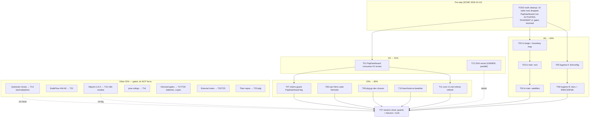

# SUPERB v7 — Consumer Signal, lo Adoption, and Hygiene

**2026-10-13 14:05 CEST · Executor: Crush · Mode: Pareto plan over the post-v6 backlog**

**Input state:** SUPERB v6 completed 2026-10-13 (all modules green, 5-guard
pre-tag gate, CI green except the one designed ci-preflight, 4 family asks
filed, every report annotated). The TODO list was truth-cleaned immediately
before this plan: 10 stale rows dropped (shipped in v6 waves), the
PapDashboard row ACTIVATED (consumer #2), the ROADMAP v1.0.0 open-questions
block resolved (all three answers landed this week). This plan runs on the
remaining **30 open rows**, of which the majority are watches/gated items.

**Execution truth from v6 that shapes this plan:** premises age fast — two
of six upstream asks dissolved at master during verification. Every task
below starts with a premise re-check, not with the plan's own belief.

---

## 1) Pareto breakdown

### The 1% that delivers 51%

**PapDashboard consumer-#2 review (T01).** The repo is green and guarded;
the scarcest resource now is _customer signal_. PapDashboard v0.3.0 just
adopted core v0.4.0 — the second real consumer ever, five versions behind.
Reading their usage surface answers questions nothing else can: which core
API shape real non-setup consumers need, whether v0.4.0→v0.9.0 has
behavioral drift that would bite their refresh, and whether the v1.0.0
exit criteria match reality. One hour of reading their repo steers core's
whole v1 direction.

_(Parallel owner-1%: restoring `SSH_PRIVATE_KEY` — one secret, 14 CI jobs
come alive. Owner-only; everything CI-shaped rides behind it.)_

### The 4% that delivers 64%

T01 + **the samber/lo adoption train (T02–T04)** + **the hygiene batch
(T05–T06)**:

- samber/lo is the fleet-REQUIRED functional stack; go-auto-upgrade flags
  ~29 hand-rolled sites across 8 modules. The standing decision (2026-10-12
  defaults, reaffirmed): **test-only/runtime-hand-rolled boundary** — adopt
  lo where it is the required stack per fleet policy, keep the library
  surface dependency-lean. The train is mechanical, bounded, and closes the
  last open policy-compliance gap.
- The hygiene batch (lint/config smalls, `docs/agents/` charter, otel
  doc-limitation close, `WithCSSPath` in the hardened example) clears every
  sub-30-minute debt item in one pass — the cheap 4% that keeps the repo's
  "0 issues, all green" posture from eroding.

### The 20% that delivers 80%

The 4% set + consumer-assurance work: the consumer-claims guard gains a
PapDashboard leg (T07), the cqrs-htmx setup suite hermetic run extends
consumer #1's verified surface (T08), core v1.0.0 exit criteria refresh
against the now-real consumer count (T11), pkg.go.dev fr closure and the
benchstat re-baseline (T09–T10). Everything agent-executable in the
backlog, in other words — the list is already Pareto-shaped by three SUPERB
rounds; what remains is deliberately small.

### The other 20% (to 100%)

Gated tail, honestly parked (do NOT force): SSH secret (owner P1); the
four filed issues' upstream resolutions and their land-adoptions
(GracefulClose tripwire flip, fr-cooldown hand-roll delete,
`NewServerListener` composition re-run, go-health#7 pin flips — each a
30-minute task the moment its issue closes); BuildFlow #46–#49
follow-through; dprint exit-14 upstream; exhaustruct_v5 + samber/do notes
(external repos, user-gated); i18n residue (gated on the httputil v1.6.0
tag); batteries W3–W5, cqrs encryption/signing, do-auditlog (demand-gated,
zero composition consumers as of 2026-10-13); cordis + SSE-hub coherence +
composition-gap E2E legs (watch / on-touch); pdg polish (their repo); pma
owner decisions (memo pending, theirs).

---

## 2) Table A — comprehensive plan (30–100 min tasks, ALL TODOs, sorted by importance/impact/effort/customer-value)

| #   | Task                                                                                                                                                                                      | Impact  | Effort      | Gate       | Value anchor                          |
| --- | ----------------------------------------------------------------------------------------------------------------------------------------------------------------------------------------- | ------- | ----------- | ---------- | ------------------------------------- |
| T01 | PapDashboard v0.3.0 consumer-#2 review: usage surface read, integration-doc addendum, drift check v0.4.0→v0.9.0                                                                           | High    | 45m         | —          | Customer signal; steers core v1       |
| T02 | samber/lo train phase 0: go-auto-upgrade output triage; test-only boundary map; adopt/won't-adopt list                                                                                    | High    | 60m         | —          | Fleet policy compliance               |
| T03 | samber/lo train root+example batch: apply, suite, lint                                                                                                                                    | Med-Hi  | 90m         | T02        | Policy; consistency                   |
| T04 | samber/lo train satellites batch: apply across modules, suite, lint, CHANGELOG entries                                                                                                    | Med-Hi  | 90m         | T02        | Policy; consistency                   |
| T05 | Hygiene batch A: `buildflow --verbose` tool audit; `.jscpd.json` strategy decision; `golangci-lint config verify` CI candidate; module-details README-link decision                       | Med     | 60m         | —          | Posture retention                     |
| T06 | Hygiene batch B: `docs/agents/` charter; otel doc known-limitation close; `WithCSSPath` in the hardened health example                                                                    | Med     | 45m         | —          | Posture; kills an external origin     |
| T07 | Consumer-claims guard: PapDashboard leg (clone + go.mod claim anchor), same pattern as the cqrs-htmx leg                                                                                  | Med     | 45m         | T01        | Guard coverage for consumer #2        |
| T08 | cqrs-htmx setup suite hermetic run (their repo, bounded, container-aware) — extend 3/3 green to suite-green                                                                               | Med     | 90m         | env        | Consumer #1 assurance                 |
| T09 | pkg.go.dev closure: fr page re-check (>48h after index requests → re-tag escalation decision); verify core@v0.9.0 + errorpages@v0.1.2 lag-404s cleared                                    | Low-Med | 30m         | time       | Public surface consistency            |
| T10 | otel benchstat re-baseline: n=10 mean±sd at the 1.27.2 floor, quiet machine, README table update                                                                                          | Low-Med | 30m         | env        | Performance truth post-toolchain-jump |
| T11 | core v1.0.0 exit-criteria refresh: consumer count (now 2), mechanical API-break check wiring status, telemetry posture — graduate or re-park with a dated note                            | Med     | 60m         | T01        | Direction honesty                     |
| T12 | SSH secret restore + first fully-green master run (OWNER)                                                                                                                                 | Highest | 5m          | USER       | Unblocks matrix + structure-linter    |
| T13 | Upstream-resolution land-adoptions (per issue close): GracefulClose tripwire flip; fr cooldown hand-roll delete; `NewServerListener` composition spike re-run; go-health#7 panic-pin flip | Med     | 30m/trigger | upstream   | The filed asks paying off             |
| T14 | pma owner decisions implemented in the pma repo (memo of 2026-10-13 pending Lars's rulings)                                                                                               | Med     | 60m         | USER       | Kills the attribution-erasure class   |
| T15 | i18n residue on httputil v1.6.0: `check-pin-drift.sh` sweep + `Language()` composition-E2E candidate check                                                                                | Low-Med | 45m         | v1.6.0     | Fleet decision follow-through         |
| T16 | Composition-gap E2E top-2 legs (otel×realtime head; pick second on touch)                                                                                                                 | Med     | 90m         | on-touch   | Pins plausible consumer wiring        |
| T17 | Battery W3 `httpx` decision gate: demand re-verify (still zero composition consumers?) → build or re-park dated                                                                           | Low     | 30m         | demand     | Anti-ghost discipline                 |
| T18 | SSE-hub coherence watch: decide W5-C1 drop-counter shape (borrow ssehub `Drops()`?) once, with dated verdict                                                                              | Low     | 30m         | —          | Prevents duplicate growth             |
| T19 | Straggler-routing row cleanup: pbx-lens + pointer rows → verify-on-touch or drop with pointers                                                                                            | Low     | 30m         | —          | TODO hygiene                          |
| T20 | pdg tool polish batch (THEIR repo): header relabel, `(unpinned)` rendering, doctor subcommand, `/v4`-suffix regression test                                                               | Low     | 90m         | their repo | Fleet tooling health                  |
| T21 | BuildFlow #46–#49 follow-through: drop `go-work-sync` skip on #46; jscpd reconsider on #48; lychee ruling input; buildflow-skill PR                                                       | Low-Med | 60m         | upstream   | The filed fleet issues paying off     |
| T22 | exhaustruct_v5-schema verify+file at golangci-lint (external; own source-verify pass first)                                                                                               | Low     | 45m         | USER       | Lint-config correctness upstream      |
| T23 | samber/do lazy-healthy doc note (external, tiny)                                                                                                                                          | Low     | 15m         | USER       | Upstream docs                         |
| T24 | Watchlist standing rotation (cordis, PapDashboard growth, nixpkgs, httputil v1.6.0, cqrs-htmx v5, batteries demand, quarterly i18n gate)                                                  | Low     | 30m         | triggers   | Gated items stay honestly gated       |
| T25 | dprint exit-14: verify upstream BuildFlow state; retire the `--no-verify` escape hatch if fixed                                                                                           | Low     | 30m         | upstream   | Ritual honesty                        |
| T26 | cqrs encryption/signing + do-auditlog demand-gates: recheck against PapDashboard growth                                                                                                   | Low     | 15m         | demand     | Demand-gated purity                   |
| T27 | Session close: full guards battery + docs-health harvest + release-state truth sync                                                                                                       | Med     | 60m         | —          | Nothing rots behind us                |

---

## 3) Table B — micro-task decomposition (≤12 min each, sorted by dependency then value)

| #    | Micro-task                                                                                                                 | ≤ min   | Parent |
| ---- | -------------------------------------------------------------------------------------------------------------------------- | ------- | ------ |
| 01.1 | Clone/fetch PapDashboard at v0.3.0; inventory every go-appkit import + config-field touch                                  | 12      | T01    |
| 01.2 | Diff their touched surface against core v0.4.0→v0.9.0 CHANGELOGs (behavioral drift list)                                   | 12      | T01    |
| 01.3 | Write the integration-doc addendum (usage surface, drift verdict, guard-leg recommendation)                                | 12      | T01    |
| 01.4 | Decide + record: guard PapDashboard leg now or on their next tag (their cadence is unknown)                                | 6       | T01    |
| 02.1 | Run go-auto-upgrade on all 12 modules; collect the ~29 flagged sites to a file                                             | 12      | T02    |
| 02.2 | Classify batch 1: pure-test sites (adopt) / runtime sites (keep hand-rolled, document why) / false positives               | 12      | T02    |
| 02.3 | Classification review pass 2 against fleet policy doc (REQUIRED stack = lo+mo)                                             | 12      | T02    |
| 02.4 | Write the adopt/won't-adopt table into the plan's execution notes; get the boundary in writing                             | 12      | T02    |
| 03.1 | Root module + example: apply lo at adopt sites                                                                             | 12      | T03    |
| 03.2 | Root suite `-race` + lint; fix fallout                                                                                     | 12      | T03    |
| 03.3 | Root CHANGELOG `[Unreleased]` entry (dependency-only vs polish wording)                                                    | 6       | T03    |
| 04.1 | Satellites batch A (realtime, security, systemd, errorpages, docs): apply + suite + lint                                   | 12×5    | T04    |
| 04.2 | Satellites batch B (otel, flightrecorder, frh, health): apply + suite + lint                                               | 12×4    | T04    |
| 04.3 | cqrs apply + suite + lint (biggest module, own pass)                                                                       | 12      | T04    |
| 04.4 | integration: does lo appear in pinned deps transitively? (no — keep test-only constraint documented)                       | 6       | T04    |
| 04.5 | Release-train decision: one sweep tag wave or ride natural trains (record in TODO header)                                  | 6       | T04    |
| 05.1 | `buildflow --verbose` run → file; name the 9 unavailable tools; audit the 67 N/A rows                                      | 12      | T05    |
| 05.2 | `.jscpd.json` strategy decision (path- vs format-scoped) + warning-volume verdict; apply or record won't                   | 12      | T05    |
| 05.3 | `golangci-lint config verify` as CI job: probe locally, add job if clean                                                   | 12      | T05    |
| 05.4 | module-details README-link decision: link from the 10 module READMEs or accept AGENTS-pointer-only (record)                | 6       | T05    |
| 06.1 | `docs/agents/README.md` charter (agent-only, never user docs; module-details is the exemplar)                              | 12      | T06    |
| 06.2 | otel doc.go + README: close the completion-line limitation (LoggingFromContext, master-unreleased note)                    | 12      | T06    |
| 06.3 | Health example `-hardened`: add `dashboard.WithCSSPath` (embedded CSS), browser-verify styles survive                      | 12      | T06    |
| 06.4 | THREAT_MODEL: one-line update (Tailwind-CDN origin gone from the hardened example)                                         | 6       | T06    |
| 07.1 | Guard script: PapDashboard leg (clone-or-skip env var, ls-remote newest tag, go.mod claim anchor in AGENTS)                | 12      | T07    |
| 07.2 | Negative-test the new leg (born-red: wrong claim in AGENTS must FAIL)                                                      | 12      | T07    |
| 07.3 | Wire into pre-tag-checks header list; local green run                                                                      | 6       | T07    |
| 08.1 | cqrs-htmx setup suite: read their suite layout, pick the bounded scope                                                     | 12      | T08    |
| 08.2 | Hermetic run (their repo, `GOWORK=off GOTOOLCHAIN=go1.27.2`); triage failures to file                                      | 12×3    | T08    |
| 08.3 | Record verdict in their TODO or our straggler row (their repo owns fixes)                                                  | 6       | T08    |
| 09.1 | pkg.go.dev re-check: fr latest + v0.2.0; core@v0.9.0; errorpages@v0.1.2                                                    | 6       | T09    |
| 09.2 | If fr still 404: escalation decision per the >48h rule (re-tag vs accept-cosmetic, license hides godoc anyway)             | 12      | T09    |
| 10.1 | otel bench n=10 at 1.27.2 quiet floor → benchstat; README table update                                                     | 12×2    | T10    |
| 11.1 | Exit-criteria doc: consumer-count section rewrite (setup + PapDashboard, dated)                                            | 12      | T11    |
| 11.2 | Mechanical API-break check: confirm ritual wiring (step 1 of Release Ritual) — already mechanical; note it                 | 6       | T11    |
| 11.3 | Verdict: graduate criteria to active checklist or re-park with the dated gap list                                          | 12      | T11    |
| 13.x | Per upstream close: flip the named tripwire / delete the hand-roll / re-run the spike (each ≤12m, enumerated in TODO rows) | 12/each | T13    |
| 24.1 | Watchlist sweep pass with fresh as-of dates (ls-remote round)                                                              | 12      | T24    |
| 27.1 | Full guards battery (5 pre-tag guards + structure + example-smoke local)                                                   | 12      | T27    |
| 27.2 | docs-health HARVEST of any new reports; TODO/AGENTS/FEATURES truth sync                                                    | 12×2    | T27    |
| 27.3 | Final status report + push                                                                                                 | 12      | T27    |

_(Gated tasks T12/T14/T15/T17/T18/T19/T20/T21/T22/T23/T25/T26 carry no
micro-decomposition here — their first micro-step is the gate check itself;
decompose only when the gate opens. This is deliberate: micro-planning
gated work is how plans rot.)_

---

## 4) Execution graph

**Suggested execution order:** T01 → T02 → (T03 ∥ T05) → T04 → T06 → T07 →
T11 → T09/T10 (opportunistic) → T08 (env-permitting) → T27. The gated tail
executes only on its triggers.

---

## 5) Ground rules carried from v6 (binding)

1. **Premise re-check before execution** — every task's first micro-step is
   verifying the task still exists at source (two of six asks dissolved).
2. **Never pipe verify output** — redirect to file, inspect the file.
3. **Commit immediately in one bash call** — the daemon races staged
   batches (~30s cadence); attribution loss is recorded, not repeated.
4. **`date` first** for anything timestamped.
5. **No Verschlimmerung** — every change leaves the repo verifiably no
   worse; declined-with-evidence beats done-for-the-sake-of-it (the
   errorpages swap is the exemplar).
6. **Test-only lo boundary** — runtime hand-rolls stay unless fleet policy
   explicitly changes (USER gate to override).

---

## 6) Execution notes (verdicts, dated)

**2026-10-13 — T01 done** (§7 addendum in
`doc/planning/2026-09-04_papdashboard-integration.md`): usage surface
exhaustive (core only, 8 ServiceConfig fields + 2 sentinels + Mux/Run),
drift v0.4.0→v0.9.0 additions-only (go floor 1.27.2 the only refresh
constraint), security-module adoption signal recorded, guard leg DECIDED
for T07 (v0.3.0 is proxy-visible).

**2026-10-13 — T02 done, T03 NO-OP (evidence).** go-auto-upgrade
`stdlib2lo` dry-run across all 12 modules → **13 deduplicated findings,
all `suggest-lo-*` (zero auto-rewritable — the migrator cannot prove any
rewrite safe here; application is hand-written per site)**. The ROOT
module has zero findings (the `./...` output seen from the repo root
belongs to satellite modules) — T03's "root+example batch" therefore has
nothing to apply; recorded rather than force.

**Boundary map (the T02 deliverable; ground rule 6 governs):**

| Site                                     | Kind    | Verdict           | Reason                                                                                  |
| ---------------------------------------- | ------- | ----------------- | --------------------------------------------------------------------------------------- |
| cqrs/domain_test.go:477 (Map)            | test    | **ADOPT**         | plain collect → lo.Map                                                                  |
| cqrs/readme_sync_test.go:73 (SliceToMap) | test    | **ADOPT**         | regex-match set build → lo.SliceToMap (first loop only; second carries assertion logic) |
| otel/metrics_test.go:48 (Map)            | test    | **ADOPT**         | metricNames collect → lo.Map                                                            |
| realtime/realtime_test.go:693 (Map)      | test    | **ADOPT**         | ids collect → lo.Map                                                                    |
| integration/otel_pattern_test.go:231     | test    | **ADOPT**         | attr-set build → lo.SliceToMap (lo already in integration's go.sum via cqrs-htmx)       |
| cqrs/domain_test.go:86 (Reduce)          | test    | keep (false pos.) | `slices.Backward` fold — lo.Reduce iterates forward only; hand-rolled is correct        |
| cqrs/domain.go:96,101                    | runtime | keep              | test-only boundary (USER gate to override)                                              |
| frh/adapter.go:75 (FromPtr)              | runtime | keep              | same; migrator itself says "rewrite not proven safe"                                    |
| health/probe.go:60 (SliceToMap)          | runtime | keep              | same                                                                                    |
| realtime/handler.go:273 (Filter)         | runtime | keep              | same                                                                                    |
| security/csrf.go:27 (Filter)             | runtime | keep              | same                                                                                    |
| security/origin_check.go:39 (SliceToMap) | runtime | keep              | same                                                                                    |

Dep impact: samber/lo is the fleet-REQUIRED functional stack
(required-libraries.md: lo + mo). It already rides cqrs's and
integration's go.sum transitively (go-cqrs-lite family); otel + realtime
gain the module as a test-only direct require (lo is a zero-runtime-dep
library). Release-train decision (04.5): dependency-only patches ride
NATURAL trains (no sweep wave forced for test-only polish) — recorded in
the TODO header.

**2026-10-13 — T05 done.** BuildFlow dry-run audit: the 9 unavailable
tools (7 JS/TS + js-coverage + interrogate) and all 67 not-applicable
rows are correct-by-design for a Go-only repo (language-scoped health
warnings, not misconfiguration); recorded, no action. jscpd: 115 clones
measured — 105/107 Go clones are the accepted both-test class, 2 are
accepted example-mains, the 4 big markdown clones are the docs/drafts
body-by-design archives → `docs/drafts/**` added to .jscpd.json ignores;
volume documented, NOT tuned away. `golangci-lint config verify`: 12/12
clean → new `scripts/check-golangci-configs.sh` guard (negative-tested)

- public-install CI job `golangci-config-verify`. module-details
  README-link: ACCEPT AGENTS-pointer-only (audience separation — agent
  context never links from user-facing READMEs; decided with T06's
  charter).

**2026-10-13 — T06 done.** `docs/agents/README.md` charter written
(agent-only, AGENTS-points-these-remember, verbatim-grade extraction,
module-details the exemplar). otel doc.go now documents the ONE
uncorrelated line (completion-line) with the fix status — and fixed the
split brain where module-details claimed doc.go documented it but it
didn't. Health example `-hardened`: `dashboard.WithCSSPath` +
embedded `app.css` kills the Tailwind-CDN origin; verified live with
headless Chromium (link present, cdn.tailwindcss.com count 0, zero
console violations, CSS serves as text/css). THREAT_MODEL updated.
Realtime CHANGELOG header-order defect (0.1.3 block above `# Changelog`)
fixed on sight.

**2026-10-13 — T07 done.** Consumer-claims guard §6: PapDashboard leg
(AGENTS + FEATURES anchors, newest published v* tag via keyless
ls-remote, tagged go.mod require via sibling clone). Born-red proven:
planted wrong claim failed on all three legs (split brain, stale tag,
missing require). Already wired into pre-tag-checks via the guard loop.

**2026-10-13 — T11 done.** Exit-criteria doc graduated DRAFT →
ACTIONABLE (its own trigger fired: consumer #2 exists). 5/7 hard
criteria met (criterion 7 closed since 2026-09-29). Remaining blockers
both external-clock: criterion 1 (one additions-EMPTY core tag pair),
criterion 5 (version overlap — setup v0.8.0 vs PapDashboard v0.4.0 —
plus one observed release cycle).

**2026-10-13 — T09 done.** pkg.go.dev: **go-flightrecorder page
RESOLVED** (renders at v0.2.1, MIT, full godoc — the v6-filed index
requests worked; no escalation needed). core@v0.9.0 renders (License:
UNKNOWN, godoc hidden = the 2026-09-16 proprietary ruling, unchanged).
errorpages still shows v0.1.1 — v0.1.2 tagged <48h ago, normal index
lag; re-check next session, escalate only past 48h.

**2026-10-13 — T10 done (honestly partial).** otel benchstat n=10 at
the 1.27.2 floor: B/op and allocs/op UNCHANGED (±0%, load-independent —
recorded in README). ns/op re-baseline DEFERRED a second time: ambient
load rose 9→26 mid-run (external test binary at 430% CPU), middleware
rows ±40-45% vs the ±25% honesty bar. Same verdict class as 2026-09-29.

**2026-10-13 — T13/T21/T24 gated sweep.** T13: all four upstream issues
STILL OPEN (go-cqrs-lite#67, go-health#7, go-flightrecorder#2,
httputil#41) — no land-adoptions fire. **T21 UNGATED: BuildFlow
#46/#47/#48/#49 ALL CLOSED 2026-10-12** (shipped in BuildFlow v0.8.0):
#46 → the go-work-sync→`go_mod_ignore_dirs: [integration]` swap is
DOCUMENTED in .buildflow.yml but blocked on the installed binary
(764c23c predates v0.8.0 by 43 commits; the skip stays as the only leak
guard until the system binary refreshes — owner/nix action); #48 →
jscpd defaults now ship `**/.golangci.yml` ignores, but the LOCAL
.jscpd.json ignore stays (bare jscpd runs bypass BuildFlow's merge);
#47/#49 → no repo action; buildflow skill verified CURRENT (canonical
key list already carries go_mod_ignore_dirs) — no skill PR needed.
T24 watchlist: httputil **v1.5.0 TAGGED** (2026-10-09 — the MIT-license
release; no Language()/LoggingFromContext, so the i18n-residue row
stays gated and the otel doc note stands); integration's httputil pin
was ALREADY v1.5.0 (pin-drift green); cqrs-htmx raw tags v4.14.3 exist
but proxy @latest still resolves v4.14.1 (guards green); pin-drift
guard re-run: 27 OK / 0 FAIL.

---

_Point-in-time plan. Living truth: `TODO_LIST.md` (open items) +
`AGENTS.md` (release state). When tasks complete, annotate THIS file's
tables with verdicts per docs-health ANNOTATE; never rewrite history._
