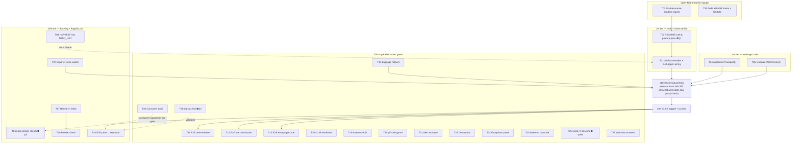

# SUPERB v8 — OTel Leverage Execution Plan

**2026-10-18 01:48 CEST · Executor: Crush · Mode: Pareto plan over the OTel deep-dive queue**

**Input state:** the 2026-10-18 session shipped the OTel deep dive
(`docs/research/2026-10-18_otel-deep-dive.html`, 78/100, commit `7f176f9`) and its status
report (`docs/status/2026-10-18_01-23_otel-deep-dive-session-status.md`, §f = 34 items).
This plan converts that queue into an executable sequence. TODO_LIST.md re-read today
(75 lines, truth-cleaned 2026-10-14); SUPERB v7 plan read for overlap — **zero task overlap**
(v7 was lo-adoption + hygiene; v8 is otel leverage). Per `pareto-planning` Step 0, every
ranked item was verified still-open during the deep dive itself (file:line citations
gate-checked: 44/44 in range) — no stale rows discovered; the errata section records the
two items that changed state _during_ planning.

**Execution truth carried from the deep dive:** the repo's OTel adoption is already
strong (25/37 fully leveraged, zero anti-patterns, zero version gap). Everything here is
either (a) closing the four missed opportunities, (b) upgrading eight partials, or
(c) session-hygiene debt the audit itself created. Nothing here re-litigates decided
non-goals — the Prometheus path, HTTP-only OTLP, and the no-runtime-metrics posture stay.

---

## 0) Provenance & errata (Step 0 findings)

- **Still-open, re-verified this session:** items 1–34 of the status report §f (citations in
  the deep dive; the four 2026-09-29 items verified DONE are excluded here, not re-planned).
- **Errata 1 — `otel v0.3.0` carrier already exists:** TODO_LIST (samber/lo row) names
  `otel v0.3.0 (LoggingFromContext wiring)` as a pending natural train. T01/T03/T04/T05/T07/T14
  below ride the SAME train — one release ritual, not six.
- **Errata 2 — quiet-gate prerequisite:** the ns/op re-baseline (T25) is blocked by the
  TODO_LIST P2 "quiet-gate helper" row, not by this plan; T25 only fires after that helper
  lands (or in a coincidentally quiet window, per the load-flake protocol).
- **Tree notes (not planned, recorded):** `go.work.sum` carried +3 additive hash lines of
  tooling residue during the session (daemon-committed meanwhile — harmless, no action).
  An UNTRACKED foreign status file from a concurrent session exists
  (`docs/status/2026-10-18_01-45_buildflow-full-run-triage-and-remediation.md`) — not this
  plan's work; left untouched. Master is ahead of origin by 6 commits; this plan's commit
  pushes them all (push explicitly requested).

---

## 1) Pareto breakdown

Weight = impact × ease per task (from the deep-dive priority table; bundled tasks carry the
sum of their findings). Total weight Σ = 230 across 27 tasks. Cumulative math is shown so
the tiers are checkable, not vibes.

### The 1% that delivers ~31% (the two keystones)

**T03 — otel README truth & posture pass (Σ36)** and **T01 — SDK self-diagnostics wiring
(Σ20)**. Rationale: the audit's entire credibility story is "the module's docs describe the
world it pins" — and right now one sentence doesn't (the logs non-goal predates the v1.47.0
logs-stabilization it pins). And the module's one real blind spot is silent exporter failure.
Truth restored + failures visible = the foundation every later task reports against.
56/230 = 24% for 2 of 27 tasks; with T02 (double-sourcing the headline claims, Σ15) the top
three reach 31% — the cheapest possible insurance against building on a wrong fact.

### The 4% that delivers ~64%

T03 + T01 + T02 + **T04 (`appkitotel.Transport()`, Σ16)** + **T05 (`resource.WithProcess()`,
Σ15)** + **T09 (git/CI hygiene: audit the daemon's foreign hunks + CI-state check, Σ15)**.
Seven of 27 tasks (26%) → cumulative 153/230 ≈ **67%**. These close three of the four missed
opportunities, the cheapest partial, and the session's own accountability debt.

### The 20% that delivers ~80%

The 4% set plus **T06 (logs design sketch, Σ15)**, **T08 (HARVEST into TODO_LIST/ROADMAP,
Σ12)**, **T17 (research index, Σ10)**, **T07 (exporter-selector off-switch, Σ9)**, **T18
(render check + checker decision, Σ7)**, **T10 (panic→exception E2E, Σ6)**. Thirteen of 27
tasks (48%) → cumulative 185/230 ≈ **80%**. At this point: docs true, failures loud, client
spans shipped, resource identity complete, the living backlog owns the queue, and the
flagship composition contract is pinned by an E2E.

### The remaining 20% → 100%

The long tail, mostly parallelizable and partially gated: the other three composition E2Es
(T11–T13), baggage helpers (T14), v1.48 train readiness (T15), the consumer-side adoption
audit (T16), the smalls (T19–T24), and the user-gated pair (T25 quiet-window bench, T26
SigNoz live validation) plus the two recorded watches (T27). None of these blocks the 80%;
several are owner-gated (Q1–Q3 below) and correctly wait.

---

## 2) Comprehensive plan — 30–100 min tasks (ALL todos; sorted by weight)

| #   | Task                                                                                                              | Source items                        | Min | I | E | Σ  | Cum % | Tier       |
| --- | ----------------------------------------------------------------------------------------------------------------- | ----------------------------------- | --- | - | - | -- | ----- | ---------- |
| T03 | otel README truth & posture pass (logs non-goal fix†, semconv trigger, exemplars/cardinality, MessageEvents note) | f3, f7, f8, f29 (+f32/f33 recorded) | 70  | — | — | 36 | 16%   | 1%         |
| T01 | Wire `otel.SetErrorHandler` + `otel.SetLogger` into `Setup` (+ TELEMETRY.md line + pin tests)                     | f1                                  | 90  | 4 | 5 | 20 | 24%   | 1%         |
| T02 | Double-source the deep dive's two headline claims; annotate report if anything shifts                             | f15                                 | 30  | 3 | 5 | 15 | 31%   | 1%         |
| T04 | Export `appkitotel.Transport()` + "Outbound calls" README + example downstream leg                                | f2, f27                             | 90  | 4 | 4 | 16 | 38%   | 4%         |
| T05 | `resource.WithProcess()` (or targeted Runtime\* options) + merged-resource test                                   | f4                                  | 45  | 3 | 5 | 15 | 44%   | 4%         |
| T09 | Git/CI hygiene: audit `a584b6f` foreign hunks; verify `7f176f9` CI state                                          | f16, f17                            | 45  | — | — | 15 | 51%   | 4%         |
| T06 | `WithOTLPLogs()` design sketch + dependency-cost + shutdown-order note (build stays gated)                        | f5                                  | 45  | 5 | 3 | 15 | 57%   | 20%        |
| T08 | HARVEST §f + deep-dive table into TODO_LIST/ROADMAP (docs-health)                                                 | f13                                 | 60  | 3 | 4 | 12 | 63%   | 20%        |
| T17 | Create `docs/research/README.md` index (4 reports)                                                                | f14                                 | 30  | 2 | 5 | 10 | 67%   | 20%        |
| T07 | Honor `OTEL_*_EXPORTER=none` off-switch; document HTTP-only protocol divergence                                   | f6                                  | 60  | 3 | 3 | 9  | 70%   | 20%        |
| T18 | Headless render-check of the deep dive; go/no-go on a scripts/ report checker                                     | f18, f20                            | 30  | — | — | 7  | 73%   | 20%        |
| T10 | E2E #1: full-stack panic→exception through a real Service (integration module)                                    | f10                                 | 90  | 3 | 2 | 6  | 76%   | 20%        |
| T14 | Baggage correlation-ID helpers (`WithCorrelationID`/`CorrelationID`)                                              | f9                                  | 60  | 3 | 2 | 6  | 79%   | tail       |
| T15 | Upstream v1.48.0 train readiness (retry-bound note; confirm zero deprecated-surface impact)                       | f30                                 | 40  | 2 | 3 | 6  | 81%   | tail       |
| T16 | Consumer-side OTel adoption audit (cqrs-htmx setup, PapDashboard)                                                 | f31                                 | 60  | 2 | 3 | 6  | 84%   | tail       |
| T11 | E2E #2: otel×realtime (SSE spans/metrics on the NoTimeout path)                                                   | f21                                 | 75  | 2 | 2 | 4  | 86%   | tail       |
| T12 | E2E #3: otel×health-dashboard (traced vs filtered routes)                                                         | f22                                 | 60  | 2 | 2 | 4  | 87%   | tail       |
| T19 | Fold errorpages-`trace_id` + fr-snapshot→span-link into the inventory (annotate)                                  | f19                                 | 30  | 1 | 4 | 4  | 89%   | tail       |
| T20 | `check-pin-drift.sh`: assert the dashboard JSON name/path                                                         | f28                                 | 30  | 1 | 4 | 4  | 91%   | tail       |
| T26 | SigNoz live validation: dashboard import + Exceptions-view E2E (needs Q2)                                         | f11                                 | 60  | 2 | 2 | 4  | 93%   | tail/gated |
| T21 | SigNoz alert example JSON (5xx error-rate) next to the dashboard                                                  | f24                                 | 45  | 1 | 3 | 3  | 94%   | tail       |
| T22 | Multi-env deploy doc (k8s/Compose OTEL_\* snippet)                                                                | f25                                 | 40  | 1 | 3 | 3  | 95%   | tail       |
| T23 | Exceptions-oriented dashboard panel (or record the builder blocker)                                               | f26                                 | 30  | 1 | 3 | 3  | 96%   | tail       |
| T24 | Daemon working-file class: propose pma ignore pattern for `docs/**/.*-body.html`                                  | f34                                 | 30  | 1 | 3 | 3  | 98%   | tail       |
| T13 | E2E #4: errorpages×otel (pretty 500s + exception events together)                                                 | f23                                 | 60  | 1 | 2 | 2  | 98%   | tail       |
| T25 | Middleware ns/op re-baseline (needs the quiet-gate helper; CPU-pinned n=10 + benchstat)                           | f12                                 | 40  | 1 | 2 | 2  | 99%   | tail/gated |
| T27 | Recorded watches: semconv-families flag (f32), PeriodicReader-timeout YAGNI (f33)                                 | f32, f33                            | 0   | — | — | 0  | 100%  | watch      |

† T03's non-goal fix is **Q1-conditioned** (fix-on-sight vs report-first for released-module
docs). If the owner rules report-first, T03 ships everything EXCEPT the non-goal edit and
drops to Σ28 — the tier math shifts by ≤4 points; the order stands.

---

## 3) Detailed breakdown — ≤12 min micro-tasks (ALL todos; execution order)

_Sequence: verify-first (T02, T09) → truth (T03, T01) → leverage code (T04, T05, T07, T14) →
backlog (T08, T17) → E2Es (T10–T13) → tail. Gates marked ⛔ (Q1/Q2/Q3) or 🔒 (needs otel
v0.3.0 tag first — integration pins published tags only)._

### T01 — Diagnostics wiring (90)

| ID    | Micro-task (≤12 min)                                                                                         | Min |
| ----- | ------------------------------------------------------------------------------------------------------------ | --- |
| 01.1  | Read setup.go provider-build flow; decide option shape (auto-wire + `WithOwnTelemetryDiagnostics()` opt-out) | 10  |
| 01.2  | Implement `otel.SetErrorHandler(otel.ErrorHandlerFunc(...))` → `logger.Error("otel export failed", ...)`     | 12  |
| 01.3  | Implement `otel.SetLogger(logr.FromSlogHandler(logger.Handler()))` behind the same opt-out                   | 12  |
| 01.4  | Test: failing-exporter stub → error handler fires, line carries the export error                             | 12  |
| 01.5  | Test: SetLogger path routes SDK internal logs through a capture slog handler                                 | 10  |
| 01.6  | Test: opt-out leaves globals untouched (isolated-provider contract)                                          | 8   |
| 01.7  | doc/TELEMETRY.md §1: add `otel export failed` row + §3 lossy-row cross-link                                  | 10  |
| 01.8  | otel README "Options that matter" + doc.go: document the wiring and the opt-out                              | 10  |
| 01.9  | CHANGELOG `[Unreleased]` (otel v0.3.0 carrier note)                                                          | 5   |
| 01.10 | Hermetic verify: `otel/` test `-race` + vet + golangci-lint (module dir)                                     | 12  |
| 01.11 | API-break diff vs `otel/v0.2.0` (additions-only expected)                                                    | 7   |

### T03 — README truth & posture pass (70) ⛔Q1 (one edit)

| ID   | Micro-task (≤12 min)                                                                                                                                      | Min |
| ---- | --------------------------------------------------------------------------------------------------------------------------------------------------------- | --- |
| 03.1 | Draft the non-goal replacement: "Logs API+SDK stable since v1.47.0 (2026-10-02); OTLP log exporters v0.x; build on consumer demand"                       | 10  |
| 03.2 | ⛔ Apply the README edit per Q1 ruling (fix-on-sight → edit now; report-first → skip 03.2, keep draft)                                                    | 5   |
| 03.3 | semconv section: pin rationale (SigNoz default = old key) + rename trigger (`deployment.environment.name` when SigNoz flips)                              | 10  |
| 03.4 | Exemplars + cardinality posture paragraph (middleware metrics can carry exemplars; bridge/cqrs `context.Background()` opt-out; default 2000 limit active) | 10  |
| 03.5 | MessageEvents non-adoption note (evaluated + declined 2026-08-18)                                                                                         | 5   |
| 03.6 | CHANGELOG `[Unreleased]` Documented entries                                                                                                               | 5   |
| 03.7 | FEATURES.md otel rows: wording sync if any claim changed                                                                                                  | 10  |
| 03.8 | Docs guards (dprint-safe commit; CHANGELOG-only escape hatch known)                                                                                       | 8   |

### T02 — Double-source the headlines (30)

| ID   | Micro-task (≤12 min)                                                                          | Min |
| ---- | --------------------------------------------------------------------------------------------- | --- |
| 02.1 | Fetch the otel releases page directly (primary source) — confirm v1.47.0 latest + logs-stable | 8   |
| 02.2 | Fetch contrib release notes — confirm v0.72.0 pairing                                         | 7   |
| 02.3 | Diff vs report claims; if drift: annotate the report appendix (in-place, dated errata)        | 10  |
| 02.4 | Commit the annotation (or record "confirmed, no change")                                      | 5   |

### T04 — `appkitotel.Transport()` (90)

| ID   | Micro-task (≤12 min)                                                                              | Min |
| ---- | ------------------------------------------------------------------------------------------------- | --- |
| 04.1 | API sketch: `Transport(opts ...MiddlewareOption) http.RoundTripper` over `otelhttp.NewTransport`  | 10  |
| 04.2 | Implement wrapper (propagator + provider defaults mirroring `Middleware`)                         | 12  |
| 04.3 | Test: CLIENT span created; W3C traceparent injected; span ends on body close                      | 12  |
| 04.4 | Test: no-op without a provider (strictly-opt-in contract)                                         | 8   |
| 04.5 | README "Outbound calls" section + otelhttptrace `WithoutSubSpans()` high-fanout note              | 10  |
| 04.6 | example/main.go: one downstream call through `appkitotel.Transport()` + README metrics note (f27) | 12  |
| 04.7 | doc.go propagation bullet update + CHANGELOG                                                      | 8   |
| 04.8 | Hermetic verify + lint (otel module dir)                                                          | 12  |
| 04.9 | API-break diff (additions-only)                                                                   | 6   |

### T05 — Resource process detectors (45)

| ID   | Micro-task (≤12 min)                                                                                             | Min |
| ---- | ---------------------------------------------------------------------------------------------------------------- | --- |
| 05.1 | Decide full `WithProcess()` vs targeted `WithProcessRuntime*` (document `process.command_args` sensitivity call) | 10  |
| 05.2 | Implement in `buildResource`                                                                                     | 8   |
| 05.3 | Test: merged resource carries `process.runtime.name`/`version` + `process.pid`                                   | 10  |
| 05.4 | README resource-identity note + CHANGELOG                                                                        | 8   |
| 05.5 | Hermetic verify + lint                                                                                           | 9   |

### T06 — Logs design sketch (45) ⛔Q3 (build gate, not sketch gate)

| ID   | Micro-task (≤12 min)                                                                                    | Min |
| ---- | ------------------------------------------------------------------------------------------------------- | --- |
| 06.1 | Draft `WithOTLPLogs()` option shape mirroring `WithOTLP()` (endpoint/headers/timeout reuse)             | 12  |
| 06.2 | Dependency-cost note: `sdk/log` (stable) + `otlploghttp` v0.23 (pre-1.0) + `otelslog` v0.21             | 8   |
| 06.3 | Shutdown-order note: LoggerProvider ForceFlush placement inside `Provider.Shutdown` (traces→logs order) | 10  |
| 06.4 | Write the sketch to `docs/planning/` (or README non-goal pointer per Q1 outcome) + TODO_LIST gated row  | 10  |
| 06.5 | Record gate status (Q3 answer) in the sketch                                                            | 5   |

### T07 — Exporter-selector off-switch (60)

| ID   | Micro-task (≤12 min)                                                                                                        | Min |
| ---- | --------------------------------------------------------------------------------------------------------------------------- | --- |
| 07.1 | `applyOTLPWiring`: read `OTEL_TRACES_EXPORTER`/`OTEL_METRICS_EXPORTER`; `none` vetoes the signal                            | 12  |
| 07.2 | Tests: none-veto per signal; explicit code still wins; `console`/`prometheus` values → documented no-op (HTTP-only posture) | 12  |
| 07.3 | README production-exporter section: divergence paragraph (protocol env unsupported by design; `none` honored)               | 10  |
| 07.4 | CHANGELOG + re-run affected tests                                                                                           | 10  |
| 07.5 | Hermetic verify + lint                                                                                                      | 10  |

### T08 — HARVEST (60)

| ID   | Micro-task (≤12 min)                                                                                | Min |
| ---- | --------------------------------------------------------------------------------------------------- | --- |
| 08.1 | Map §f items → TODO_LIST P2 (execution) vs P3 (gated/watch) rows                                    | 15  |
| 08.2 | Add new P2 rows: diagnostics, Transport, off-switch, WithProcess; mark riding the otel v0.3.0 train | 12  |
| 08.3 | ROADMAP: update baggage/Transport rows (now planned), add logs-signal trigger row                   | 12  |
| 08.4 | Cross-link the deep dive + status report from each new row (no entombment)                          | 6   |
| 08.5 | TODO_LIST header date + TODO/ROADMAP truth pass                                                     | 8   |

### T09 — Git/CI hygiene (45)

| ID   | Micro-task (≤12 min)                                                                                      | Min |
| ---- | --------------------------------------------------------------------------------------------------------- | --- |
| 09.1 | `git show a584b6f -- AGENTS.md` — read + classify the +2 lines                                            | 8   |
| 09.2 | Classify the go.sum (−13) / integration go.sum (−76) hunks (expect: the 2026-10-14 checksum-repair class) | 10  |
| 09.3 | Verify CI state of `7f176f9` (expect: docs-path-ignored, no run — confirm via `gh run list`)              | 12  |
| 09.4 | Record verdicts in the status-report appendix (annotate, don't rewrite)                                   | 8   |
| 09.5 | Record the go.work.sum-residue verdict + the foreign untracked status file (leave-alone decision)         | 7   |

### T10 — E2E panic→exception (90) 🔒 (needs the otel v0.3.0 tag: integration pins published tags)

| ID   | Micro-task (≤12 min)                                                                                               | Min |
| ---- | ------------------------------------------------------------------------------------------------------------------ | --- |
| 10.1 | Read `integration/otel_pattern_test.go` + `contract_parity_test.go` patterns; draft the test charter-fit note      | 10  |
| 10.2 | Write E2E: Service + OuterMiddlewares(otel) + ExtraMiddlewares(Recovery) → `/panic` → assert exception event + 500 | 15  |
| 10.3 | Add the `/boom` handled-error leg via `RecordError` (both exception flavors in one test)                           | 10  |
| 10.4 | 🔒 Re-pin integration to the otel v0.3.0 tag (train ritual; `documentedPins` + check-pin-drift)                    | 12  |
| 10.5 | Hermetic run (`GOWORK=off`, integration README commands verbatim)                                                  | 12  |
| 10.6 | Lint + guards (directives, charter, dependabot parity)                                                             | 10  |

### T11 — E2E otel×realtime (75) 🔒

| ID   | Micro-task (≤12 min)                                                                                  | Min |
| ---- | ----------------------------------------------------------------------------------------------------- | --- |
| 11.1 | Read realtime README house rules (SubscriberCount sync, timeout client) + NoTimeout span-end contract | 10  |
| 11.2 | Write E2E: SSE stream through OuterMiddlewares(otel) → assert span name + stream-lifetime span end    | 15  |
| 11.3 | Assert middleware metrics still attribute http.route on the SSE path                                  | 10  |
| 11.4 | Hermetic integration run + load-flake protocol check (`uptime` first)                                 | 12  |
| 11.5 | Lint + guards                                                                                         | 8   |

### T12 — E2E otel×health-dashboard (60) 🔒

| ID   | Micro-task (≤12 min)                                                                                   | Min |
| ---- | ------------------------------------------------------------------------------------------------------ | --- |
| 12.1 | Enumerate dashboard routes + health-filter interactions; write the traced-vs-filtered matrix           | 12  |
| 12.2 | Write E2E asserting which dashboard routes produce spans (dashboard UI routes NOT filtered by default) | 15  |
| 12.3 | Hermetic integration run                                                                               | 12  |
| 12.4 | Lint + guards + record the matrix in the test doc-comment                                              | 8   |

### T13 — E2E errorpages×otel (60) 🔒

| ID   | Micro-task (≤12 min)                                                                                             | Min |
| ---- | ---------------------------------------------------------------------------------------------------------------- | --- |
| 13.1 | Read errorpages module surface (templ components, classification)                                                | 10  |
| 13.2 | Write E2E: 500 via errorpages behind otel middleware → pretty page + error span (+ exception event via Recovery) | 15  |
| 13.3 | Hermetic integration run + lint                                                                                  | 12  |
| 13.4 | Guards + record the composition note                                                                             | 8   |

### T14 — Baggage helpers (60)

| ID   | Micro-task (≤12 min)                                                                                     | Min |
| ---- | -------------------------------------------------------------------------------------------------------- | --- |
| 14.1 | API sketch: `WithCorrelationID(ctx, req)` / `CorrelationID(ctx)` over `go.opentelemetry.io/otel/baggage` | 10  |
| 14.2 | Implement (set-if-present; read-or-empty; no invented keys)                                              | 12  |
| 14.3 | Tests: round-trip through the middleware propagator; absent-baggage no-op                                | 12  |
| 14.4 | README propagation row note (baggage carried + helpers available)                                        | 8   |
| 14.5 | CHANGELOG + ROADMAP row update + hermetic verify                                                         | 12  |

### T15 — v1.48.0 train readiness (40, conditional on upstream)

| ID   | Micro-task (≤12 min)                                                                         | Min |
| ---- | -------------------------------------------------------------------------------------------- | --- |
| 15.1 | Watch upstream release; read the v1.48.0 changelog                                           | 10  |
| 15.2 | Confirm zero deprecated-surface impact (bridges, cardinality env — both unused here)         | 8   |
| 15.3 | Note the retry-bound-by-WithTimeout improvement for `WithOTLPTimeout` semantics in CHANGELOG | 8   |
| 15.4 | Ride the next natural train (floor/toolchain unchanged expected); hermetic verify            | 12  |

### T16 — Consumer-side adoption audit (60)

| ID   | Micro-task (≤12 min)                                                                                     | Min |
| ---- | -------------------------------------------------------------------------------------------------------- | --- |
| 16.1 | Grep cqrs-htmx setup + PapDashboard for `appkitotel` imports and wiring                                  | 10  |
| 16.2 | Compare their usage vs the module surface (Setup options, Middleware, Recovery, TraceHandler)            | 12  |
| 16.3 | Identify underused surface worth documenting for consumers (e.g. env-driven setup)                       | 10  |
| 16.4 | Record findings in the consumer-claims doc path (or a planning note); update guard claims if any changed | 12  |
| 16.5 | Route any consumer-signal findings to TODO_LIST (they may un-gate T06!)                                  | 8   |

### T17 — Research index (30)

| ID   | Micro-task (≤12 min)                                                                                     | Min |
| ---- | -------------------------------------------------------------------------------------------------------- | --- |
| 17.1 | Write `docs/research/README.md`: 4-row table (two 2026-10-06 reports, 2026-10-11 audit, 2026-10-18 otel) | 12  |
| 17.2 | One-line scope + supersede note per row                                                                  | 8   |
| 17.3 | Commit (docs paths — expect CI-ignored)                                                                  | 5   |

### T18 — Render check + checker decision (30)

| ID   | Micro-task (≤12 min)                                                                                 | Min |
| ---- | ---------------------------------------------------------------------------------------------------- | --- |
| 18.1 | Headless render of the deep-dive HTML (available chromium/browser; else record tool gap)             | 12  |
| 18.2 | Console-error + layout sanity capture; fix if trivially broken                                       | 10  |
| 18.3 | Go/no-go decision on `scripts/check-research-report.sh`; record (default: no until the series grows) | 8   |

### T19 — ROADMAP fold into inventory (30)

| ID   | Micro-task (≤12 min)                                                                                     | Min |
| ---- | -------------------------------------------------------------------------------------------------------- | --- |
| 19.1 | Annotate the deep-dive appendix: errorpages-`trace_id` + fr-snapshot→span-link rows (dated errata block) | 12  |
| 19.2 | Cross-check ROADMAP lines 90–92 still match the plan's framing                                           | 8   |
| 19.3 | Commit                                                                                                   | 5   |

### T20 — pin-drift dashboard guard (30)

| ID   | Micro-task (≤12 min)                                                          | Min |
| ---- | ----------------------------------------------------------------------------- | --- |
| 20.1 | Read `scripts/check-pin-drift.sh`; add the dashboard-JSON name/path assertion | 12  |
| 20.2 | Negative test (rename → guard red); restore                                   | 10  |
| 20.3 | Wire into pre-tag-checks run + commit                                         | 8   |

### T21 — Alert example (45)

| ID   | Micro-task (≤12 min)                                                                           | Min |
| ---- | ---------------------------------------------------------------------------------------------- | --- |
| 21.1 | Derive a 5xx-error-rate alert JSON from SigNoz template grammar (same source as the dashboard) | 12  |
| 21.2 | jq parse-verify + dashboards/README row + version note                                         | 10  |
| 21.3 | Copy-verify query grammar against the dashboard's `CompositeQuery` shapes                      | 12  |
| 21.4 | Commit + cross-link from the otel README                                                       | 6   |

### T22 — Deploy doc (40)

| ID   | Micro-task (≤12 min)                                                                                      | Min |
| ---- | --------------------------------------------------------------------------------------------------------- | --- |
| 22.1 | Draft the k8s Deployment + Compose snippets (OTEL_EXPORTER_OTLP_ENDPOINT, OTEL_SERVICE_NAME, sampler env) | 12  |
| 22.2 | Add "Deploying with telemetry" section (README or doc/)                                                   | 12  |
| 22.3 | Verify snippets against the zero-code setup contract (env names exact)                                    | 8   |
| 22.4 | Commit                                                                                                    | 5   |

### T23 — Exceptions dashboard panel (30)

| ID   | Micro-task (≤12 min)                                                                  | Min |
| ---- | ------------------------------------------------------------------------------------- | --- |
| 23.1 | Research SigNoz builder error-index query support for panels                          | 12  |
| 23.2 | Add the panel JSON if supported; else record the builder blocker in dashboards/README | 12  |
| 23.3 | Commit                                                                                | 6   |

### T24 — Daemon working-file class (30)

| ID   | Micro-task (≤12 min)                                                                                 | Min |
| ---- | ---------------------------------------------------------------------------------------------------- | --- |
| 24.1 | Read pma config docs (`/etc/projects-management-automation/service.yaml` paths; journalctl evidence) | 10  |
| 24.2 | Draft the ignore-pattern ask (`docs/**/.*-body.html`) as an owner memo row (pma is Lars's service)   | 12  |
| 24.3 | Record in TODO_LIST (owner-gated)                                                                    | 8   |

### T25 — ns/op re-baseline (40) ⛔needs quiet window / quiet-gate helper

| ID   | Micro-task (≤12 min)                                                                      | Min |
| ---- | ----------------------------------------------------------------------------------------- | --- |
| 25.1 | Check `uptime`; abort if outside the quiet protocol (or wait for the TODO_LIST P2 helper) | 5   |
| 25.2 | CPU-pinned (taskset) `go test -bench . -benchmem -count=10` in `otel/`                    | 12  |
| 25.3 | benchstat summary; compare vs 2026-09-16 rows (±25% honesty bar)                          | 10  |
| 25.4 | README table update + TODO_LIST row close                                                 | 10  |

### T26 — SigNoz live validation (60) ⛔Q2

| ID   | Micro-task (≤12 min)                                                             | Min |
| ---- | -------------------------------------------------------------------------------- | --- |
| 26.1 | Confirm the instance (Q2) or record none-exists → reclassify as accepted-risk    | 8   |
| 26.2 | Run the example against it (`OTEL_EXPORTER_OTLP_ENDPOINT`)                       | 10  |
| 26.3 | Import the dashboard; screenshot; record the SigNoz version in dashboards/README | 12  |
| 26.4 | Exceptions-view E2E: hit `/panic` + `/boom`, confirm both flavors indexed        | 12  |
| 26.5 | Update FEATURES/dashboard honest-notes (unvalidated → validated-at-version-X)    | 8   |

### T27 — Recorded watches (0 min execution; rows live in TODO_LIST)

| ID   | Watch                                                                      | Min |
| ---- | -------------------------------------------------------------------------- | --- |
| 27.1 | semconv-families flag default flip (execute T03.3's trigger when it flips) | 0   |
| 27.2 | PeriodicReader timeout env — YAGNI watch, build only on demand             | 0   |

**Micro totals: 122 tasks, ≈1,614 min ≈ 27 h; 4 gates (Q1 ×1 edit, Q2, Q3, quiet-window), 5
tag-sequenced tasks.**

---

## 4) Execution graph

**Sequencing rules (non-negotiable):** (1) T02/T09 before anything that trusts the audit's
facts. (2) T01/T04/T05/T07/T14 land under otel `[Unreleased]` and ride ONE train — the
release ritual runs once (mechanical API-break diff, CHANGELOG dating, same-train
release-state updates, `pre-tag-checks.sh`, annotated tag, push, fresh-consumer proxy
check). (3) Integration E2Es (T10–T13) re-pin to the PUBLISHED tag only — the charter
forbids workspace resolution; run their commands verbatim with `GOWORK=off`. (4) No
`go work sync`, no bare-tool formatters, lint one module at a time from its own directory.

---

## 5) Verschlimmbesser guards (what this plan must NOT do)

1. **No re-litigating decided non-goals:** Prometheus-side metrics, HTTP-only OTLP,
   no-runtime-OTel-metrics, no autoexport umbrella — all stand. T07 adds a _veto_, not an
   exporter zoo.
2. **No released-module doc edits beyond Q1's ruling** — the standing trivial-fix permission
   is exactly one README sentence wide; everything else rides T03 as a reviewed batch.
3. **No tags without the release ritual** (AGENTS Release Ritual steps 1–5, incl.
   FEATURES.md same-train sync and `pre-tag-checks.sh`).
4. **No TODO_LIST bypass:** T08 runs BEFORE or WITH T01–T07 shipping, so the living backlog
   never diverges from the plan (the deep dive's own lesson: no entombment).
5. **No new dependencies beyond the sketched set** (sdk/log + otlploghttp + otelslog stay
   OUT of go.mod until the Q3 gate opens; the sketch is documentation).

---

## 6) Open questions carried (from the status report §g — they gate tasks above)

1. **Q1 (gates T03.2):** truth-fixes in RELEASED module READMEs — fix-on-sight under the
   2026-09-06 standing permission, or report-first when the sentence encodes an owner posture?
2. **Q2 (gates T26):** is there a live SigNoz instance (which version)? If none is planned,
   T26 reclassifies to accepted-risk and T23 records the blocker permanently.
3. **Q3 (gates T06's build half):** does any consumer (cqrs-htmx setup, PapDashboard,
   KeyHolderAI, InboxClean) want OTLP log ingestion now? T16's audit may answer this
   empirically.

_Awaiting execution approval. Default when approved: run tiers in order, gates skipped and
recorded, MULTIPLE independent tasks batched, build kept green (`verify-all.sh` subsets per
module), every tier committed separately with detailed messages._
