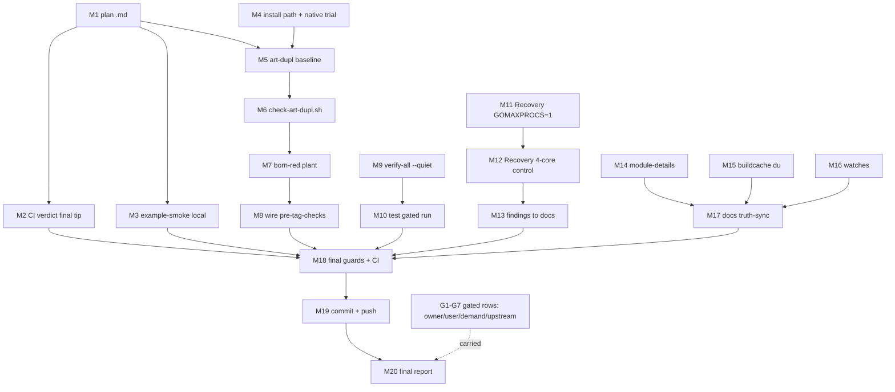

# SUPERB v9 — Post-Train Hardening (Verification, Standing Gates, Measurement Honesty)

**Date:** 2026-10-18 22:33 CEST · **Trigger:** user-directed continuation of the 2026-10-18 quiet-gate quality train (morning session closed 11 TODO rows; this wave hardens the results into standing infrastructure and closes the trust gaps)
**Input queue:** `docs/status/2026-10-18_09-47_self-review-and-full-session-status.md` §f (NEXT) + open TODO_LIST rows.

## Context

The morning shipped: `scripts/quiet-run.sh` (SMT-aware quiet gate), a quiet-window 12/12 green sweep + cqrs `-count=10` (b1 closed), the otel ns/op re-baseline, the art-dupl `-t 1` judgment sweep (1 extraction), and four upstream/watch resolutions. The self-review (09:47) exposed the gaps this wave attacks:

1. **Trust gap** — the session's own commits were unpushed at close; the session-close ritual (CI green on the FINAL tip) is incomplete; `example-smoke` (the only CI job without a local equivalent run) never ran locally.
2. **Standing-gate gap** — art-dupl acceptance is PROSE (632 groups adjudicated by judgment, nothing prevents regression); go-etag already solved this with a committed baseline + release-gate check (public precedent, `scripts/pre-release-check.sh` §OQ8).
3. **Measurement gap** — Recovery happy/panic benches are cross-run unstable (16.35↔27.29µs) with no protocol investigation; the honesty note exists but the CAUSE doesn't.
4. **Small rot** — module-details lacks the new files; buildcache at 85% unmeasured; watches not re-checked since morning.

**Verschlimmbessern guardrails (explicitly NOT touched):** benchmark source code; the 2026-10-12 Recovery baseline values; any cache content (buildcache analysis is READ-ONLY — shared box, owner's call); gated rows (owner/user/demand/upstream — carried, never decided by proxy); the daemon's commit cadence.

## Pareto breakdown

- **1% → 51%:** Verify CI on the final pushed tip + run `example-smoke` locally — XS effort, converts "everything green locally" into "everything green, period" for the whole morning train.
- **4% → 64%:** art-dupl **standing gate** (committed baseline + check, born-red proven, wired into pre-tag-checks) + `verify-all.sh --quiet` — the morning's one-off judgment and gate protocol become permanent infrastructure; regression of either class becomes impossible to ship silently.
- **20% → 80%:** Recovery-bench stability probe (GOMAXPROCS=1 vs 4-core control — either re-baseline becomes possible or the instability gets a documented cause) + module-details rows + buildcache read-only report + watch re-checks.
- **Other 20% → 100%:** the gated queue (below) — carried with exact unblock conditions, not forgotten.

## Comprehensive plan (30-100 min granularity, ALL TODOs)

| ID | Task | Imp | Eff | Customer value | Status after this wave |
|----|------|-----|-----|----------------|------------------------|
| A1 | Trust closure: CI verdict on final tip `56e41c0` + local `example-smoke` on the session tree | High | 30m | Green-train assurance | DONE |
| A2 | art-dupl standing gate: baseline report committed + `scripts/check-art-dupl.sh` (native `baseline`/`check` if clean, else go-etag count-gate) + born-red proof + pre-tag-checks wiring | High | 60m | Clone-regression prevention (gate, not prose) | DONE |
| A3 | `verify-all.sh --quiet` (self-gating gold-standard sweep through quiet-run.sh) + test | Med | 30m | One-command quiet sweeps | DONE |
| A4 | Recovery-bench stability probe: GOMAXPROCS=1 single-primary-core vs 4-core control, n=10, findings documented | Med | 60m | Measurement honesty (cause, not just symptom) | DONE (outcome per findings) |
| A5 | Docs completeness: module-details rows (otel_testharness_test.go, quiet-run.sh), TODO truth-sync | Med | 30m | Agent-session context | DONE |
| A6 | Hygiene: buildcache read-only size report (no deletion), watch re-checks (httputil tag, otel v1.48, 3 open asks) | Low | 30m | Owner decision input, early warning | DONE |
| A7 | Commit (detailed) + push (user-directed) | High | 30m | Landed work | DONE |
| G1 | OWNER: restore `SSH_PRIVATE_KEY` secret → structure-linter leg | P1 | 2m | CI completeness | CARRIED (owner) |
| G2 | OWNER: pma §6 decisions + `docs/**/.*-body.html` ignore edit | Med | 30m | Deterministic commits | CARRIED (owner) |
| G3 | USER: Q1 consumer-claim posture / Q2 cross-repo nudge / Q3 flightrecorder re-tag (asked 09:47, unanswered) | Med | — | Posture clarity | CARRIED (user) |
| G4 | DEMAND: W3-W5 batteries; composition-gap E2Es (3); subscribe-before-flush; EventConfig opt-ins; OTLP logs; auditlog hooks | High-when-fired | L | SDK growth | CARRIED (demand) |
| G5 | UPSTREAM/EVENT: httputil#41 (compose+TLS); go-health#7; fr#2; i18n residue (next httputil feature tag); otel v1.48; SigNoz watches (×3); cordis (2/3); nixpkgs go; core v1.0 criteria (5/7); health `WithHealthRecorder` (go-health#7 pack); go.work gopls-class residual; pma root-cause residual | Med | — | Family convergence | CARRIED (event) |
| G6 | THEIR-REPO: pbx-lens testkit migration; project-dependency-graph polish | Low | — | Fleet UX | CARRIED (their repos) |
| G7 | WATCH standing: watchlist refresh cadence; pkg.go.dev flightrecorder weekly GETs | Low | XS | Early warning | CARRIED (standing) |

## Micro plan (≤12 min each)

| ID | Micro-task | ≤min | Verifies |
|----|-----------|------|----------|
| M1 | This plan file + mermaid graph | 12 | file exists, graph renders |
| M2 | Poll CI run 39163825323 → verdict per job (only ci-preflight may be red) | 5 | all real jobs ✓ |
| M3 | Run `scripts/example-smoke.sh` locally, capture to file | 12 | all 7 examples PASS |
| M4 | Locate art-dupl install path (gh api contents) + trial native `baseline`/`check` on `integration/` | 12 | subcommand behavior understood |
| M5 | Generate full-repo baseline (gate settings: `-t 1 --type-aware`, default test-threshold) → `docs/reports/dupl/` | 12 | baseline file committed-able |
| M6 | Write `scripts/check-art-dupl.sh` (native check preferred; count-gate fallback) | 12 | script + bash -n |
| M7 | Born-red: plant a duplicate block in a scratch file → check MUST flag; remove | 12 | gate fails closed |
| M8 | Wire into `pre-tag-checks.sh`; re-run guard offline set | 12 | pre-tag flow green |
| M9 | Read `verify-all.sh`; add `--quiet [LOAD]` flag wrapping through quiet-run.sh | 12 | flag parses, help honest |
| M10 | Test `verify-all.sh --quiet <fast-module>` (e.g. docs) | 12 | gated run PASS line |
| M11 | Recovery probe P1: GOMAXPROCS=1, 1 primary core, count=10 → benchstat | 12 | sd comparison |
| M12 | Recovery probe P2: GOMAXPROCS=4, 4 primaries, count=10 (control pair) | 12 | sd comparison |
| M13 | Probe findings → otel README instability note extension + TODO row | 12 | doc honesty |
| M14 | module-details: add the two new-file rows (if tables enumerate them) | 12 | table updated |
| M15 | buildcache read-only `du -d1` size profile (timeout-guarded) | 12 | report, NO deletion |
| M16 | Watches: httputil tags, otel v1.48 proxy, 3 issue states | 6 | states dated |
| M17 | Docs truth-sync: TODO rows/header, status report for this wave | 12 | no stale rows |
| M18 | Final guards (directives/dependabot/charter/sse-protocol + new art-dupl gate) + final CI verdict | 12 | all green |
| M19 | `git status` → detailed commit → `git push` (user-directed) | 12 | pushed, hooks green |
| M20 | Final chat report (both tables folded) | 8 | every row dispositioned |

## Execution graph

## Verification checklist (wave exit)

- [ ] CI on final tip: all real jobs green (ci-preflight red = designed)
- [ ] example-smoke local: PASS
- [ ] check-art-dupl.sh: green on tree, RED on planted duplicate (born-red)
- [ ] pre-tag-checks: runs with the new guard (offline set green)
- [ ] verify-all --quiet: parses + gated PASS on a fast module; non-quiet mode unchanged
- [ ] Recovery probe: two protocols measured, findings written, NO baseline change without a stable protocol
- [ ] Guards 4/4 + bash -n on touched scripts
- [ ] Detailed commit + push; working tree clean after
