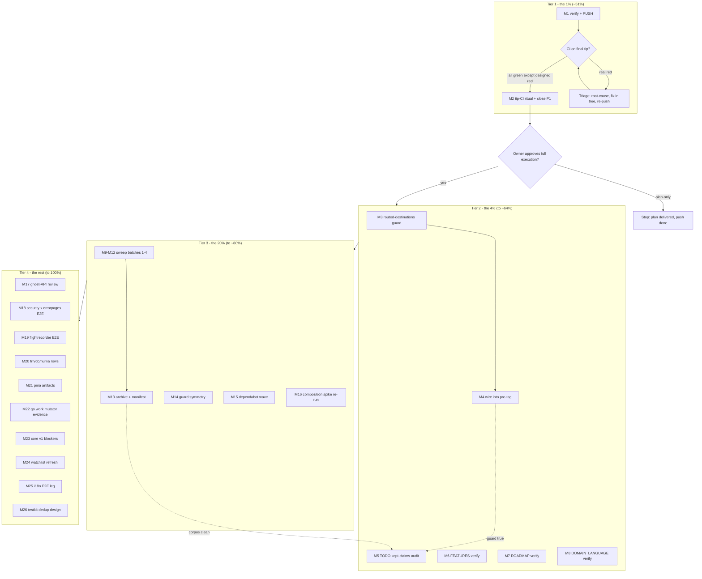

# SUPERB v10 — Docs-Truth Automation & Fleet Hygiene Plan

**Created:** 2026-11-02 07:24 CET · **Type:** pareto execution plan (input: TODO_LIST @ `d6b3bd4` + the 07-14 sweep report + ROADMAP)
**Method:** docs-health pass 2026-11-02 (this session) proved the dominant failure mode is **doc-lag** (two master CI reds from missed same-train updates; 8 dead routed pointers; 1 stale kept-claim). This plan ranks ALL open TODOs against that evidence.

**Verschlimmbesser guardrails (read before executing):**

1. Nothing in this plan changes runtime behavior of any released module. The only code a task may touch: NEW guards (scripts/), NEW tests (integration), NEW testkit helpers (additions-only, rides a natural train).
2. Every guard task is born-red-proven or negative-tested BEFORE wiring; every doc-truth task cites `file:line` evidence; every sweep runs `emit-keys → dry-run → apply → check-rows`.
3. Owner-gated rows are NEVER executed by an agent — they get decision-ready artifacts, not actions.
4. The push in M1 is explicitly authorized by the owner (2026-11-02 instruction); after it, the session-close ritual (M2) runs on the FINAL pushed commit only.
5. Rollback posture: every task leaves the tree green (suite + guards); any red stops the task, not the plan.

---

## 0. The result we are optimizing for

A **trustworthy** repo: CI green and meaningful, guards mechanically true, docs that cannot silently lie, zero rot in the status corpus. This session's evidence: the two CI reds were NOT code bugs — they were documentation contracts (pin fixture, release state) lagging reality. The tools that caught it (pin-drift, documentedPins, check-rows) are the reason the repo healed itself in hours. The plan therefore spends its leverage on making truth **mechanical and current**, then clears the rot corpus, and only then spends on new surface.

## 1. Pareto breakdown

### The 1% → ≈51% of the result

**Push + tip-CI ritual (M1–M2).** Everything this session fixed is a local claim until a runner proves it. One push converts: CI reds → green (the standing net re-armed), the dependabot wave unblocked, every "fixed in tree" annotation becomes evidence. Effort ≈ 30 minutes of which 28 is waiting. No other single task comes close per minute.

### The 4% → ≈64% of the result

The 1% **plus the doc-truth machinery** (M3–M8):

- `scripts/check-routed-destinations.sh` — the NEW guard that kills the dead-pointer class permanently (this session hand-fixed ~8 instances; a grep-able check makes the class impossible to re-enter silently).
- Kept-claims audit (TODO) + FEATURES/ROADMAP/DOMAIN_LANGUAGE row-by-row verify passes — the same audit that caught the SSE+health stale row, applied to everything still standing.
  Rationale: the 2026-11-02 pass fixed the rot that had ALREADY accumulated; these tasks make recurrence mechanical. After them, "docs lie" stops being a pass-by-pass hope and becomes a gate.

### The 20% → ≈80% of the result

The 4% **plus the corpus sweep and the two biggest unblocked levers** (M9–M16):

- The 2026-10+ reports sweep (36 files — the exact pipeline that just worked: annotate → check-rows → archive → manifest).
- Dependabot wave merge (10 stale PRs = false-red noise + stale deps; unblocked the moment CI is green).
- Guard-coverage symmetry review (one decision document closes "which guard runs where" ambiguity).
- Composition spike re-run vs httputil v1.7.0 (the biggest CODE lever unblocked since 2026-10-25 — but verdict-first, swap later).

### The remaining 20% → 100%

Everything demand-gated, owner-gated, upstream-gated, or trigger-gated (M17–M26 + the registries in §2): composition-gap E2Es, ghost-API review, watchlist refreshes, pma/go.work owner evidence packs, i18n E2E leg, testkit dedup design (staged for the next core train), and the two USER questions minted as decision-ready rows.

---

## 2. Owner / external / trigger gates (NOT agent-executable — decision-ready artifacts only)

| Gate                                                                                                     | What only the owner can do               | Agent's prepared artifact                               |
| -------------------------------------------------------------------------------------------------------- | ---------------------------------------- | ------------------------------------------------------- |
| SSH secret (P1)                                                                                          | Add `SSH_PRIVATE_KEY` in GitHub settings | P1 row carries acceptance (structure-linter runs green) |
| Machine go default                                                                                       | Bump nix-managed default go ≥1.27.2      | Standing Open question; retirement train scoped         |
| Cross-repo posture                                                                                       | Choose nudge-vs-report-only              | Open question                                           |
| pkg.go.dev flightrecorder                                                                                | Authorize docs-ghost re-tag ritual       | TODO P2 row (owner-gated last resort)                   |
| SigNoz instance                                                                                          | Provide/authorize an instance            | ACCEPTED-RISK row + dashboards README notes             |
| Battery demand W3–W5                                                                                     | Name a consumer                          | Canonical spec + demand re-check standing               |
| huma.md push                                                                                             | Push httputil docs file                  | Deferred Register row                                   |
| pma service.yaml edit                                                                                    | Edit owner-only config                   | Memo recommendations + ask text ready                   |
| OTLP logs build                                                                                          | Consumer adopts + asks                   | Design sketch + CLOSED-not-met gate audit               |
| cqrs EventConfig opt-ins / subscribe-before-flush / samber-do-auditlog / cordis triggers / fr#2 cooldown | Demand/consumer signals                  | Rows carry exact re-open triggers                       |
| pdg tool polish / go-plugin-mvp reverse adoption                                                         | Their repos                              | TODO pointer rows with full lists                       |

---

## 3. Comprehensive plan — 26 tasks, 30–100 min each (ALL TODOs mapped)

| #   | Task                                                                                                                                                                                                      | Tier | Eff  | Impact   | Cust.val | Depends on                               | TODO refs                |
| --- | --------------------------------------------------------------------------------------------------------------------------------------------------------------------------------------------------------- | ---- | ---- | -------- | -------- | ---------------------------------------- | ------------------------ |
| M1 **→ EXECUTED pre-dispatch (2026-11-02 morning): local verify + PUSH done** | Final local verify (guards trio, TODO grep) → **PUSH master** → confirm CI started | 1% | 30m | Critical | High | owner push authorized (this instruction) | P1 push row |
| M2 **→ EXECUTED pre-dispatch: tip-CI ritual run; chronic ci-preflight red re-confirmed DESIGNED (Actions SSH secret empty since ~10:5xZ; dependabot-PR runs use the Dependabot secrets namespace and pass) — full triage in the close-out report** | Tip-CI ritual on the FINAL pushed commit (every job green except designed ci-preflight red) → close P1 row | 1% | 45m | Critical | High | M1 | P1 both rows |
| M3 **→ EXECUTED in a467328: guard built born-red-proven, 194 enforced / 0 dead** | Build `scripts/check-routed-destinations.sh`: resolve every `→ routed — …` marker target against TODO/ROADMAP/AGENTS/files; negative-test with a planted dead pointer | 4% | 75m | High | Med | M2 green | report §f-8 |
| M4 **→ EXECUTED in a467328: ten guards + venue matrix in pre-tag-checks.sh** | Wire the guard into `pre-tag-checks.sh` (8→9 guards) + AGENTS ritual text + index gate note; full pre-tag dry-run on the latest tag | 4% | 30m | High | Med | M3 | report §f-8 |
| M5 **→ EXECUTED in a467328 sweep** | TODO kept-claims audit: every remaining `[ ]`/`[~]` row re-verified vs code; stale fixed on sight (the d-6 class) | 4% | 90m | High | Med | M2 | report §f-12 |
| M6 **→ EXECUTED in a467328 sweep** | FEATURES row-by-row re-verification — the 9 sections not covered this session (cqrs, docs, security, errorpages, realtime, fr, frh, otel, systemd+integration) | 4% | 100m | High | Med | — | report §f-11 |
| M7 **→ EXECUTED in a467328 sweep** | ROADMAP raw-ideas row-by-row vs code (retired rows stay retired) | 4% | 45m | Med | Low | — | report §f-13 |
| M8 **→ EXECUTED in a467328 sweep** | DOMAIN_LANGUAGE.md verify: every term grepped against code; missing domain terms added | 4% | 60m | Med | Low | — | report §f-14 |
| M9 **→ EXECUTED in a467328 sweep** | 2026-10+ sweep batch 1: 10-01 ×2 + 10-06 ×4 (emit-keys → verdicts → check-rows) | 20% | 100m | High | Med | M2 | TODO sweep item (new) |
| M10 **→ EXECUTED in a467328 sweep** | Sweep batch 2: 10-07 ×5 reports | 20% | 100m | High | Med | M9 pattern | same |
| M11 **→ EXECUTED in a467328 sweep** | Sweep batch 3: 10-10 ×2 + 10-12 ×5 | 20% | 100m | High | Med | M9 pattern | same |
| M12 **→ EXECUTED in a467328 sweep** | Sweep batch 4: 10-13 ×5 + 10-14 + 10-18 ×5 + 10-19 ×2 | 20% | 100m | High | Med | M9 pattern | same |
| M13 **→ EXECUTED in a467328 sweep: 38 reports archived, index rebuilt 53→89** | Sweep closeout: archive fully-resolved reports (`git mv` + gate-first), index manifest + counts | 20% | 45m | High | Med | M9–M12 | same |
| M14 **→ EXECUTED in a467328: routed-destinations CI job + venue matrix; fleet-lint overlap documented as intentional** | Guard-coverage symmetry review: inventory guard × venue (pre-tag / pre-commit / CI), decide intended symmetry, wire or document; reconcile fleet-lint vs matrix overlap | 20% | 90m | High | Med | M2 | TODO P2 row |
| M15 **→ EXECUTED-REVISED (2026-11-02 afternoon): 5 PRs MERGED (#42 #37 #38 #51 #53-new-content), 7 SUPERSEDED closed (4 auto by dependabot post-daemon-wave, #46/#28 manual with supersession comments); local verify folded to runner truth per owner question-3 default; integration tidy-diff green hermetic** | Dependabot wave: integration re-tidy FIRST (go-health v0.8.1 MVS), then merge the 10 PRs in dependency-safe order, suites + guards green | 20% | 100m | High | Med | M2 green | TODO P2 row |
| M16 **→ EXECUTED (2026-11-02): spike §5 addendum maps all three pins against the v1.7.0 godoc (bind SOLVED, Addr/Running SOLVED, phase logs appkit-owned with the single-timeout discipline); swap plan-of-record written into the TODO composition row; NOT the swap itself per scope** | Composition spike re-run vs httputil v1.7.0 `NewServerListener` semantics (listener-consumed, sync bind, `ListenerAddr`) → spike-doc annotation + swap plan (NOT the swap itself) | 20% | 90m | High | High | — | TODO P2 composition row |
| M17 **→ EXECUTED (2026-11-02): caller census 0+0, PapDashboard §7.3 cross-checked, KEEP verdict (anti-drift helper + demand signal UP), TODO row rewritten** | `security.APIKeyMatches` ghost-API review: repo + consumer sweep (PapDashboard §7 signal) → keep/deprecate decision row | rest | 60m | Med | Med | — | TODO P3 row |
| M18 **→ EXECUTED (2026-11-02): integration/security_errorpages_test.go green — truth-pins: Mount's catch-all SWALLOWS method mismatches into pretty 404s (Wrap owns pretty 405s), pretty pages are main-fragment HTML carrying the default-stack security headers, auth 401 stays plain JSON** | Composition-gap E2E: security×errorpages (pretty 404/500 behind the security stack) through published tags | rest | 90m | Med | Med | — | TODO P3 row |
| M19 **→ EXECUTED (2026-11-02): integration/flightrecorder_e2e_test.go green — truth-pins: one runtime trace per process (Start-to-Close sequential vs health_stack's recorder), dir-sink retains one file per capture, trigger filtering exact, download=1 streams octet-stream; file EXISTENCE races the trace flush (poll non-empty)** | Composition-gap E2E: flightrecorder middleware through an appkit Service | rest | 90m | Med | Med | — | TODO P3 row |
| M20 **→ EXECUTED (2026-11-02): frh pin-vs-MVS dormant note in AGENTS (frh=health=integration at go-health v0.8.1), samber/do lazy-healthcheck draft ruled FILE-WORTHY (premise re-verified at master, isHealthchecker exclusion nuance added), huma.md row RESOLVED (pushed + renders verified)** | frh go-health sweep watch note + samber/do draft file-or-shelve ruling + huma.md owner-row refresh | rest | 45m | Low | Low | — | TODO P3 rows |
| M21 **→ EXECUTED (2026-11-02): owner execution checklist added to the memo (5 concrete steps incl. the final ignore_patterns ask text)** | pma §6 walkthrough doc (owner checklist from the memo) + working-file `ignore_patterns` ask final text | rest | 45m | Med | Low | — | TODO pma rows |
| M22 **→ EXECUTED (2026-11-02): accept-cadence note — ZERO gopls-class leaks in the 3 weeks post-BuildFlow#46 (only 2 post-10-12 commits touching go.work are legitimate train content); hunt stays unconditionally justified** | go.work mutator evidence pass: journalctl timeline vs leak commits → name the tool or write the accept-cadence note | rest | 60m | Med | Low | — | TODO P2 go.work row |
| M23 **→ EXECUTED (2026-11-02): graduation table added — criterion 1 ARMED (release-ritual API diff v0.9.0-to-tree is ZERO lines), criterion 5 unchanged (claims guard green, PapDashboard still v0.4.0)** | core v1 exit criteria: re-verify the 2 blockers (additions-empty tag pair, consumer version overlap) → graduation table update | rest | 45m | Med | Med | — | TODO P2 v1 row |
| M24 **→ EXECUTED (2026-11-02): as-of refresh — nixpkgs go 1.26.10 DRIFT verdict (below floor, no nixpkgs path), otel v1.48 still unreleased (v1.47.0 latest), semconv still v1.26.0, OTLP-logs gate audit stands (claims green same day), go-aichat convergence verified (go-sse v0.6.2 + ssetest v0.5.0 match fleet), cordis as-of honestly limited (fork clone tagless), exact-token lesson COMMITTED in crush-config 227a130 (F95)** | Watchlist mega-refresh with as-of dates: cordis consumers, nixpkgs go, battery demand, otel v1.48 / semconv flip / PeriodicReader / OTLP-logs gate re-audit, go-aichat convergence | rest | 60m | Med | Low | — | TODO watchlist + v8 rows |
| M25 **→ EXECUTED (2026-11-02): integration/i18n_language_test.go green — primary-subtag fallback, q-weight ordering, default-tag fallbacks, Content-Language + Vary through the default stack** | i18n `Language()` composition E2E leg (trigger FIRED 2026-10-25: httputil v1.6.0+ published) — demand-gated remainder of the i18n row | rest | 100m | Med | Med | — | TODO P3 i18n row |
| M26 **→ EXECUTED with a discovered constraint (2026-11-02): HTTPGetURL/HTTPGetContext/WaitForRunning(+Within)/FreeAddr landed in testkit + unit tests + CHANGELOG [Unreleased] + README section; root appkit_test migrations done; IN-PACKAGE (package appkit) tests CANNOT import testkit (import cycle) so whitebox helpers stay local permanently; satellite + integration migrations ride the next core train (hermetic proxy cannot see unreleased API)** | Testkit helper dedup: design + implement `httpGetURL`/poll/context-GET/`freeAddr` families as testkit additions; stage core `[Unreleased]`; integration migration rides the NEXT core train (pin charter) | rest | 100m | Med | Med | M2 | TODO P2 testkit row |

Coverage check: P1 (M1–M2 + registry), P2 (M5, M14–M16, M22, M23, M26, M3–M4 new, registry for owner parts), P3 (M17–M21, M24–M25, registry for demand/trigger gates), SUPERB v8 harvest rows (M24), report §f new items (M3–M8, M9–M13). **All open TODOs are mapped; none dropped.**

## 4. Detailed breakdown — fine tasks, ≤12 min each

| #   | Task (≤12 min)                                                                                                           | Part of | Eff | Done-when                            |
| --- | ------------------------------------------------------------------------------------------------------------------------ | ------- | --- | ------------------------------------ |
| F1  | Run guards trio + `grep -c '\[x\]' TODO_LIST.md` + `git status` clean check                                              | M1      | 5m  | all green, tree clean                |
| F2  | `git push origin master` (authorized)                                                                                    | M1      | 2m  | push accepted                        |
| F3  | `gh run list` — note the new run id for the tip                                                                          | M1      | 3m  | run id recorded                      |
| F4  | `gh run view <id>` — read EVERY job on the final pushed commit                                                           | M2      | 10m | verdict per job                      |
| F5  | Update TODO P1 rows: push done, ritual result recorded                                                                   | M2      | 8m  | rows truthed                         |
| F6  | Annotate the 07-14 report's §b1 (acceptance status)                                                                      | M2      | 5m  | report current                       |
| F7  | Inventory: `grep -rn "→ routed\|→ their repo\|→ TODO_LIST\|→ TODO\b" TODO_LIST.md ROADMAP.md AGENTS.md docs/status/*.md` | M3      | 10m | marker census                        |
| F8  | Define target-resolution rules (TODO row exists? ROADMAP row exists? AGENTS row exists? file exists?)                    | M3      | 12m | rules written in script header       |
| F9  | Script skeleton: arg parsing, marker extraction, per-venue checks                                                        | M3      | 12m | script runs, exits 2 on usage        |
| F10 | Implement resolvers (TODO row regex, ROADMAP section, AGENTS grep, `test -f`)                                            | M3      | 12m | resolvers pass on known-good targets |
| F11 | Negative test: plant `→ routed — TODO_LIST no-such-row` in a scratch file → expect exit 1 naming it                      | M3      | 10m | born-red proven                      |
| F12 | Run on the real tree → expect 0 findings; fix any surfaced                                                               | M3      | 12m | 0 findings or fixed                  |
| F13 | Usage docs + `--help`; scratch file removed                                                                              | M3      | 8m  | self-clean                           |
| F14 | Append guard to `scripts/pre-tag-checks.sh` guard list                                                                   | M4      | 8m  | wired                                |
| F15 | AGENTS Release Ritual step 5 text (8→9 guards) + index README gate section note                                          | M4      | 10m | docs true                            |
| F16 | Dry-run `pre-tag-checks.sh v0.9.0 health/v0.3.0` (latest tags) → green                                                   | M4      | 12m | gate green end-to-end                |
| F17 | Audit P1 rows vs `gh`/CI state                                                                                           | M5      | 10m | rows verified                        |
| F18 | Audit P2 rows (testkit/guards/dependabot/pkg.go.dev/go.work/pma/composition/v1) vs code                                  | M5      | 12m | findings list                        |
| F19 | Audit P3 rows first half vs code                                                                                         | M5      | 12m | findings list                        |
| F20 | Audit P3 rows second half + SUPERB v8 rows vs code                                                                       | M5      | 12m | findings list                        |
| F21 | Fix surfaced staleness on sight + CHANGELOG/annotation notes                                                             | M5      | 12m | TODO truthful                        |
| F22 | FEATURES cqrs section row-by-row vs `cqrs/` code+tests                                                                   | M6      | 12m | verdicts                             |
| F23 | FEATURES docs section vs `docs/`                                                                                         | M6      | 10m | verdicts                             |
| F24 | FEATURES security section vs `security/`                                                                                 | M6      | 12m | verdicts                             |
| F25 | FEATURES errorpages section vs `errorpages/`                                                                             | M6      | 10m | verdicts                             |
| F26 | FEATURES realtime section vs `realtime/`                                                                                 | M6      | 12m | verdicts                             |
| F27 | FEATURES flightrecorder + frh sections vs modules                                                                        | M6      | 12m | verdicts                             |
| F28 | FEATURES otel section vs `otel/`                                                                                         | M6      | 12m | verdicts                             |
| F29 | FEATURES systemd section vs `systemd/`                                                                                   | M6      | 10m | verdicts                             |
| F30 | FEATURES integration section vs `integration/` + Consumers section links                                                 | M6      | 12m | verdicts                             |
| F31 | ROADMAP raw ideas 1/3 vs code (route-cardinality, httpx seam, metadata feed)                                             | M7      | 12m | verdicts                             |
| F32 | ROADMAP raw ideas 2/3 (config modules, W4 candidates, errorpages trace_id)                                               | M7      | 12m | verdicts                             |
| F33 | ROADMAP raw ideas 3/3 (multi-instance realtime, multi-recorder ADR, cqrs ops backlog, health aggregate, fleet patterns)  | M7      | 12m | verdicts                             |
| F34 | Extract DOMAIN_LANGUAGE term list + section map                                                                          | M8      | 10m | inventory                            |
| F35 | Grep each term vs code usage (batched)                                                                                   | M8      | 12m | live/dead per term                   |
| F36 | Add missing terms found during the session (e.g. `documentedPins` contract, routed verdict) + fix drifted definitions    | M8      | 12m | file truthful                        |
| F37 | Read 10-01_07-16 report; verify items vs tree; emit-keys                                                                 | M9      | 12m | keys emitted                         |
| F38 | Spec + dry-run + apply + check-rows for 10-01_07-16                                                                      | M9      | 12m | annotated                            |
| F39 | Same for 10-01_14-27 (likely fully struck — archive candidate)                                                           | M9      | 12m | annotated                            |
| F40 | Same for 10-06_16-06 flightrecorder adoption plan (EXECUTED banner exists — verify + archive)                            | M9      | 12m | annotated                            |
| F41 | Same for 10-06_22-21 ×2 reports                                                                                          | M9      | 12m | annotated                            |
| F42 | Same for 10-06_23-23 closeout + 10-06_23-34 self-review                                                                  | M9      | 12m | annotated                            |
| F43 | Same for 10-07_00-40 + 10-07_01-20                                                                                       | M10     | 12m | annotated                            |
| F44 | Same for 10-07_01-22 + 10-07_10-07                                                                                       | M10     | 12m | annotated                            |
| F45 | Same for 10-07_11-00 pma dossier (owner §6 stays routed; annotate what shipped)                                          | M10     | 12m | annotated                            |
| F46 | Same for 10-07_11-01 mid-flight snapshot                                                                                 | M10     | 12m | annotated                            |
| F47 | Same for 10-07_10-11 SUPERB pareto plan (partially executed → verdict banner or remaining rows routed)                   | M10     | 12m | annotated                            |
| F48 | Same for 10-10_01-43 i18n research                                                                                       | M11     | 12m | annotated                            |
| F49 | Same for 10-10_10-21 i18n resolution                                                                                     | M11     | 12m | annotated                            |
| F50 | Same for 10-12_14-16 + 10-12_14-17                                                                                       | M11     | 12m | annotated                            |
| F51 | Same for 10-12_15-12 + 10-12_15-53                                                                                       | M11     | 12m | annotated                            |
| F52 | Same for 10-12_17-27 fleet issues + 10-12_18-16 SUPERB v6 wave1                                                          | M11     | 12m | annotated                            |
| F53 | Same for 10-12_20-36 mid-train + 10-13_13-55 v6 complete                                                                 | M12     | 12m | annotated                            |
| F54 | Same for 10-13_14-05 v7 plan (ACTIVE — verify rows, do not archive while active) + 10-13_15-33 v7 complete               | M12     | 12m | annotated                            |
| F55 | Same for 10-13_15-54 + 10-13_17-02 + 10-13_17-49                                                                         | M12     | 12m | annotated                            |
| F56 | Same for 10-14_14-55 CI-split report                                                                                     | M12     | 12m | annotated                            |
| F57 | Same for 10-18_01-23 + 10-18_01-45                                                                                       | M12     | 12m | annotated                            |
| F58 | Same for 10-18_05-10 SUPERB v8 + 10-18_06-57 guard train                                                                 | M12     | 12m | annotated                            |
| F59 | Same for 10-18_08-45 quiet-gate + 10-18_23-20 SUPERB v9 + 10-19_00-15 + 10-19_07-34                                      | M12     | 12m | annotated                            |
| F60 | Same for 10-25 brutal-self-review (reviews/ HTML) + 10-25_20-10 httputil sweep report                                    | M12     | 12m | annotated                            |
| F61 | Archive gate-first: `check-rows` every newly-annotated file → `git mv` resolved ones → index manifest + counts           | M13     | 12m | archive consistent                   |
| F62 | Re-run whole-archive gate + completeness grep on moved files only                                                        | M13     | 10m | gates print nothing                  |
| F63 | Guard × venue inventory table (each of the 9+ guards: pre-commit/pre-tag/CI/none)                                        | M14     | 12m | table                                |
| F64 | Decide intended symmetry (what ships in a tag vs what gates a push); write the decision paragraph                        | M14     | 12m | decision recorded                    |
| F65 | Wire/document per decision (moves between venues, no new network guards in CI)                                           | M14     | 12m | venue truth                          |
| F66 | Reconcile fleet-lint job vs matrix build/vet overlap (document or trim)                                                  | M14     | 10m | overlap resolved                     |
| F67 | Integration: `go mod tidy` + suite hermetic (the v0.8.1 MVS state)                                                       | M15     | 12m | green                                |
| F68 | Dependabot PRs wave 1: merge safe dep-only PRs, suite spot                                                               | M15     | 12m | merged set 1                         |
| F69 | Wave 2: go-cqrs-lite catalog + go-health PR (re-tidy check)                                                              | M15     | 12m | merged set 2                         |
| F70 | Wave 3: ssetest realtime PR + remainder; guards trio                                                                     | M15     | 12m | all 10 merged/closed                 |
| F71 | Read httputil v1.7.0 `NewServerListener` godoc + source semantics                                                        | M16     | 12m | semantics captured                   |
| F72 | Map spike's 3 pins (bind contract, Addr/Running, phase logs) against the new API                                         | M16     | 12m | pin-by-pin verdict                   |
| F73 | Annotate spike doc §3/§4 with the re-run verdict + write the swap plan into the TODO composition row                     | M16     | 12m | verdict recorded                     |
| F74 | `grep -rn "APIKeyMatches"` repo + `git -C PapDashboard`/consumer scan                                                    | M17     | 10m | caller census                        |
| F75 | Cross-check PapDashboard planning §7 middleware list for the API's shape                                                 | M17     | 10m | adoption signal verdict              |
| F76 | Decision row: keep-with-consumer / deprecate-on-next-train (+ CHANGELOG note drafted)                                    | M17     | 10m | row written                          |
| F77 | Design security×errorpages E2E (published tags, wire plan)                                                               | M18     | 12m | test design                          |
| F78 | Implement the E2E in `integration/`                                                                                      | M18     | 12m | test compiles                        |
| F79 | Suite `-race` + lint + guards; wire sse-protocol rules if any broadcast                                                  | M18     | 12m | green                                |
| F80 | Design flightrecorder-middleware E2E (capture → snapshot endpoint → assertions)                                          | M19     | 12m | test design                          |
| F81 | Implement + verify + suite/lint/guards                                                                                   | M19     | 12m | green                                |
| F82 | frh go-health pin watch note + samber/do draft ruling row + huma.md row refresh                                          | M20     | 12m | rows truthed                         |
| F83 | pma §6 owner checklist from the memo + final ignore-ask text                                                             | M21     | 12m | artifact ready                       |
| F84 | go.work mutator: journalctl timeline vs the 8 leak commits; name or write accept-note                                    | M22     | 12m | evidence verdict                     |
| F85 | core v1 blockers re-verify + graduation table update                                                                     | M23     | 12m | table current                        |
| F86 | Watchlist probes part 1 (cordis consumers, nixpkgs go, battery demand)                                                   | M24     | 12m | as-of dates                          |
| F87 | Watchlist probes part 2 (otel v1.48, semconv flip, PeriodicReader, OTLP-logs gate re-audit, go-aichat)                   | M24     | 12m | as-of dates                          |
| F88 | i18n Language() E2E design + implement (httputil v1.7.0 published)                                                       | M25     | 12m | test compiles                        |
| F89 | i18n E2E suite/lint/guards + TODO row 67 update                                                                          | M25     | 12m | green                                |
| F90 | Testkit: inventory the 4 helper families + signatures (realtime/fr/poll/context-GET/freeAddr)                            | M26     | 12m | inventory                            |
| F91 | Testkit API design (names, optionality, import-cycle check)                                                              | M26     | 12m | design note                          |
| F92 | Implement `HTTPGetURL` + poll family in testkit + unit tests                                                             | M26     | 12m | green                                |
| F93 | Implement context-GET + `freeAddr` share; root+satellite migrations                                                      | M26     | 12m | green                                |
| F94 | Core CHANGELOG `[Unreleased]` entry + README testkit section + integration-migration note (rides next train)             | M26     | 12m | staged                               |
| F95 | crush-config lessons.md: exact-token guard lesson (ledger marker class) — commit THERE                                   | M24/M3  | 12m | lesson committed                     |

(95 fine tasks; every medium task decomposed; every ≤12 min.)

## 5. Execution graph

Parallelization notes: M2 is wall-clock (CI) — run M3 design/F7-F10 during the wait. M9–M13 batches are independent of M14–M16 after M2. Owner-gate registry items never block agent tiers.

## 6. Errata surfaced while planning (skill step 0)

- TODO row 65's "SSE+health" leg was found stale during the report self-review and FIXED before this plan (commit `d6b3bd4`) — the plan's M5 generalizes that kept-claims audit.
- go-health#7 is CLOSED COMPLETED upstream (shipped v0.8.x, adopted by health v0.3.0) — watchlist already truthed 2026-11-02; M24 re-probes only for as-of dates.
- prompt-crusher-exec is RESOLVED in their repo (renamed `prompt-crusher`, go.mod clean) — no plan task; pointer rows already updated.
- The 10-13_14-05 SUPERB v7 plan is still ACTIVE per the index — its sweep task (F54) verifies rows but does NOT archive it while rows remain open.
- No stale backlog items were discovered beyond those already fixed this session — the TODO rebuild (2026-11-02) is the baseline this plan ranks.

## 7. Harvest contract

New tasks this plan introduces (routed-destinations guard, the four verify passes, the sweep batches, the exact-token lesson) were NOT in TODO_LIST before today — per the docs-health HARVEST rule they are added to TODO_LIST when execution starts (the plan is the snapshot; TODO_LIST is the living source). Execution may not begin before owner approval per the plan-only scope of this dispatch.

_Awaiting approval. Plans are point-in-time; bring current via docs-health ANNOTATE, never rewrite._
