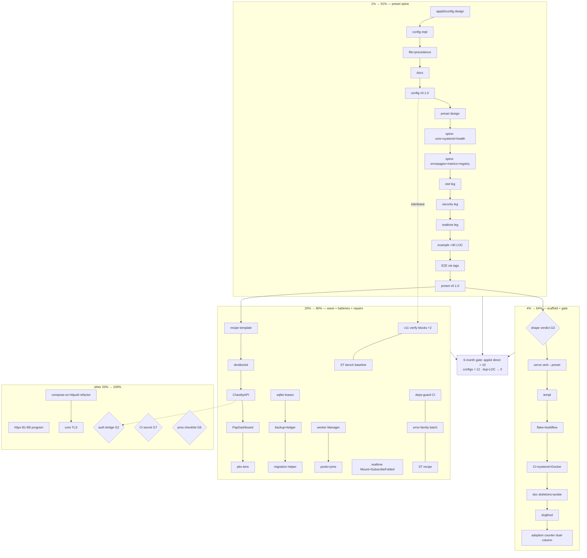

# SUPERB v12 — Unified Execution Plan (ALL open TODOs, Pareto-ranked)

**Created:** 2026-11-06 01:48 · **Method:** pareto-planning skill — TODO_LIST + both 2026-11-06 status-report §f lists + the v12 preset plan, every open row verified against source before ranking · **Companion evidence:** `docs/review/apps/2026-11-06_integration-burden-audit.md` (fleet demand), `docs/planning/2026-11-06_01-00-SUPERB-v12-app-composition-preset-plan.html` (program detail) · **Supersedes nothing** — TODO_LIST stays the living source; this file is the ranked snapshot.

**Staleness check performed (Step 0):** TODO_LIST re-read in full 01:48. One row found
PARTIALLY DONE: "AGENTS deps-table version-drift guard" — script EXISTS
(`scripts/check-agents-deps.sh`, commit 530d71a) and IS wired into pre-tag-checks; the CI job
and pre-commit wiring are still missing → ranked as the residual only. No other done-but-open
rows found. Owner-gated rows are ranked but marked **[OWNER]**.

---

## 1. The Pareto thesis (what we should REALLY do)

The audit's measured truth: the building blocks are adopted everywhere, the composition layer
is the least-adopted member of its own stack (go-appkit 6/39 direct vs blocks at 18–22 direct),
and 22 apps hand-roll config, 16 migrations, 10 JWT, 9 SSE, 9 shutdown. The fleet does not
need more parts — it needs the parts to compose themselves.

- **1% → 51%: the preset spine.** `appkit/config` (F1, 22×/25× demand) then `appkit/preset`
  (one call composing ONLY shipped batteries). Every future app AND every migration lands on
  it. Nothing else moves the fleet default.
- **4% → 64%: the scaffold + the mechanical gate.** `appkit new` (or template repo) kills the
  new-app copy-paste class (37/39 flakes, 20 buildflows); the adoption-counter script turns the
  six-month success gate from a promise into a number.
- **20% → 80%: the wave + the proven batteries + the v11 repairs.** Swap recipes for the four
  heaviest hand-rollers (−~6,400 LOC mapped); D3 sqlite+migrations, D1 workers, C2 realtime
  Mount (audit-proven demand); the owner-picked v11 repair backlog keeps guards/docs honest;
  three small audit batches (deps-guard CI, error-family, Server-Timing).
- **The other 20% → 100%: the httpx program, the composition refactor, gates and watches.**
  httpx B1–B9 (promoted), compose-Service-on-httputil.Server + core TLS, core v1 exit
  criteria, systemd backlog, owner gates (auth bridge, pma checklist, CI secret, pkg.go.dev
  re-tag), their-repo rows, and the standing watchlists (reactive by nature — no fake tasks).

**Blocking user gates (ranked at their dependency position, cannot be decided by an agent):**
G1 sequencing v11-repairs vs v12-spine (both are "next"); G2 auth bridge (T5.4); G3 scaffold
shape; G4 plan-revision convention; G5 machine go default; G6 pma owner checklist; G7 CI
secret. **Recommended default if no answer: interleave — config train (small) first, then one
v11 repair batch, then preset.**

---

## 2. Comprehensive plan — ALL open TODOs as 30–100 min tasks

Sorted by tier, then impact/effort. `[OWNER]` = owner-only. Source column: TL=TODO_LIST row,
SR=status-report item, V12=v12 plan task.

### Tier 1 — 1% → 51% (the preset spine)

| ID | Task                                                                                                           | Impact    | Effort | Source     |
| -- | -------------------------------------------------------------------------------------------------------------- | --------- | ------ | ---------- |
| C1 | `appkit/config` design note: env-first struct tags, precedence (flag>env>file), koanf adopt-or-decline verdict | Very High | 90m    | TL/TL V12a |
| C2 | `appkit/config` implement env binding + defaults + classified failures (Rejection + field path)                | Very High | 90m    | V12 T2.2a  |
| C3 | `appkit/config` file layer + precedence matrix tests                                                           | Very High | 90m    | V12 T2.2b  |
| C4 | `appkit/config` README + runnable example + compile-checked snippets                                           | High      | 60m    | V12 T2.3   |
| C5 | `appkit/config` v0.1.0 release train (ritual + proxy check)                                                    | High      | 60m    | V12 T2.4   |
| P1 | `appkit/preset` design: Config struct, env-switch grammar frozen, posture table, skeleton                      | Very High | 90m    | V12 T1.1   |
| P2 | `appkit/preset` spine wiring: core + systemd.Install + health dashboard                                        | Very High | 90m    | V12 T1.2a  |
| P3 | `appkit/preset` spine wiring: errorpages + metrics/version + RegisterClassifications                           | Very High | 90m    | V12 T1.2b  |
| P4 | `appkit/preset` otel leg (APPKIT_OTEL, off-switch honored)                                                     | High      | 90m    | V12 T1.3   |
| P5 | `appkit/preset` security-profile leg (explicit switch, posture matrix test)                                    | High      | 90m    | V12 T1.4a  |
| P6 | `appkit/preset` realtime leg (Mount shape)                                                                     | High      | 90m    | V12 T1.4b  |
| P7 | `appkit/preset` example app <40 LOC + conflict-matrix tests                                                    | High      | 90m    | V12 T1.5a  |
| P8 | Integration E2E through PUBLISHED tags post-release                                                            | High      | 90m    | V12 T1.5b  |
| P9 | `appkit/preset` v0.1.0 train + consumer heads-up drafts                                                        | High      | 60m    | V12 T1.6   |

### Tier 2 — 4% → 64% (scaffold + mechanical gate)

| ID    | Task                                                                              | Impact | Effort | Source    |
| ----- | --------------------------------------------------------------------------------- | ------ | ------ | --------- |
| S1    | Scaffold shape verdict: template repo vs generator (short doc) — G3 unblocks this | High   | 60m    | V12 T3.1  |
| S2    | Template: cmdguard serve verb → preset + typed flags                              | High   | 90m    | V12 T3.2a |
| S3    | Template: templ + templ-components skeleton + assets                              | High   | 60m    | V12 T3.2b |
| S4    | Template: flake.nix + .buildflow.yml                                              | High   | 60m    | V12 T3.3a |
| S5    | Template: CI workflow + systemd unit + Dockerfile                                 | High   | 60m    | V12 T3.3b |
| S6    | Template: README/CHANGELOG/AGENTS/FEATURES skeleton + boot probe script           | Medium | 60m    | V12 T3.4  |
| S7    | Dogfood: scaffold one real app end-to-end, fix what hurt                          | High   | 90m    | V12 T3.5  |
| G-CNT | Adoption-counter script (dual any/direct columns) + wire pre-tag-or-CI            | High   | 60m    | SR §f7    |

### Tier 3 — 20% → 80% (wave + proven batteries + repairs)

| ID  | Task                                                                                                      | Impact | Effort | Source         |
| --- | --------------------------------------------------------------------------------------------------------- | ------ | ------ | -------------- |
| A1  | Swap-recipe template in docs/recipes/ (inventory→map→order→LOC→green)                                     | High   | 60m    | TL V12d        |
| A2  | dnsblockd swap recipe (−~1,600 LOC mapped)                                                                | High   | 60m    | V12 T4.2       |
| A3  | ChastityAPI swap recipe (−~4,800 LOC class)                                                               | High   | 90m    | V12 T4.3       |
| A4  | PapDashboard security swap recipe (M17 follow-up)                                                         | Medium | 45m    | V12 T4.4       |
| A5  | pbx-lens cmdguard migration recipe (fatalCode → exit contract)                                            | Medium | 45m    | V12 T4.5       |
| D3a | SQLite ops kit: design + lease matrix (spec D3)                                                           | High   | 90m    | TL W8          |
| D3b | SQLite ops kit: backup round-trip + ledger atomicity                                                      | High   | 90m    | TL W8          |
| D3c | Embedded-migration helper + versioning round-trip (16-app demand)                                         | High   | 90m    | V12 T5.2       |
| D1a | Worker supervisor: Manager port-from (quotaboard hooks + ChastityAPI joins)                               | High   | 90m    | TL W8          |
| D1b | Worker supervisor: pools, panic-restart, start-during-shutdown joins                                      | High   | 90m    | TL W8          |
| C2R | realtime: Mount one-liner + SubscribeFolded discriminator test (spec C2)                                  | Medium | 90m    | TL W8          |
| R1a | v11 repair: fix httputil.md rg command + verify-blocks batch 1 (libs 1–6)                                 | Medium | 90m    | TL R1          |
| R1b | v11 repair: verify-blocks batch 2 (libs 7–12) + fix failures                                              | Medium | 90m    | TL R1          |
| R1c | ServerTiming real bench baseline (-benchtime 1s -count 6) + AGENTS perf + total assertion                 | Medium | 60m    | TL R1          |
| R1d | hub.go:80 doc-const note + libs index mobile screenshot + dprint coverage                                 | Low    | 45m    | TL R1          |
| R1e | Integration go-retry MVS proof + example-smoke vs new stack                                               | Medium | 60m    | TL R1          |
| R2  | deps-guard: CI job + pre-commit wiring (script already shipped)                                           | Medium | 30m    | TL R2 residual |
| R3  | error-family adoption batch (recipe + cross-links + errorfamilytest asserts + WrapOnce/WithContext sites) | Medium | 90m    | TL R3          |
| R4a | Server-Timing: handler-phase README recipe + dependabot coverage check                                    | Medium | 45m    | TL R4          |
| R4b | Server-Timing composition E2E at next integration re-pin                                                  | Medium | 30m    | TL R4          |
| R5a | httpx shortlist verdicts: CORS battery row + trusted-proxy keying                                         | Medium | 60m    | TL R5          |

### Tier 4 — the other 20% → 100% (program builds, gates, watches)

| ID  | Task                                                                                           | Impact | Effort | Source                |
| --- | ---------------------------------------------------------------------------------------------- | ------ | ------ | --------------------- |
| H1  | httpx B1 ResultHandler family + errorpages classification-parity test                          | High   | 100m   | TL W8                 |
| H2  | httpx B2 bind + validation                                                                     | High   | 60m    | TL W8                 |
| H3  | httpx B9 no-leak error responses (leak matrix test)                                            | High   | 60m    | TL W8                 |
| H4  | httpx B3 ResponseWriter wrapper contract (AssertForwardsInterfaces)                            | Medium | 45m    | TL W8                 |
| H5  | httpx B4 conditional GET on go-etag                                                            | Medium | 60m    | TL W8                 |
| H6  | httpx B5 content negotiation on go-codec                                                       | Medium | 90m    | TL W8                 |
| H7  | httpx B7 per-route write deadlines                                                             | Medium | 60m    | TL W8                 |
| H8  | `svc.Routes()` seam decision (owner) + B6 golden + B8 docs feed                                | Medium | 60m    | TL W8 [OWNER]         |
| X1  | Compose Service on httputil.Server refactor (fresh-server-per-Start swap, six phase logs kept) | High   | 100m   | TL R9                 |
| X2  | Core TLS on the NewServerListener seam (G1)                                                    | Medium | 60m    | TL R9                 |
| X3  | testkit satellite+integration migration (rides next core train)                                | Medium | 60m    | TL R6                 |
| X4  | Core v1 exit criteria close-out (additions-empty tag pair watch + consumer overlap)            | High   | 60m    | TL R10                |
| Y1  | systemd small backlog (godoc Examples, WithStatus, Install→Hooks, README notes)                | Low    | 60m    | TL W4                 |
| Y2  | D5 polite outbound client port (CV scanner layer)                                              | Medium | 100m   | TL W8                 |
| Y3  | D7 idempotency adopt-wire decision (go-idempotency vs 165-LOC port)                            | Medium | 30m    | TL W8                 |
| Y4  | D4 atomic-write promote (floor ≥v0.5.1) + D6 webhook sender                                    | Medium | 90m    | TL W8                 |
| Y5  | F4 config hot-reload (validate-gate → atomic swap) — demand-gated                              | Low    | 100m   | TL W8                 |
| Y6  | C1 realtime drop counters + C3 per-subscriber auth/filter                                      | Medium | 90m    | TL W8                 |
| OG1 | Auth-bridge decision memo (usermgmt recipe vs security session) — G2                           | High   | 90m    | TL [OWNER]            |
| OG2 | Consumer heads-ups post when core tags (drafts ready)                                          | Medium | 30m    | TL W2                 |
| OG3 | pma owner checklist walkthrough (4 dossier decisions + working-file ignore)                    | High   | 30m    | TL [OWNER]            |
| OG4 | pkg.go.dev flightrecorder re-tag ritual (last resort)                                          | Low    | 30m    | TL [OWNER]            |
| OG5 | CI SSH secret restore (structure-linter leg unblocks)                                          | High   | 5m     | TL P1 [OWNER]         |
| OG6 | Machine go default ≥1.27.2 decision (retires GOTOOLCHAIN prefix)                               | Medium | 15m    | TL open-q [OWNER]     |
| Z1  | Process lessons entry: asserted-vs-computed counts (crush-config repo)                         | Medium | 30m    | SR §f12               |
| Z2  | dprint html coverage decision (plugin or documented exclusion)                                 | Low    | 30m    | SR §f13               |
| Z3  | CV deep-read + single-membership archetype matrix (audit appendix)                             | Medium | 90m    | SR §f8/14             |
| Z4  | TODO preset row: dual-number citation fix + plan-revision convention ruling — G4               | Low    | 15m    | SR §f15/20            |
| Z5  | pdg tool polish batch (their repo: header relabel, doctor, member-key fix)                     | Low    | 90m    | TL W11                |
| Z6  | samber/do: file the lazy-healthcheck upstream ask + do-bridge verdict                          | Low    | 30m    | TL W10 [OWNER filing] |
| Z7  | cqrs EventConfig opt-ins README recipe (demand-gated path)                                     | Low    | 30m    | TL W9                 |

### Standing watches (reactive — intentionally NOT decomposed into tasks)

go-sse breaking `ssetest` release; go-etag v1.0.0 root-shim; go-idempotency CHANGELOG hygiene;
httputil server_timing pairing + apidiff gate; realtime subscribe-before-flush (demand-gated);
go-flightrecorder#2 cooldown combinator; SSE-hub convergence; cordis triggers; nixpkgs go
drift; pkg.go.dev renders; otel v1.48 train / semconv flip / OTLP-logs gate / SigNoz instance;
consumer tags firing the claims guard; pma daemon cadence. Full statements live in TODO_LIST
P3 — they fire on triggers, not on a schedule.

---

## 3. Fine plan — ≤12 min per task (executable slices)

The 1%/4%/20% tiers are cut to the bone — every row is a startable, verifiable unit. Tier 4
train-bound builds get their first executable slice; the rest of each train is micro-cut at
ITS sprint start (cutting all of httpx today would be a brainstorm, not a plan — the skill's
own warning). IDs map to the comprehensive table.

### Tier 1 slices

| #  | Micro-task (≤12m)                                                          | Parent |
| -- | -------------------------------------------------------------------------- | ------ |
| 1  | Re-read F1 spec + 3 exemplar config packages; list recurring struct fields | C1     |
| 2  | Draft config/README API sketch (Load, tags, defaults, precedence)          | C1     |
| 3  | koanf verdict note (env-first wins on fleet reality: 25 os.Getenv apps)    | C1     |
| 4  | Module skeleton: go.mod 1.27.2, .golangci.yml from satellite, CHANGELOG    | C1     |
| 5  | Types: Loader[T], tag grammar, ValidationError (error-family Rejection)    | C2     |
| 6  | Red test: env binding happy path                                           | C2     |
| 7  | Green: implement binding                                                   | C2     |
| 8  | Test: missing-required → Rejection with field path                         | C2     |
| 9  | Test: bad value → classified error, no panic                               | C2     |
| 10 | Test: defaults applied when env absent                                     | C2     |
| 11 | Red test: precedence env>defaults                                          | C3     |
| 12 | Green: precedence resolution                                               | C3     |
| 13 | Red test: file layer + env-overrides-file                                  | C3     |
| 14 | Green: file loader                                                         | C3     |
| 15 | Test: precedence matrix flag>env>file (flag stub)                          | C3     |
| 16 | README quick-start section                                                 | C4     |
| 17 | Example main.go in example/                                                | C4     |
| 18 | Scratch-module compile check of both snippets                              | C4     |
| 19 | Charter add + dependabot parity entry                                      | C5     |
| 20 | verify-all.sh config + lint from module dir                                | C5     |
| 21 | Release ritual: API diff (additions-only assert)                           | C5     |
| 22 | Tag + pre-tag-checks + fresh-consumer proxy check                          | C5     |
| 23 | Enumerate preset spine pieces + their config surfaces                      | P1     |
| 24 | Env-switch grammar table (name/type/default/conflicts) — freeze            | P1     |
| 25 | preset.Config struct + options sketch in README                            | P1     |
| 26 | Posture table per environment (dev/prod/systemd)                           | P1     |
| 27 | Conflict-matrix test plan (env present + code override + absent)           | P1     |
| 28 | Skeleton module + charter + dependabot                                     | P1     |
| 29 | Wire core Service construction + Run/Shutdown passthrough                  | P2     |
| 30 | Wire systemd.Install + Type=notify harness test                            | P2     |
| 31 | Wire health dashboard mount + probe                                        | P2     |
| 32 | Test: spine boot → /health/ready 200                                       | P2     |
| 33 | Wire errorpages Mount + pretty-404 test                                    | P3     |
| 34 | Wire metrics/version + /version test                                       | P3     |
| 35 | Wire RegisterClassifications + idempotency test                            | P3     |
| 36 | Test: full spine boots with zero app code                                  | P3     |
| 37 | otel leg skeleton + APPKIT_OTEL parse                                      | P4     |
| 38 | Test: env absent → no otel deps active                                     | P4     |
| 39 | Test: env present → spans + log bridge                                     | P4     |
| 40 | Test: explicit WithOTEL overrides env                                      | P4     |
| 41 | Security profile enum + none/standard/strict matrix test                   | P5     |
| 42 | Wire standard profile through security battery                             | P5     |
| 43 | Test: opt-out removes leg cleanly                                          | P5     |
| 44 | realtime leg = Mount wiring + stream smoke test                            | P6     |
| 45 | Example app main.go ≤40 LOC                                                | P7     |
| 46 | Conflict-matrix test suite run + fix                                       | P7     |
| 47 | Example boot probe + graceful-stop probe                                   | P7     |
| 48 | integration/ E2E skeleton (pins after release)                             | P8     |
| 49 | E2E: preset boot → health → drain through PUBLISHED tags                   | P8     |
| 50 | E2E: env legs on/off through tags                                          | P8     |
| 51 | CHANGELOG dating + release-state AGENTS sync                               | P9     |
| 52 | Tag preset v0.1.0 + pre-tag-checks                                         | P9     |
| 53 | Heads-up drafts (cqrs-htmx + PapDashboard convention)                      | P9     |

### Tier 2 slices

| #  | Micro-task (≤12m)                                  | Parent |
| -- | -------------------------------------------------- | ------ |
| 54 | Verdict doc: template-repo vs generator table      | S1     |
| 55 | Verdict: pick + name maintenance owner             | S1     |
| 56 | Template repo scaffold or cmd/ skeleton            | S2     |
| 57 | Serve verb: typed flags struct                     | S2     |
| 58 | Serve verb: config.Load → preset.New wiring        | S2     |
| 59 | Generated main compiles + boots                    | S2     |
| 60 | templ + component skeleton page                    | S3     |
| 61 | Static asset route + CSP nonce posture             | S3     |
| 62 | flake.nix (ldflags version stamp pattern)          | S4     |
| 63 | .buildflow.yml (GOWORK off + skips mirroring repo) | S4     |
| 64 | CI workflow (matrix + guards minimal set)          | S5     |
| 65 | systemd unit Type=notify + Dockerfile              | S5     |
| 66 | README/CHANGELOG/AGENTS/FEATURES skeletons         | S6     |
| 67 | Boot probe script (build→boot→probe→graceful-stop) | S6     |
| 68 | Dogfood run: generate real toy app                 | S7     |
| 69 | Dogfood: time-to-first-route + pain list           | S7     |
| 70 | Counter script: per-app any/direct columns         | G-CNT  |
| 71 | Counter: six-month gate table output mode          | G-CNT  |
| 72 | Counter: wire pre-tag or CI + baseline commit      | G-CNT  |

### Tier 3 slices

| #   | Micro-task (≤12m)                                           | Parent |
| --- | ----------------------------------------------------------- | ------ |
| 73  | Recipe template skeleton (5 sections)                       | A1     |
| 74  | dnsblockd inventory: internal/* vs battery map              | A2     |
| 75  | dnsblockd swap order + risk notes + LOC ledger              | A2     |
| 76  | ChastityAPI inventory: 8 auth files + logger/config/csp/sse | A3     |
| 77  | ChastityAPI battery map + JWT→usermgmt flag (G2)            | A3     |
| 78  | PapDashboard middleware→security matrix                     | A4     |
| 79  | pbx-lens fatalCode→cmdguard class table                     | A5     |
| 80  | D3 design note: lease semantics from spec                   | D3a    |
| 81  | Lease matrix red tests (takeover/stale/foreign/refcount)    | D3a    |
| 82  | Lease implementation green                                  | D3a    |
| 83  | Backup round-trip test + impl                               | D3b    |
| 84  | Ledger atomicity test under concurrent writers              | D3b    |
| 85  | Migration helper: version table + up round-trip test        | D3c    |
| 86  | Migration helper: embed FS loader + dirty-state rejection   | D3c    |
| 87  | D1 design: Manager instance-shape (drop CV's global)        | D1a    |
| 88  | Register/StopAll port + goroutine-baseline test             | D1a    |
| 89  | WorkerPool[T] port                                          | D1b    |
| 90  | Panic-restart counter test                                  | D1b    |
| 91  | Start-during-shutdown join test (CV boot-warm lesson)       | D1b    |
| 92  | C2: wrapper-appends-mid-fold discriminator test             | C2R    |
| 93  | C2: SubscribeFolded + Mount wiring green                    | C2R    |
| 94  | Fix httputil.md rg command (run as written)                 | R1a    |
| 95  | Verify-blocks libs 1–3 executed + failures filed            | R1a    |
| 96  | Verify-blocks libs 4–6                                      | R1a    |
| 97  | Verify-blocks libs 7–9                                      | R1b    |
| 98  | Verify-blocks libs 10–12 + fix batch                        | R1b    |
| 99  | ST bench via quiet-run (pin cores) + capture                | R1c    |
| 100 | AGENTS perf section update + total assertion test           | R1c    |
| 101 | hub.go:80 doc note + mobile screenshot + dprint check       | R1d    |
| 102 | MVS proof command + example-smoke run                       | R1e    |
| 103 | deps-guard CI job yaml + actionlint                         | R2     |
| 104 | error-family: README recipe + example call                  | R3     |
| 105 | error-family: errorfamilytest asserts (otel+systemd)        | R3     |
| 106 | error-family: WrapOnce + WithContext sites                  | R3     |
| 107 | ST README handler-phase recipe (pre-write contract)         | R4a    |
| 108 | ST dependabot coverage check                                | R4a    |
| 109 | CORS battery row + trusted-proxy verdicts                   | R5a    |

### Tier 4 first slices (rest micro-cut at each train's sprint start)

| #   | Micro-task (≤12m)                                                           | Parent |
| --- | --------------------------------------------------------------------------- | ------ |
| 110 | httpx B1: parity-test oracle extraction from CV                             | H1     |
| 111 | httpx B1: ResultHandler signature sketch + red test                         | H1     |
| 112 | httpx B2: bind struct + validation hook sketch                              | H2     |
| 113 | httpx B9: leak matrix list (paths/SQL/hosts)                                | H3     |
| 114 | Compose refactor: fresh-server-per-Start swap plan re-read + test inventory | X1     |
| 115 | Compose refactor: composition-contract test list pinned first               | X1     |
| 116 | TLS: config fields + NewServerListener StartTLS seam check                  | X2     |
| 117 | v1 exit: criteria table refresh vs current state                            | X4     |
| 118 | OG1 auth memo: JWT hand-roller inventory table                              | OG1    |
| 119 | OG1 auth memo: usermgmt vs battery tradeoff + recommendation                | OG1    |
| 120 | Z1 lessons entry draft (2 same-day instances cited)                         | Z1     |
| 121 | Z2 dprint html: plugin probe + decision note                                | Z2     |
| 122 | Z3 CV deep-read: 13-module map + archetype tagging                          | Z3     |

---

## 4. Execution graph (mermaid)

**Default sequencing (no owner answer):** C-train → one R1 batch → P-train → S-train →
A/D/C2R waves interleaved with v11 remainder. G1 explicitly overrides.

---

## 5. Verification

- Every code task: module verify loop (`scripts/verify-all.sh <mod>`), lint from module dir,
  `-race -count=1` hermetic; release tasks ride the full release ritual (API diff,
  pre-tag-checks, fresh-consumer proxy check, integration re-pin).
- Plan-level: the adoption-counter baseline (G-CNT) lands in-tree; the six-month gate becomes
  a command, not a claim.
- This plan's own claims: every TODO row verified against TODO_LIST 2026-11-06 01:48; one
  stale half (deps-guard) corrected at §1.
