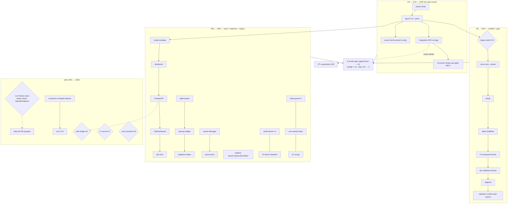

# SUPERB v13 — Ship-the-Spine Refresh (ALL open TODOs, Pareto re-ranked)

**Created:** 2026-11-06 07:10 · **Method:** pareto-planning skill — v12 unified plan re-verified
row-by-row against source before re-ranking; TODO_LIST (living source) re-read in full ·
**Predecessor:** `docs/planning/2026-11-06_01-48_SUPERB-v12-unified-execution-plan.md` (its
RANKING is superseded here; its task IDs carry forward unchanged — nothing is re-numbered) ·
**Companion evidence:** `docs/review/apps/2026-11-06_integration-burden-audit.md` (fleet demand),
`docs/review/libs/endpoints.md` (NEW since v12 — the H8 seam input) · **Supersedes nothing else**
— TODO_LIST stays the living source; this file is the ranked snapshot.

---

## 0. Staleness check performed (Step 0) — what shipped in the 5 hours since v12

The v12 plan is FIVE HOURS old and its Tier 1 is already ~16/17 tasks executed. Verified
against source, not asserted:

- **C1–C5 DONE** — `appkit/config` shipped as config **v0.1.0**; the v12-era "push held"
  state is RESOLVED: the tag is ON ORIGIN (`git ls-remote` verified 2026-11-06 06:59).
  Residual: the fresh-consumer proxy check for config was pending that push — re-run rides
  this plan (P9c).
- **P1–P7 DONE in-tree** — `preset/` carries spine + all four legs + conflict/env/metrics
  tests; suite GREEN under `-race -count=1` hermetic (17.2s, re-run this session); example
  `main.go` = 35 LOC (<40 acceptance). REMAINING: P8 (E2E via tags) + P9 (release train) —
  they are the new 1%.
- **R1a slice #94 DONE** — the invalid rg command in `docs/review/libs/httputil.md` is fixed
  by the 2026-11-06 errata block (re-verified by literal replay). The verify-block
  EXECUTION across all 12 libs (R1a/R1b) is still open.
- **H8 REFRAMED** — `httputil/endpoints` v0.1.0 (tagged 2026-11-06 05:27, AFTER v12 was
  written) shipped the family route-registry seam. The owner decision now has a concrete
  family wheel on the table; verdict + fit: `docs/review/libs/endpoints.md`. TODO_LIST W3
  row and the AGENTS decision register already carry the input.
- No other done-but-open rows found (R2 residual, S1, A1, G-CNT all re-verified open:
  no deps-guard CI job, no scaffold verdict doc, no recipe template, no counter script).

---

## 1. The Pareto thesis (refreshed)

The v12 thesis stands — the fleet needs the parts to compose themselves — and its first
half is now BUILT. The composing spine exists in-tree but UNRELEASED, and an unreleased
preset adopts nothing. The lever moved from "build the spine" to "SHIP it, then make every
new app land on it".

- **1% → 51%: ship the spine.** preset v0.1.0 release train (verify → same-train state
  sync → tag → pre-tag-checks → push → proxy check), then the integration E2E that pins it
  through PUBLISHED tags (P8), then the consumer heads-ups whose gate (core train tagged +
  pushed) is MET (OG2). Everything downstream — scaffold, recipes, adoption — lands on a
  published spine or on nothing.
- **4% → 64%: the scaffold + the mechanical gate.** Unchanged from v12: `appkit new` /
  template repo (kills the 37/39 flake.nix copy-paste class) + the adoption-counter script
  (six-month success gate becomes a number). Now formally unblocked by the release.
- **20% → 80%: the wave + the proven batteries + the v11 repairs.** Swap recipes for the
  four heaviest hand-rollers (−~6,400 LOC mapped); D3 sqlite+migrations (16-app demand),
  D1 workers, C2R realtime Mount; the owner-picked v11 repair backlog keeps guards/docs
  honest while adoption starts; R2 wiring closes a twice-found drift class.
- **The other 20% → 100%: the httpx program, the composition refactor, gates and watches.**
  httpx B1–B9 with H8 reframed (decide the seam AGAINST the shipped family wheel), compose-
  Service-on-httputil.Server + core TLS, core v1 exit criteria, systemd backlog, owner
  gates, their-repo rows, standing watchlists (reactive — no fake tasks).

**Blocking user gates (unchanged, ranked at dependency position):** G2 auth bridge (OG1),
G3 scaffold shape (S1), G4 plan-revision convention (Z4), G5 machine go default (OG6),
G6 pma checklist (OG3), G7 CI secret (OG5). G1 (sequencing) is RESOLVED BY EXECUTION —
the C-train and P-train both shipped ahead of the repairs.

---

## 2. Comprehensive plan — ALL open TODOs as 30–100 min tasks

Sorted by tier, then impact/effort. `[OWNER]` = owner-only. IDs carry over from v12.

### Tier 1 — 1% → 51% (ship the spine) — 5 tasks, ~240m

| ID  | Task                                                                                          | Impact    | Effort | Source    |
| --- | --------------------------------------------------------------------------------------------- | --------- | ------ | --------- |
| P9a | preset pre-release verify: verify-all preset + module lint + example boot probe               | Very High | 30m    | V12 T1.6  |
| P9b | preset v0.1.0 train: CHANGELOG dating + AGENTS/FEATURES/TODO same-train sync + tag + push     | Very High | 60m    | V12 T1.6  |
| P9c | fresh-consumer proxy checks: preset v0.1.0 + config v0.1.0 close-out                          | High      | 30m    | Ritual §2 |
| P8  | integration E2E through PUBLISHED tags (preset boot→health→drain + env legs) + pin re-align    | High      | 90m     | V12 T1.5b |
| OG2 | post consumer heads-ups (drafts voice-checked; core v0.10.0 tagged+pushed → gate MET)         | Medium    | 30m     | TL W2     |

### Tier 2 — 4% → 64% (scaffold + mechanical gate) — 8 tasks, ~580m (unchanged from v12)

| ID    | Task                                                              | Impact | Effort | Source    |
| ----- | ----------------------------------------------------------------- | ------ | ------ | --------- |
| S1    | Scaffold shape verdict: template repo vs generator (short doc)    | High   | 60m    | V12 T3.1  |
| S2    | Template: cmdguard serve verb → preset + typed flags              | High   | 90m    | V12 T3.2a |
| S3    | Template: templ + templ-components skeleton + assets              | High   | 60m    | V12 T3.2b |
| S4    | Template: flake.nix + .buildflow.yml                              | High   | 60m    | V12 T3.3a |
| S5    | Template: CI workflow + systemd unit + Dockerfile                 | High   | 60m    | V12 T3.3b |
| S6    | Template: README/CHANGELOG/AGENTS/FEATURES skeleton + boot probe  | Medium | 60m    | V12 T3.4  |
| S7    | Dogfood: scaffold one real app end-to-end, fix what hurt          | High   | 90m    | V12 T3.5  |
| G-CNT | Adoption-counter script (dual any/direct columns) + wiring        | High   | 60m    | SR §f7    |

### Tier 3 — 20% → 80% (wave + proven batteries + repairs) — 20 tasks, ~1490m (unchanged except R1a)

| ID  | Task                                                                                                       | Impact | Effort | Source         |
| --- | ---------------------------------------------------------------------------------------------------------- | ------ | ------ | -------------- |
| A1  | Swap-recipe template in docs/recipes/ (inventory→map→order→LOC→green)                                      | High   | 60m    | TL V12d        |
| A2  | dnsblockd swap recipe (−~1,600 LOC mapped)                                                                 | High   | 60m    | V12 T4.2       |
| A3  | ChastityAPI swap recipe (−~4,800 LOC class)                                                                | High   | 90m    | V12 T4.3       |
| A4  | PapDashboard security swap recipe (M17 follow-up)                                                          | Medium | 45m    | V12 T4.4       |
| A5  | pbx-lens cmdguard migration recipe (fatalCode → exit contract)                                             | Medium | 45m    | V12 T4.5       |
| D3a | SQLite ops kit: design + lease matrix (spec D3)                                                            | High   | 90m    | TL W8          |
| D3b | SQLite ops kit: backup round-trip + ledger atomicity                                                       | High   | 90m    | TL W8          |
| D3c | Embedded-migration helper + versioning round-trip (16-app demand)                                          | High   | 90m    | V12 T5.2       |
| D1a | Worker supervisor: Manager port-from (quotaboard hooks + ChastityAPI joins)                                | High   | 90m    | TL W8          |
| D1b | Worker supervisor: pools, panic-restart, start-during-shutdown joins                                       | High   | 90m    | TL W8          |
| C2R | realtime: Mount one-liner + SubscribeFolded discriminator test (spec C2)                                   | Medium | 90m    | TL W8          |
| R1a | v11 repair: verify-blocks batch 1 (libs 1–6) executed as written + failures fixed (rg fix DONE)            | Medium | 90m    | TL R1          |
| R1b | v11 repair: verify-blocks batch 2 (libs 7–12) + fix failures                                              | Medium | 90m    | TL R1          |
| R1c | ServerTiming real bench baseline (-benchtime 1s -count 6, quiet-run) + AGENTS perf + total assertion       | Medium | 60m    | TL R1          |
| R1d | hub.go:80 doc-const note + libs index mobile screenshot + dprint coverage                                  | Low    | 45m    | TL R1          |
| R1e | Integration go-retry MVS proof + example-smoke vs new stack                                               | Medium | 60m    | TL R1          |
| R2  | deps-guard: CI job + pre-commit wiring (script already shipped + pre-tag-wired)                            | Medium | 30m    | TL R2 residual |
| R3  | error-family adoption batch (recipe + cross-links + errorfamilytest asserts + WrapOnce/WithContext sites)  | Medium | 90m    | TL R3          |
| R4a | Server-Timing: handler-phase README recipe + dependabot coverage check                                     | Medium | 45m    | TL R4          |
| R4b | Server-Timing composition E2E at next integration re-pin (rides P8's re-pin)                               | Medium | 30m    | TL R4          |
| R5a | httpx shortlist verdicts: CORS battery row + trusted-proxy keying + compression/Logging verdicts           | Medium | 60m    | TL R5          |

### Tier 4 — the other 20% → 100% (program builds, gates, watches) — 31 tasks (unchanged except H8)

| ID  | Task                                                                                           | Impact | Effort | Source        |
| --- | ---------------------------------------------------------------------------------------------- | ------ | ------ | ------------- |
| H1  | httpx B1 ResultHandler family + errorpages classification-parity test                          | High   | 100m   | TL W8         |
| H2  | httpx B2 bind + validation                                                                     | High   | 60m    | TL W8         |
| H3  | httpx B9 no-leak error responses (leak matrix test)                                            | High   | 60m    | TL W8         |
| H4  | httpx B3 ResponseWriter wrapper contract (AssertForwardsInterfaces)                            | Medium | 45m    | TL W8         |
| H5  | httpx B4 conditional GET on go-etag                                                            | Medium | 60m    | TL W8         |
| H6  | httpx B5 content negotiation on go-codec (reconcile w/ endpoints + Language precedents)        | Medium | 90m    | TL W8         |
| H7  | httpx B7 per-route write deadlines                                                             | Medium | 60m    | TL W8         |
| H8  | `svc.Routes()` seam decision [OWNER, NEW INPUT: family wheel exists] + B6 golden + B8 docs feed | Medium | 60m    | TL W8         |
| X1  | Compose Service on httputil.Server refactor (fresh-server-per-Start swap, six phase logs kept) | High   | 100m   | TL R9         |
| X2  | Core TLS on the NewServerListener seam (G1)                                                    | Medium | 60m    | TL R9         |
| X3  | testkit satellite+integration migration (rides next core train)                                | Medium | 60m    | TL R6         |
| X4  | Core v1 exit criteria close-out (additions-empty tag pair watch + consumer overlap)            | High   | 60m    | TL R10        |
| Y1  | systemd small backlog (godoc Examples, WithStatus, Install→Hooks, README notes)                | Low    | 60m    | TL W4         |
| Y2  | D5 polite outbound client port (CV scanner layer)                                              | Medium | 100m   | TL W8         |
| Y3  | D7 idempotency adopt-wire decision (go-idempotency vs 165-LOC port)                            | Medium | 30m    | TL W8         |
| Y4  | D4 atomic-write promote (floor ≥v0.5.1) + D6 webhook sender                                    | Medium | 90m    | TL W8         |
| Y5  | F4 config hot-reload (validate-gate → atomic swap) — demand-gated                              | Low    | 100m   | TL W8         |
| Y6  | C1 realtime drop counters + C3 per-subscriber auth/filter                                      | Medium | 90m    | TL W8         |
| OG1 | Auth-bridge decision memo (usermgmt recipe vs security session) — G2                           | High   | 90m    | TL [OWNER]    |
| OG3 | pma owner checklist walkthrough (4 dossier decisions + working-file ignore)                    | High   | 30m    | TL [OWNER]    |
| OG4 | pkg.go.dev flightrecorder re-tag ritual (last resort)                                          | Low    | 30m    | TL [OWNER]    |
| OG5 | CI SSH secret restore (structure-linter leg unblocks)                                          | High   | 5m     | TL P1 [OWNER] |
| OG6 | Machine go default ≥1.27.2 decision (retires GOTOOLCHAIN prefix)                               | Medium | 15m    | TL open-q [OWNER] |
| Z1  | Process lessons entry: asserted-vs-computed counts (crush-config repo)                         | Medium | 30m    | SR §f12       |
| Z2  | dprint html coverage decision (plugin or documented exclusion)                                 | Low    | 30m    | SR §f13       |
| Z3  | CV deep-read + single-membership archetype matrix (audit appendix)                             | Medium | 90m    | SR §f8/14     |
| Z4  | TODO preset row: dual-number citation fix + plan-revision convention ruling — G4               | Low    | 15m    | SR §f15/20    |
| Z5  | pdg tool polish batch (their repo: header relabel, doctor, member-key fix)                     | Low    | 90m    | TL W11        |
| Z6  | samber/do: file the lazy-healthcheck upstream ask + do-bridge verdict                          | Low    | 30m    | TL W10 [OWNER filing] |
| Z7  | cqrs EventConfig opt-ins README recipe (demand-gated path)                                     | Low    | 30m    | TL W9         |

### Standing watches (reactive — intentionally NOT decomposed)

go-sse breaking `ssetest` release; go-etag v1.0.0 root-shim; go-idempotency CHANGELOG
hygiene; httputil server_timing pairing + apidiff gate; realtime subscribe-before-flush;
go-flightrecorder#2 cooldown combinator; SSE-hub convergence; cordis triggers; nixpkgs go
drift; pkg.go.dev renders; otel v1.48 train / semconv flip / OTLP-logs gate / SigNoz
instance; consumer tags firing the claims guard; pma daemon cadence. Full statements in
TODO_LIST P3 — they fire on triggers, not schedules.

---

## 3. Fine plan — ≤12 min per task (executable slices)

Tiers 1 is cut to the bone (fresh — it is new work); Tiers 2–4 carry v12's slice tables
(minus the done #94). Train-bound builds get their first executable slice; the rest of each
train is micro-cut at ITS sprint start (cutting all of httpx today would be a brainstorm,
not a plan).

### Tier 1 slices (fresh)

| #  | Micro-task (≤12m)                                                       | Parent |
| -- | ----------------------------------------------------------------------- | ------ |
| 1  | verify-all.sh preset + golangci-lint from module dir                    | P9a    |
| 2  | Example boot + graceful-stop probe (example-smoke or manual probe)      | P9a    |
| 3  | preset CHANGELOG: Planned → dated [0.1.0]                               | P9b    |
| 4  | AGENTS release-state: preset bullet + latest-list + module count        | P9b    |
| 5  | FEATURES.md: preset v0.1.0 rows                                         | P9b    |
| 6  | TODO_LIST row 45 close-out + pin-drift guard run                        | P9b    |
| 7  | git tag -a preset/v0.1.0 + pre-tag-checks.sh preset/v0.1.0              | P9b    |
| 8  | push master + tag; watch CI jobs incl. fleet-lint preset leg            | P9b    |
| 9  | Fresh-consumer proxy check: preset v0.1.0 (recipe as written)           | P9c    |
| 10 | Fresh-consumer proxy check: config v0.1.0 (held-check close-out)        | P9c    |
| 11 | integration/preset_e2e_test.go skeleton + documentedPins add            | P8     |
| 12 | E2E: preset boot → /health/ready 200 → drain flip through tags          | P8     |
| 13 | E2E: env legs on/off + explicit-code-wins through tags                  | P8     |
| 14 | Heads-up drafts: re-verify premise vs preset tag, then post             | OG2    |

### Tier 2 slices (v12 #54–72, unchanged)

| #  | Micro-task (≤12m)                                  | Parent |
| -- | -------------------------------------------------- | ------ |
| 54 | Verdict doc: template-repo vs generator table      | S1     |
| 55 | Verdict: pick + name maintenance owner             | S1     |
| 56 | Template repo scaffold or cmd/ skeleton            | S2     |
| 57 | Serve verb: typed flags struct                     | S2     |
| 58 | Serve verb: config.Load → preset.New wiring        | S2     |
| 59 | Generated main compiles + boots                    | S2     |
| 60 | templ + component skeleton page                    | S3     |
| 61 | Static asset route + CSP nonce posture             | S3     |
| 62 | flake.nix (ldflags version stamp pattern)          | S4     |
| 63 | .buildflow.yml (GOWORK off + skips mirroring repo) | S4     |
| 64 | CI workflow (matrix + guards minimal set)          | S5     |
| 65 | systemd unit Type=notify + Dockerfile              | S5     |
| 66 | README/CHANGELOG/AGENTS/FEATURES skeletons         | S6     |
| 67 | Boot probe script (build→boot→probe→graceful-stop) | S6     |
| 68 | Dogfood run: generate real toy app                 | S7     |
| 69 | Dogfood: time-to-first-route + pain list           | S7     |
| 70 | Counter script: per-app any/direct columns         | G-CNT  |
| 71 | Counter: six-month gate table output mode          | G-CNT  |
| 72 | Counter: wire pre-tag or CI + baseline commit      | G-CNT  |

### Tier 3 slices (v12 #73–109, minus done #94)

| #   | Micro-task (≤12m)                                           | Parent |
| --- | ----------------------------------------------------------- | ------ |
| 73  | Recipe template skeleton (5 sections)                       | A1     |
| 74  | dnsblockd inventory: internal/* vs battery map              | A2     |
| 75  | dnsblockd swap order + risk notes + LOC ledger              | A2     |
| 76  | ChastityAPI inventory: 8 auth files + logger/config/csp/sse | A3     |
| 77  | ChastityAPI battery map + JWT→usermgmt flag (G2)            | A3     |
| 78  | PapDashboard middleware→security matrix                     | A4     |
| 79  | pbx-lens fatalCode→cmdguard class table                     | A5     |
| 80  | D3 design note: lease semantics from spec                   | D3a    |
| 81  | Lease matrix red tests (takeover/stale/foreign/refcount)    | D3a    |
| 82  | Lease implementation green                                  | D3a    |
| 83  | Backup round-trip test + impl                               | D3b    |
| 84  | Ledger atomicity test under concurrent writers              | D3b    |
| 85  | Migration helper: version table + up round-trip test        | D3c    |
| 86  | Migration helper: embed FS loader + dirty-state rejection   | D3c    |
| 87  | D1 design: Manager instance-shape (drop CV's global)        | D1a    |
| 88  | Register/StopAll port + goroutine-baseline test             | D1a    |
| 89  | WorkerPool[T] port                                          | D1b    |
| 90  | Panic-restart counter test                                  | D1b    |
| 91  | Start-during-shutdown join test (CV boot-warm lesson)       | D1b    |
| 92  | C2: wrapper-appends-mid-fold discriminator test             | C2R    |
| 93  | C2: SubscribeFolded + Mount wiring green                    | C2R    |
| 95  | Verify-blocks libs 1–3 executed + failures filed            | R1a    |
| 96  | Verify-blocks libs 4–6                                      | R1a    |
| 97  | Verify-blocks libs 7–9                                      | R1b    |
| 98  | Verify-blocks libs 10–12 + fix batch                        | R1b    |
| 99  | ST bench via quiet-run (pin cores) + capture                | R1c    |
| 100 | AGENTS perf section update + total assertion test           | R1c    |
| 101 | hub.go:80 doc note + mobile screenshot + dprint check       | R1d    |
| 102 | MVS proof command + example-smoke run                       | R1e    |
| 103 | deps-guard CI job yaml + actionlint                         | R2     |
| 104 | error-family: README recipe + example call                  | R3     |
| 105 | error-family: errorfamilytest asserts (otel+systemd)        | R3     |
| 106 | error-family: WrapOnce + WithContext sites                  | R3     |
| 107 | ST README handler-phase recipe (pre-write contract)         | R4a    |
| 108 | ST dependabot coverage check                                | R4a    |
| 109 | CORS battery row + trusted-proxy verdicts                   | R5a    |

### Tier 4 first slices (rest micro-cut at each train's sprint start)

| #   | Micro-task (≤12m)                                                           | Parent |
| --- | --------------------------------------------------------------------------- | ------ |
| 110 | httpx B1: parity-test oracle extraction from CV                             | H1     |
| 111 | httpx B1: ResultHandler signature sketch + red test                         | H1     |
| 112 | httpx B2: bind struct + validation hook sketch                              | H2     |
| 113 | httpx B9: leak matrix list (paths/SQL/hosts)                                | H3     |
| 114 | Compose refactor: fresh-server-per-Start swap plan re-read + test inventory | X1     |
| 115 | Compose refactor: composition-contract test list pinned first               | X1     |
| 116 | TLS: config fields + NewServerListener StartTLS seam check                  | X2     |
| 117 | v1 exit: criteria table refresh vs current state                            | X4     |
| 118 | OG1 auth memo: JWT hand-roller inventory table                              | OG1    |
| 119 | OG1 auth memo: usermgmt vs battery tradeoff + recommendation                | OG1    |
| 120 | Z1 lessons entry draft (2 same-day instances cited)                         | Z1     |
| 121 | Z2 dprint html: plugin probe + decision note                                | Z2     |
| 122 | Z3 CV deep-read: 13-module map + archetype tagging                          | Z3     |
| 123 | H8: re-read docs/review/libs/endpoints.md; frame the 3 seam options         | H8     |
| 124 | H8: if adopt — core svc.Routes exposure sketch (owner input doc)           | H8     |

---

## 4. Execution graph (mermaid)

**Default sequencing:** P9 train → P8 → OG2; then S-train + G-CNT; then R2 → R1 batches →
R3/R4/R5a interleaved with the A-wave; D/C2R trains; Tier 4 sprints. Owner gates execute
whenever answered — none block the P/S/R trains.

---

## 5. Verification

- Every code task: module verify loop (`scripts/verify-all.sh <mod>`), lint from module dir,
  `-race -count=1` hermetic; release tasks ride the full release ritual (API diff,
  pre-tag-checks, fresh-consumer proxy check, integration re-pin).
- Plan-level: adoption-counter baseline (G-CNT) lands in-tree; the six-month gate becomes a
  command, not a claim.
- This plan's own claims: every carried row re-verified against TODO_LIST 2026-11-06 ~07:00
  and source (suite run, ls-remote, script/dir greps); corrections recorded in §0.
