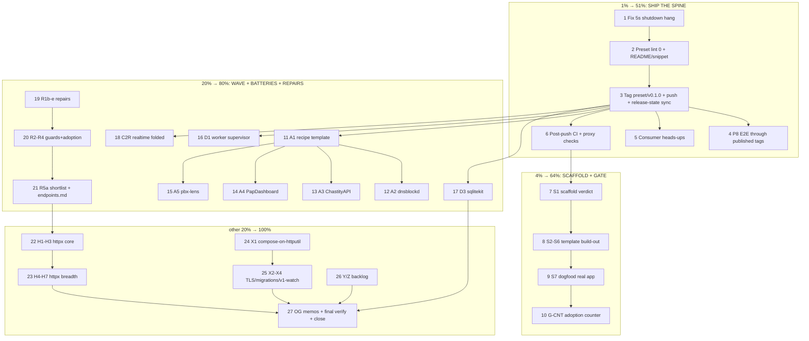

# SUPERB v13 — Ship the Spine (refresh plan: preset release, scaffold, migration wave)

**Created:** 2026-11-06 07:46 · **Method:** pareto-planning skill (comprehensive 30–100m table + ≤12m micro table) · **Inputs:** TODO_LIST.md (2026-11-06 state), the v12 unified plan (`2026-11-06_01-48_SUPERB-v12-unified-execution-plan.md`), session reports 06:22 + 06:59, the preset design note, and live repo truth verified this session (origin ls-remote, git status, preset file mtimes) · **Supersedes:** nothing — TODO_LIST stays the living source; this is the ranked snapshot for the v13 execution window.

**Push policy: RESOLVED.** The 07:02 session pushed master + `config/v0.1.0` (origin-verified) under the owner's standing execute directive; the owner's current directive explicitly orders commit + push. All remaining trains push as they complete.

## Errata recorded at creation (Step 0 staleness findings)

1. **The TODO_LIST row for the preset spine claims "suite GREEN under -race hermetic (17.2s)"** — one green run of a suite with a KNOWN ~1/3 intermittent failure (the 5s listener_close hang, session-4 report §b1). The hang is unfixed on disk (preset sources untouched since 06:53). Treat the suite as NOT green until V13-1 lands; the green claim was a lucky pass, not a fix.
2. **The TODO_LIST/AGENTS edits referenced this plan as `2026-11-06_07-10_SUPERB-v13-ship-the-spine-refresh-plan.md`** — a file the interrupted 07:02 session never wrote. This document is that plan; the TODO reference is corrected to this filename in the same commit.
3. **config v0.1.0 push-hold: RESOLVED** (tag on origin, ls-remote verified 07:44). The AGENTS narrative already reflects it.

---

## 1. Pareto thesis (what moves the fleet)

The 2026-11-06 audit's measured truth still governs: blocks adopted everywhere (18–22 direct), composition layer least-adopted in its own stack (go-appkit 6/39 direct); 22 apps hand-roll config, 16 migrations, 10 JWT, 9 SSE, 9 shutdown. The fleet does not need more parts — the parts must compose themselves. v12 built the composition (config + preset, 95% done); v13 SHIPS it and turns it into the default path.

- **1% → 51% — SHIP THE SPINE.** Root-cause the last preset bug, polish, tag `preset/v0.1.0`, push, prove it through PUBLISHED tags (P8), tell both consumers. The spine exists; unreleased it moves nothing.
- **4% → 64% — SCAFFOLD + THE MECHANICAL GATE.** Template repo (cmdguard serve → preset, templ, flake/buildflow, CI/systemd/Dockerfile) kills the new-app copy-paste class (37/39 flakes, 20 buildflows); the adoption counter turns the six-month success gate (beat setup's 10 direct) into a number.
- **20% → 80% — THE WAVE + PROVEN BATTERIES + REPAIRS.** Swap recipes for the four heaviest hand-rollers (−~6,400 LOC mapped), D3 sqlite+migrations (16-app demand), D1 workers, C2 realtime Mount; the v11 repair batch keeps guards/docs honest.
- **The other 20% → 100% — PROGRAM BUILDS + GATES + WATCHES.** httpx B1–B9 (H8 fed by the NEW `httputil/endpoints` v0.1.0 input), compose-Service-on-httputil + TLS, Y/Z backlog, owner gates, final verify-all.

**Owner-gated (prepared, never agent-decided):** G2 auth bridge (OG1), pma checklist (OG3), pkg.go.dev re-tag (OG4), CI SSH secret (OG5), machine go ≥1.27.2 (OG6), H8 `svc.Routes()` seam (feed: `docs/review/libs/endpoints.md`), G4 plan-revision convention, catalog templ migration (upstream repo — assumed out-of-scope, HOLDS + held_pins make the wait safe).

---

## 2. Comprehensive plan — ALL TODOs, 30–100 min each, sorted by importance/impact/effort/customer-value

| #   | Task                                                                                                  | Tier | Impact | Effort | Customer value                                            |
| --- | ---------------------------------------------------------------------------------------------------- | ---- | ------ | ------ | --------------------------------------------------------- |
| 1   | **Preset ship-blocker:** root-cause + fix the intermittent 5s `listener_close` hang (goroutine dump mid-window; pin with regression test) | T1   | Very High | 60m  | Spine cannot tag while CI flakes ~1/3                      |
| 2   | **Preset P7 polish:** golangci-lint 0 from module dir; README truth pass (hooks passthrough + grammar) + scratch-module snippet compile; wire preset example into `example-smoke.sh` if enumerated | T1   | High   | 45m    | A preset that docs what it ships                           |
| 3   | **Preset P9 release train:** CHANGELOG [0.1.0], API-diff record, fast guards, tag `preset/v0.1.0`, pre-tag-checks, PUSH; release-state sync (AGENTS 13 released, FEATURES, TODO_LIST, ci.yml "eleven released"→twelve) | T1   | Very High | 60m  | THE deliverable of v12/v13                                 |
| 4   | **P8 integration E2E through PUBLISHED tags:** preset boot + two legs + graceful stop from a pinned-tag integration test; unpin-blocked legs noted | T1   | High   | 60m    | Consumers get proxy-proven composition                     |
| 5   | **Consumer heads-ups:** refresh both drafts (Server-Timing header + preset announcement); stage for posting at core-tag | T1   | High   | 30m    | The two known consumers hear it from us                    |
| 6   | **Post-push verification:** CI green on final commit (every new job ran), fresh-consumer proxy checks for v0.10.0 + config + preset; unset insteadOf global rewrite after tag resolution verified | T1   | High   | 45m    | Tags that consumers can actually resolve                   |
| 7   | **S1 scaffold verdict doc:** template-repo vs generator (G3 default: template repo); include cmdguard serve verb contract | T2   | High   | 45m    | Unblocks S2–S7                                             |
| 8   | **S2–S6 template build-out:** cmdguard serve → preset; templ+templ-components skeleton+assets; flake.nix + .buildflow.yml; CI workflow + systemd unit + Dockerfile; README/CHANGELOG/AGENTS/FEATURES skeletons + boot-probe script | T2   | High   | 90m    | Kills the 37/39 flake copy-paste class                     |
| 9   | **S7 dogfood:** scaffold ONE real app end-to-end (boot + graceful-stop probe), fix what hurt | T2   | High   | 90m    | Template proven on a real consumer                         |
| 10  | **G-CNT adoption counter:** dual any/direct columns, gate table (target: beat setup's 10 direct), wire pre-tag-or-CI | T2   | High   | 45m    | Six-month success gate becomes a number                    |
| 11  | **A1 swap-recipe template** in `docs/recipes/` (inventory → map → order → LOC → green) | T3   | High   | 45m    | Wave becomes repeatable                                    |
| 12  | **A2 dnsblockd recipe** (−~1,600 LOC mapped: internal/otel 777, sdnotify 59, middleware ~590, sampling 206) | T3   | High   | 60m    | Heaviest per-file hand-roll                                |
| 13  | **A3 ChastityAPI recipe** (−~4,800 LOC class: auth 1,068 / logger 541 / config 409 / csp / captcha / sse) | T3   | High   | 90m    | Largest total deletion                                      |
| 14  | **A4 PapDashboard security swap recipe** (M17 follow-up; their hand-rolls ≈ security v0.2.0 battery set) | T3   | Medium | 45m    | Consumer #2 on-ramp                                        |
| 15  | **A5 pbx-lens cmdguard migration recipe** (fatalCode exit contract IS the cmdguard contract) | T3   | Medium | 45m    | Fleet CLI consistency                                      |
| 16  | **D1 worker supervisor** (port-from quotaboard hooks + ChastityAPI joins; pools, panic-restart counts, start-during-shutdown joins; ×100 goroutine-baseline) | T3   | High   | 90m    | 9-app shutdown hand-roll demand                            |
| 17  | **D3 sqlitekit** (Open+WithLease lease matrix, Backup VACUUM INTO round-trip, OpenLedger atomicity, embedded-migration helper + versioning round-trip, SetMaxOpenConns(1) doc) | T3   | High   | 90m    | 16-app migration hand-roll demand                          |
| 18  | **C2R realtime Mount one-liner + SubscribeFolded discriminator test** (spec C2) | T3   | Medium | 60m    | 9-app SSE hand-roll demand                                 |
| 19  | **R1b–e v11 repairs batch 2:** execute verify-blocks libs 7–12 as written + fix failures; ServerTiming real bench baseline (quiet-run, -count 6) + AGENTS perf + total assertion; hub.go:80 doc-const note + libs index mobile screenshot + dprint coverage decision; go-retry MVS proof + example-smoke vs new stack | T3   | Medium | 90m    | Guards/docs stay honest                                    |
| 20  | **R2–R4:** deps-guard CI job + pre-commit wiring; error-family adoption batch (recipe, BodyLimit cross-link, errorfamilytest asserts, WrapOnce/WithContext sites); Server-Timing handler-phase recipe + dependabot coverage | T3   | Medium | 90m    | Repair backlog burned down                                 |
| 21  | **R5a + H8 feed:** httpx shortlist verdicts (CORS row, trusted-proxy keying, compression/logging adopt-or-decline); write `docs/review/libs/endpoints.md` feeding the owner's B6/B8 seam decision | T3   | Medium | 60m    | httpx program de-risked; owner gate fed                    |
| 22  | **H1–H3 httpx core:** B1 ResultHandler family + errorpages classification-parity test; B2 bind+validation; B9 no-leak error responses (leak matrix) | T4   | High   | 100m   | Handler DX battery, parity-pinned                          |
| 23  | **H4–H7 httpx breadth:** B3 ResponseWriter contract (AssertForwardsInterfaces); B4 conditional GET on go-etag; B5 content negotiation on go-codec; B7 per-route write deadlines | T4   | Medium | 100m   | Composition-mission consequence #2                          |
| 24  | **X1 compose-Service-on-httputil refactor:** fresh-server-per-Start swap vs v1.7.0+ ownership semantics, six phase logs kept, composition-contract suite green | T4   | High   | 100m   | The repo's own composition story closed                    |
| 25  | **X2–X4:** core TLS on the seam; testkit satellite+integration migrations (ride trains); core v1 exit-criteria watch refresh (additions-empty anchor re-check) | T4   | Medium | 90m    | v1 path stays armed                                        |
| 26  | **Y/Z backlog:** systemd small backlog; polite/idempotency/atomic-write/webhook verdicts; realtime drop counters; Z1 lessons commit, Z3 CV deep-read, Z5 pdg polish pointers, Z7 cqrs recipe, AGENTS pin-hold one-liner | T4   | Medium | 90m    | Debt paid as we go                                         |
| 27  | **OG memos + final gate:** owner memos (auth bridge, pma checklist, catalog ask, CI secret, machine go, H8); final `scripts/verify-all.sh` (13 modules + integration); final release-state sync; session-close ritual + /tmp cleanup | T4   | High   | 90m    | Program ends verified, not assumed                         |

**Effort total:** ~28h. T1 ≈ 5h, T2 ≈ 4.5h, T3 ≈ 13h, T4 ≈ 9h (overlapping trains).

---

## 3. Micro plan — ALL TODOs, ≤12 min each, sorted by importance/impact/effort/customer-value

| #  | Micro-task (≤12m)                                                                                       | Parent | Est |
| -- | ------------------------------------------------------------------------------------------------------- | ------ | --- |
| 1  | Hang: run `errorpages+security+spine` combo with goroutine dump captured mid-window (SIGQUIT timer)      | 1      | 12m |
| 2  | Hang: read dump, name the stuck conn/reader; write one-paragraph root-cause note                         | 1      | 12m |
| 3  | Hang: implement fix (suspects: default-client keep-alive in spine loop; client-per-request pooling)      | 1      | 12m |
| 4  | Hang: full suite `-race -count=3` ×3 consecutive green; add regression pin if preset-side                | 1      | 12m |
| 5  | Preset lint: `cd preset && golangci-lint run ./...` — triage every finding                                | 2      | 12m |
| 6  | Preset lint: fix findings (nlreturn/gci/noctx/errcheck classes) to 0                                     | 2      | 12m |
| 7  | README: hooks passthrough + final Config shape truth pass                                                | 2      | 12m |
| 8  | README: scratch-module compile check of the quick-start snippet (local replace)                          | 2      | 12m |
| 9  | `example-smoke.sh`: check enumeration; add preset example if listed; local run green                      | 2      | 12m |
| 10 | Preset CHANGELOG: date [0.1.0], write the entry (spine, legs, hooks passthrough, RegisterHealth fix)     | 3      | 12m |
| 11 | API-diff record: `go doc -all` diff vs empty (new module — record the surface)                           | 3      | 12m |
| 12 | Fast offline guard sweep (directives, dependabot, charter, golangci-configs, agents-deps, art-dupl)      | 3      | 12m |
| 13 | Tag `preset/v0.1.0` (annotated, semantic delta) + `pre-tag-checks.sh preset/v0.1.0`                      | 3      | 12m |
| 14 | Push master + tag; release-state sync AGENTS (13 released, latest-per-module +preset)                    | 3      | 12m |
| 15 | Release-state sync: FEATURES preset section, TODO_LIST, ci.yml "eleven"→twelve comment                   | 3      | 12m |
| 16 | P8: scratch integration test module pinning preset v0.1.0 — boot + healthz + one leg + graceful stop     | 4      | 12m |
| 17 | P8: promote into `integration/` behind the pin charter (published tags only), suite green                | 4      | 12m |
| 18 | Heads-ups: update cqrs-htmx draft (+preset announcement)                                                 | 5      | 12m |
| 19 | Heads-ups: update PapDashboard draft (+preset announcement)                                              | 5      | 12m |
| 20 | Post-push: `gh run list` — every job ran, matrix green on final commit                                   | 6      | 12m |
| 21 | Post-push: fresh-consumer proxy check v0.10.0 (recipe doc)                                               | 6      | 12m |
| 22 | Post-push: fresh-consumer proxy checks config v0.1.0 + preset v0.1.0                                     | 6      | 12m |
| 23 | Unset global insteadOf; verify preset hermetic build resolves via origin                                 | 6      | 12m |
| 24 | S1: write the verdict doc (template repo wins: go-website-template pattern; generator declined)          | 7      | 12m |
| 25 | S2: template repo init + cmdguard serve verb skeleton calling preset.New                                 | 8      | 12m |
| 26 | S2: typed flags → preset.Config mapping + env passthrough                                                | 8      | 12m |
| 27 | S3: templ + templ-components skeleton page + assets dir                                                  | 8      | 12m |
| 28 | S4: flake.nix + .buildflow.yml minimal                                                                   | 8      | 12m |
| 29 | S5: CI workflow (matrix pattern) + systemd unit + Dockerfile                                             | 8      | 12m |
| 30 | S6: README/CHANGELOG/AGENTS/FEATURES skeletons + boot-probe script                                       | 8      | 12m |
| 31 | S6: template self-test (probe script green on scaffolded copy)                                           | 8      | 12m |
| 32 | S7: pick the real app; scaffold from template                                                            | 9      | 12m |
| 33 | S7: port one route + boot probe; record what hurt                                                        | 9      | 12m |
| 34 | S7: fix template findings; template repo commit                                                          | 9      | 12m |
| 35 | G-CNT: script skeleton (fleet scan: any/direct columns, per repo + total)                                | 10     | 12m |
| 36 | G-CNT: gate table (today 6/39; target >10 direct by 2027-05) + guard wiring (pre-tag)                    | 10     | 12m |
| 37 | G-CNT: run + record baseline in TODO_LIST success-metric row                                             | 10     | 12m |
| 38 | A1: write the swap-recipe template (inventory→map→order→LOC→green checkboxes)                            | 11     | 12m |
| 39 | A2: dnsblockd inventory pass (read internal/otel, sdnotify, middleware, sampling)                        | 12     | 12m |
| 40 | A2: write the dnsblockd recipe (battery map + order + LOC table)                                         | 12     | 12m |
| 41 | A3: ChastityAPI inventory pass (auth/logger/config/csp/captcha/sse)                                      | 13     | 12m |
| 42 | A3: write the ChastityAPI recipe                                                                         | 13     | 12m |
| 43 | A3: recipe compile-notes (usermgmt/auth-bridge rows marked owner-gated)                                  | 13     | 12m |
| 44 | A4: write the PapDashboard security-swap recipe                                                          | 14     | 12m |
| 45 | A5: write the pbx-lens cmdguard recipe (fatalCode → exit contract map)                                   | 15     | 12m |
| 46 | D1: worker design note (Manager port-from + joins semantics)                                            | 16     | 12m |
| 47 | D1: supervisor core (Start/Shutdown, panic-restart counting)                                             | 16     | 12m |
| 48 | D1: pools + start-during-shutdown join tests                                                             | 16     | 12m |
| 49 | D1: ×100 goroutine-baseline stability test + README                                                      | 16     | 12m |
| 50 | D3: sqlitekit design note (lease matrix, why MaxOpenConns(1))                                            | 17     | 12m |
| 51 | D3: Open+WithLease + lease-matrix tests                                                                  | 17     | 12m |
| 52 | D3: Backup (VACUUM INTO) round-trip test                                                                 | 17     | 12m |
| 53 | D3: OpenLedger atomicity test                                                                            | 17     | 12m |
| 54 | D3: embedded-migration helper + versioning round-trip                                                    | 17     | 12m |
| 55 | C2R: realtime FoldedSource sketch + subscribe-folded discriminator                                       | 18     | 12m |
| 56 | C2R: discriminator test + Mount one-liner doc                                                            | 18     | 12m |
| 57 | R1b: execute verify-blocks libs 7–9 as written; fix failures                                             | 19     | 12m |
| 58 | R1b: execute verify-blocks libs 10–12; fix failures                                                      | 19     | 12m |
| 59 | R1c: ServerTiming bench (quiet-run, pinned cores, -benchtime 1s -count 6)                                | 19     | 12m |
| 60 | R1c: record AGENTS perf baseline + add `total` assertion to server-level test                            | 19     | 12m |
| 61 | R1d: hub.go:80 doc-const note + libs index mobile screenshot                                             | 19     | 12m |
| 62 | R1d: dprint coverage decision (plugin vs documented exclusion)                                           | 19     | 12m |
| 63 | R1e: integration `go list -m all \| grep go-retry` MVS proof                                             | 19     | 12m |
| 64 | R1e: example-smoke vs the ServerTiming stack run                                                         | 19     | 12m |
| 65 | R2: deps-guard CI job + pre-commit wiring + one green run                                                | 20     | 12m |
| 66 | R3: RegisterClassifications README recipe + BodyLimit cross-link + example call                          | 20     | 12m |
| 67 | R3: errorfamilytest asserts in otel/systemd tests                                                         | 20     | 12m |
| 68 | R3: WrapOnce + WithContext at the mapped sites                                                           | 20     | 12m |
| 69 | R4: Server-Timing handler-phase README recipe (pre-write contract) + dependabot check                    | 20     | 12m |
| 70 | R5a: httpx shortlist verdicts (CORS row, trusted-proxy, compression, LoggingFromContext)                 | 21     | 12m |
| 71 | R5a: write `docs/review/libs/endpoints.md` (feeds H8 owner decision)                                     | 21     | 12m |
| 72 | H1: httpx module skeleton + design note (B1 error taxonomy = errorpages parity)                          | 22     | 12m |
| 73 | H1: ResultHandler family + parity test red→green                                                         | 22     | 12m |
| 74 | H2: bind + validation battery                                                                            | 22     | 12m |
| 75 | H3: no-leak error responses (leak matrix test)                                                           | 22     | 12m |
| 76 | H4: ResponseWriter wrapper contract + AssertForwardsInterfaces                                           | 23     | 12m |
| 77 | H5: conditional GET on go-etag (promote the indirect dep)                                                | 23     | 12m |
| 78 | H6: content negotiation on go-codec                                                                      | 23     | 12m |
| 79 | H7: per-route write deadlines                                                                            | 23     | 12m |
| 80 | X1: re-run the spike vs v1.7.0 ownership semantics; update swap plan-of-record                           | 24     | 12m |
| 81 | X1: the refactor (fresh-server-per-Start) + phase-log pins green                                         | 24     | 12m |
| 82 | X2: core TLS option on the seam + tests                                                                  | 25     | 12m |
| 83 | X3: testkit satellite+integration migrations (next core train)                                           | 25     | 12m |
| 84 | X4: v1 exit-criteria watch refresh (additions-empty anchor check)                                        | 25     | 12m |
| 85 | Y1: systemd small backlog (Examples, WithStatus note, Install→Hooks)                                     | 26     | 12m |
| 86 | Y2–Y4: polite/idempotency/atomic-write+webhook verdict notes                                             | 26     | 12m |
| 87 | Y5–Y6: config hot-reload verdict + realtime drop counters reference note                                 | 26     | 12m |
| 88 | Z1: lessons commit (asserted-vs-computed) in crush-config repo                                           | 26     | 12m |
| 89 | Z2–Z4: dprint decision row, CV deep-read, TODO citation fix + G4 note                                    | 26     | 12m |
| 90 | Z5–Z7: pdg polish pointers, do-bridge note, cqrs opt-in recipe                                           | 26     | 12m |
| 91 | AGENTS pin-hold one-liner ("holds ride held_pins in the same change")                                    | 26     | 12m |
| 92 | OG memos: auth-bridge (G2), catalog ask, CI secret, machine go, pma checklist — drafted                   | 27     | 12m |
| 93 | Final `scripts/verify-all.sh` full pass (13 modules + integration)                                       | 27     | 12m |
| 94 | Final release-state sync + session-close ritual (every new CI job ran)                                   | 27     | 12m |
| 95 | /tmp scratch cleanup + insteadOf verify-unset                                                            | 27     | 12m |

95 micro-tasks covering all 27 comprehensive tasks (every open TODO row in TODO_LIST P1/P2/P3 is reachable from a parent).

---

## 4. Execution graph (mermaid)

Key dependencies: the hang (1) gates the preset tag (3), which gates P8/proxy checks/recipes/batteries (all consumer-facing proof). S7 dogfood (9) needs the template (8) and ideally the tagged preset. X1 (24) is independent — schedule on the load-quiet window. H8/B6/B8 wait on the OWNER seam decision (fed by 21).

## 5. Standing watches (reactive — deliberately not tasked)

Unchanged from the v12 plan §"Standing watches" + the TODO_LIST P3 rows: go-sse breaking ssetest release (held_pins armed), go-etag root-shim, go-idempotency hygiene, semconv flip, otel v1.48, nixpkgs go drift, pkg.go.dev renders, consumer tags firing the claims guard, pma cadence.

## 6. Rules of engagement for this program

1. Every task ends VERIFIED (tests green / lint 0 / guard green as applicable) — "compiles" is not "works" (session-4 lesson d5).
2. Read the FULL log, never the tail (session-4 lesson d1).
3. No verschlimmbessern: preset stays batteries-only; core stays thin; no speculative rewrites; every change leaves the repo verifiably no worse.
4. Member go.mod changes ride release trains; pin holds ride held_pins in the same change.
5. Pushes: as trains complete (policy resolved); pre-tag-checks before every tag; never push a module whose go.mod carries a filesystem replace.
