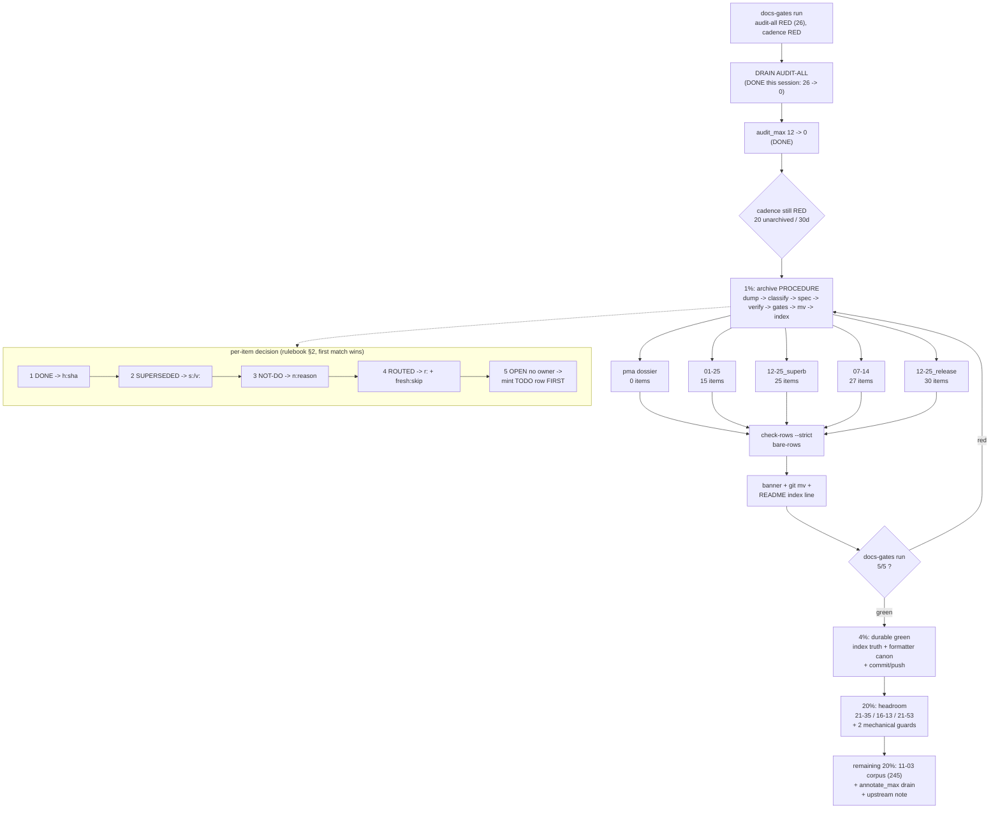

# SUPERB — Docs-Gates Green: Archive the Corpus Without Lying

**Date:** 2026-11-06 09:37 CET
**Trigger:** `docs-gates run .` red on TWO arms (`audit-all`, `cadence`); one was drained this
session (26 → 0), the other is untouched.
**Scope:** the docs-health corpus only — `docs-gates` battery, the status-report corpus, the
living docs it is checked against, and the guard that protects routed pointers.
**Out of scope (owned elsewhere):** the v13 product program (`docs/planning/2026-11-06_07-10_SUPERB-v13-ship-the-spine-refresh-plan.md`
— P8/P9 preset release, D1/D3/C2R batteries), the owner-gated CI secret (TODO P1), consumer notices.

**Current state on entry (verified on this tree):**

| Gate      | Verdict  | Detail                                                  |
| --------- | -------- | ------------------------------------------------------- |
| freshness | PASS     | newest report: 0 unharvested §f items                   |
| audit-all | PASS     | **0** unharvested across 108 reports (was 26)           |
| annotate  | PASS     | 244 findings, pin 255                                   |
| routing   | PASS     | 0 unrouted open rows                                    |
| cadence   | **FAIL** | 20 unarchived (threshold 15); oldest 30d (threshold 29) |

Already landed this session and not re-planned here: the 26-item drain, the two `ROADMAP`
bullets, the routed-destinations marker grammar fix, and `audit_max: 12 → 0`.

---

## 0. Definition of done (mechanical, no adjectives)

```console
docs-gates run .                      # 5/5 PASS
./scripts/check-routed-destinations.sh # exit 0, 0 dead, <= 1 unenforced
cat .docs-gates.json                   # audit_max 0; cadence thresholds UNCHANGED
./scripts/pre-tag-checks.sh            # fast+offline guards green (no tag created)
ls docs/status/*.md | grep -vc README  # <= 13 (wave 1+2 target; 15 is the gate floor)
```

Plus: every archived report carries the banner, every moved file passed `check-rows --strict`
and `bare-rows` BEFORE the move, `docs/status/README.md` lists it under `archived/`, and no
verdict cites a commit hash that does not resolve.

---

## 1. PARETO LADDER — what actually moves this

### 1% → 51%: **one repeatable archive procedure, executed 5 times**

There is exactly ONE red gate left, and its cost is not "archive 5 files" — it is "adjudicate
97 numbered items truthfully". Without a procedure, every report becomes a bespoke
archaeology dig; with one, each report is a 20-minute batch cycle.

The procedure (see §3) is: `dump-items` → classify each item against the report's own a/b/c
sections and the living docs → emit one TSV spec → `annotate.go status-items --verify` →
`check-rows --strict` + `bare-rows` → banner + `git mv` + index line → re-run both gates.

Cheapest 5 that satisfy BOTH arms (count 20 → 15 AND oldest 30d → 4d):

| Report                                | Unstruck §f items | Adjudications |
| ------------------------------------- | ----------------- | ------------- |
| `2026-10-07_11-00_pma-…dossier.md`    | 0 (no §f at all)  | 0             |
| `2026-11-06_01-25_cross-app-audit…`   | 15                | 15            |
| `2026-11-02_12-25_superb-v10-m3-m15…` | 25                | 25            |
| `2026-11-02_07-14_docs-health…`       | 27                | 27            |
| `2026-11-02_12-25_release-train…`     | 30                | 30            |
| **Total**                             | **97**            | **97**        |

Why 51%: this is the ONLY action that turns the last red row green, and it simultaneously
clears the age arm (the pma dossier is the 30-day outlier). Everything else in this plan
improves a gate that is already passing.

### 4% → 64%: **make the green durable instead of momentary**

- **`audit_max: 0`** — DONE this session; a drained ratchet left slack is not a ratchet.
- **Status index truth** — `docs/status/README.md` is the canonical tree and currently
  mis-names one report and omits 11 rows; a stale index is how the next session re-treads
  this work.
- **Formatter canon** — `annotate → check-rows → format → check-rows` over every moved file;
  a formatter is a cooperating rewriter that does not know about markers. This is the class
  that damaged 7 archived files in one pass before.
- **Commit + push** the whole batch as logical commits, so the corpus state is shareable.

### 20% → 80%: **headroom + the two mechanical guards**

- **Wave 2** (3 more archives, 136 adjudications) → 12 unarchived, so tomorrow's report does
  not re-trip the gate at exactly 15.
- **`scripts/docs-annotate-pass.sh`** — the four-step canon as one command (today it is a
  paragraph of prose that a session must remember; that is why it was skipped this session).
- **Index liveness leg** — every filename listed in `docs/status/README.md` must exist on
  disk (catches the `…-routing-status.md` class mechanically).
- **`fresh:skip` convention documentation** — the mechanism had ZERO prior uses in this repo;
  undocumented, it reads as vandalism to the next session.
- **Close the last unenforced routed marker** (`Z2–Z7` → v13 plan path) to a form the guard
  enforces.

### Remaining 20% → 100%: **corpus completion + ratchet drain**

- **Wave 3**: the five `2026-11-03` reports (245 §f items; 45–50 each) → 7 unarchived.
- **Wave 4** (after the v13 program stops writing): the `2026-11-06` session reports and this
  plan's own report.
- **`annotate_max` drain**: 244 tolerated findings → fix the `G/uniform` table-strike class in
  the worst archived offenders, then lower the pin.
- **Upstream note** the `routed ≠ resolved` semantic gap between `docs-freshness` and
  `docs-routing` (routed rows count as resolved for tables, but not for freshness without a
  skip marker) — found at source level this session.
- The long-tail items from the 2026-11-06 09:32 report §f that are still open (dprint
  verification of the new marker suffix, threshold-override rationale docs, legacy `TODO row N`
  anchor sweep).

---

## 2. THE ADJUDICATION RULEBOOK (this is what prevents fabricated verdicts)

For each open §f item, in this order, and STOP at the first match:

1. **DONE** — the item's work exists on disk AND you can name the commit that put it there
   (`git log --diff-filter=A -- <file>`; `git log -S <string>`; or a semantic commit found via
   `git log --grep`). Write `h:<sha>`. Never cite a daemon commit you have not opened.
2. **SUPERSEDED / MOOT** — a later artifact replaced it (plan row executed, decision doc
   ruled, report's own errata). Write `s:<successor>` or `v:<evidence>`. Cite the successor path.
3. **DELIBERATELY NOT DONE** — a recorded ruling or a structural reason (upstream location,
   dedicated job exists). Write `n:<reason>` and make the reason checkable in one grep.
4. **ROUTED** — the work is real and still open. Write `r:` naming the OWNING artifact, then
   append `<!-- fresh:skip: routed in <venue> -->`. Use one of the two guard-safe forms:
   - `TODO P1|P2|P3 — <fragment present in the section>` (guard resolves by section existence), or
   - a repo path to the owning doc/plan (guard enforces existence).
     **Never** write `TODO_LIST P3 …` — the guard parses that as venue+fragment and demands the
     literal first five words inside `TODO_LIST.md`.
5. **STILL OPEN, NO OWNER** — do NOT archive the report yet. Mint the TODO/ROADMAP row first,
   then route. An unowned open item is the reason the archive ritual exists.

Batch mechanics: generate the spec from `emit-keys`/`dump-items`, never from memory;
`status-items --verify` prints every matched line — read it IN FULL before writing.

---

## 3. THE ARCHIVE PROCEDURE (repeat per report, ~20 min once items are decided)

```console
A=/home/lars/.config/crush/skills/docs-health/assets/annotate
docs-gates freshness . --dump-items docs/status/<report>.md     # 1. what is open
$A emit-keys docs/status/<report>.md <line>…                    # 2. exact spec keys
$A status-items --verify docs/status/<report>.md spec.tsv       # 3. read every match
$A status-items docs/status/<report>.md spec.tsv                # 4. apply (atomic per file)
$A check-rows --strict docs/status/<report>.md                  # 5. archive gate (BEFORE mv)
$A bare-rows docs/status/<report>.md                            # 6. archive gate (BEFORE mv)
# format pass, then check-rows AGAIN (formatter re-write guard)
git mv docs/status/<report>.md docs/status/archived/            # 7. only after 5+6 are clean
# 8. banner at the top: > **Live remainder:** … naming the owning sections/rows
# 9. index: remove from README "Current", add to the archived manifest with one-line classification
```

---

## 4. COARSE PLAN — 30–100 min per task (all of it)

Ordering key: **Impact** (gate movement / durability) × **Customer value** (a future session
or consumer can trust the docs) ÷ **Effort**. P-tiers follow §1.

| ID    | Task                                                                                                                                    | Tier | Impact | Effort  | Customer value | Depends on |
| ----- | --------------------------------------------------------------------------------------------------------------------------------------- | ---- | ------ | ------- | -------------- | ---------- |
| W1-1  | Archive the pma dossier: write the `Live remainder` banner (TODO P2 pma row + memo §6), `git mv`, index line                            | 1%   | High   | 25m     | High           | —          |
| W1-2  | Adjudicate the 15 `01-25` audit items against a/b/c + v12 sessions (spec + verify + apply)                                              | 1%   | High   | 60m     | High           | §2, §3     |
| W1-3  | Archive `01-25` (gates 5+6, banner, mv, index)                                                                                          | 1%   | High   | 20m     | High           | W1-2       |
| W1-4  | Adjudicate the 25 `12-25_superb` items                                                                                                  | 1%   | High   | 85m     | High           | §2, §3     |
| W1-5  | Archive `12-25_superb`                                                                                                                  | 1%   | High   | 20m     | High           | W1-4       |
| W1-6  | Adjudicate the 27 `07-14` docs-health items                                                                                             | 1%   | High   | 90m     | High           | §2, §3     |
| W1-7  | Archive `07-14`                                                                                                                         | 1%   | High   | 20m     | High           | W1-6       |
| W1-8  | Adjudicate the 30 `12-25_release` items                                                                                                 | 1%   | High   | 100m    | High           | §2, §3     |
| W1-9  | Archive `12-25_release`                                                                                                                 | 1%   | High   | 20m     | High           | W1-8       |
| W1-10 | Battery + routed guard re-run; confirm 5/5 and 15 unarchived / oldest 4d; record the before/after numbers                               | 4%   | High   | 20m     | High           | W1-9       |
| W2-1  | Refresh `docs/status/README.md`: add the 11 missing Current rows, fix the `…-routing-status.md` filename, add the new archive manifest  | 4%   | Med    | 45m     | High           | W1-10      |
| W2-2  | Formatter canon sweep over every file touched in waves 1–2: `check-rows` → format → `check-rows`; investigate any PARTIAL               | 4%   | Med    | 40m     | High           | W1-10      |
| W2-3  | Commit the archive wave as logical commits (adjudications / moves / index) and push                                                     | 4%   | Med    | 30m     | High           | W2-1, W2-2 |
| W3-1  | Write `scripts/docs-annotate-pass.sh` (annotate → check-rows → format → check-rows, per-file args, dry-run default) + usage doc         | 20%  | Med    | 60m     | Med            | W2-2       |
| W3-2  | Write the index-liveness leg (every filename in `docs/status/README.md` exists; wire into `pre-tag-checks.sh` + a CI step)              | 20%  | Med    | 50m     | Med            | W2-1       |
| W3-3  | Wave 2 archives: `21-35` (41), `16-13` (50), `21-53` (45) — 3 procedure runs → 12 unarchived                                            | 20%  | Med    | 100m ×3 | Med            | W2-3       |
| W3-4  | Close the `Z2–Z7` unenforced marker to a guard-enforceable form; re-run the guard (0 unenforced)                                        | 20%  | Low    | 20m     | Med            | —          |
| W3-5  | Document the `fresh:skip` convention + the routed-vs-freshness gap in the repo's docs-home; add the "read the gate source first" gotcha | 20%  | Med    | 45m     | Med            | —          |
| W3-6  | Wave 3 archives: the five `11-03` reports (245 items) — 5 procedure runs → 7 unarchived                                                 | 20%  | Med    | 100m ×5 | Med            | W3-3       |
| W4-1  | Drain `annotate_max`: fix `G/uniform` in the worst archived offenders (per-cell strikes), lower the pin to the new count                | 20%  | Low    | 100m    | Low            | W3-6       |
| W4-2  | Long-tail hygiene: dprint stability of the `fresh:skip` suffix, cadence threshold-override rationale, legacy `TODO row N` anchor sweep  | 20%  | Low    | 60m     | Low            | W3-5       |
| W4-3  | Wave 4 (post-v13): archive the `11-06` session reports + this plan's report once the program stops writing                              | 20%  | Low    | 100m×4  | Low            | v13 close  |

---

## 5. FINE PLAN — max 12 min per task (waves 1 + systemic, fully expanded)

Batch rule for waves 2–3: **one 12-minute task = 5–6 adjudications of one report** (5 items ≈
10 min, 6 ≈ 12 min). A 50-item report therefore decomposes into 9 batch tasks + the 8 fixed
archive steps; the batch count is stated per report so nothing is hidden.

| ID   | Task (≤12 min)                                                                                               | Tier | Impact | Effort  | Customer value | Depends on |
| ---- | ------------------------------------------------------------------------------------------------------------ | ---- | ------ | ------- | -------------- | ---------- |
| F-01 | Read the pma dossier §5–§6; quote the owner decisions verbatim into working notes                            | 1%   | High   | 10m     | High           | —          |
| F-02 | Write the `Live remainder` banner naming the TODO P2 pma row + memo §6                                       | 1%   | High   | 8m      | High           | F-01       |
| F-03 | `check-rows --strict` + `bare-rows` on the pma dossier (table inventory)                                     | 1%   | High   | 8m      | High           | F-02       |
| F-04 | `git mv` the dossier to `archived/`                                                                          | 1%   | High   | 3m      | Med            | F-03       |
| F-05 | Move its row from README "Current" to the archived manifest                                                  | 1%   | Med    | 8m      | Med            | F-04       |
| F-06 | `01-25`: dump items + emit keys for items 1–6                                                                | 1%   | High   | 8m      | High           | §2         |
| F-07 | `01-25`: classify items 1–6 (config/preset/scaffold/recipes/auth/battery) → done or routed                   | 1%   | High   | 12m     | High           | F-06       |
| F-08 | `01-25`: verify + apply the items 1–6 spec                                                                   | 1%   | High   | 8m      | High           | F-07       |
| F-09 | `01-25`: emit keys + classify items 7–10 (adoption script, deep-reads, errata link, breakdown)               | 1%   | High   | 12m     | High           | F-08       |
| F-10 | `01-25`: verify + apply the items 7–10 spec                                                                  | 1%   | High   | 8m      | High           | F-09       |
| F-11 | `01-25`: emit keys + classify items 11–15 (render check, config depth-audit, appendix, meta tag, sequencing) | 1%   | High   | 12m     | High           | F-10       |
| F-12 | `01-25`: verify + apply the items 11–15 spec                                                                 | 1%   | High   | 8m      | High           | F-11       |
| F-13 | `01-25`: `check-rows --strict` + `bare-rows`                                                                 | 1%   | High   | 8m      | High           | F-12       |
| F-14 | `01-25`: banner + `git mv` + index line                                                                      | 1%   | High   | 10m     | Med            | F-13       |
| F-15 | `12-25_superb`: dump + emit keys, batch 1 (items 1–6)                                                        | 1%   | High   | 8m      | High           | §2         |
| F-16 | `12-25_superb`: classify batch 1                                                                             | 1%   | High   | 12m     | High           | F-15       |
| F-17 | `12-25_superb`: verify + apply batch 1                                                                       | 1%   | High   | 8m      | High           | F-16       |
| F-18 | `12-25_superb`: batch 2 (items 7–12) classify + apply                                                        | 1%   | High   | 12m     | High           | F-17       |
| F-19 | `12-25_superb`: batch 3 (items 13–18) classify + apply                                                       | 1%   | High   | 12m     | High           | F-18       |
| F-20 | `12-25_superb`: batch 4 (items 19–25) classify + apply                                                       | 1%   | High   | 12m     | High           | F-19       |
| F-21 | `12-25_superb`: `check-rows --strict` + `bare-rows`                                                          | 1%   | High   | 8m      | High           | F-20       |
| F-22 | `12-25_superb`: banner + `git mv` + index line                                                               | 1%   | High   | 10m     | Med            | F-21       |
| F-23 | `07-14`: dump + emit keys, batch 1 (items 1–6)                                                               | 1%   | High   | 8m      | High           | §2         |
| F-24 | `07-14`: classify batch 1                                                                                    | 1%   | High   | 12m     | High           | F-23       |
| F-25 | `07-14`: verify + apply batch 1                                                                              | 1%   | High   | 8m      | High           | F-24       |
| F-26 | `07-14`: batch 2 (items 7–12) classify + apply                                                               | 1%   | High   | 12m     | High           | F-25       |
| F-27 | `07-14`: batch 3 (items 13–18) classify + apply                                                              | 1%   | High   | 12m     | High           | F-26       |
| F-28 | `07-14`: batch 4 (items 19–24) classify + apply                                                              | 1%   | High   | 12m     | High           | F-27       |
| F-29 | `07-14`: batch 5 (items 25–27 + §f tail) classify + apply                                                    | 1%   | High   | 10m     | High           | F-28       |
| F-30 | `07-14`: `check-rows --strict` + `bare-rows`                                                                 | 1%   | High   | 8m      | High           | F-29       |
| F-31 | `07-14`: banner + `git mv` + index line                                                                      | 1%   | High   | 10m     | Med            | F-30       |
| F-32 | `12-25_release`: dump + emit keys, batch 1 (items 1–6)                                                       | 1%   | High   | 8m      | High           | §2         |
| F-33 | `12-25_release`: classify batch 1                                                                            | 1%   | High   | 12m     | High           | F-32       |
| F-34 | `12-25_release`: verify + apply batch 1                                                                      | 1%   | High   | 8m      | High           | F-33       |
| F-35 | `12-25_release`: batch 2 (items 7–12) classify + apply                                                       | 1%   | High   | 12m     | High           | F-34       |
| F-36 | `12-25_release`: batch 3 (items 13–18) classify + apply                                                      | 1%   | High   | 12m     | High           | F-35       |
| F-37 | `12-25_release`: batch 4 (items 19–24) classify + apply                                                      | 1%   | High   | 12m     | High           | F-36       |
| F-38 | `12-25_release`: batch 5 (items 25–30) classify + apply                                                      | 1%   | High   | 12m     | High           | F-37       |
| F-39 | `12-25_release`: `check-rows --strict` + `bare-rows`                                                         | 1%   | High   | 8m      | High           | F-38       |
| F-40 | `12-25_release`: banner + `git mv` + index line                                                              | 1%   | High   | 10m     | Med            | F-39       |
| F-41 | Battery run: assert 5/5 PASS, 15 unarchived, oldest 4d; paste the matrix                                     | 4%   | High   | 6m      | High           | F-40       |
| F-42 | Routed guard run: assert exit 0 and 0 dead                                                                   | 4%   | High   | 3m      | High           | F-40       |
| F-43 | README index: add the five `11-03` + six `11-06` Current rows (one line each)                                | 4%   | Med    | 12m     | High           | F-41       |
| F-44 | README index: fix `…-routing-status.md` → `…-routing.md`; verify every remaining filename exists             | 4%   | Med    | 8m      | High           | F-43       |
| F-45 | README manifest: one line per newly archived report (classification + reason)                                | 4%   | Med    | 10m     | Med            | F-40       |
| F-46 | Format pass over the five moved files + the annotation-touched set                                           | 4%   | Med    | 10m     | Med            | F-40       |
| F-47 | Re-run `check-rows` after the format pass; investigate any PARTIAL row                                       | 4%   | Med    | 8m      | High           | F-46       |
| F-48 | Re-run `docs-gates annotate`; assert 244 or lower; if higher, find the offending file                        | 4%   | Med    | 5m      | High           | F-47       |
| F-49 | Commit 1: the five adjudication specs + moves (detailed body, per-report verdict counts)                     | 4%   | Med    | 10m     | High           | F-47       |
| F-50 | Commit 2: index refresh + manifest + format pass; push master                                                | 4%   | Med    | 8m      | High           | F-49       |
| F-51 | `scripts/docs-annotate-pass.sh`: skeleton + flag parsing + per-file loop                                     | 20%  | Med    | 12m     | Med            | F-47       |
| F-52 | `scripts/docs-annotate-pass.sh`: wire check-rows/format/check-rows, dry-run default, exit contract           | 20%  | Med    | 12m     | Med            | F-51       |
| F-53 | `scripts/docs-annotate-pass.sh`: self-test fixture + README/docstring usage block                            | 20%  | Med    | 12m     | Med            | F-52       |
| F-54 | Index-liveness leg: implement the filename-exists check over `docs/status/README.md`                         | 20%  | Med    | 10m     | Med            | F-43       |
| F-55 | Index-liveness leg: wire into `pre-tag-checks.sh` + a CI job; prove it red on a planted stale name           | 20%  | Med    | 12m     | Med            | F-54       |
| F-56 | Close the `Z2–Z7` marker: rewrite to a guard-enforceable form; re-run the guard                              | 20%  | Low    | 8m      | Med            | —          |
| F-57 | Document `fresh:skip` + routed-vs-freshness gap in the docs-home; add the actor-table row                    | 20%  | Med    | 12m     | Med            | —          |
| F-58 | Add the "read the gate source, then the `--explain-item` token table" gotcha to AGENTS/docs-home             | 20%  | Med    | 8m      | High           | F-57       |
| F-59 | `21-35` wave 2: 41 items = **8 batch tasks** (5–6 each) + the 8 fixed steps                                  | 20%  | Med    | 12m ×8  | Med            | F-50       |
| F-60 | `16-13` wave 2: 50 items = **9 batch tasks** + the 8 fixed steps                                             | 20%  | Med    | 12m ×9  | Med            | F-59       |
| F-61 | `21-53` wave 2: 45 items = **8 batch tasks** + the 8 fixed steps                                             | 20%  | Med    | 12m ×8  | Med            | F-60       |
| F-62 | Wave 3: each `11-03` report (45–50 items) = **8–9 batch tasks** + the 8 fixed steps, ×5 reports              | 20%  | Med    | 12m ×45 | Med            | F-61       |
| F-63 | `annotate_max` drain: fix `G/uniform` in the two worst archived offenders, re-run, lower the pin             | 20%  | Low    | 12m ×4  | Low            | F-62       |
| F-64 | Long-tail: verify the `fresh:skip` suffix survives a format pass; document the cadence-threshold override    | 20%  | Low    | 10m     | Low            | F-57       |
| F-65 | Long-tail: sweep legacy `TODO row N` anchors in reports that no longer resolve                               | 20%  | Low    | 12m     | Low            | F-58       |
| F-66 | Wave 4 (post-v13): archive the `11-06` session reports + this plan's report                                  | 20%  | Low    | 12m ×8  | Low            | v13 close  |

---

## 6. ANTI-VERSCHLIMMBESSERUNG GUARDRAILS (what we will NOT do)

1. **We will NOT raise `cadence.max_unarchived` / `oldest_days`** to make the gate green. The
   ritual is owed; moving the goalpost converts a real signal into noise permanently.
2. **We will NOT mass-`NOT-DO`** brainstorm rows to empty a file. `n:` verdicts must carry a
   checkable reason; "the file needs to be archivable" is not one.
3. **We will NOT archive a report that still carries an item with no owner.** Mint the TODO or
   ROADMAP row first, then route.
4. **We will NOT hand-edit mangled table bytes.** Damage triage order: `cat -A` → pick
   `--normalize` (padding) / `unwrap` (formatter re-wrap) / `repair-mangle` (double strike);
   never `unwrap` on double-strike damage.
5. **We will NOT strike a table row across pipes.** Per-cell strikes only; a whole-row span
   re-wraps and can drop cells.
6. **We will NOT write `TODO_LIST P3 …`** in a routed marker (guard parses it as a fragment).
7. **We will NOT commit files this session did not author** (`hookclassification_test.go` is
   a pre-existing working-tree change; it stays unstaged).
8. **We will NOT turn one 97-verdict pass into a single mega-apply.** Per-report atomic specs,
   `--verify` read in full, gates between every move — the tooling is atomic per file, so a
   mistake is one file wide, not a corpus wide.

---

## 7. EXECUTION GRAPH



---

## 8. RISK REGISTER

| Risk                                              | Detection                             | Mitigation                                                           |
| ------------------------------------------------- | ------------------------------------- | -------------------------------------------------------------------- |
| Fabricated verdict (wrong hash / wrong "done")    | `docs-gates annotate` rule B          | every `h:` hash opened with `git log -1` before writing              |
| Routed marker the guard cannot resolve            | `check-routed-destinations.sh`        | run the guard after EVERY routed batch, not at the end               |
| Formatter destroys a struck row                   | `check-rows` after the format pass    | per-cell strikes only; gates on both sides of the formatter          |
| Daemon commits mid-`git mv`                       | `git status` clean check before/after | do moves in one command batch; verify `git status` before continuing |
| Index drifts again                                | index-liveness leg (W3-2)             | mechanical check, not discipline                                     |
| Gate goes green but the corpus is still untriaged | `check-rows --strict` + `bare-rows`   | they are archive gates, not suggestions                              |

---

## 9. VERIFY (run as written)

```console
cd /home/lars/projects/go-appkit
docs-gates run .                                   # 5/5 PASS, cadence detail shows <=15 / <29d
docs-gates freshness . --audit-all                 # 0 unharvested (pin is 0 now)
docs-gates annotate                                # <= 255 findings (244 today)
./scripts/check-routed-destinations.sh             # exit 0, 0 dead
ls docs/status/*.md | grep -vc README              # <= 13 after wave 2
grep -c 'audit_max' .docs-gates.json && cat .docs-gates.json
```
