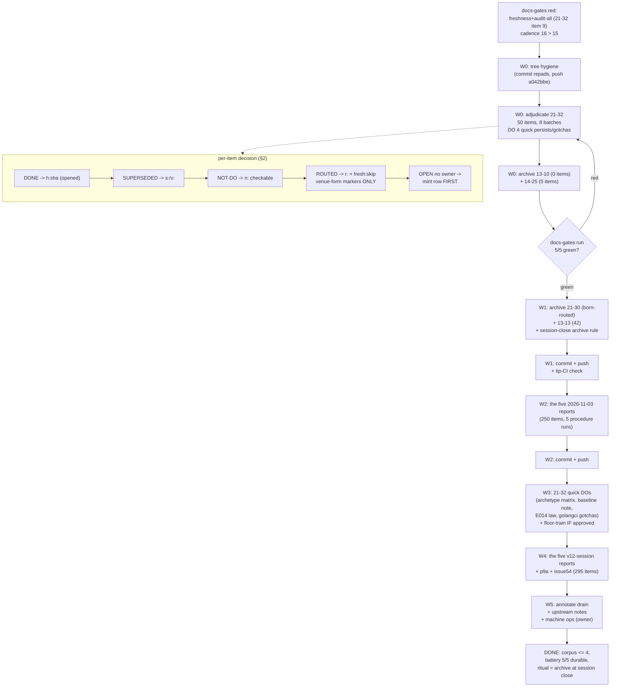

# SUPERB — Corpus Wave 3: Drain the Treadmill, Keep the Ratchet

**Date:** 2026-11-06 22:05 CET
**Trigger:** `docs-gates run .` red on freshness+audit-all (the concurrent
21-32 self-review report's item 9) and cadence (16 > 15) — within 3 hours of
the previous wave going green. The treadmill is now the finding: 16
unarchived reports carrying ~687 open §f items, while concurrent sessions
write ~2 reports per hour.
**Scope:** the docs-health corpus (the 16 unarchived reports), the minted
TODO rows awaiting real work (floor-train, cqrs-lint, machine ops, loose
ends), the annotate drain, and the upstream docs-gates notes.
**Out of scope (owned elsewhere):** the v13 program's P8/P9c remainder (its
own session), owner-gated CI secret, the release trains.

**Current state on entry (verified 21:55–22:00):**

| Gate        | Verdict | Detail                                                     |
| ----------- | ------- | ---------------------------------------------------------- |
| freshness   | **FAIL**| 1 unharvested item in the 21-32 report (item 9)            |
| audit-all   | **FAIL**| same item; pin 0 doing its job                             |
| annotate    | PASS    | 243 findings, pin 255                                      |
| routing     | PASS    | STRICT, 0 unrouted, 0 dead, 0 unenforced                   |
| cadence     | **FAIL**| 16 unarchived (threshold 15), oldest 3d                    |

**Working-tree hygiene on entry:** two dprint-repadded files uncommitted
(21-30 report + archived 14-05 banner); the concurrent session's `a042bbe`
(self-review report) is LOCAL-UNPUSHED — push it, never revert it.

**Unarchived inventory (open items per report, verified by dump-items):**

| Report (docs/status/)                                   | Items | Class                  |
| -------------------------------------------------------- | ----- | ---------------------- |
| `2026-11-06_13-10_v13-continuation-r1c-r1d-closeout.md`  | 0     | no §f — free archive   |
| `2026-11-06_14-25_integration-flake-…status.md`          | 5     | light                  |
| `2026-11-06_13-13_v13-continuation-self-review-…md`      | 42    | medium                 |
| `2026-11-03_16-28_consumer-train-…status.md`             | 45    | wave 3                 |
| `2026-11-06_03-18_superb-v12-execution-session1…md`      | 48    | wave 3                 |
| `2026-11-06_05-03_superb-v12-session2…md`                | 49    | wave 3                 |
| `2026-11-06_06-22_superb-v12-session3…md`                | 49    | wave 3                 |
| `2026-11-06_09-32_docs-gates-audit-all-drain…md`         | 49    | wave 3                 |
| `2026-11-03_19-54_sibling-library-fleet-audit…md`        | 50    | wave 3                 |
| `2026-11-03_20-35_server-timing-adoption…md`             | 50    | wave 3                 |
| `2026-11-03_21-25_decision-batch-execution…md`           | 50    | wave 3                 |
| `2026-11-03_22-36_superb-v11-landing-status.md`          | 50    | wave 3                 |
| `2026-11-06_11-47_issue54-health-v031…md`                | 50    | wave 3                 |
| `2026-11-06_12-46_v13-execution-session-p9a…md`          | 50    | wave 3                 |
| `2026-11-06_21-30_corpus-archive-execution…md` (mine)    | 50    | all born-routed        |
| `2026-11-06_21-32_self-review-and-full-status.md`        | 50    | **the live red**       |
| **Total**                                                | ~687  |                        |

---

## 0. Definition of done (mechanical, no adjectives)

```console
docs-gates run .                        # 5/5 PASS (and STAYS green through every wave step)
./scripts/check-routed-destinations.sh  # exit 0, 0 dead, 0 unenforced
./scripts/check-status-index.sh         # exit 0 both directions
./scripts/pre-tag-checks.sh <any-pushed-tag>   # exit 0 (all guards)
ls docs/status/*.md | grep -vc README   # <= 8 after waves 0-2 (floor 15)
git rev-parse HEAD origin/master        # identical; CI on the tip: designed reds only
```

Plus: every archived report carries the banner, every move passed
`check-rows` before and after the formatter, no threshold edit anywhere
(`.docs-gates.json` untouched), no verdict cites an unopened commit.

---

## 1. PARETO LADDER

### 1% → 51%: **Restore the gates — one self-review adjudicated, two free archives**

The red is ONE unharvested item in 21-32 plus ONE count over the floor.
The 1% is: adjudicate the 21-32 report's 50 items (a self-review's forgotten
records — mostly DO-sized: persist two files, write two AGENTS gotchas, fix
two errata pointers, route the rest), archive `13-10` (ZERO items — free
cadence unit) and `14-25` (5 items, already routed except its remainder).
This is ~2 hours and turns the whole battery green with the corpus at 13.

### 4% → 64%: **Make green durable — the born-routed archives + the session-close ritual**

My 21-30 report (50 items, ALL born-routed with fresh:skip) and 13-13 (42)
archive with near-zero adjudication cost. Plus: write the "archive your own
reports at session close" rule into the docs-health ritual surface (AGENTS
gotcha or the status README) so the corpus stops refilling — this is the
only structural fix for the treadmill, and it costs one paragraph.

### 20% → 80%: **The 2026-11-03 + v12-session bulk (5 reports, 250 items) and the quick product rows**

The five 2026-11-03 reports route overwhelmingly to rows already wired this
week (battery W3-W5, upstream watchlist, owner gates, samber/do, cordis,
nixpkgs) — adjudication is fast; the work is READING each §f and matching
owners. Then the minted rows that are quick real work: the archetype-matrix
persist, the baseline-note restore, the E014 law + golangci-drift gotchas
(from 21-32's own asks), the cqrs-lint CI pin prep.

### Remaining 20% → 100%: **The v12-session five + p9a/issue54 (295 items), the annotate drain, upstream notes, machine ops**

The five 2026-11-06 v12 session reports (48-50 each), p9a (50), issue54
(50) — same routing fabric. Then: `annotate_max` drain (per-cell strikes in
the worst archived offenders → lower 255), the three upstream docs-gates
notes, and the machine-ops batch (only if the owner is present — most are
machine-level).

---

## 2. THE ADJUDICATION RULEBOOK (inherits 2026-11-06_09-37 §2, with this wave's additions)

Per open §f item, first match wins:
1. **DONE** — work exists on disk AND the commit is named (`h:<sha>`, opened
   with `git log`/`git show` first).
2. **SUPERSEDED/MOOT** — a later artifact replaced it (`s:`/`v:` citing the
   successor path).
3. **DELIBERATELY NOT DONE** — recorded ruling or structural reason
   (`n:<reason>` checkable in one grep).
4. **ROUTED** — real open work with an owner: `r:` + `<!-- fresh:skip -->`.
   **Guard-safe forms only:** `TODO P1|P2|P3 — <fragment>` (section
   existence) or an existing repo path. **Traps learned this week:** never
   put a not-yet-existing `scripts/…` path in a marker; never write
   `TODO_LIST P3 …`; bare-path-only markers are unenforced notes.
5. **STILL OPEN, NO OWNER** — mint the TODO/ROADMAP row FIRST, then route.

**Wave additions (2026-11-06 afternoon lessons):**
- Pre-flight EVERY new living-doc line: `docs-gates freshness . --pre-flight
  --duplicates < candidates.txt` — the DF=8 genericity boundary broke three
  harvests last wave (`backlog`, `sweep`, `mount`).
- Compound §f blocks renumber: the annotate prose matcher addresses a
  wrapped `22. …` block as id 22, not sequential 10 — dry-run exposes it
  atomically, read the match list before applying.
- Batch steps are atomic per file: one wrong verdict costs one file, not a
  corpus.

---

## 3. THE ARCHIVE PROCEDURE (unchanged, proven 12× this week)

```console
A=/home/lars/.config/crush/skills/docs-health/assets/annotate
docs-gates freshness . --dump-items docs/status/<report>.md     # 1. what is open
$A prose --dry-run "$F" "## f)" <id>:<kind>:<value>…            # 2-3. spec + verify read IN FULL
$A prose "$F" "## f)" …                                          # 4. apply
$A check-rows "$F"                                               # 5. archive gate
# banner (> **Live remainder:** naming owners) → git mv → index (both tables)
./scripts/docs-annotate-pass.sh --apply "$F"                     # 6. formatter canon
```

---

## 4. COARSE PLAN — 30–100 min per task

| ID   | Task                                                                                     | Tier | Impact | Effort | Customer value | Depends |
| ---- | ---------------------------------------------------------------------------------------- | ---- | ------ | ------ | -------------- | ------- |
| W0-1 | Tree hygiene: commit the dprint repads; push the concurrent `a042bbe`                     | 1%   | High   | 10m    | Med            | —       |
| W0-2 | Adjudicate the 21-32 self-review (50 items: DO the 6 quick persists/gotchas, route the rest)| 1%   | High   | 70m    | High           | §2      |
| W0-3 | Archive `13-10` (0 items) + `14-25` (5 items): banners, moves, index                      | 1%   | High   | 25m    | High           | W0-2    |
| W0-4 | Battery + guards green check; record the before/after matrix                              | 1%   | High   | 10m    | High           | W0-3    |
| W1-1 | Adjudicate + archive my `21-30` (50 born-routed items)                                    | 4%   | High   | 30m    | High           | W0-4    |
| W1-2 | Adjudicate + archive `13-13` (42 items; v13 continuation — owners already wired)          | 4%   | High   | 45m    | High           | W0-4    |
| W1-3 | Write the session-close archive rule into the docs-health ritual surface                  | 4%   | High   | 15m    | High           | W0-4    |
| W1-4 | Commit + push waves 0-1 as logical commits; tip-CI check                                  | 4%   | High   | 20m    | High           | W1-3    |
| W2-1 | Adjudicate + archive `16-28` (45; consumer-train — the claims-guard fabric is wired)      | 20%  | High   | 50m    | High           | W1-4    |
| W2-2 | Adjudicate + archive `22-36` (50; v11 landing)                                            | 20%  | Med    | 55m    | High           | W1-4    |
| W2-3 | Adjudicate + archive `21-25` (50; decision batch)                                         | 20%  | Med    | 55m    | High           | W1-4    |
| W2-4 | Adjudicate + archive `20-35` (50; server-timing adoption)                                 | 20%  | Med    | 55m    | High           | W1-4    |
| W2-5 | Adjudicate + archive `19-54` (50; fleet audit)                                            | 20%  | Med    | 55m    | High           | W1-4    |
| W2-6 | Wave-2 commit + push + battery                                                            | 20%  | Med    | 15m    | High           | W2-5    |
| W3-1 | The 21-32 quick DOs: persist the archetype matrix + baseline note restore                 | 20%  | Med    | 30m    | High           | W0-2    |
| W3-2 | The 21-32 quick DOs: E014 law + golangci-drift + langProbe gotchas into AGENTS/module-details | 20% | Med    | 30m    | High           | W0-2    |
| W3-3 | Floor-train go 1.27.2 → 1.27.3 (12 go.mods + go.work + fixture + AGENTS) — IF owner picks standalone | 20% | High | 45m | High | §g-1 |
| W3-4 | cqrs-lint CI pin prep (upstream stable tag check) + memo draft                            | 20%  | Low    | 30m    | Med            | —       |
| W4-1 | Adjudicate + archive `03-18` (48)                                                         | rem. | Med    | 55m    | Med            | W2-6    |
| W4-2 | Adjudicate + archive `05-03` (49)                                                         | rem. | Med    | 55m    | Med            | W4-1    |
| W4-3 | Adjudicate + archive `06-22` (49)                                                         | rem. | Med    | 55m    | Med            | W4-2    |
| W4-4 | Adjudicate + archive `09-32` (49)                                                         | rem. | Med    | 55m    | Med            | W4-3    |
| W4-5 | Adjudicate + archive `11-47` (50)                                                         | rem. | Med    | 55m    | Med            | W4-4    |
| W4-6 | Adjudicate + archive `12-46` (50)                                                         | rem. | Med    | 55m    | Med            | W4-5    |
| W4-7 | Wave-3 commit + push + battery; corpus target ≤ 4                                         | rem. | Med    | 15m    | High           | W4-6    |
| W5-1 | `annotate_max` drain: per-cell strikes in the worst archived offenders; lower the pin     | rem. | Low    | 100m   | Low            | W4-7    |
| W5-2 | Upstream docs-gates notes (routed≠resolved; compound-id quirk; DF-boundary report)        | rem. | Low    | 60m    | Med            | W1-4    |
| W5-3 | Machine-ops batch — ONLY with the owner present (§g)                                      | rem. | Low    | 100m   | Med            | §g-3    |
| W5-4 | Long-tail: dprint-vs-fresh:skip stability check; cadence-rationale doc; `TODO row N` sweep | rem. | Low | 40m | Low | W1-3 |

---

## 5. FINE PLAN — max 12 min per task

Batch rule: one ≤12-min task = 5-6 adjudications of one report, or one
archive fixed step. Reports with 50 items = 9 batch tasks + 8 fixed steps
(stated per report so nothing hides).

| ID    | Task (≤12 min)                                                                          | Tier | Depends |
| ----- | ---------------------------------------------------------------------------------------- | ---- | ------- |
| F-01  | Commit the two dprint-repadded files (tree hygiene)                                       | 1%   | —       |
| F-02  | Push `a042bbe` (concurrent session's self-review commit)                                  | 1%   | F-01    |
| F-03  | 21-32: dump items + emit keys for batch 1 (items 1-6: errata pointer, archetype matrix, baseline note, langProbe, E014, golangci gotcha) | 1% | §2 |
| F-04  | 21-32: classify batch 1 — DO the four file-writes, route the two AGENTS asks              | 1%   | F-03    |
| F-05  | 21-32: verify + apply batch 1                                                             | 1%   | F-04    |
| F-06  | 21-32: batch 2 (items 7-12) classify + apply                                              | 1%   | F-05    |
| F-07  | 21-32: batch 3 (items 13-18) classify + apply                                             | 1%   | F-06    |
| F-08  | 21-32: batch 4 (items 19-24) classify + apply                                             | 1%   | F-07    |
| F-09  | 21-32: batch 5 (items 25-30) classify + apply                                             | 1%   | F-08    |
| F-10  | 21-32: batch 6 (items 31-36) classify + apply                                             | 1%   | F-09    |
| F-11  | 21-32: batch 7 (items 37-42) classify + apply                                             | 1%   | F-10    |
| F-12  | 21-32: batch 8 (items 43-50) classify + apply                                             | 1%   | F-11    |
| F-13  | 21-32: `check-rows --strict` + bare inventory + fix any PARTIAL                            | 1%   | F-12    |
| F-14  | 21-32: banner + `git mv` + index (Current row → manifest)                                  | 1%   | F-13    |
| F-15  | Archive `13-10`: banner (superseded-by pointer) + mv + index (0 items)                     | 1%   | F-14    |
| F-16  | Archive `14-25`: adjudicate remaining 5 + banner + mv + index                              | 1%   | F-15    |
| F-17  | Battery + routed + index guards green; paste the matrix                                    | 1%   | F-16    |
| F-18  | Archive my `21-30`: verify the born-routed markers hold + banner + mv + index              | 4%   | F-17    |
| F-19  | 13-13: dump + batch 1 (items 1-6) classify + apply                                         | 4%   | F-18    |
| F-20  | 13-13: batches 2-4 (items 7-24) classify + apply                                           | 4%   | F-19    |
| F-21  | 13-13: batches 5-7 (items 25-42) classify + apply                                          | 4%   | F-20    |
| F-22  | 13-13: gates + banner + mv + index                                                         | 4%   | F-21    |
| F-23  | Write the session-close archive rule (AGENTS gotcha or status README ritual note)          | 4%   | F-17    |
| F-24  | Commit waves 0-1 (adjudications/moves/index as logical commits)                            | 4%   | F-23    |
| F-25  | Push + tip-CI check (designed reds only)                                                   | 4%   | F-24    |
| F-26  | 16-28: dump + batches 1-2 (items 1-12) classify + apply                                    | 20%  | F-25    |
| F-27  | 16-28: batches 3-5 (items 13-30) classify + apply                                          | 20%  | F-26    |
| F-28  | 16-28: batches 6-8 (items 31-45) classify + apply                                          | 20%  | F-27    |
| F-29  | 16-28: gates + banner + mv + index                                                         | 20%  | F-28    |
| F-30  | 22-36: dump + batches 1-2 classify + apply                                                 | 20%  | F-29    |
| F-31  | 22-36: batches 3-5 classify + apply                                                        | 20%  | F-30    |
| F-32  | 22-36: batches 6-9 classify + apply                                                        | 20%  | F-31    |
| F-33  | 22-36: gates + banner + mv + index                                                         | 20%  | F-32    |
| F-34  | 21-25: dump + batches 1-3 classify + apply                                                 | 20%  | F-33    |
| F-35  | 21-25: batches 4-6 classify + apply                                                        | 20%  | F-34    |
| F-36  | 21-25: batches 7-9 classify + apply + gates                                                | 20%  | F-35    |
| F-37  | 21-25: banner + mv + index                                                                 | 20%  | F-36    |
| F-38  | 20-35: dump + batches 1-3 classify + apply                                                 | 20%  | F-37    |
| F-39  | 20-35: batches 4-6 classify + apply                                                        | 20%  | F-38    |
| F-40  | 20-35: batches 7-9 classify + apply + gates                                                | 20%  | F-39    |
| F-41  | 20-35: banner + mv + index                                                                 | 20%  | F-40    |
| F-42  | 19-54: dump + batches 1-3 classify + apply                                                 | 20%  | F-41    |
| F-43  | 19-54: batches 4-6 classify + apply                                                        | 20%  | F-42    |
| F-44  | 19-54: batches 7-9 classify + apply + gates                                                | 20%  | F-43    |
| F-45  | 19-54: banner + mv + index                                                                 | 20%  | F-44    |
| F-46  | Wave-2 commit + push + battery + index check                                               | 20%  | F-45    |
| F-47  | 21-32 DOs: persist `docs/review/apps/archetype-matrix-2026-11-06.md` (41-app table)        | 20%  | F-04    |
| F-48  | 21-32 DOs: restore the baseline population-reconciliation note (from `git show dfeb4a5`)   | 20%  | F-04    |
| F-49  | 21-32 DOs: the E014 directive-shape LAW + golangci v2.15.0 drift + langProbe/StateNew gotchas into AGENTS/module-details | 20% | F-04 |
| F-50  | Floor-train (IF standalone approved): bump 12 go.mods + go.work + fixture + AGENTS; hermetic suites | 20% | §g-1 |
| F-51  | Floor-train: directives guard + fleet lint + battery green; commit                         | 20%  | F-50    |
| F-52  | cqrs-lint: check upstream for a stable tag; draft the CI-pin change                        | 20%  | —       |
| F-53  | cqrs-lint: draft the F032 upstream memo (framework wrappers)                               | 20%  | F-52    |
| F-54  | 03-18: dump + batches 1-3 classify + apply                                                 | rem. | F-46    |
| F-55  | 03-18: batches 4-6 classify + apply                                                        | rem. | F-54    |
| F-56  | 03-18: batches 7-9 classify + apply + gates + banner + mv + index                          | rem. | F-55    |
| F-57  | 05-03: dump + batches 1-3 classify + apply                                                 | rem. | F-56    |
| F-58  | 05-03: batches 4-6 classify + apply                                                        | rem. | F-57    |
| F-59  | 05-03: batches 7-9 classify + apply + gates + banner + mv + index                          | rem. | F-58    |
| F-60  | 06-22: dump + batches 1-3 classify + apply                                                 | rem. | F-59    |
| F-61  | 06-22: batches 4-6 classify + apply                                                        | rem. | F-60    |
| F-62  | 06-22: batches 7-9 classify + apply + gates + banner + mv + index                          | rem. | F-61    |
| F-63  | 09-32: dump + batches 1-3 classify + apply                                                 | rem. | F-62    |
| F-64  | 09-32: batches 4-6 classify + apply                                                        | rem. | F-63    |
| F-65  | 09-32: batches 7-9 classify + apply + gates + banner + mv + index                          | rem. | F-64    |
| F-66  | 11-47: dump + batches 1-3 classify + apply                                                 | rem. | F-65    |
| F-67  | 11-47: batches 4-6 classify + apply                                                        | rem. | F-66    |
| F-68  | 11-47: batches 7-9 classify + apply + gates + banner + mv + index                          | rem. | F-67    |
| F-69  | 12-46: dump + batches 1-3 classify + apply                                                 | rem. | F-68    |
| F-70  | 12-46: batches 4-6 classify + apply                                                        | rem. | F-69    |
| F-71  | 12-46: batches 7-9 classify + apply + gates + banner + mv + index                          | rem. | F-70    |
| F-72  | Wave-3 commit + push + battery; corpus ≤ 4 (14-25/21-32/21-30/13-13 done in waves 0-1)     | rem. | F-71    |
| F-73  | `annotate_max` drain: per-cell-strike the two worst archived offenders; re-count           | rem. | F-72    |
| F-74  | `annotate_max` drain: next two offenders; lower the pin toward the new count               | rem. | F-73    |
| F-75  | Upstream note 1: routed≠resolved (freshness vs routing) — draft via verify-before-filing   | rem. | F-25    |
| F-76  | Upstream note 2: prose-matcher compound-id renumbering quirk                               | rem. | F-75    |
| F-77  | Upstream note 3: DF-boundary report (`--explain-df` / tokens-at-DF-6/7)                    | rem. | F-76    |
| F-78  | Long-tail: dprint round-trip on a fresh:skip-bearing file (F-64 stability check)           | rem. | F-23    |
| F-79  | Long-tail: cadence threshold-override rationale doc (`oldest_days: 29` etc.)               | rem. | F-23    |
| F-80  | Long-tail: sweep legacy `TODO row N` anchors that no longer resolve                        | rem. | F-79    |

---

## 6. ANTI-VERSCHLIMMBESSERUNG GUARDRAILS (unchanged, plus this week's scars)

1. **No threshold edits** — `.docs-gates.json` stays untouched; the gates
   red for REAL reasons and get fixed at the cause.
2. **No mass-NOT-DO** — every `n:` verdict carries a one-grep checkable reason.
3. **No archiving a report with an unowned open item** — mint the row first.
4. **No hand-edited mangled table bytes** — `cat -A` → `--normalize` /
   `unwrap` / `repair-mangle` / `repair-partial`.
5. **Per-cell strikes only** — never a strike across pipes.
6. **Guard-safe markers only** — `TODO P1|P2|P3 — fragment` or an existing
   path; no `TODO_LIST P3 …`; no paths to files that do not exist yet.
7. **Pre-flight every living-doc line** — the DF=8 boundary bit three times
   in one day; `--pre-flight --duplicates` before every TODO/AGENTS write.
8. **Never touch another session's commit** (`a042bbe` is theirs — push it,
   never revert/reword it).
9. **One report = one atomic spec** — `--verify` read in full, gates between
   every move; a mistake is one file wide.
10. **Concurrent sessions are LIVE** — re-check `git status` before every
    commit batch; verify daemon-commit content if it races; never rebalance
    history.

---

## 7. EXECUTION GRAPH



---

## 8. RISK REGISTER

| Risk                                        | Detection                          | Mitigation                                             |
| ------------------------------------------- | ---------------------------------- | ------------------------------------------------------ |
| A concurrent session lands mid-wave         | `git status` before every batch    | rebase-free coexistence; verify daemon commits          |
| DF regression from my own TODO writes       | `--pre-flight --duplicates`        | reword, never rethreshold                               |
| Compound §f blocks mismatch ids             | `--dry-run` match list             | address by the extractor's id (22-style), read it       |
| Formatter repad between annotate and commit | `docs-annotate-pass.sh` both sides | run it before every commit batch                        |
| Cadence re-reds from NEW session reports    | the gate itself                    | archive own reports at session close (W1-3 is the fix)  |
| Fabricated verdicts under batch fatigue     | `docs-gates annotate` rule B       | every hash opened; every claim grepped                  |
| Floor-train breaks a consumer               | hermetic suites + fresh-consumer check | only IF owner picks standalone (§g-1); else rides next train |

---

## 9. VERIFY (run as written)

```console
cd /home/lars/projects/go-appkit
docs-gates run .                                   # 5/5 PASS after every wave step
docs-gates freshness . --audit-all                 # 0 unharvested (pin 0)
docs-gates annotate                                # <= 255 findings (243 today)
./scripts/check-routed-destinations.sh             # exit 0, 0 dead, 0 unenforced
./scripts/check-status-index.sh                    # exit 0 both directions
./scripts/pre-tag-checks.sh health/v0.3.1          # exit 0 (all twelve guards)
ls docs/status/*.md | grep -vc README              # <= 8 after waves 0-2
git log origin/master..HEAD --oneline             # empty after every push step
grep -c audit_max .docs-gates.json                 # present; values UNCHANGED
```
