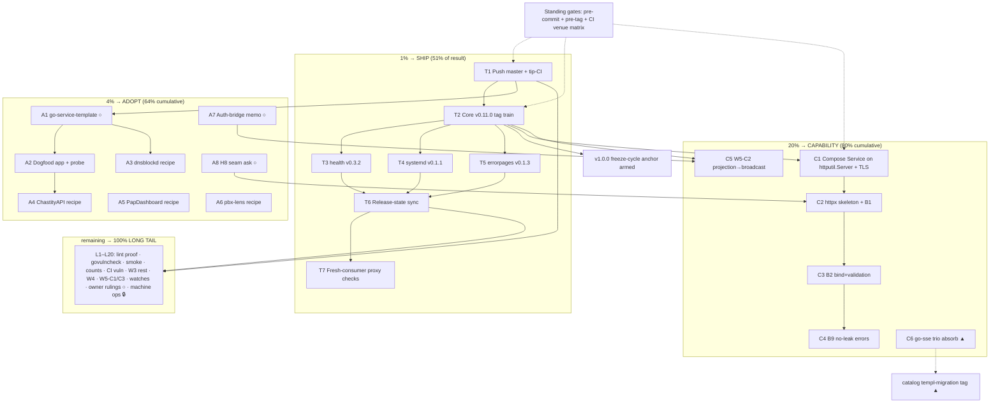

# SUPERB v14 — Pareto Plan: Ship the Green Tree, Open the Adoption Path, Then Build the Capability Trains

**Date:** 2026-11-07 04:09 CET
**Mandate:** figure out what we should REALLY do — the 20% that delivers
80%, the 4% that delivers 64%, the 1% that delivers 51% — plus the
remaining 20% to reach 100%. Two granularities (30–100min comprehensive,
≤12min execution), ALL open TODOs included, sorted by
importance/impact/effort/customer-value. Execution graph included.
**Mission anchor (owner ruling 2026-11-03):** "the entire reason this repo
exists is to make it easy for my apps to smartly use all my libs together."
**Base state:** floor train go 1.27.3 landed + fleet ALL 14 GREEN; 9
verified commits on master unpushed; docs-gates FRESH; guards green;
adoption frontier = daemons (25 apps), any-adoption 9/41, direct 7/41;
preset v0.1.0 shipped (spine+legs, 35-LOC acceptance met).

---

## 1. The Pareto ladder

### 1% → 51% of the result: SHIP THE GREEN TREE

Two weeks of finished, verified work sits unpushed and untagged: the
floor train, testkit additions, `RegisterClassifications`, systemd
Examples + truth-fixed docs, errorpages godoc fix, health's LICENSE (the
module tag carries it), the WrapOnce hook-classification contract. None
of it reaches a consumer until it is pushed AND tagged — and every
downstream unlock (v1.0.0 freeze-cycle anchor, testkit satellite
migrations, integration re-pins, consumer bumps, the six-month adoption
metric) is blocked on exactly this. Highest impact-per-minute in the
entire backlog; effort is hours, all ritualized
(`scripts/tag-module.sh`, pre-tag-checks, fresh-consumer proxy check).

### 4% → 64% cumulative: OPEN THE ADOPTION PATH

The audit's verdict: presets get adopted, parts catalogs don't. The
preset spine shipped; what converts it into the second adoption wave is
(a) the scaffold template (new-app path, archetype frontier = 25
daemons), (b) the per-repo swap recipes (existing-app path: dnsblockd
−~1,600 LOC, ChastityAPI −~4,800 LOC are the exemplars), and (c) the two
owner decision memos that gate the next batteries (auth-bridge, H8
route-seam). Every item here multiplies items in tier 1 and 3 — shipped
batteries with zero adopters are inventory, not value.

### 20% → 80% cumulative: BUILD THE CAPABILITY TRAINS

The four capability moves the composition mission actually needs next:
the `httputil.Server` composition refactor (plan-of-record ready,
unblocks Core TLS G1 as a free seam), the httpx handler-DX core (B1
ResultHandler + B2 bind + B9 no-leak errors — the batteries every
handler-touching consumer touches), W5-C2 projection→broadcast fold (the
must-have for every future cqrs+realtime consumer — without it each one
re-runs the pre-fold-state race), and the joint go-sse v0.7.0 /
cqrs-htmx v4.16.0 / templ-components v1.27.0 absorb (upstream-gated on
catalog's templ-migration tag).

### remaining 80% → 100%: THE LONG TAIL (do not forget)

Batteries B3–B9 remainder, W4 (worker/sqlite/polite/do/D4/D6/D7),
W5-C1/C3, machine-ops remainder, docs-health corpus waves 3–4
remainders, the watch rows (upstream releases, semconv, cordis, SSE-hub
convergence, otel v1.48), the owner-gated rulings (pma §6, working-file
ignore, plan-revision + rev-N conventions, cross-repo posture, samber/do
filings, SSH secret), and this session's verification partials (fleet
lint proof, govulncheck 14/14, example-smoke local run, stale-count
sweep). Individually small; collectively they are the difference between
a green repo and a trustworthy one.

---

## 2. Comprehensive plan — ALL open TODOs as 30–100min tasks

Sort key: importance/impact/effort/customer-value. ○ = owner-gated,
▲ = upstream-gated, 🔒 = machine/root-gated.

| #   | Tier | Task (30–100min)                                                                                                                                                                                                                                                         | Source row                                                        | Effort       | Impact                                 | Value |
| --- | ---- | ------------------------------------------------------------------------------------------------------------------------------------------------------------------------------------------------------------------------------------------------------------------------ | ----------------------------------------------------------------- | ------------ | -------------------------------------- | ----- |
| T1  | 1%   | Push master (9 commits) + tip-CI verify                                                                                                                                                                                                                                  | session close                                                     | 30m          | Unblocks everything                    | Proof |
| T2  | 1%   | Core v0.11.0 tag train (CHANGELOG date, API-diff additions-only proof, tag, push, integration re-pin + tidy via insteadOf, guards)                                                                                                                                       | AGENTS Release Ritual; testkit/RegisterClassifications/floor ride | 90m          | Freeze-cycle anchor + consumer unlocks | High  |
| T3  | 1%   | health v0.3.2 tag (LICENSE finally on the page)                                                                                                                                                                                                                          | AGENTS pkg.go.dev ¶                                               | 30m          | Cosmetic-but-owed                      | Med   |
| T4  | 1%   | systemd v0.1.1 tag (Examples + README truth)                                                                                                                                                                                                                             | systemd [Unreleased]                                              | 30m          | Doc quality to consumers               | Med   |
| T5  | 1%   | errorpages v0.1.3 tag (Mount 405-catchall godoc)                                                                                                                                                                                                                         | closed row, rides tag                                             | 30m          | Doc precision                          | Med   |
| T6  | 1%   | Release-state sync: AGENTS + FEATURES + TODO header + check-features-claims green                                                                                                                                                                                        | ritual step 3                                                     | 30m          | Guard-enforced truth                   | Med   |
| T7  | 1%   | Fresh-consumer proxy checks for the wave (`docs/recipes/fresh-consumer-proxy-check.md`)                                                                                                                                                                                  | ritual last step                                                  | 30m          | Consumer-validity proof                | Med   |
| A1  | 4%   | go-service-template repo: creation ○ + skeleton per verdict spec                                                                                                                                                                                                         | scaffold verdict doc                                              | 90m          | New-app adoption path                  | High  |
| A2  | 4%   | Dogfood: scaffold one real app, boot + graceful-stop probe, <40 LOC                                                                                                                                                                                                      | TODO scaffold row                                                 | 60m          | Template done-ness proof               | High  |
| A3  | 4%   | dnsblockd battery-swap recipe (template → filled; −~1,600 LOC)                                                                                                                                                                                                           | recipes row                                                       | 60m          | Flagship exemplar                      | High  |
| A4  | 4%   | ChastityAPI battery-swap recipe (−~4,800 LOC)                                                                                                                                                                                                                            | recipes row                                                       | 90m          | Second exemplar                        | High  |
| A5  | 4%   | PapDashboard security swap recipe (M17 follow-up)                                                                                                                                                                                                                        | recipes row                                                       | 60m          | Consumer #2 deepening                  | Med   |
| A6  | 4%   | pbx-lens cmdguard migration recipe (`fatalCode` = the cmdguard contract)                                                                                                                                                                                                 | recipes row                                                       | 30m          | CLI archetype entry                    | Med   |
| A7  | 4%   | Auth-bridge decision memo drafted (usermgmt-recipe vs session battery) — decision ○                                                                                                                                                                                      | P3 owner gate                                                     | 90m          | Gates preset auth leg                  | High  |
| A8  | 4%   | H8 seam decision feed packaged for owner (svc.Routes() vs httputil/endpoints; endpoints.md verdict)                                                                                                                                                                      | 13-decision row                                                   | 30m          | Unblocks B6/B8                         | Med   |
| C1  | 20%  | Compose `Service` on `httputil.Server` (fresh-Server-per-Start, Addr/Running views, six phase logs preserved, composition suite) + Core TLS G1 sketch                                                                                                                    | compose row (plan-of-record)                                      | 100m×2       | Architecture + TLS seam                | High  |
| C2  | 20%  | httpx module skeleton + B1 ResultHandler (+ classification-parity test vs errorpages taxonomy)                                                                                                                                                                           | W3 row                                                            | 100m         | Handler DX core                        | High  |
| C3  | 20%  | httpx B2 bind+validation                                                                                                                                                                                                                                                 | W3 row                                                            | 90m          | Handler DX                             | High  |
| C4  | 20%  | httpx B9 no-leak error responses                                                                                                                                                                                                                                         | W3 row                                                            | 60m          | Security hygiene                       | High  |
| C5  | 20%  | W5-C2 projection→broadcast folded contract                                                                                                                                                                                                                               | W5 row (the must-have)                                            | 100m         | cqrs+realtime unlock                   | High  |
| C6  | 20%  | Joint absorb: go-sse v0.7.0 + cqrs-htmx v4.16.0 + templ-components v1.27.0 + hub.go doc swap ▲ (trigger: catalog ships migrated tag)                                                                                                                                     | held_pins unblock                                                 | 30m          | Dependency freshness                   | Med   |
| L1  | tail | Fleet lint proof: verify-all WITH lint at 1.27.3, sequential                                                                                                                                                                                                             | session partial                                                   | 30m          | Train completeness                     | Med   |
| L2  | tail | govulncheck on the remaining 9 modules (full 14/14 record)                                                                                                                                                                                                               | session partial                                                   | 30m          | Security record                        | Med   |
| L3  | tail | example-smoke.sh local run post-bump (8 legs)                                                                                                                                                                                                                            | session partial                                                   | 30m          | Smoke proof                            | Med   |
| L4  | tail | Stale-count sweep ("12 modules"/"11 member modules" repo-wide)                                                                                                                                                                                                           | report §d                                                         | 30m          | Truth hygiene                          | Med   |
| L5  | tail | CI govulncheck leg in flake.yml (nightly)                                                                                                                                                                                                                                | report §e                                                         | 60m          | Mechanized rule                        | Med   |
| L6  | tail | quiet-run polish: captured probe names + grounded default                                                                                                                                                                                                                | report §d                                                         | 30m          | Script hygiene                         | Low   |
| L7  | tail | SigNoz semconv-families flip re-probe                                                                                                                                                                                                                                    | watch row                                                         | 30m          | Watch truth                            | Low   |
| L8  | tail | docs-health corpus waves 3–4 remainders: annotate_max drain + upstream docs-gates notes                                                                                                                                                                                  | docs-health row                                                   | 60m          | Gate durability                        | Med   |
| L9  | tail | Machine ops: /tmp sweeper (TMPDIR guard) 🔒, BuildFlow rebuild 🔒, cache-DB VACUUM 🔒, interrogate install 🔒                                                                                                                                                            | machine-ops row                                                   | 60m×4        | Machine hygiene                        | Med   |
| L10 | tail | W3 remainder: B3 ResponseWriter contract, B4 conditional GET (go-etag promotion), B5 negotiation (go-codec), B6/B8 introspection (needs H8), B7 write deadlines                                                                                                          | W3 row                                                            | 60m×5        | Battery program                        | Med   |
| L11 | tail | W4: worker supervisor+pool, sqlite ops kit, polite outbound client, do bridge, D4 atomic write, D6 webhook, D7 idempotency adopt-wire decision                                                                                                                           | W4 row                                                            | 60–100m each | Ops batteries                          | Med   |
| L12 | tail | W5 remainder: C1 drop counters (WithOnDrop, dedupe ssehub), C3 per-subscriber auth+filter                                                                                                                                                                                | W5 row                                                            | 60m each     | Realtime completion                    | Med   |
| L13 | tail | Realtime subscribe-before-flush (demand-gated; sketch exists)                                                                                                                                                                                                            | P3 row                                                            | 60m          | On demand                              | Low   |
| L14 | tail | systemd remainder: `Install` returns Hooks + `WithStatus` (demand-gated)                                                                                                                                                                                                 | P3 row                                                            | 30m          | API completeness                       | Low   |
| L15 | tail | cqrs EventConfig opt-in recipes (idempotency middleware via CommandMiddleware) — demand-gated                                                                                                                                                                            | P3 row                                                            | 60m          | On demand                              | Low   |
| L16 | tail | i18n content lane (parked; N=1 consumer)                                                                                                                                                                                                                                 | i18n row                                                          | 60m          | On demand                              | Low   |
| L17 | tail | Upstream asks ▲: go-flightrecorder#2 cooldown (watch), go-idempotency CHANGELOG hygiene, go-etag v1.0.0 plan, project-dependency-graph polish                                                                                                                            | watch rows                                                        | 30–60m       | Fleet coherence                        | Low   |
| L18 | tail | Owner rulings ○: pma §6 four decisions + working-file ignore_patterns, plan-revision convention, "rev N (expanded)" convention, cross-repo tracking posture, SSH secret restore, samber/do lazy-healthcheck filing, machine go default follow-through (retire prefixes?) | open questions + owner rows                                       | 30m each     | Unblocks gated work                    | Med   |
| L19 | tail | Watches (standing): otel v1.48, OTLP-logs gate, SigNoz live validation, cordis trigger, SSE-hub convergence, go-aichat reverse adoption, nixpkgs pull re-check                                                                                                           | P3 watch rows                                                     | 30m batch    | Drift detection                        | Low   |
| L20 | tail | Six-month adoption re-sweep (success metric: any/direct beats cqrs-htmx's 10)                                                                                                                                                                                            | preset row tail                                                   | 60m          | Mission metric                         | Med   |

## 3. Execution breakdown — ALL TODOs as ≤12min subtasks

| #    | Parent | Subtask (≤12min)                                                                                             | Done when                                               |
| ---- | ------ | ------------------------------------------------------------------------------------------------------------ | ------------------------------------------------------- |
| 1.1  | T1     | Pre-push: run the fast offline guard suite + confirm tree clean                                              | all green                                               |
| 1.2  | T1     | `git push origin master` (9 commits)                                                                         | origin tip = ce77f08→80776b7                            |
| 1.3  | T1     | `gh run list/watch` the tip run: matrix, fleet-lint, guards, proxy-smoke, example-smoke                      | green except designed-red preflight                     |
| 1.4  | T1     | Triage any red: classify real vs flake (load protocol: re-run `-count=10`)                                   | verdict recorded                                        |
| 2.1  | T2     | API-diff core v0.10.0→tree via release-ritual `go doc -all` diff                                             | additions-only proof                                    |
| 2.2  | T2     | Date core CHANGELOG `[Unreleased]` → `[0.11.0] - 2026-11-07`                                                 | CHANGELOG dated                                         |
| 2.3  | T2     | `git tag -a core/v0.11.0` (semantic delta message)                                                           | annotated tag                                           |
| 2.4  | T2     | `./scripts/pre-tag-checks.sh core/v0.11.0` (ten guards + artifact asserts)                                   | exit 0                                                  |
| 2.5  | T2     | `git push origin master core/v0.11.0`                                                                        | tag on origin                                           |
| 2.6  | T2     | Integration re-pin: bump documentedPins + go.mod (insteadOf trick), tidy, suite green                        | pin-drift green                                         |
| 2.7  | T2     | Fresh-consumer scratch: `verify-consumer.sh` core@v0.11.0                                                    | compiles at tag                                         |
| 3.1  | T3     | Date health CHANGELOG (v0.3.2: LICENSE + floor)                                                              | dated                                                   |
| 3.2  | T3     | Tag + pre-tag-checks + push health/v0.3.2                                                                    | tag on origin                                           |
| 3.3  | T3     | pkg.go.dev health page re-check (LICENSE badge)                                                              | renders                                                 |
| 4.1  | T4     | Date systemd CHANGELOG → v0.1.1                                                                              | dated                                                   |
| 4.2  | T4     | Tag + pre-tag-checks + push systemd/v0.1.1                                                                   | tag on origin                                           |
| 5.1  | T5     | Date errorpages CHANGELOG → v0.1.3                                                                           | dated                                                   |
| 5.2  | T5     | Tag + pre-tag-checks + push errorpages/v0.1.3                                                                | tag on origin                                           |
| 6.1  | T6     | AGENTS release-state bullets for the wave                                                                    | synced                                                  |
| 6.2  | T6     | FEATURES.md rows for the wave                                                                                | synced                                                  |
| 6.3  | T6     | TODO header + `check-features-claims.sh` + `check-tagged-changelogs.sh` green                                | guards green                                            |
| 7.1  | T7     | Fresh-consumer proxy scratch for each new tag (recipe)                                                       | all resolve                                             |
| 8.1  | A1     | Fleet/name availability check for `go-service-template`                                                      | name free                                               |
| 8.2  | A1     | Repo creation (owner ○) + LICENSE/AGENTS/CHANGELOG skeleton                                                  | repo exists                                             |
| 8.3  | A1     | `cmd/<name>/main.go`: cmdguard serve verb → `preset.Run`                                                     | compiles                                                |
| 8.4  | A1     | templ page skeleton + errorpages mount                                                                       | renders                                                 |
| 8.5  | A1     | flake.nix (build + devShell + test app)                                                                      | `nix build` ok                                          |
| 8.6  | A1     | `.buildflow.yml` + GitHub Actions CI (matrix + fast guards)                                                  | CI green                                                |
| 8.7  | A1     | systemd unit (Type=notify + WatchdogSec) + Dockerfile (distroless)                                           | artifacts                                               |
| 8.8  | A1     | Version stamp (appkit pins + go floor + date) in AGENTS                                                      | stamp present                                           |
| 9.1  | A2     | Scaffold the dogfood app from the template                                                                   | app exists                                              |
| 9.2  | A2     | Boot + probe + graceful-stop (example-smoke pattern)                                                         | probe green                                             |
| 9.3  | A2     | main.go < 40 LOC assertion + record in verdict doc                                                           | acceptance met                                          |
| 10.1 | A3     | dnsblockd inventory: `wc -l` per hand-roll (otel 777, sdnotify 59, middleware ~590, logging 206)             | table filled                                            |
| 10.2 | A3     | Battery map rows (hand-roll → appkit battery or NO-BATTERY verdict)                                          | map filled                                              |
| 10.3 | A3     | Risk-ranked swap order (observability → security → lifecycle → transport)                                    | order fixed                                             |
| 10.4 | A3     | Recipe file in consumer repo + LOC ledger (net MUST be negative)                                             | recipe landed                                           |
| 11.1 | A4     | ChastityAPI inventory (auth 1,068 / logger 541 / config 409 / csp / captcha / sse)                           | table filled                                            |
| 11.2 | A4     | Battery map + swap order + recipe file + ledger                                                              | recipe landed                                           |
| 12.1 | A5     | PapDashboard hand-roll inventory vs security v0.2.0 batteries (§7.3 map)                                     | table filled                                            |
| 12.2 | A5     | Swap order + recipe + ledger                                                                                 | recipe landed                                           |
| 13.1 | A6     | pbx-lens inventory (`fatalCode` exit-contract vs cmdguard)                                                   | table filled                                            |
| 13.2 | A6     | Recipe + ledger                                                                                              | recipe landed                                           |
| 14.1 | A7     | Draft the auth-bridge memo (options, demand numbers: 10/39 JWT hand-rolls)                                   | memo drafted                                            |
| 14.2 | A7     | Owner decision request filed (decision ○ stays open)                                                         | ask logged                                              |
| 15.1 | A8     | Package endpoints.md verdict + H8 options into the owner ask                                                 | ask ready                                               |
| 16.1 | C1     | Re-read spike §5 + httputil v1.7.0 `NewServerListener` godoc                                                 | pins refreshed                                          |
| 16.2 | C1     | Fresh-Server-per-Start construction + `server.listener_consumed` handling                                    | code                                                    |
| 16.3 | C1     | Addr()/Running() one-listener-two-views + StartHooks mirror preserved                                        | code                                                    |
| 16.4 | C1     | Six `shutdown phase complete` lines + classification appkit-side                                             | byte-identical logs                                     |
| 16.5 | C1     | `ServerConfig.ShutdownTimeout` from the SAME config field (no double-apply)                                  | wired                                                   |
| 16.6 | C1     | Composition-contract suite + full core suite green                                                           | all green                                               |
| 16.7 | C1     | Core TLS G1 `StartTLS` seam sketch on the same train                                                         | sketch/doc                                              |
| 17.1 | C2     | httpx module skeleton (go.mod floor 1.27.3, doc.go, .golangci.yml from satellite, go.work entry, dependabot) | skeleton                                                |
| 17.2 | C2     | B1 ResultHandler family + error mapping                                                                      | API                                                     |
| 17.3 | C2     | Classification-parity test (B1 errors ≡ errorpages taxonomy)                                                 | test pins                                               |
| 17.4 | C2     | Module README + CHANGELOG + example                                                                          | docs                                                    |
| 18.1 | C3     | B2 bind + validation battery (typed bind, field errors)                                                      | API + tests                                             |
| 19.1 | C4     | B9 no-leak error responses (contract test: internals never serialize)                                        | test pins                                               |
| 20.1 | C5     | W5-C2 design note: projection→broadcast folded contract (pre-fold-state race)                                | design note                                             |
| 20.2 | C5     | Contract implementation + E2E through published tags                                                         | green                                                   |
| 21.1 | C6     | ▲ When catalog ships: bump trio together, delete hold entries, swap hub.go doc note                          | pins aligned                                            |
| 22.1 | L1     | verify-all WITH lint (sequential, no pipe traps)                                                             | 14/14 lint 0                                            |
| 23.1 | L2     | govulncheck loop over the 9 remaining modules                                                                | clean record                                            |
| 24.1 | L3     | example-smoke.sh local run (8 legs)                                                                          | all graceful-stop                                       |
| 25.1 | L4     | `rg "12 modules                                                                                              | 11 member"` sweep + fix living docs, keep point-in-time |
| 26.1 | L5     | flake.yml govulncheck job (nix shell, per-module or root)                                                    | CI green                                                |
| 27.1 | L6     | quiet-run probe cleanup to captured names; cite the 2048 MB provenance                                       | patch + test                                            |
| 28.1 | L7     | SigNoz docs/flags probe for semconv default flip                                                             | as-of stamped                                           |
| 29.1 | L8     | annotate_max drain: per-cell strikes → lower the 255 pin (docs-gates repo)                                   | drain done                                              |
| 29.2 | L8     | Upstream docs-gates notes: routed≠resolved, compound-id quirk, DF boundary                                   | notes filed                                             |
| 30.1 | L9     | /tmp sweeper script + TMPDIR guard design (needs owner input on live scratch) 🔒                             | design/sweep                                            |
| 30.2 | L9     | BuildFlow binary rebuild 74a9212→2d6bbee 🔒                                                                  | binary current                                          |
| 30.3 | L9     | cache-DB VACUUM + legacy state-DB deletion + layout fallback 🔒                                              | done                                                    |
| 30.4 | L9     | `interrogate` install + unavailable-tool inspection 🔒                                                       | done                                                    |
| 31.1 | L10    | B3 ResponseWriter contract battery                                                                           | battery                                                 |
| 31.2 | L10    | B4 conditional GET (promote the go-etag indirect; client+metrics v0.6.0 relevance noted)                     | battery                                                 |
| 31.3 | L10    | B5 content negotiation on go-codec (the promoted seam)                                                       | battery                                                 |
| 31.4 | L10    | B6 route introspection + golden test (needs H8 ○)                                                            | battery                                                 |
| 31.5 | L10    | B8 route metadata → docs feed via httputil/endpoints (needs H8 ○)                                            | battery                                                 |
| 31.6 | L10    | B7 per-route write deadlines                                                                                 | battery                                                 |
| 32.1 | L11    | W4 worker supervisor+pool                                                                                    | battery                                                 |
| 32.2 | L11    | sqlite ops kit (lease/backup/ledger)                                                                         | battery                                                 |
| 32.3 | L11    | polite outbound client (+ go-etag client module fit)                                                         | battery                                                 |
| 32.4 | L11    | do bridge module                                                                                             | battery                                                 |
| 32.5 | L11    | D4 atomic file write (go-atomic-write ≥ v0.5.1 floor)                                                        | battery                                                 |
| 32.6 | L11    | D6 webhook battery                                                                                           | battery                                                 |
| 32.7 | L11    | D7 idempotency: adopt-wire vs 165-LOC port decision note                                                     | decision                                                |
| 33.1 | L12    | W5-C1 drop/backpressure counters (`WithOnDrop`; borrow ssehub `Drops()` shape)                               | battery                                                 |
| 33.2 | L12    | W5-C3 per-subscriber auth+filter                                                                             | battery                                                 |
| 34.1 | L13    | Realtime subscribe-before-flush on first no-drop consumer demand                                             | prepared fix                                            |
| 35.1 | L14    | systemd `Install` returns Hooks (next systemd train)                                                         | API                                                     |
| 35.2 | L14    | systemd `WithStatus(string)` on demand                                                                       | API                                                     |
| 36.1 | L15    | cqrs README recipe: CommandIdempotency via EventConfig.CommandMiddleware                                     | recipe                                                  |
| 37.1 | L16    | i18n content lane only when appkit consumers > 1                                                             | parked                                                  |
| 38.1 | L17    | go-flightrecorder#2 watch (when fr ships cooldown: delete frh hand-roll)                                     | watch                                                   |
| 38.2 | L17    | go-idempotency CHANGELOG hygiene note before any direct-promotion                                            | watch                                                   |
| 38.3 | L17    | go-etag v1.0.0 root-shim plan vs integration excludes                                                        | watch                                                   |
| 38.4 | L17    | project-dependency-graph polish items (their repo)                                                           | pointer                                                 |
| 39.1 | L18    | pma §6 decisions walkthrough (owner memo §Owner checklist) ○                                                 | owner                                                   |
| 39.2 | L18    | pma working-file ignore_patterns edit + unit restart ○                                                       | owner                                                   |
| 39.3 | L18    | plan-revision convention ruling ask ○                                                                        | owner                                                   |
| 39.4 | L18    | "rev N (expanded)" convention ruling ask ○                                                                   | owner                                                   |
| 39.5 | L18    | Cross-repo tracking posture ruling ○                                                                         | owner                                                   |
| 39.6 | L18    | SSH secret restore (owner UI) + structure-linter job live acceptance ○                                       | owner                                                   |
| 39.7 | L18    | samber/do lazy-healthcheck filing (awaiting explicit approval) ○                                             | owner                                                   |
| 40.1 | L19    | Watch batch: otel v1.48 / OTLP-logs gate / SigNoz live / cordis trigger / SSE-hub / nixpkgs — one as-of pass | stamped                                                 |
| 41.1 | L20    | Six-month adoption re-sweep: `scripts/count-adopters.sh` + archetype matrix delta                            | metric recorded                                         |

## 4. Execution graph

## 5. Guardrails (the VerschlIMMbesserer clause)

- The guards are the contract: no `go work sync`, no lint from the
  workspace root, no concurrent golangci-lint, no pipe-swallowed guard
  output, no `GOTOOLCHAIN=local` shells over BuildFlow, no re-tagging
  proxy-cached tags, no release ordering that mixes local-only tags with
  gosum-canonical (health-v0.3.1 order), commit the mechanical bulk
  FIRST (the daemon races everything slower than a minute).
- Tier-1 releases follow the release ritual verbatim; a red guard is a
  STOP, not a `--no-verify`.
- Every train ships with its venue-matrix coverage: fast+offline guards
  in all three venues; network guards pre-tag; binary guards CI.

## 6. Mandate answers carried forward

- **Push policy:** ANSWERED by this mandate (§8: commit & push) — T1
  executes it; tip-CI verify is part of T1.
- **Core-train priority:** this plan's answer = ship tier 1 first, then
  C1 (composition refactor) is the FIRST capability train, httpx (C2)
  follows behind A8's owner answer for B6/B8 only — B1/B2/B9 do not
  need the seam.
- **Machine-ops authority:** still open (L9 🔒) — the only question this
  plan cannot answer itself.
