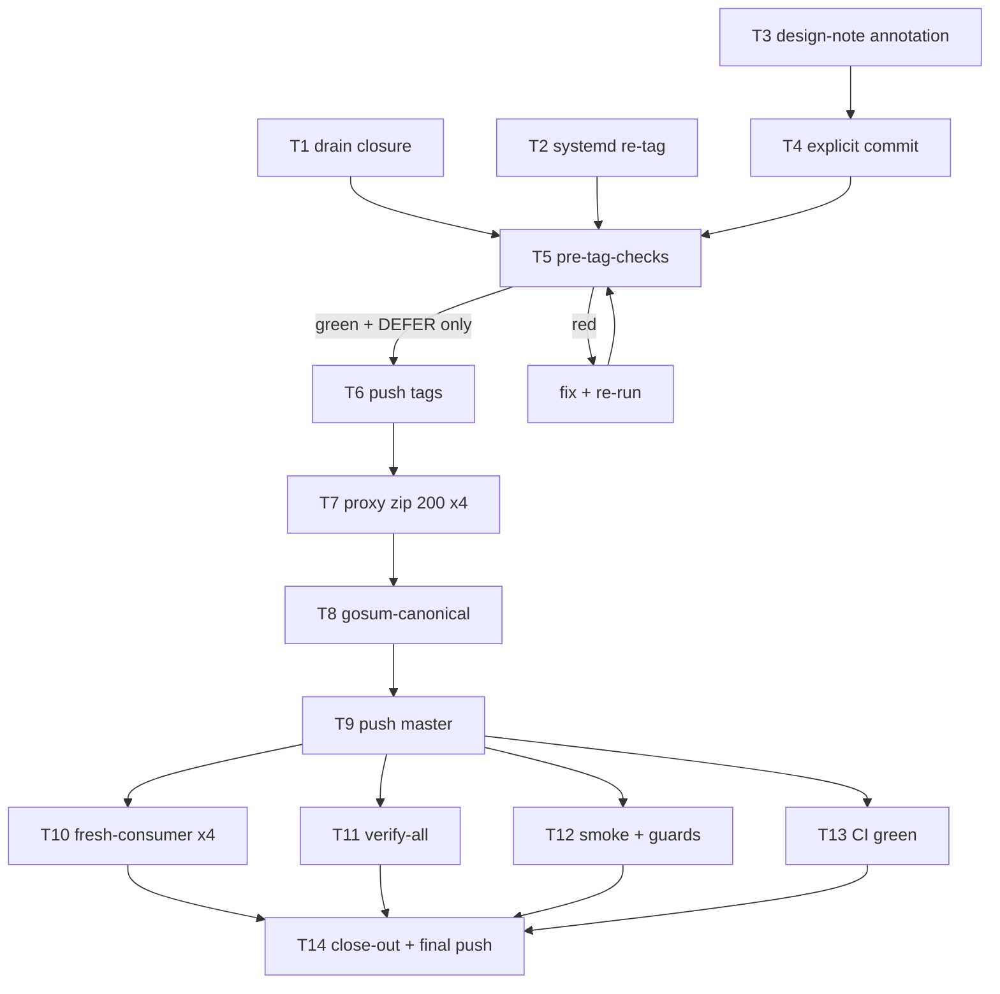

# SUPERB v15 — Release-Wave Closeout (2026-11-08 08:40)

Mandate: finish the four-tag wave (cqrs v0.9.0, realtime v0.2.0, httpx
v0.2.0, systemd v0.2.0) — guards green, tags re-cut clean, pushed, proxy +
consumer verified, master pushed, CI green, docs closed out. Owner
instruction 8 explicitly authorizes commit + push. No scope creep: parked
items stay parked (no verschlimmbessern).

## Pareto breakdown

- **1% → 51%:** the push chain — 3 drain fixes → systemd re-tag →
  pre-tag-checks → push tags → proxy 200 → gosum-canonical → push master.
  Without it the entire session ships nothing.
- **4% → 64%:** + verification proof — fresh-consumer ×4, verify-all,
  example-smoke, CI green on the final commit.
- **20% → 80%:** + truth tail — design-note §4 control annotation,
  close-out annotations of both status reports, TODO header final state.
- **Other 20% (parked, NOT this train):** cqrs godoc StartProjections
  ctx-lifetime warning; upstream ask for the sync-publish coupling (owner
  answer pending); B6/B8 (H8-gated); watchlist rows.

## Task table (10–30 min slices, importance-sorted)

| #   | Task                                                                                              | Impact        | Effort | Depends                                     |
| --- | ------------------------------------------------------------------------------------------------- | ------------- | ------ | ------------------------------------------- |
| T1  | Drain-guard closure: 2 SSE markers + 1 drain + guard green + suites re-verified                   | Blocks T5     | 15m    | —                                           |
| T2  | systemd/v0.2.0 re-tag at clean commit; tagged-tree proof (binary gone; other 3 tags never had it) | Blocks T5     | 10m    | daemon commit of removal (done: tree clean) |
| T3  | Design-note §4 annotation: control mechanism superseded (observed+2s), why                        | Truth         | 10m    | —                                           |
| T4  | Explicit release-prep commit (detailed message) if tree dirty                                     | Owner instr 8 | 5m     | T1–T3                                       |
| T5  | pre-tag-checks with all 4 tags (expect gosum DEFER only)                                          | Gate          | 20m    | T1–T3                                       |
| T6  | Push 4 tags; verify on origin                                                                     | Ships         | 5m     | T5                                          |
| T7  | Proxy poll: `.zip` 200 ×4 (download tool; 404-before-tag cache gotcha: probe .zip)                | Gate for T8   | 0–45m  | T6                                          |
| T8  | `check-gosum-canonical.sh integration` until green                                                | Correctness   | 10m    | T7                                          |
| T9  | Push master                                                                                       | Ships         | 5m     | T8                                          |
| T10 | Fresh-consumer proxy checks ×4                                                                    | Proof         | 15m    | T7                                          |
| T11 | verify-all (build+vet+test+lint, 14 modules)                                                      | Proof         | 40m bg | T9                                          |
| T12 | example-smoke + structure-linter + status-index + agents-deps                                     | Proof         | 15m    | T9                                          |
| T13 | CI watch: green on final commit; rerun tag-visibility ghosts; confirm no silently-skipped jobs    | Proof         | 20m    | T9                                          |
| T14 | Close-out: annotate 06-37 + 08-38 reports, TODO header, status index; final commit + push         | Truth         | 20m    | T13                                         |

## Micro-task table (≤12 min each, execution order)

| #   | Micro-task                                                        | Est        |
| --- | ----------------------------------------------------------------- | ---------- |
| M1  | Add `respdrain:ignore` marker to folded harness CT-mismatch close | 2m         |
| M2  | Add marker to folded harness never-subscribed close               | 2m         |
| M3  | Drain writedeadline_test.go:68 resp.Body                          | 3m         |
| M4  | Drain guard re-run → green                                        | 3m         |
| M5  | httpx suite -race + lint re-run                                   | 6m         |
| M6  | integration suite -race re-run                                    | 8m         |
| M7  | Verify binary gone from tree + daemon commit                      | 2m         |
| M8  | `git tag -d systemd/v0.2.0`; re-create same message at tip        | 3m         |
| M9  | `git ls-tree` proofs ×4 tags                                      | 3m         |
| M10 | Design-note §4 annotation                                         | 8m         |
| M11 | git status; explicit commit if dirty                              | 5m         |
| M12 | Run pre-tag-checks (log to file)                                  | 12m+       |
| M13 | Read full pre-tag output; fix any red; DEFER check                | 12m        |
| M14 | Push 4 tags                                                       | 2m         |
| M15 | `git ls-remote --tags origin` verification                        | 2m         |
| M16 | Poll proxy .zip ×4                                                | 5m+ (wait) |
| M17 | gosum-canonical integration; retry loop                           | 10m        |
| M18 | Push master                                                       | 2m         |
| M19 | Fresh-consumer ×4 (scratch module)                                | 12m        |
| M20 | verify-all (background)                                           | bg         |
| M21 | example-smoke                                                     | 10m        |
| M22 | structure-linter + status-index + agents-deps                     | 5m         |
| M23 | `gh run list/watch` on final commit; rerun ghosts                 | 12m        |
| M24 | Annotate 06-37 report (answers + outcomes)                        | 8m         |
| M25 | Annotate 08-38 report (outcomes)                                  | 8m         |
| M26 | TODO header final state + status index                            | 6m         |
| M27 | Final commit + push                                               | 5m         |

## Execution graph

## Verification bar (done = ALL true)

drain guard green; 4 tagged trees carry no binaries; pre-tag-checks exit 0
with gosum-canonical DEFER (then green post-push); 4 zips 200 on proxy;
fresh-consumer compile ×4; verify-all PASS; example-smoke green; CI green
on the final pushed commit; both status reports annotated; TODO header
final.
