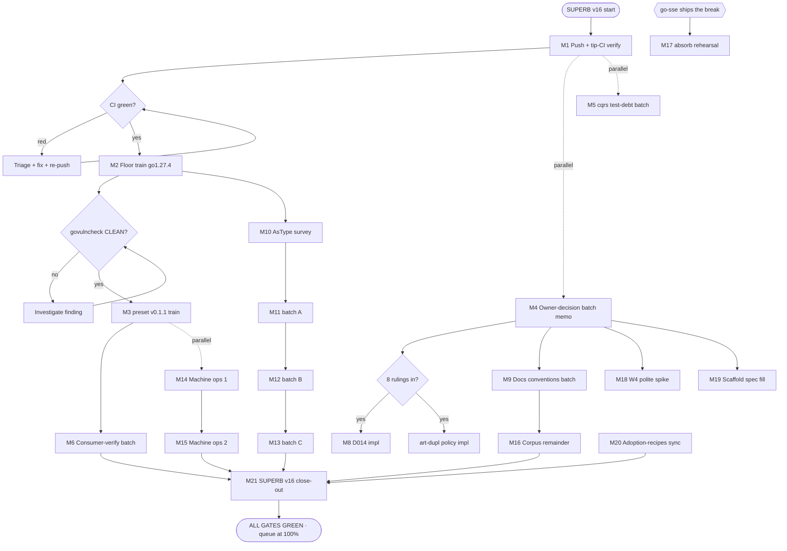

# SUPERB v16 — Pareto Execution Plan: Floor Train, Owner Unblock, and the Full Queue

**Date:** 2026-11-13 15:54 CET · **Type:** comprehensive execution plan (Pareto-ranked, two granularity levels) · **Sources:** `TODO_LIST.md` (rewritten 2026-11-13), `docs/status/2026-11-13_14-43_dedup-to-zero-session.md` §f, `docs/status/2026-11-13_15-39_docs-health-corpus-pass-preset-shutdown-fix-and-brutal-self-review.md` §f, this session's two real findings (preset deadlock, GO-2026-6859).

> **Method note (Step 0):** every task below was freshness-checked against the
> TODO rewritten this session and today's two status reports. One stale row was
> caught and is adjudicated INSIDE its task (M5.4) rather than silently dropped.
> Owner-gated work is batched into ONE memo task (M4) so a single owner hour
> unblocks ten downstream tasks.

---

## Step 1 — The Pareto Breakdown

Customer value = Lars's apps + the published consumers (cqrs-htmx setup, PapDashboard) running secure, green, bug-free appkit.

### The 1% that delivers 51% of the result (3 tasks, ~3¼ hours)

| #  | Task                                               | Why it is the 1%                                                                                                                                                                                                  |
| -- | -------------------------------------------------- | ----------------------------------------------------------------------------------------------------------------------------------------------------------------------------------------------------------------- |
| M1 | **Push master (13 commits) + tip-CI verification** | Origin master still carries a red `test (./preset)` job and none of today's fixes. Until this lands, NOTHING is verified and the session-close ritual stays open.                                                 |
| M2 | **Floor train go 1.27.3 → 1.27.4 (GO-2026-6859)**  | A stdlib `net/http` vulnerability, callable from otel's OTLP paths, is red in the nightly THREE nights running. This is a published-framework security posture task, fully mechanical with the 2026-11-07 recipe. |
| M3 | **preset v0.1.1 release train**                    | Ships the SSE graceful-shutdown deadlock fix (15s failure → 2.19ms, verified ×5 `-race`) to every consumer with the realtime leg on. A real availability bug, fix sitting in [Unreleased].                        |

**Why this is 51%:** security clean + CI green + the one live consumer bug shipped — the entire difference between "framework you can trust tonight" and "framework with a known vuln and a red master".

### The 4% that delivers 64% of the result (6 more tasks, cumulative ~9 tasks, ~8 hours)

| #  | Task                                                        | What it adds                                                                                                                                                                            |
| -- | ----------------------------------------------------------- | --------------------------------------------------------------------------------------------------------------------------------------------------------------------------------------- |
| M4 | **Owner-decision batch memo** — one document, eight rulings | D014 wire-format, art-dupl policy, H8 seam, auth-bridge, plan-revision convention, rev-N convention, watermill filing, daemon-dossier §6. One owner hour unblocks ~10 downstream tasks. |
| M5 | **cqrs test-debt batch**                                    | Helper consolidation + `startNoOpProjection` decision + the suspect CHANGELOG-split-brain row adjudicated (grep says it may be a ghost — verified BEFORE working).                      |
| M6 | **Consumer-verification batch**                             | `verify-consumer.sh` ×2 + example-smoke — turns report-cited claims into command-proven ones.                                                                                           |
| M7 | **Engine-lesson documentation pair**                        | The `StartProjections(ctx)` trap warning + the watermill synchronous-publish upstream-ask draft.                                                                                        |
| M8 | **D014 implementation** (post-ruling)                       | Either the `json:"occurredAt"` tag or the recorded suppression — 30 minutes once M4 rules.                                                                                              |
| M9 | **Docs conventions batch**                                  | Per-tree archive convention in `docs/README.md`, cordis trigger-status line, the routed≠resolved upstream note.                                                                         |

**Cumulative:** 64% — all P1/P2 quick wins, every owner decision surfaced in one place, the test debt paid, claims proven by commands instead of citations.

### The 20% that delivers 80% of the result (8 more tasks, cumulative ~17 tasks, ~17 hours)

| #   | Task                                                                        | What it adds                                                                                                                                                    |
| --- | --------------------------------------------------------------------------- | --------------------------------------------------------------------------------------------------------------------------------------------------------------- |
| M10 | **AsType survey** (erraudit fleet inventory + sentinel-trap classification) | Makes the Go 1.26 error-modernization sweep executable instead of vague.                                                                                        |
| M11 | **AsType batch A** (root + testkit)                                         | First migration batch, gate-proven.                                                                                                                             |
| M12 | **AsType batch B** (cqrs + realtime + httpx)                                | The CQRS-heavy modules.                                                                                                                                         |
| M13 | **AsType batch C** (security + otel + health + remaining satellites)        | Sweep complete, TODO row closed.                                                                                                                                |
| M14 | **Machine ops 1**                                                           | /tmp `go-build*` sweeper policy + BuildFlow binary rebuild (74a9212 → 2d6bbee).                                                                                 |
| M15 | **Machine ops 2**                                                           | Cache-DB VACUUM + legacy state-DB deletion + `interrogate` install.                                                                                             |
| M16 | **docs-health corpus remainder**                                            | `annotate_max` drain + the three upstream docs-gates notes.                                                                                                     |
| M17 | **go-sse breaking-absorb rehearsal**                                        | Dry-run the integration re-pin against the unreleased `ssetest.WithLastEventID` break so the real absorb is one calm session (demand-gated on go-sse shipping). |

**Cumulative:** 80% — the modernization sweep DONE, machine hygiene current, the next upstream break pre-absorbed.

### The remaining 80% that gets to 100% (4 more tasks + the standing/watch register)

| #   | Task                                                                              | Class                                                                                |
| --- | --------------------------------------------------------------------------------- | ------------------------------------------------------------------------------------ |
| M18 | **W4 `polite` battery design spike** (go-etag client+metrics)                     | Demand-gated design only.                                                            |
| M19 | **Scaffold template spec fill** (appkit-side; repo creation stays owner-gated)    | Prepares the owner's 30-minute act.                                                  |
| M20 | **Adoption-recipes status sync** (four per-repo instances live in CONSUMER repos) | Tracking truth only.                                                                 |
| M21 | **SUPERB v16 close-out**                                                          | TODO purge + AGENTS/FEATURES truth-sync + full `verify-all` + gates + status report. |

**Standing register (no task — recorded triggers only):** CI SSH secret restore (owner-only), Ghost-API KEEP (re-review trigger armed), core TLS G1 (PapDashboard trigger), cordis bridge (2 triggers pending), go-error-family engagement (demand), httputil server-seam refactor (upstream repo), W5 batteries (demand), httpx B6/B8 (H8-gated), PapDashboard refresh watch (criterion 5), go.work mutator hunt (fires only if leaks recur), preset six-month adoption re-sweep (due 2027-05), integration `documentedPins` bumps (ride release trains).

---

## Step 2 — Comprehensive Plan (Level 1: tasks of 30–100 min, ALL todos, importance/impact/effort/value order)

| #   | Task                                                           | Tier | Impact | Effort | Value | Depends on      | Gate                       |
| --- | -------------------------------------------------------------- | ---- | ------ | ------ | ----- | --------------- | -------------------------- |
| M1  | Push master (13 commits) + tip-CI verification                 | 1%   | H      | 35min  | H     | —               | matrix green on tip        |
| M2  | Floor train go1.27.4 (GO-2026-6859) + nightly confirmation     | 1%   | H      | 100min | H     | M1 (push first) | govulncheck CLEAN, guards  |
| M3  | preset v0.1.1 release train                                    | 1%   | H      | 60min  | H     | M1              | proxy `.zip` 200           |
| M4  | Owner-decision batch memo (8 rulings, one document)            | 4%   | H      | 45min  | H     | —               | owner answers recorded     |
| M5  | cqrs test-debt batch (helpers, projection decision, ghost row) | 4%   | M      | 90min  | M     | —               | suite+lint green           |
| M6  | Consumer-verification batch (verify-consumer ×2, smoke)        | 4%   | M      | 40min  | M     | M3              | commands green, recorded   |
| M7  | Engine-lesson documentation pair (ctx trap + watermill draft)  | 4%   | M      | 70min  | M     | —               | doc compiled, draft staged |
| M8  | D014 implementation (post-ruling)                              | 4%   | M      | 30min  | M     | M4              | suite green, row closed    |
| M9  | Docs conventions batch (archive ¶, cordis line, upstream note) | 4%   | M      | 50min  | M     | —               | docs-gates green           |
| M10 | AsType survey (erraudit inventory + sentinel classification)   | 20%  | M      | 45min  | M     | M2 (1.27.4)     | inventory recorded         |
| M11 | AsType batch A (root + testkit)                                | 20%  | M      | 60min  | L     | M10             | suite+lint green           |
| M12 | AsType batch B (cqrs + realtime + httpx)                       | 20%  | M      | 60min  | L     | M10             | suite+lint green           |
| M13 | AsType batch C (security + otel + health + satellites)         | 20%  | M      | 60min  | L     | M10             | sweep closed, row struck   |
| M14 | Machine ops 1 (/tmp sweeper + BuildFlow rebuild)               | 20%  | L      | 90min  | L     | —               | gate test-proven           |
| M15 | Machine ops 2 (VACUUM, state-DB, interrogate)                  | 20%  | L      | 60min  | L     | M14             | machine-side verified      |
| M16 | docs-health corpus remainder (annotate_max + upstream notes)   | 20%  | L      | 60min  | L     | M9              | battery green, pin lower   |
| M17 | go-sse breaking-absorb rehearsal (demand-gated on release)     | 20%  | M      | 90min  | M     | go-sse ships    | dry-run green              |
| M18 | W4 `polite` battery design spike (demand-gated)                | rest | L      | 60min  | L     | M4 (H8 context) | spec recorded              |
| M19 | Scaffold template spec fill (repo creation owner-gated)        | rest | L      | 90min  | M     | M4              | spec committed             |
| M20 | Adoption-recipes status sync (consumer repos own the work)     | rest | L      | 30min  | L     | —               | TODO rows truthful         |
| M21 | SUPERB v16 close-out (purge, truth-sync, verify-all, report)   | rest | M      | 60min  | M     | M1–M20          | all gates green            |

Sum: 21 tasks ≈ 20 hours of execution across tiers. Owner-gated items inside M4 are the owner's ~1 hour.

---

## Step 3 — Fine Breakdown (Level 2: every step ≤12 min, ALL todos)

| #    | ≤12-min step                                                                                                                                                                                                                                           | Parent | Verify                                 |
| ---- | ------------------------------------------------------------------------------------------------------------------------------------------------------------------------------------------------------------------------------------------------------ | ------ | -------------------------------------- |
| 1.1  | `git status` clean + review the 13-commit log range                                                                                                                                                                                                    | M1     | clean tree                             |
| 1.2  | `git push origin master`                                                                                                                                                                                                                               | M1     | push accepted                          |
| 1.3  | Confirm the CI run triggered on the tip; capture run ID                                                                                                                                                                                                | M1     | run listed                             |
| 1.4  | Watch matrix; on any red: `gh run view --log-failed`, triage, fix, re-push                                                                                                                                                                             | M1     | 43-44/44 (designed red = ci-preflight) |
| 1.5  | Session-close ritual: verify green on the FINAL code commit + every new job had a live run                                                                                                                                                             | M1     | ritual checklist                       |
| 2.1  | Probe go1.27.4 toolchain fetch (`GOTOOLCHAIN=go1.27.4 go version` in a scratch dir)                                                                                                                                                                    | M2     | toolchain resolves                     |
| 2.2  | Bump the 14 go.mod `go` directives to 1.27.4 (sed loop + verify diff)                                                                                                                                                                                  | M2     | `git diff --stat` = 14                 |
| 2.3  | Bump `go.work` directive                                                                                                                                                                                                                               | M2     | charter guard green                    |
| 2.4  | Bump the 13 satellite `.golangci.yml` `run.go` pins (root stays major.minor `1.27`)                                                                                                                                                                    | M2     | grep 13 hits                           |
| 2.5  | Bump integration `documentedGoDirective` fixture + workspace-guard instruction + config/example comments                                                                                                                                               | M2     | `go test ./...` in integration         |
| 2.6  | `rg '1\.27\.3'` living-doc sweep → rewrite floors in README/AGENTS/TODO/module docs                                                                                                                                                                    | M2     | rg returns intended set                |
| 2.7  | Bump the two functional script pins (example-smoke, charter-guard default)                                                                                                                                                                             | M2     | scripts lint-clean                     |
| 2.8  | Rewrite the AGENTS toolchain paragraph (floor + machine default note)                                                                                                                                                                                  | M2     | ≤220 lines, truth                      |
| 2.9  | Offline guards: directives 14/14 + charter + parity + touched-modules                                                                                                                                                                                  | M2     | all OK                                 |
| 2.10 | Fleet sweep build+vet+test (all 14 module dirs, hermetic)                                                                                                                                                                                              | M2     | ALL GREEN                              |
| 2.11 | Root + integration `-race` runs                                                                                                                                                                                                                        | M2     | ok                                     |
| 2.12 | `govulncheck` fleet run — GO-2026-6859 GONE (config x/sys informational remains)                                                                                                                                                                       | M2     | 14/14 clean                            |
| 2.13 | Confirm the 11-11/11-12 nightly logs were the same finding (two log fetches)                                                                                                                                                                           | M2     | same finding or new rows               |
| 2.14 | Floor-train commit (detailed message) + TODO P1 row closure + README floor lines                                                                                                                                                                       | M2     | row closed                             |
| 3.1  | Date the preset CHANGELOG `[Unreleased]` → `[0.1.1]`                                                                                                                                                                                                   | M3     | dated section                          |
| 3.2  | API-diff check `preset` v0.1.0 → HEAD (additions-only expectation: zero API delta, hook bucket change)                                                                                                                                                 | M3     | diff reviewed                          |
| 3.3  | Integration pin check: preset is NOT pinned by integration → note the skip, no documentedPins bump                                                                                                                                                     | M3     | recorded in train notes                |
| 3.4  | `scripts/tag-module.sh preset/v0.1.1` (dirty-tree refusal, exactly-once tag)                                                                                                                                                                           | M3     | tag created                            |
| 3.5  | `./scripts/pre-tag-checks.sh preset/v0.1.1`                                                                                                                                                                                                            | M3     | exit 0, no DEFERRED                    |
| 3.6  | Push master + tag; probe proxy `.zip` 200 before judging tip-CI                                                                                                                                                                                        | M3     | 200                                    |
| 3.7  | Fresh-consumer scratch probe on preset@v0.1.1 (FRESH GOMODCACHE)                                                                                                                                                                                       | M3     | compile-level green                    |
| 3.8  | AGENTS release-state + FEATURES preset row version bump                                                                                                                                                                                                | M3     | claims guard green                     |
| 4.1  | Draft `docs/planning/2026-11-13_<hh-mm>_owner-decision-batch.md`: the eight rulings, each with options + recommendation (D014, art-dupl policy, H8 seam, auth-bridge, plan-revision convention, rev-N convention, watermill filing, daemon dossier §6) | M4     | doc complete                           |
| 4.2  | Link the memo from every affected TODO row (one-line pointers)                                                                                                                                                                                         | M4     | rows point at memo                     |
| 4.3  | Post the batch to the owner (single ask, not eight pings)                                                                                                                                                                                              | M4     | ask sent                               |
| 4.4  | Post-ruling: update rows + spawn impl tasks (M8 fires here; art-dupl policy impl too)                                                                                                                                                                  | M4     | rows updated                           |
| 5.1  | Inventory cqrs scattered test helpers (`newTestEventService`/`appendTestEvent`/`waitFor` call sites)                                                                                                                                                   | M5     | site list                              |
| 5.2  | Consolidate into one helpers file (move + rewire imports)                                                                                                                                                                                              | M5     | builds                                 |
| 5.3  | cqrs suite `-race` + lint green                                                                                                                                                                                                                        | M5     | ok, 0 issues                           |
| 5.4  | `startNoOpProjection` generalize-or-decline verdict recorded (parameter-count rule)                                                                                                                                                                    | M5     | decision in CHANGELOG/AGENTS           |
| 5.5  | Adjudicate the "root-CHANGELOG `cqrs:` bullet" row with grep evidence — strike as ghost or do the work                                                                                                                                                 | M5     | row resolved truthfully                |
| 5.6  | cqrs CHANGELOG [Unreleased] test-refactor note                                                                                                                                                                                                         | M5     | dated note                             |
| 6.1  | `scripts/verify-consumer.sh` for config@v0.1.1                                                                                                                                                                                                         | M6     | green                                  |
| 6.2  | `scripts/verify-consumer.sh` for preset@v0.1.1                                                                                                                                                                                                         | M6     | green                                  |
| 6.3  | `scripts/example-smoke.sh` all eight legs post-push                                                                                                                                                                                                    | M6     | every shutdown clean                   |
| 6.4  | Record results into the source TODO row (command-proven, not report-cited)                                                                                                                                                                             | M6     | row updated                            |
| 7.1  | Write the `StartProjections(ctx)` run-ctx trap warning into cqrs doc.go/README                                                                                                                                                                         | M7     | doc compiled                           |
| 7.2  | Reference the instrumented-probe evidence (goroutine dump from the 2026-11-08 wave)                                                                                                                                                                    | M7     | cited                                  |
| 7.3  | Draft the watermill synchronous-publish upstream ask at source (verify-before-filing gates)                                                                                                                                                            | M7     | gates checked                          |
| 7.4  | github-voice pass on the draft                                                                                                                                                                                                                         | M7     | 0 FAIL/WARN                            |
| 7.5  | Stage at `docs/feedback/outgoing/` + TODO row pointer (filing = owner)                                                                                                                                                                                 | M7     | file indexed                           |
| 8.1  | Apply the D014 ruling (`json:"occurredAt"` tag OR inline suppression with reason)                                                                                                                                                                      | M8     | builds                                 |
| 8.2  | Update/add the pinning test                                                                                                                                                                                                                            | M8     | suite green                            |
| 8.3  | CHANGELOG note + cqrs-lint re-check                                                                                                                                                                                                                    | M8     | lint clean                             |
| 9.1  | Write the per-tree archive-convention paragraph into `docs/README.md`                                                                                                                                                                                  | M9     | ¶ committed                            |
| 9.2  | Inline trigger-status line on the cordis planning doc header (trigger 1/3 met)                                                                                                                                                                         | M9     | doc truthful                           |
| 9.3  | Draft the routed≠resolved upstream note (docs-gates repo)                                                                                                                                                                                              | M9     | note staged                            |
| 9.4  | Decide the samber-do review disposition per the new convention (annotate-in-place vs archive)                                                                                                                                                          | M9     | tree consistent                        |
| 9.5  | Full docs-gates re-run                                                                                                                                                                                                                                 | M9     | 5/5 PASS                               |
| 10.1 | Run erraudit across the fleet (14 module dirs)                                                                                                                                                                                                         | M10    | findings list                          |
| 10.2 | Classify: migrate vs sentinel-trap keep (`io.EOF`/`ErrNoRows`/`context.Canceled` stay `errors.Is`)                                                                                                                                                     | M10    | classified table                       |
| 10.3 | Record the inventory + batches in the TODO P3 row                                                                                                                                                                                                      | M10    | row updated                            |
| 11.1 | Migrate root + testkit `errors.As` → `errors.AsType[E]` (non-sentinel sites only)                                                                                                                                                                      | M11    | builds                                 |
| 11.2 | Root suite `-race` + lint                                                                                                                                                                                                                              | M11    | ok                                     |
| 11.3 | erraudit re-run on the batch (zero remaining)                                                                                                                                                                                                          | M11    | clean                                  |
| 12.1 | Migrate cqrs + realtime + httpx batches                                                                                                                                                                                                                | M12    | builds                                 |
| 12.2 | Per-module suite `-race` + lint                                                                                                                                                                                                                        | M12    | ok ×3                                  |
| 12.3 | erraudit re-run                                                                                                                                                                                                                                        | M12    | clean                                  |
| 13.1 | Migrate security + otel + health + remaining satellites                                                                                                                                                                                                | M13    | builds                                 |
| 13.2 | Per-module suite `-race` + lint                                                                                                                                                                                                                        | M13    | ok                                     |
| 13.3 | Close the TODO P3 AsType row with the fleet delta                                                                                                                                                                                                      | M13    | row closed                             |
| 14.1 | Inventory `/tmp/go-build*` ownership (live BuildFlow scratch vs stale)                                                                                                                                                                                 | M14    | inventory                              |
| 14.2 | Write the sweeper policy + TMPDIR-guarded script                                                                                                                                                                                                       | M14    | script lint-clean                      |
| 14.3 | Test the sweeper (stale-only deletion, dry-run + live)                                                                                                                                                                                                 | M14    | proven                                 |
| 14.4 | Rebuild the BuildFlow binary (74a9212 → 2d6bbee) + verify full-run results freshness                                                                                                                                                                   | M14    | version current                        |
| 15.1 | VACUUM the BuildFlow cache DB (quiet load, per quiet-run gate)                                                                                                                                                                                         | M15    | size delta                             |
| 15.2 | Legacy state-DB deletion decision + execution                                                                                                                                                                                                          | M15    | deleted, noted                         |
| 15.3 | Storage-layout migration fallback verify                                                                                                                                                                                                               | M15    | fallback path proven                   |
| 15.4 | `interrogate` install + unavailable-tool inspection run                                                                                                                                                                                                | M15    | report captured                        |
| 16.1 | Measure the current max per-cell strike count (annotate gate metrics)                                                                                                                                                                                  | M16    | number recorded                        |
| 16.2 | Lower the `annotate_max` pin in `.docs-gates.json`                                                                                                                                                                                                     | M16    | battery green at new pin               |
| 16.3 | Draft the three upstream docs-gates notes (routed≠resolved, compound-id quirk, DF-boundary)                                                                                                                                                            | M16    | notes staged                           |
| 16.4 | Corpus re-check: zero unarchived + gates                                                                                                                                                                                                               | M16    | 5/5 PASS                               |
| 17.1 | Scratch-worktree rehearsal: bump integration to the unreleased go-sse ssetest (insteadOf local)                                                                                                                                                        | M17    | resolves                               |
| 17.2 | Fix the `WithLastEventID` call sites against the new signature                                                                                                                                                                                         | M17    | compiles                               |
| 17.3 | Integration suite `-race` in the worktree                                                                                                                                                                                                              | M17    | green                                  |
| 17.4 | Document the absorb ritual delta (hub.go doc prose swap for `DefaultSubscriberBuffer` included)                                                                                                                                                        | M17    | notes committed                        |
| 18.1 | Read go-etag client+metrics module surface                                                                                                                                                                                                             | M18    | surface noted                          |
| 18.2 | Sketch the W4 `polite` battery spec (idempotency-replay posture)                                                                                                                                                                                       | M18    | spec draft                             |
| 18.3 | Record the demand-gate verdict in the batteries ledger                                                                                                                                                                                                 | M18    | verdict recorded                       |
| 19.1 | Fill the template spec from the scaffold verdict doc                                                                                                                                                                                                   | M19    | spec complete                          |
| 19.2 | Draft the repo-creation checklist for the owner (name, visibility, seed contents)                                                                                                                                                                      | M19    | checklist ready                        |
| 19.3 | Plan the one-real-app dogfood probe (boot + graceful-stop, example-smoke pattern)                                                                                                                                                                      | M19    | probe plan                             |
| 19.4 | AGENTS/TODO scaffold-row sync                                                                                                                                                                                                                          | M19    | rows truthful                          |
| 20.1 | Refresh the four per-repo recipe rows (dnsblockd, ChastityAPI, PapDashboard, pbx-lens) status                                                                                                                                                          | M20    | rows truthful                          |
| 20.2 | State consumer-repo ownership explicitly on each row                                                                                                                                                                                                   | M20    | no appkit-side drift                   |
| 20.3 | TODO sync + gates                                                                                                                                                                                                                                      | M20    | green                                  |
| 21.1 | TODO_LIST purge pass (struck DONE rows → CHANGELOG purge entry)                                                                                                                                                                                        | M21    | purge-healthy                          |
| 21.2 | AGENTS release-state + gotcha truth-sync for everything landed                                                                                                                                                                                         | M21    | ≤220 lines                             |
| 21.3 | FEATURES claims guard + version truth                                                                                                                                                                                                                  | M21    | guard green                            |
| 21.4 | Full `verify-all.sh` sweep (14 module dirs)                                                                                                                                                                                                            | M21    | ALL PASS                               |
| 21.5 | docs-gates + the seven offline guards                                                                                                                                                                                                                  | M21    | all green                              |
| 21.6 | Write the SUPERB v16 status report + index it                                                                                                                                                                                                          | M21    | index green                            |

Step count: **99 steps**, every one ≤12 minutes, covering every open TODO (the standing/watch register in Step 1 has no steps by definition — recorded triggers only).

---

## Execution Graph

**Execution rules (Verschlimmbesser guards):**

1. Every task ends with its verify line green BEFORE the next starts — no rolling reds forward.
2. Bisects, dep downgrades, and package-manager experiments run in `git worktree add` scratch trees — NEVER the live tree (the daemon fossilizes whatever it finds; proven today with `92c34f7`).
3. `docs-gates freshness . --pre-flight` runs BEFORE any multi-line TODO/AGENTS/ROADMAP rewrite — the 2026-11-13 flip was preventable.
4. Member go.mod changes ride release trains only — never `go work sync`, never casual bumps (the frh/ssetest class).
5. Tags are final before the re-point window: CHANGELOG datings FIRST, tag LAST, `git ls-remote --tags origin` before any delete/re-create.
6. The pinned golangci binary (v2.14.0 schema) is the lint verdict; local v2.15 findings on untouched files are recorded drift, not work.
7. No new guards/scripts without a born-red or born-green proof (the fleet's standing rule).
8. If a step's verify fails twice, STOP and re-read the gate source before fighting it (docs-gates anatomy rule).

---

## Sources

- `TODO_LIST.md` — rewritten 2026-11-13 (the living source; this plan is a snapshot).
- `docs/status/2026-11-13_14-43_dedup-to-zero-session.md` §f — the dedup session's 35-item queue (harvested into TODO + this plan).
- `docs/status/2026-11-13_15-39_docs-health-corpus-pass-preset-shutdown-fix-and-brutal-self-review.md` §f — this pass's queue + the three open owner questions.
- Prior plans: SUPERB v14 (`2026-11-07_04-09`), v15 close-out (`2026-11-08_08-40`) — checked for re-dispatch (Step 0); nothing re-ranked here already shipped.
- Standing register cross-refs: AGENTS Deferred Register + the TODO P3 watchlist rows.

**Harvest note:** new tasks minted by this plan that were not already in `TODO_LIST.md`: the floor-train row (minted 2026-11-13), preset v0.1.1 (rides the preset CHANGELOG + this plan), the owner-decision batch memo (new). Everything else routes to existing rows.
