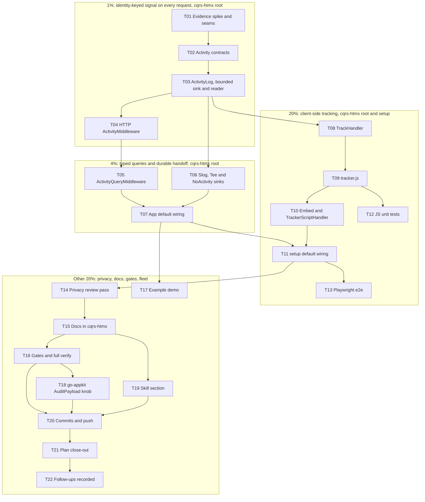
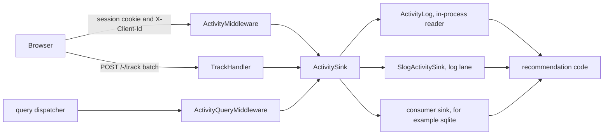

# SUPERB: user-mapped queries and client-side tracking

> **SUPERSEDED 2026-11-26 11:19 CET. Do not execute this plan.**
> The owner review found that it undervalues the native go-cqrs-lite query log: it builds a second
> activity store beside a durable, user-mapped journal that already exists. The plan of record is
> [`2026-11-26_11-19_SUPERB-native-query-log-and-client-tracking.md`](2026-11-26_11-19_SUPERB-native-query-log-and-client-tracking.md);
> its section 2 lists every correction. Nothing in this file was executed.
>
> **Filed:** 2026-11-26 05:55 CET, go-appkit session (the repo where the question was asked).
> **Was:** the plan of record. About 80% of the code lands in `~/projects/cqrs-htmx`; tasks
> carry a Repo column. go-appkit itself gets one small slice (T18) plus this plan.
> **Status:** SUPERSEDED. Section 9 holds only the "Plan written" row.

## 0. The ask and the verdict

Owner ask, verbatim:

> We need to make sure every query can be mapped to a user, so we can build recommendations
> algorithms by default. We should also have some good client side tracking that makes sense.
> Is that something for ~/projects/go-appkit or ~/projects/cqrs-htmx?

**Verdict: mostly cqrs-htmx.**

- go-appkit has no user-identity concept. `security.APIKeyAuth` stores no caller identity,
  the preset ships without auth, and the dependency direction is cqrs-htmx -> appkit only.
- cqrs-htmx already knows who the caller is on every request and every dispatched query.
  What is missing is a first-class signal that carries that identity to a place where
  recommendation code can read it, plus any client-side capture at all.

Success criteria (all test-pinned):

1. A request or dispatched query by a signed-in user produces a signal whose user key is set,
   with no consumer code (default on).
2. An anonymous visitor's signal carries the device key (`X-Client-Id`) when the browser sent one.
3. A typed query signal carries the query type and, opt-in, the payload.
4. The browser reports the four things the server cannot see: logical page views, dwell time,
   tracked clicks, and impressions. Each arrives attributed to the same user or device.
5. One line turns capture off; one line swaps the in-process store for a durable sink.
6. Nothing is persisted that the request log does not already contain, except the device key,
   the route pattern and the trimmed referrer.

## 1. Evidence baseline (verified 2026-11-26, before any edit)

| Fact | Where | Consequence |
| ---- | ----- | ----------- |
| Every query decoded through the route builder or the huma adapter is stamped with `UserID` and `ActorID` | cqrs-htmx `handler.go:282`, `handler.go:367`, `context.go:349`, `huma/enrich.go:48` | Attribution on the dispatch path already works. |
| The request log line carries `user_id` | cqrs-htmx `logging.go:229` | The log lane already has per-request user mapping. It lacks the device key, the route pattern and the referrer. |
| `X-Client-Id` is a persistent browser ID, read into the context by `ContextEnrichmentMiddleware` | cqrs-htmx `requestmeta.go:58`, `sync/sync-client.js:103` (`localStorage` key `cqrs-htmx-client-id`) | A pre-login identity exists. Reuse it; do not invent a second one. |
| go-cqrs-lite ships `query.AuditMiddleware(sink, AuditFull, logger)` and its audit record carries actor and user | go-cqrs-lite `query/v4@v4.10.1/audit.go` | "Who queried what" is an upstream primitive. |
| No cqrs-htmx code wires a query audit middleware | grep `AuditMiddleware` in non-test code: only `usermgmt/audit_context.go` (commands) | The query store is an empty passive sink in cqrs-htmx-composed apps. |
| appkit's own `queryAuditor` writes the query store with a `nil` payload | go-appkit `cqrs/audit.go:200`, `cqrs/eventservice.go:469-491` | Query type without the "what". Only apps composed through `cqrs.NewEventService` get it. |
| `setup` requires core appkit only and takes the dispatchers from the consumer | cqrs-htmx `setup/go.mod`, `Config.CommandMiddleware` | The `App` (root package) is the one composition point that sees both dispatchers and the identity middleware. |
| `setup.Bundle` exposes `Mount(mux)`, `Middleware()`, `Handler(mux)`; script paths follow the `XxxPath` + `"-"` disables convention | cqrs-htmx `setup/mount.go:35`, `setup/bundle.go:165`, `setup/route_postures.go:123` | Default wiring follows an existing pattern. |
| Root already embeds browser JS | cqrs-htmx `sync_embed.go` | One embed pattern to copy. |
| No client tracking exists | grep `sendBeam`, `keepalive`, `data-track`: no hits | Greenfield. |
| No backlog row mentions tracking or recommendations in either repo | grep over both `TODO_LIST.md`, `ROADMAP.md`, `FEATURES.md` | Nothing to de-duplicate; see section 10. |

## 2. Design

### 2.1 Data model first

One signal type, three producers, one sink contract. Identity fields are the typed IDs the
library already uses, so a signal can never carry a stringly user key.

```go
// ActivityKind names the producer of an Activity.
type ActivityKind string

const (
    ActivityRequest    ActivityKind = "request"    // any HTTP request
    ActivityQuery      ActivityKind = "query"      // a dispatched typed query
    ActivityPageView   ActivityKind = "pageview"   // client: logical page view
    ActivityEngagement ActivityKind = "engagement" // client: visible dwell time
    ActivityClick      ActivityKind = "click"      // client: data-track click
    ActivityImpression ActivityKind = "impression" // client: data-track-impression seen
)

// Activity is one user-observable interaction, observed by the server or reported
// by the tracker. Identity is whichever of UserID or ClientID is known; both may
// be zero for an anonymous full page load.
type Activity struct {
    At            time.Time
    Kind          ActivityKind
    UserID        id.UserID        // zero when anonymous
    ActorID       id.ActorID       // effective actor (user, bot, system)
    ClientID      id.ClientID      // device key, pre-login
    RequestID     id.RequestID
    CorrelationID id.CorrelationID
    Method        string            // HTTP method, empty for client events
    Name          string           // route pattern, query type, or client event name
    Target        string           // request path, or the tracked element's target
    Referrer      string           // origin + path only
    Status        int              // HTTP status, 0 for client events
    Duration      time.Duration
    HTMX          bool
    Props         []byte           // query payload (opt-in) or bounded client properties
}
```

Lifecycle: produced once, immutable, never updated. A signal is either recorded or dropped
(sink error, capacity overwrite, validation failure); nothing is ever mutated in place.

Invariants, each pinned by a test:

- `Kind` is never empty.
- `Name` is never empty for `request` and `query` signals.
- Every string field is capped before it reaches a sink (path 2048, others 512).
- No query string is ever stored unless its key is on the allowlist.
- The referrer is reduced to origin plus path.

### 2.2 Contracts

```go
type ActivitySink interface {
    Record(ctx context.Context, a Activity) error
}

type ActivityReader interface {
    ForUser(ctx context.Context, userID id.UserID, since time.Time, limit int) ([]Activity, error)
    ForClient(ctx context.Context, clientID id.ClientID, since time.Time, limit int) ([]Activity, error)
}
```

Built-ins:

- `ActivityLog`: bounded in-process ring, both a sink and a reader. The default.
- `SlogActivitySink`: one JSON line per signal on a caller-chosen logger, for the log lane.
- `TeeActivitySink`: fans out to several sinks; returns the first error.
- `NoActivity`: the explicit off switch.

### 2.3 Producers

| Producer | Sees identity because | Records |
| -------- | --------------------- | ------- |
| `ActivityMiddleware(sink, opts...)` | runs inside `App.Middleware()`, after context enrichment | request signals: method, path, route pattern, status, duration, HTMX flag, referrer |
| `ActivityQueryMiddleware(sink, opts...)` | installed by `App` on the query dispatcher, innermost | query signals: type, duration, payload when opted in |
| `TrackHandler(sink, opts...)` | mounted inside the session and enrichment stack | client signals, attributed from the session and `X-Client-Id` |

The route pattern is resolved with an optional `WithActivityPatternFunc`, which setup backs
with `mux.Handler(r)`. An outer middleware never sees `r.Pattern`, so this is the only way to
get a low-cardinality, PII-free page key.

### 2.4 Defaults

| Question | Default | Why |
| -------- | ------- | --- |
| On or off? | On, with an in-process log of 4096 signals | "By default" is the ask. Bounded, no I/O, lost on restart, so it costs nothing durable. |
| Durable by default? | No. `Config.ActivitySink` adds a durable sink beside the log | Writing a second line per request would duplicate the request log. Persistence is one explicit line, to a store the app chooses. |
| Query payloads | Off. `WithQueryPayload()` opts in | Payloads can hold what a user typed. |
| Query strings | Off. `WithActivityQueryParamKeys(...)` allowlists keys | Same reason. |
| Client endpoint | `POST /-/track`, 202 always for a well-formed envelope | A beacon must never slow a page. |
| Tracker script | `/-/tracker.js`, external file, no inline code | Works under nonce CSP. |
| Tracker off switches | `navigator.globalPrivacyControl`, `<html data-tracking="off">`, `window.cqrsTracker.disable()` | No cookie, no consent banner logic; the host page owns consent. |

### 2.5 Client tracker: four events, no more

| Event | Trigger | Fields | Why the server cannot see it |
| ----- | ------- | ------ | ---------------------------- |
| `pageview` | load, `htmx:pushedIntoHistory`, `htmx:replacedInHistory`, `popstate` | path, referrer | A fragment navigation changes the URL without a page-shaped request. |
| `engagement` | `pagehide`, `visibilitychange` to hidden | path, visible milliseconds | Dwell is never on the wire. |
| `click` | delegated click on `[data-track]` | name, target, path | Non-navigating controls send nothing. |
| `impression` | `IntersectionObserver` on `[data-track-impression]`, once per element | target, path | Needed to rank what was shown but not clicked. |

Delivery: queue, flush at 20 events or every 5 s, and always on hide with `fetch(..., {keepalive: true})`.
Headers: the session cookie (same-origin credentials) and `X-Client-Id` from the shared
`localStorage` key. Vanilla ES2022, strict mode, no build step, no dependencies.

Deliberately not built: scroll depth, rage clicks, session replay, a consent banner, a
recommendation algorithm, an admin panel, a cookie-based device ID.

### 2.6 Threat and privacy notes

- The tracking endpoint accepts strings from anyone. Every field is capped, unknown event types
  are dropped, and the batch is limited to 64 KiB and 50 events.
- Cross-site forgeries are refused by `Sec-Fetch-Site` and an Origin check before reading the body.
  If the host stack applies CSRF middleware to the route, the tracker sends the token from
  `<meta name="csrf-token">` (the adminui convention).
- No IP address is stored on an `Activity`. The request log and event metadata already own that.
- An in-process log is memory only. Durable sinks own their retention.

## 3. Pareto breakdown

| Tier | Share of effort | Result | What it is |
| ---- | --------------- | ------ | ---------- |
| **1%** | `Activity` + `ActivityLog` + `ActivityMiddleware` (T02, T03, T04) | 51% | Every request becomes a signal with a user or device key. In an HTMX app this already covers page views, item views and search requests. |
| **4%** | + query middleware, sinks, `App` wiring (T05, T06, T07) | 64% | Typed queries carry their payload to the same sink, and a durable sink is one line. |
| **20%** | + tracker script, endpoint, setup wiring (T08 to T13) | 80% | Dwell, logical page views, clicks and impressions arrive attributed. `setup.New` gets all of it with zero code. |
| **Other 20%** | + privacy pass, docs, gates, example, appkit knob, skill (T14 to T22) | 100% | It is safe, documented, verified in a real browser, and reproducible for the next service. |

## 4. Execution graph



Data flow:



## 5. Comprehensive plan

Sort key: Impact (1 to 5) descending, then customer value (1 to 5) descending, then effort
ascending. Hard dependencies override the sort and are listed in the Depends column.
Estimates are 30 to 100 minutes each.

| Rank | ID   | Task                                                             | Repo         | Tier       | Impact | Value | Effort | Depends on |
| ---- | ---- | ---------------------------------------------------------------- | ------------ | ---------- | ------ | ----- | ------ | ---------- |
| 1    | T01  | Evidence spike: name every seam, settle the open decisions       | cqrs-htmx    | 1%         | 5      | 4     | 45     | none       |
| 2    | T02  | `activity.go`: `Activity`, `ActivityKind`, sink and reader contracts | cqrs-htmx  | 1%         | 5      | 4     | 45     | T01        |
| 3    | T03  | `activity_log.go`: bounded `ActivityLog`, sink and reader          | cqrs-htmx    | 1%         | 5      | 4     | 60     | T02        |
| 4    | T04  | `activity_middleware.go`: request signals with identity           | cqrs-htmx    | 1%         | 5      | 5     | 90     | T03        |
| 5    | T05  | `ActivityQueryMiddleware`: query type, payload opt-in             | cqrs-htmx    | 4%         | 5      | 5     | 60     | T04        |
| 6    | T06  | `SlogActivitySink`, `TeeActivitySink`, `NoActivity`               | cqrs-htmx    | 4%         | 3      | 4     | 30     | T03        |
| 7    | T07  | `App` default wiring: default on, opt-out, accessors              | cqrs-htmx    | 4%         | 5      | 5     | 75     | T05, T06   |
| 8    | T08  | `tracking.go`: `TrackHandler` with validation and attribution     | cqrs-htmx    | 20%        | 4      | 5     | 100    | T03        |
| 9    | T09  | `assets/tracker.js`: four events, batching, opt-outs              | cqrs-htmx    | 20%        | 4      | 5     | 100    | T08        |
| 10   | T10  | `tracking_embed.go`: embed and `TrackerScriptHandler`             | cqrs-htmx    | 20%        | 3      | 4     | 30     | T09        |
| 11   | T11  | `setup` default wiring: paths, mounts, ignore list, accessor       | cqrs-htmx    | 20%        | 5      | 5     | 90     | T07, T10   |
| 12   | T12  | JS unit tests for `tracker.js` in the existing harness            | cqrs-htmx    | 20%        | 3      | 4     | 60     | T09        |
| 13   | T13  | Playwright spec: events arrive attributed; opt-outs are silent     | cqrs-htmx    | 20%        | 3      | 4     | 75     | T11        |
| 14   | T14  | Privacy review pass with pinned assertions                        | cqrs-htmx    | other 20%  | 3      | 4     | 30     | T11        |
| 15   | T15  | Docs: README section, CHANGELOGs, FEATURES, TODO row               | cqrs-htmx    | other 20%  | 3      | 4     | 60     | T14        |
| 16   | T16  | Gates and full verify battery                                    | cqrs-htmx    | other 20%  | 4      | 3     | 45     | T15, T17   |
| 17   | T17  | Example demo with a read-your-signals endpoint                   | cqrs-htmx    | other 20%  | 2      | 3     | 45     | T07        |
| 18   | T18  | `EventConfig.AuditPayload`: capture the query payload, opt-in     | go-appkit    | other 20%  | 2      | 3     | 60     | none       |
| 19   | T19  | Skill section for tracking and activity signals                  | SKILLS       | other 20%  | 1      | 3     | 30     | T15        |
| 20   | T20  | Commits in logical groups, push both repos                        | both         | other 20%  | 4      | 2     | 30     | T16, T18   |
| 21   | T21  | Plan close-out: execution log, verification table, status         | go-appkit    | other 20%  | 2      | 2     | 30     | T20        |
| 22   | T22  | Record follow-ups that are deliberately not built                 | go-appkit    | other 20%  | 1      | 2     | 15     | T21        |

Total estimate: about 1170 minutes across 22 tasks.

## 6. Fine breakdown

Micro-tasks are at most 12 minutes each. They are sorted by impact, then value, then effort
inside each coarse task, except where the build order forces a sequence; that is marked in the
Done-when column where it matters. "Plan §8" means the decision is written there.

### T01 Evidence spike and seams (45 min)

| ID     | Micro-task                                                                | Impact | Effort | Done when |
| ------ | ------------------------------------------------------------------------- | ------ | ------ | --------- |
| T01.1  | Read `App.Config`, `New`, `MustNew`: where dispatchers and middleware live | 5      | 6      | Seam named in plan section 8 |
| T01.2  | Read `setup/bundle.go` `Middleware()` and `Handler()`: where enrichment runs relative to `ExtraMiddleware` | 5 | 6 | Ordering written in plan section 8 |
| T01.3  | Read setup CSRF wiring and `httputil.CSRFConfig` exemption options       | 5      | 8      | Token versus exemption decided in plan section 8 |
| T01.4  | Read `sync/sync-client.js:90-150` and `id.ParseClientID`: the device ID format | 4      | 6      | Format recorded; tracker reuses it |
| T01.5  | Find the JS test harness (`sync/jstests`, how it runs) and the root `sync_js_worker_test.go` engine | 4 | 8 | Harness named for T12 |
| T01.6  | Read cqrs-htmx `AGENTS.md` gates table and `CONTRIBUTING.md` verify commands | 5 | 8 | Exact commands in plan section 7 |

### T02 Activity contracts (45 min)

| ID     | Micro-task                                                     | Impact | Effort | Done when |
| ------ | -------------------------------------------------------------- | ------ | ------ | --------- |
| T02.1  | Define `ActivityKind` and the six constants                    | 5      | 5      | Compiles |
| T02.2  | Define `Activity` with typed identity fields                   | 5      | 8      | Compiles; no primitive identity keys |
| T02.3  | `Activity.Subject()`: user first, then device, then unknown    | 5      | 6      | Unit-tested precedence |
| T02.4  | Define `ActivitySink` and `ActivityReader` with doc comments   | 5      | 6      | `go doc` reads cleanly |
| T02.5  | `Activity.slogAttrs()` and JSON tags                          | 3      | 8      | Round-trip test green |
| T02.6  | Tests: JSON round trip, zero identity, invariants              | 4      | 8      | Green under `-race` |

### T03 ActivityLog (60 min)

| ID     | Micro-task                                                     | Impact | Effort | Done when |
| ------ | -------------------------------------------------------------- | ------ | ------ | --------- |
| T03.1  | `ActivityLog` struct, `NewActivityLog(capacity)`, default constant | 5   | 8      | Zero and negative capacity rejected |
| T03.2  | `Record`: mutex, ring, oldest overwritten, drop counter         | 5      | 10     | Unit-tested wraparound |
| T03.3  | `ForUser` and `ForClient`: newest first, `since`, `limit`      | 5      | 10     | Filters tested |
| T03.4  | `Recent`, `Len`, `Capacity`, `Dropped`, `Reset`                | 3      | 8      | Tested |
| T03.5  | Concurrency test: parallel `Record` and reads under `-race`     | 4      | 10     | Green with `-race -count=5` |
| T03.6  | Limit clamp test: zero, negative, larger than length            | 2      | 6      | Green |

### T04 HTTP ActivityMiddleware (90 min)

| ID     | Micro-task                                                               | Impact | Effort | Done when |
| ------ | ------------------------------------------------------------------------- | ------ | ------ | --------- |
| T04.1  | Options: ignore paths, pattern function, query-parameter allowlist        | 4      | 10     | Compiles |
| T04.2  | Middleware body: timing, status capture, skip, build, best-effort record  | 5      | 12     | A request yields one signal |
| T04.3  | Identity read from context: user, actor, device, request, correlation     | 5      | 8      | Tested with a stamped context |
| T04.4  | Referrer reduced to origin plus path; HTMX flag                          | 4      | 8      | Tested |
| T04.5  | Query string only for allowlisted keys                                    | 4      | 10     | Tested on and off |
| T04.6  | Sink error never changes the response; record outlives the request context | 5      | 8      | Tested |
| T04.7  | Response-writer contract kept: `Flush`, `Hijack`, `Unwrap` forwarded       | 5      | 10     | Pins with the existing recorder |
| T04.8  | `BenchmarkActivityMiddleware`                                             | 2      | 6      | Runs |

### T05 ActivityQueryMiddleware (60 min)

| ID     | Micro-task                                                            | Impact | Effort | Done when |
| ------ | --------------------------------------------------------------------- | ------ | ------ | --------- |
| T05.1  | `ActivityQueryMiddleware(sink, opts...)` and `WithQueryPayload()`      | 5      | 8      | Compiles |
| T05.2  | Metadata read through `query.MetadataCarrier`: user, actor, device     | 5      | 10     | Tested with a stamped query |
| T05.3  | Payload read through `query.PayloadCarrier`, nil when unsupported      | 4      | 8      | Tested both ways |
| T05.4  | Nil sink and `NoActivity` are pass-through with zero allocations       | 4      | 8      | Tested |
| T05.5  | Duration and failure recorded; sink error never fails the query        | 5      | 10     | Tested |

### T06 Sinks (30 min)

| ID     | Micro-task                                            | Impact | Effort | Done when |
| ------ | ----------------------------------------------------- | ------ | ------ | --------- |
| T06.1  | `SlogActivitySink{logger, level}`                     | 4      | 10     | One line per signal |
| T06.2  | `TeeActivitySink(sinks...)`: fan out, first error wins | 3      | 8      | Tested; no `errors.Join` |
| T06.3  | `NoActivity`: the explicit off switch                 | 4      | 6      | Tested |

### T07 App default wiring (75 min)

| ID     | Micro-task                                                              | Impact | Effort | Done when |
| ------ | ------------------------------------------------------------------------- | ------ | ------ | --------- |
| T07.1  | `Config.ActivitySink`, `Config.DisableActivity` with doc                 | 5      | 8      | Compiles |
| T07.2  | `New`: build the sink; default log; `NoActivity` when disabled            | 5      | 10     | Tested |
| T07.3  | Install `ActivityQueryMiddleware` on the query dispatcher, innermost      | 5      | 10     | Every dispatch recorded |
| T07.4  | `App.Middleware()` appends `ActivityMiddleware` after enrichment          | 5      | 10     | Identity present in signals |
| T07.5  | `App.ActivityLog()` and `App.Activities()` accessors                      | 4      | 8      | Nil-safe when disabled |
| T07.6  | Update the API surface compatibility test for the additions               | 5      | 10     | Green |
| T07.7  | End-to-end App test: signed-in request and query both carry the user      | 5      | 12     | Green under `-race` |

### T08 TrackHandler (100 min)

| ID     | Micro-task                                                               | Impact | Effort | Done when |
| ------ | ------------------------------------------------------------------------- | ------ | ------ | --------- |
| T08.1  | Wire types: `trackBatch{V, Events}`, `trackEvent` with bounded fields     | 5      | 10     | Compiles |
| T08.2  | Options: max body 64 KiB, max 50 events, string caps, allowed types       | 5      | 10     | Compiles |
| T08.3  | Same-origin guard: `Sec-Fetch-Site` and Origin before reading the body    | 5      | 10     | Cross-site 403, tested |
| T08.4  | Decode with `MaxBytesReader`; malformed envelope is 400                    | 5      | 10     | Tested |
| T08.5  | Attribute from context: user, actor, device, request, correlation         | 5      | 10     | Tested |
| T08.6  | Per-event validation: drop unknown types, cap strings, clamp client time   | 4      | 12     | Tested |
| T08.7  | Record all valid events; answer 202 with an empty body                    | 5      | 10     | Tested |
| T08.8  | Stats: accepted, dropped invalid, rejected origin                        | 3      | 8      | Tested |
| T08.9  | Method and content-type checks: POST and JSON only                        | 4      | 8      | 405 and 415 tested |

### T09 tracker.js (100 min)

| ID     | Micro-task                                                                   | Impact | Effort | Done when |
| ------ | ----------------------------------------------------------------------------- | ------ | ------ | --------- |
| T09.1  | Bootstrap: strict IIFE, `window.cqrsTracker`, no globals beyond that         | 4      | 10     | Loads under CSP |
| T09.2  | Opt-outs: GPC, `data-tracking="off"`, `disable()`                            | 4      | 8      | No-ops, tested in T12 |
| T09.3  | Device ID: read or create the shared `localStorage` key                      | 5      | 10     | Same value as the sync client |
| T09.4  | Queue, batch of 20, 5 s timer, `fetch` with `keepalive`                       | 5      | 12     | Flushes, tested in T12 |
| T09.5  | Hide flush: `pagehide` and `visibilitychange` to hidden                      | 5      | 10     | Tested in T12 |
| T09.6  | CSRF token from `<meta name="csrf-token">` when present                      | 4      | 8      | Header set, tested in T12 |
| T09.7  | `pageview`: load, htmx history events, `popstate`                             | 5      | 12     | Tested in T12 |
| T09.8  | `engagement`: visible-time accumulation, emitted once per page view          | 5      | 12     | Tested in T12 |
| T09.9  | `click`: delegated listener on `[data-track]`                                 | 4      | 10     | Tested in T12 |
| T09.10 | `impression`: observer on `[data-track-impression]`, re-bound after swaps     | 4      | 12     | Tested in T12 |
| T09.11 | Referrer: internal pages as origin plus path, external as origin only         | 4      | 8      | Tested in T12 |

### T10 Embed and script handler (30 min)

| ID     | Micro-task                                               | Impact | Effort | Done when |
| ------ | -------------------------------------------------------- | ------ | ------ | --------- |
| T10.1  | `tracking_embed.go`: embed, version constant            | 4      | 6      | Compiles |
| T10.2  | `TrackerScriptHandler()`: GET and HEAD, type, ETag, 304  | 4      | 10     | Tested |
| T10.3  | Cache-Control immutable pinned to the version            | 3      | 8      | Tested |

### T11 setup default wiring (90 min)

| ID     | Micro-task                                                              | Impact | Effort | Done when |
| ------ | ------------------------------------------------------------------------- | ------ | ------ | --------- |
| T11.1  | Config: `TrackingPath`, `TrackerScriptPath`, `ActivitySink`, `DisableActivity`, `ActivityIgnorePaths` | 5 | 10 | Compiles |
| T11.2  | Defaults `/-/track` and `/-/tracker.js`; `"-"` disables                   | 5      | 8      | Tested |
| T11.3  | Path validation: no clash with reserved setup paths                      | 4      | 10     | Tested |
| T11.4  | Mount script and endpoint inside the session and security stack           | 5      | 10     | Tested |
| T11.5  | Pattern function over `mux.Handler(r)`; recorder ordered after enrichment | 5      | 12     | Signals carry the session user |
| T11.6  | Ignore defaults: tracking path, script path, health and live paths         | 4      | 10     | Tested |
| T11.7  | `Bundle.ActivityLog()` and `Bundle.Activities()`                          | 4      | 8      | Nil-safe when disabled |
| T11.8  | Update `setup_defaults_test` and the reserved-path test                   | 5      | 10     | Green |

### T12 JS unit tests (60 min)

| ID     | Micro-task                                                    | Impact | Effort | Done when |
| ------ | ------------------------------------------------------------- | ------ | ------ | --------- |
| T12.1  | Test file in the harness with minimal `document`, `window`, `fetch` stubs | 4 | 12 | Runs |
| T12.2  | Opt-outs produce no requests                                  | 4      | 10     | Green |
| T12.3  | Page view queued once on load; again on a history push        | 4      | 10     | Green |
| T12.4  | Batch flush at 20 events and on the timer                     | 4      | 10     | Green |
| T12.5  | Hide flush uses `keepalive`                                   | 4      | 8      | Green |
| T12.6  | Click and impression produce one event each                   | 4      | 10     | Green |
| T12.7  | Device ID is stable across two loads                          | 3      | 8      | Green |

### T13 Playwright e2e (75 min)

| ID     | Micro-task                                                        | Impact | Effort | Done when |
| ------ | ----------------------------------------------------------------- | ------ | ------ | --------- |
| T13.1  | e2e server: mount tracker and expose a test-only signals endpoint  | 4      | 12     | Served |
| T13.2  | Spec: page view and dwell arrive with the user and device keys     | 4      | 12     | Chromium green |
| T13.3  | Spec: click and impression arrive                                 | 3      | 10     | Chromium green |
| T13.4  | Spec: GPC and `data-tracking="off"` send nothing                  | 4      | 10     | Chromium green |
| T13.5  | Run the fast slice; note the Firefox advisory result               | 3      | 12     | Results in section 9 |

### T14 Privacy review pass (30 min)

| ID     | Micro-task                                                    | Impact | Effort | Done when |
| ------ | ------------------------------------------------------------- | ------ | ------ | --------- |
| T14.1  | Test: a URL with a secret query key stores no query string    | 5      | 10     | Green |
| T14.2  | Test: no `Activity` field ever holds an IP address             | 4      | 8      | Green |
| T14.3  | Test: every client string is capped before it reaches a sink  | 4      | 10     | Green |
| T14.4  | README paragraph: what is stored, where, and how to turn off  | 4      | 10     | Written |

### T15 Docs in cqrs-htmx (60 min)

| ID     | Micro-task                                                     | Impact | Effort | Done when |
| ------ | -------------------------------------------------------------- | ------ | ------ | --------- |
| T15.1  | Root README: "Tracking and activity signals" section           | 4      | 12     | Snippets compile |
| T15.2  | Root CHANGELOG `[Unreleased]`: Added and Changed entries        | 4      | 10     | Written |
| T15.3  | `setup/CHANGELOG` and `setup/README`: the new config knobs       | 4      | 10     | Written |
| T15.4  | `FEATURES.md`: one row per new capability                       | 3      | 10     | Written |
| T15.5  | `TODO_LIST.md`: follow-up row pointing at this plan             | 3      | 8      | Written |

### T16 Gates and full verify (45 min)

| ID     | Micro-task                                                          | Impact | Effort | Done when |
| ------ | -------------------------------------------------------------------- | ------ | ------ | --------- |
| T16.1  | Root module: build, vet, `go test -race`                              | 5      | 12     | Green |
| T16.2  | `setup` module: build, vet, `go test -race`                           | 5      | 12     | Green |
| T16.3  | Lint root and setup from their own directories, one at a time         | 5      | 12     | Zero issues |
| T16.4  | Repo gates that this change can trip: re-export policy, module layers, skill claims, api surface | 5 | 12 | Green |
| T16.5  | `govulncheck` on root and setup                                       | 3      | 10     | Clean |

### T17 Example demo (45 min)

| ID     | Micro-task                                                 | Impact | Effort | Done when |
| ------ | ---------------------------------------------------------- | ------ | ------ | --------- |
| T17.1  | `examples/tracking-demo`: setup app with tracked elements   | 3      | 12     | Boots |
| T17.2  | Endpoint that reads `ActivityLog` and returns recent signals | 3      | 12     | Returns JSON |
| T17.3  | Example README with the read-your-signals snippet           | 2      | 10     | Written |
| T17.4  | Boot, probe, graceful stop, following the smoke pattern     | 3      | 12     | Recorded |

### T18 go-appkit AuditPayload (60 min)

| ID     | Micro-task                                                     | Impact | Effort | Done when |
| ------ | -------------------------------------------------------------- | ------ | ------ | --------- |
| T18.1  | `EventConfig.AuditPayload *bool` with doc                      | 3      | 8      | Compiles |
| T18.2  | `queryAuditor` records the payload when on, via `PayloadCarrier` | 3      | 12     | Tested |
| T18.3  | Tests: default off, opted in, payload-less query               | 3      | 12     | Green |
| T18.4  | `cqrs/CHANGELOG.md` `[Unreleased]` entry and FEATURES row      | 3      | 10     | Written |
| T18.5  | Hermetic `GOWORK=off` test, vet and lint for the cqrs module   | 3      | 12     | Green |

### T19 Skill section (30 min)

| ID     | Micro-task                                                 | Impact | Effort | Done when |
| ------ | ---------------------------------------------------------- | ------ | ------ | --------- |
| T19.1  | New section appended; no existing section retitled         | 2      | 12     | Written |
| T19.2  | Snippets compile in a scratch module; skill-claims gate    | 3      | 10     | Green |

### T20 Commits and push (30 min)

| ID     | Micro-task                                                | Impact | Effort | Done when |
| ------ | --------------------------------------------------------- | ------ | ------ | --------- |
| T20.1  | cqrs-htmx: one commit per logical group with full context | 4      | 12     | `git status` clean |
| T20.2  | go-appkit: plan file, cqrs knob, docs, each its own commit | 4      | 12     | `git status` clean |
| T20.3  | Push master in both repos; confirm CI started             | 4      | 12     | Run URLs in section 9 |

### T21 Plan close-out (30 min)

| ID     | Micro-task                                           | Impact | Effort | Done when |
| ------ | ---------------------------------------------------- | ------ | ------ | --------- |
| T21.1  | Execution log rows for every task                    | 3      | 10     | Section 9 complete |
| T21.2  | Verification table: what ran, where, result          | 3      | 10     | Section 7 filled |
| T21.3  | Status line and commit hashes                        | 3      | 6      | Header updated |

### T22 Follow-ups recorded (15 min)

| ID     | Micro-task                                                 | Impact | Effort | Done when |
| ------ | ---------------------------------------------------------- | ------ | ------ | --------- |
| T22.1  | List in section 8.4 with a trigger for each                | 2      | 10     | Written |
| T22.2  | go-appkit `TODO_LIST.md` row pointing at the list          | 2      | 8      | Written |

## 7. Verification battery

Commands are confirmed in T01.6 and recorded here.

| Scope | Command | Result |
| ----- | ------- | ------ |
| cqrs-htmx root | pending T01.6 | pending |
| cqrs-htmx setup | pending T01.6 | pending |
| cqrs-htmx gates | pending T01.6 | pending |
| go-appkit cqrs | `GOWORK=off GOTOOLCHAIN=go1.27.4 go test ./... -race -count=1`, then `golangci-lint run ./...` from `cqrs/` | pending |

## 8. Decisions, assumptions and follow-ups

### 8.1 Decisions

| # | Decision | Alternative dismissed | Why |
| - | -------- | --------------------- | --- |
| D1 | One `Activity` type with typed identity fields | Reuse the go-cqrs-lite query audit record | The audit record is query-shaped. Request and client signals do not fit it. |
| D2 | Default store is a bounded in-process log | slog lines by default | A second line per request duplicates the request log. Durable storage is one explicit line. |
| D3 | The `App` installs capture by default | Only `setup.New` does | "By default" must hold for Path A apps too. The cost is one bounded append per request. |
| D4 | Query payload and query strings are opt-in | On by default | They hold what a user typed. |
| D5 | The tracker is a standalone script, not an htmx extension | htmx extension | Tracking must work on DataStar apps and on plain pages. |
| D6 | The route pattern comes from an optional resolver function | Record `r.Pattern` directly | An outer middleware never sees `r.Pattern`. |
| D7 | No recommendation algorithm ships | A co-viewing helper | The ask is the data foundation. Algorithms belong to the app's domain. |
| D8 | appkit gets only the payload knob, opt-in | An identity seam in appkit | Identity in appkit would duplicate cqrs-htmx and reverse the layering. |

### 8.2 Assumptions to verify in T01

| # | Assumption | If false |
| - | ---------- | -------- |
| A1 | `App.Middleware()` is the place context enrichment runs, so capture can follow it | Capture moves to a consumer-applied middleware with the same options |
| A2 | `setup` applies the enrichment middleware globally | Same fallback as A1 |
| A3 | The device ID is a ULID the tracker can generate with the sync client's code | Reuse the sync client's generator verbatim |
| A4 | A JS test harness exists without new dependencies | Tests move into the Playwright spec only |
| A5 | `httputil.CSRFConfig` can exempt one path | The tracker sends the token and hosts add the meta tag |

### 8.3 Corrections to earlier statements

- The first answer said the request log "carries `user_id`". That is right, and it means the
  log lane is already a user-mapped request record. The new work therefore does not add a
  second log line; it adds a first-class signal with a device key and a pluggable store.
- Observed, not part of this plan: core tag `v0.13.1` is on origin at HEAD and cqrs-htmx
  `setup` already requires it, while go-appkit `CHANGELOG.md` and `AGENTS.md` still say
  Unreleased and v0.13.0. Left untouched in case a release is in flight.

### 8.4 Follow-ups, deliberately not built

Filled in T22.

## 9. Execution log

| Task | State | Evidence |
| ---- | ----- | -------- |
| Plan written | done | This file |

## 10. Errata

- No prior plan or backlog row covers tracking or recommendations in either repo, so nothing
  here re-dispatches shipped work.
- go-cqrs-lite's `query.AuditMiddleware` exists, which makes appkit's hand-rolled `queryAuditor`
  a near-duplicate. Collapsing it onto upstream is a separate cleanup and is not in this plan.
