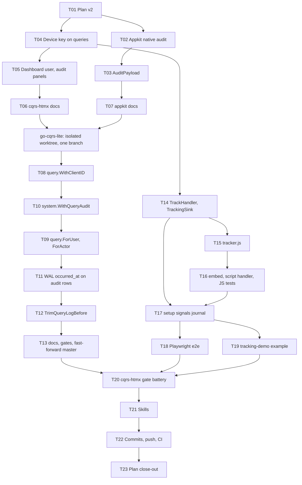
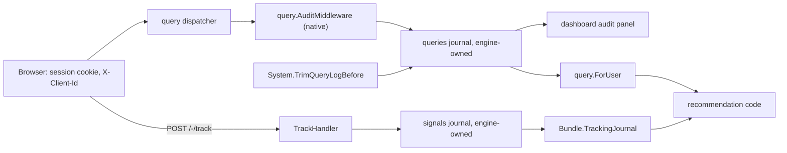

# SUPERB: native query log and client-side tracking

> **Filed:** 2026-11-26 11:19 CET, go-appkit session.
> **Plan of record:** this file. It supersedes
> [`2026-11-26_05-55_SUPERB-user-mapped-queries-and-client-tracking.md`](2026-11-26_05-55_SUPERB-user-mapped-queries-and-client-tracking.md)
> (v1). Nothing of v1 was executed.
> **Repos:** go-cqrs-lite (native expansion), go-appkit (`cqrs` module), cqrs-htmx (transport and
> tracking), SKILLS (documentation). Each task carries a Repo column.
> **Status:** EXECUTING. The execution log is section 10.

## 0. The ask, the verdict, what changed

Owner ask, verbatim:

> We need to make sure every query can be mapped to a user, so we can build recommendations
> algorithms by default. We should also have some good client side tracking that makes sense.
> Is that something for ~/projects/go-appkit or ~/projects/cqrs-htmx?

Owner review of v1, verbatim:

> Does this plan properly value the native /home/lars/projects/go-cqrs-lite/ Query capabilities?
> Should we expand on the go-cqrs-lite native Query(Log) (WAL;metaengine;system) capabilities?

**Verdict 1 (v1): mostly cqrs-htmx. Wrong in one important way.** v1 invented a second
activity store (`Activity`, `ActivityLog`, `ActivityQueryMiddleware`, three custom sinks) beside
a native query log that already exists, is durable, and is user-mapped.

**Verdict 2 (this plan): the native query log is the foundation; expand it where it is
incomplete; cqrs-htmx owns only the transport.**

- go-cqrs-lite already records every read-side record as a `query.PersistedQuery` with user and
  actor metadata, in a durable `"queries"` collection that `system.New` builds by default.
- It is incomplete in four measured ways (section 1): `system` ships no writer, queries carry no
  device key, the journal has no read by user, and audit rows can never be swept.
- cqrs-htmx already stamps user and actor on every dispatched query and already renders the
  query log in its dashboard. It lacks the device key on queries and all client tracking.
- go-appkit patched the missing writer by hand (unreleased `cqrs/audit.go`, 2026-11-24), with a
  near-copy of the upstream `query.AuditMiddleware`.

Success criteria (all test-pinned):

1. Every query dispatched through the fleet-default stack is recorded durably with its user and
   actor, with its device key when the browser sent one, and with its payload when opted in.
2. `system.New` can switch that recording on with one option, for every go-cqrs-lite consumer.
3. A consumer can read "the queries of user U" through a library function, on every store.
4. On SQLite, a consumer can cut the query and command logs by age.
5. The browser reports the four things the server cannot see (logical page views, visible dwell,
   tracked clicks, impressions). Each arrives with the user or device key, in an engine-owned
   journal that is separate from the domain event journal and from the query log.
6. Nothing new is persisted that the query log does not already hold, except the device key, the
   client signals, and the opt-in payload. One line turns each recorder off.

## 1. Evidence baseline

All facts verified 2026-11-26 before any edit. "Probe" marks numbers measured against the
PUBLISHED versions go-appkit pins (`system/v4 v4.19.0`, `metaengine/sqliteengine/v4 v4.9.1`,
`query/v4 v4.10.1`) in a scratch module outside every repo; the source is in the appendix.

| # | Fact | Where | Consequence |
| - | ---- | ----- | ----------- |
| 1 | `PersistedQuery` carries ID, type, received-at, payload and metadata; metadata carries `UserID`, `ActorID`, `RequestID`, `CorrelationID` | go-cqrs-lite `query/v4/store.go:18`, `metadata/v4/metadata.go:16` | "Query mapped to a user" is already the native record shape. |
| 2 | `query.AuditMiddleware(sink, level, logger)` persists every dispatched query; `AuditMetadata` drops the payload, `AuditFull` keeps it; audit failure never fails the read; the save outlives the request context | `query/v4/audit.go:39` | The writer exists. It is identical at the published pin and at HEAD. |
| 3 | `system.New` builds the query store on the source-of-truth engine, or on a dedicated `RoleQueries` instance; `system.Standard` declares that instance as "the query audit log ... a named concern" | `system/v4/roles.go:252`, `system/v4/standard.go:8` | The durable, engine-owned store is the default topology. |
| 4 | Nothing in `system` installs the writer. cqrs-lint rule B033 says it in its own doc comment: "passive sinks - the library ships no writer ... a permanently empty audit surface" | `cmd/cqrs-lint/v4/pkg/rules/boilerplate/b032_b033.go:121`; grep `AuditMiddleware` in `system/v4`: no hits | Gap 1: the composition root builds a store nothing writes to. |
| 5 | The retired `stack` presets had the missing helper (`stack.QueryAuditMiddleware(bundle, level)`); `system`, the ADR-0123 successor, has no equivalent | `stack/v4/accessors.go:208` | Gap 1 is a regression of the v4 to system migration, not a design choice. |
| 6 | go-appkit hand-rolled `commandAuditor` and `queryAuditor`, default on, to feed the dashboard panels; `queryAuditor` always writes a nil payload. The file is in no tag and in no CHANGELOG | go-appkit `cqrs/audit.go:152-248`, `cqrs/eventservice.go:141-149, 469-492`; `git show cqrs/v0.10.0:cqrs/audit.go` fails | Gap 1 was patched downstream by duplicating fact 2. |
| 7 | cqrs-htmx stamps `UserID`, `ActorID`, `CorrelationID`, `RequestID` on every dispatched query. It does not stamp the device key, although `X-Client-Id` is parsed into the context and is propagated to events | cqrs-htmx `context.go:349`, `requestmeta.go:115`, `context.go:282` | Gap 2: an anonymous read cannot be mapped to a device. |
| 8 | The event side has the convention: `event.MetadataKeyClientID = "client.id"`, `event.WithClientID`, `event.RequestScope.ClientID` | `event/v4/options.go:100,151`, `event/v4/request_context.go:26` | The query side should mirror it, not invent a second key. |
| 9 | The journal reads are `ReadAllQueries` (everything), `ReadQueriesFrom(afterRequestID, limit)` (forward only) and `LoadQueries(after)`. Every stored query is its own stream, keyed by request ID | `query/v4/store.go:99-126`, `system/v4/adapter_query.go:59` | Gap 3: no read by user. |
| 10 | Probe: `ReadAllQueries` decodes 30,000 rows in 594 ms (about 20 µs per row, linear). A subject-keyed `StreamRead` returns one subject's 150 values in 489 µs | probe, section 8 | A scan-based read by user is fine up to tens of thousands of rows; subject-keyed streams are the scale path and need no engine change. |
| 11 | `JournalSweeper.TrimJournalBefore` exists on the SQLite engine only (Turso delegates). It deletes rows whose typed `occurred_at` is older than the cutoff and "conservatively" keeps rows without one | `metaengine/v4/stream_trim.go:44`, `sqliteengine/v4/stream_trim.go:52` | Retention is by typed timestamp. |
| 12 | The typed WAL fills `occurred_at` from EVENT envelopes only; a command or query envelope makes the extractor return "not an event", so the column stays NULL | `sqliteengine/v4/typed_wal.go:37-46` | Gap 4: audit rows are never swept. |
| 13 | Probe: `TrimJournalBefore("queries", cutoff = now + 1 h)` removed 0 of 30,000 query rows. Control in the same database: the same call on `"events"` removed the event row | probe | Gap 4 is measured, not inferred. |
| 14 | `System.TrimJournalBefore` and `System.TrimStream` resolve the EVENT store only | `system/v4/trim.go:27` | There is no maintenance surface for the audit logs. |
| 15 | Probe: the audit write costs 56 to 59 µs per query on a file-backed SQLite WAL, about 500 bytes per row | probe | Default-on audit is cheap per query and unbounded over time, which is why gap 4 matters. |
| 16 | Subject-keyed appends cost 26 µs each on the same backend; plain `StreamAppend` has no version check | probe; `system/v4/adapter_event.go:198` | A signals journal needs no concurrency protocol. |
| 17 | cqrs-htmx `dashboardui` renders the query log (list, detail, CSV and JSON export) through `QueryJournal`; the detail shows the actor but not the user; the `setup` bundle does not wire the two audit panels | `dashboardui/handlers_audit.go:246`, `dashboardui/detail_items.go:183`, `setup/README.md:387`, `setup/setup.go:415` | The native reader exists in the fleet and is dark. |
| 18 | Owner directive in force: "ALL durable data I/O goes solely through `metaengine` ... (B) the capability should exist? Design it WITH the owner first ... land it in metaengine, then build on top" | go-cqrs-lite `AGENTS.md` Internal Contract 30, `SKILL.md` I/O rule | v1's "durable sink to a store the app chooses" violated this. Every durable home in this plan is an engine collection. |
| 19 | ADR-0123: new apps build on `system` and `metaengine`; the low-level `stack` presets are removed at v5 | `SKILL.md:13` | The writer belongs in `system`. |
| 20 | No TODO, ROADMAP, FEATURES or `[Unreleased]` row in go-cqrs-lite, go-appkit or cqrs-htmx covers query-audit wiring, reads by user, audit retention, tracking or recommendations | grep over the living docs of all three repos | Nothing here re-dispatches shipped or planned work. |
| 21 | Six prior deep-dive reports touch go-cqrs-lite; none mentions query persistence, the audit middleware, the passive sink, the `"queries"` collection, or journal retention | go-appkit `docs/research/2026-10-06_...`, `2026-09-04_...`; cqrs-htmx `docs/research/2026-11-03_...`, `go-cqrs-lite-feature-audit.html`; go-cqrs-lite `docs/research/2026-11-13_...`; browser-history `docs/research/2026-10-08_...` | Section 1 is the first utilization record for the native query log. It contradicts none of them. |
| 22 | `system.AdapterCore[T]` is the exported shared runtime behind the event, command and query adapters ("WAL cores are generic, policies injected", Internal Contract 17) | `system/v4/adapter_core.go:11` | A further journal composes on it with no engine code. |
| 23 | go-cqrs-lite has an active concurrent session (uncommitted edits in `cmd/cqrs-gen`, `metaengine/*engine`, `flake.nix`, `ci.yml`, `AGENTS.md` at 11:00) | `git status` in go-cqrs-lite | Its changes are developed in an isolated worktree and landed in one fast-forward (section 5, T13). |

## 2. What v1 got wrong

| v1 claim or task | Why it is wrong | Replaced by |
| ---------------- | --------------- | ----------- |
| New `Activity` type with six kinds, `ActivityLog` ring as the default store | Parallel store beside the native query log; the default kept nothing durably, so "every query mapped to a user" held only until restart | The native query log; `system` ships the writer (T10) |
| `ActivityQueryMiddleware` | Near-copy of `query.AuditMiddleware` | Native middleware everywhere |
| `ActivityReader.ForUser` / `ForClient` on the new ring | The real gap is a read by user on the NATIVE journal | `query.ForUser`, `query.ForActor` (T09) |
| "A durable sink is one explicit line, to a store the app chooses" | Violates the go-cqrs-lite I/O rule (fact 18) | Engine collections only |
| `ActivityMiddleware` with a status-capture writer wrapper (about 90 minutes) | The request log line already carries `user_id`; queries and commands are in their journals | `client_id` on the request log line (T04) |
| T18: add `AuditPayload` by extending appkit's hand-rolled `queryAuditor` | Deepens a duplicate | Delete the duplicate, use `AuditFull` (T02, T03) |
| Client signals as two more `Activity` kinds in one ring | Durable telemetry needs an engine-owned home; a click is not a query and not a domain event | A dedicated signals journal (T17) |

Kept from v1: the four client signals and their triggers, the batching and keepalive rules, the
opt-out switches, the body and string limits, the same-origin guard, and "no recommendation
algorithm ships".

## 3. Design

### 3.1 Data model

Three record families, each already native or composed on native parts:

| Record | Lives in | Written by | Read by |
| ------ | -------- | ---------- | ------- |
| `query.PersistedQuery` | `"queries"` collection (engine journal) | `query.AuditMiddleware` | dashboard, `query.ForUser`, journals |
| `command.PersistedCommand` | `"commands"` collection | consumer audit middleware | dashboard, journals |
| `cqrshtmx.TrackedEvent` (new, transport-owned) | `"signals"` collection (engine journal, composed on `system.AdapterCore`) | cqrs-htmx `TrackHandler` | `Bundle.TrackingJournal()` |

`TrackedEvent` (validated, attributed, immutable):

```go
type TrackedEvent struct {
	Kind      TrackedEventKind // pageview, engagement, click, impression
	Path      string           // logical page path, at most 2048 bytes
	Referrer  string           // origin and path only
	Name      string           // data-track name, at most 200 bytes
	Target    string           // tracked element target, at most 512 bytes
	VisibleMS int64            // engagement: visible milliseconds, 0 to 24 h
	At        time.Time        // server receive time; client clocks are not trusted
	UserID    id.UserID        // zero when anonymous
	ActorID   id.ActorID
	ClientID  id.ClientID      // device key
	RequestID id.RequestID
}
```

Invariants, each pinned by a test: `Kind` is one of the four values; every string is capped
before it reaches a sink; the referrer is reduced to origin plus path; `At` is the server clock.

Lifecycle: produced once, appended, never updated. A signal is either recorded or dropped.

### 3.2 Additions to go-cqrs-lite (all additive, v4 and its `core/v5` twin in lockstep)

| Addition | Module | Closes | Uses existing engine capability |
| -------- | ------ | ------ | ------------------------------- |
| `query.MetadataKeyClientID`, `query.WithClientID` | `query/v4` | fact 7, 8 | yes (custom metadata) |
| `query.ForUser`, `query.ForActor` | `query/v4` | fact 9 | yes (journal reads) |
| `system.WithQueryAudit(level, logger)`, `System.UseQueryMiddleware` | `system/v4` | fact 4, 5 | yes (`QueryStore`, fact 2) |
| `System.TrimQueryLogBefore`, `System.TrimCommandLogBefore` | `system/v4` | fact 14 | yes (`JournalSweeper`) |
| `occurred_at` on the command and query wire envelopes; the SQLite typed-WAL extractor fills the column for any dated envelope | `system/v4`, `sqliteengine/v4` | fact 12, 13 | the column and the sweeper exist; only the writer's stamp was missing |

`WithQueryAudit` is opt-in in v4: switching it on by default would add a durable write to every
read for 38 direct consumers and change a tagged train's behavior. go-appkit's `cqrs.EventService`
keeps its default-on posture. The v5 default is an owner question once retention has shipped.

### 3.3 Transport in cqrs-htmx

| Piece | Behaviour |
| ----- | --------- |
| `QueryOptionsFromContext` | adds `client.id` (the key is `event.MetadataKeyClientID`, so there is one constant) |
| `RequestLoggingSlog` | adds a `client_id` attribute when the header was sent |
| `dashboardui` query detail | shows user and device |
| `setup.Config.CommandJournal`, `setup.Config.QueryJournal` | forwarded to the dashboard; the two audit panels light up |
| `TrackHandler(sink, opts...)` at `POST /-/track` | POST and JSON only; same-origin check before the body is read; 64 KiB body; 50 signals; invalid signals are dropped, valid ones are recorded; 202 for every well-formed envelope, even when the sink fails |
| `tracker.js` at `/-/tracker.js` | vanilla ES2022, strict mode, no dependencies, no inline code (works under a nonce CSP) |
| `setup` signals journal | `system.AdapterCore[*TrackedEvent]` over the engine's stream-log backend; streams keyed `user:<id>`, `client:<id>` or `anonymous`; built by default when `Config.EventStore` is the system event adapter; `Config.TrackingBackend` overrides |

### 3.4 Defaults

| Question | Default | Why |
| -------- | ------- | --- |
| Query recording in go-appkit | On, metadata level (unchanged) | Already the fleet default. |
| Query payload | Off. `EventConfig.AuditPayload` opts in | A payload holds what a user typed. |
| Query recording in bare `system.New` | Off. `system.WithQueryAudit(query.AuditMetadata)` opts in | Tagged-train behavior and write amplification are the operator's call. |
| Device key on queries | On, whenever the header was sent | It is the only identity an anonymous visitor has. |
| Client tracking | Served by default; collecting starts when the page includes the script tag | Available by default, never injected without the app saying so. |
| Client tracking durability | The signals journal, when the event store is system-composed; otherwise off with one log line | Engine-owned, no engine code. |
| Tracker opt-outs | `navigator.globalPrivacyControl`, `<html data-tracking="off">`, `window.cqrsTracker.disable()` | The host page owns consent. |

### 3.5 Durable home of client signals: decision D6

| Option | Verdict | Reason |
| ------ | ------- | ------ |
| Records in the `"queries"` journal | Rejected | A click is not a query; `PersistedQuery` would lie by the owner's naming rule, and the audit panel would fill with page views. |
| Events in the domain event journal | Rejected as default | Every dashboard event view, replay and catalog would carry telemetry; an age sweep is collection-wide, so telemetry could not expire without expiring domain events. |
| Events in a dedicated event collection | Deferred | Needs a second journal and projection host in `system`. Right when folds over signals are wanted. |
| **Signals journal composed on `system.AdapterCore`** | **Chosen** | Honest type, append-only with no version protocol, isolated from both journals, subject-keyed, becomes sweepable with the WAL change, no go-cqrs-lite API change. |

### 3.6 Threat and privacy notes

- The tracking endpoint accepts strings from anyone. Every field is capped, unknown kinds are
  dropped, the body is limited to 64 KiB and 50 signals, the batch is limited to 50.
- Cross-site forgeries are refused by `Sec-Fetch-Site` and an Origin check before the body is read.
  The tracker sends the token from `<meta name="csrf-token">` when the host stack requires one.
- No IP address or user agent is stored on a `TrackedEvent` or a `PersistedQuery`.
- Client clocks are not stored: `At` is the server receive time.

## 4. Pareto breakdown

| Tier | Effort | Result | What it is |
| ---- | ------ | ------ | ---------- |
| **1%** | T01 to T07, 355 min | 51% | The fleet-default stack records every query durably with user, actor and device, opt-in payload, visible in the dashboard. Published pins only. |
| **4%** | T08 to T13, 415 min | 64% | go-cqrs-lite ships the writer, the device key, reads by user and age-based retention, for every consumer. |
| **20%** | T14 to T19, 510 min | 80% | Dwell, logical page views, clicks and impressions arrive attributed, in an engine-owned journal. |
| **Other 20%** | T20 to T23, 195 min | 100% | Gates green in three repos, skills current, plan closed. |

## 5. Execution graph



Data flow after the plan:



## 6. Comprehensive plan

Sort key: Impact (1 to 5) descending, then customer value descending, then effort ascending.
Hard dependencies override the sort and are named in the last column. The go-cqrs-lite tasks
(T08 to T13) run as one batch inside one worktree, so they sit between the two consumer phases.
Estimates are 30 to 100 minutes each.

| Rank | ID   | Task | Repo | Tier | Impact | Value | Effort | Depends on |
| ---- | ---- | ---- | ---- | ---- | ------ | ----- | ------ | ---------- |
| 1 | T01 | Plan v2, superseded banner on v1, probe evidence | go-appkit | 1% | 5 | 4 | 45 | none |
| 2 | T04 | Device key on every dispatched query (`client.id`); `client_id` on the request log line | cqrs-htmx | 1% | 5 | 5 | 45 | T01 |
| 3 | T02 | `cqrs`: native `query.AuditMiddleware` replaces the hand-rolled `queryAuditor`, correlation parity kept | go-appkit | 1% | 5 | 5 | 75 | T01 |
| 4 | T03 | `cqrs`: `EventConfig.AuditPayload` (opt-in payload through `AuditFull`) | go-appkit | 1% | 4 | 4 | 40 | T02 |
| 5 | T05 | `dashboardui` query detail shows user and device; `setup` forwards the two audit journals | cqrs-htmx | 1% | 4 | 5 | 75 | T04 |
| 6 | T06 | cqrs-htmx docs: "User-mapped queries" recipe, CHANGELOGs | cqrs-htmx | 1% | 3 | 4 | 45 | T05 |
| 7 | T07 | go-appkit docs: `cqrs` CHANGELOG entry for the audit trail, FEATURES row | go-appkit | 1% | 3 | 3 | 30 | T03 |
| 8 | T10 | `system.WithQueryAudit(level, logger)`: the composition root ships the writer; `System.UseQueryMiddleware` | go-cqrs-lite | 4% | 5 | 5 | 75 | T06, T07 |
| 9 | T11 | WAL retention: `occurred_at` on command and query envelopes; SQLite typed-WAL extraction | go-cqrs-lite | 4% | 5 | 4 | 100 | T10 |
| 10 | T14 | `tracking.go`: wire contract, validation, same-origin guard, attribution, `TrackHandler`, `TrackingSink` | cqrs-htmx | 20% | 5 | 5 | 100 | T13 |
| 11 | T17 | `setup`: signals journal on `system.AdapterCore`, subject-keyed streams; paths, mounts, accessor | cqrs-htmx | 20% | 5 | 5 | 100 | T14, T16 |
| 12 | T08 | `query.MetadataKeyClientID`, `query.WithClientID` (v4 and `core/v5` twin) | go-cqrs-lite | 4% | 4 | 4 | 45 | T10 |
| 13 | T09 | `query.ForUser`, `query.ForActor` (v4 and `core/v5` twin) | go-cqrs-lite | 4% | 4 | 4 | 60 | T08 |
| 14 | T12 | `System.TrimQueryLogBefore`, `System.TrimCommandLogBefore` | go-cqrs-lite | 4% | 4 | 4 | 60 | T11 |
| 15 | T16 | Embed and `TrackerScriptHandler`; JS unit tests in the existing harness | cqrs-htmx | 20% | 4 | 4 | 75 | T15 |
| 16 | T18 | Playwright e2e: signals arrive attributed; opt-outs are silent | cqrs-htmx | 20% | 4 | 4 | 75 | T17 |
| 17 | T13 | go-cqrs-lite docs and gates; branch fast-forwarded onto master | go-cqrs-lite | 4% | 4 | 3 | 75 | T09, T12 |
| 18 | T20 | cqrs-htmx gate battery for every touched module | cqrs-htmx | other | 4 | 3 | 60 | T18, T19 |
| 19 | T15 | `assets/tracker.js`: four signals, batching, keepalive, opt-outs | cqrs-htmx | 20% | 4 | 5 | 100 | T14 |
| 20 | T22 | Commits in logical groups with detailed messages; push; CI check | all | other | 4 | 2 | 45 | T20, T21 |
| 21 | T19 | Example `tracking-demo` with a read-your-signals page; smoke | cqrs-htmx | 20% | 2 | 3 | 60 | T17 |
| 22 | T21 | Skills: cqrs-htmx section, go-cqrs-lite module row; skill gates | SKILLS | other | 2 | 3 | 45 | T20 |
| 23 | T23 | Plan close-out: execution log, verification table, TODO rows, status | go-appkit | other | 3 | 2 | 45 | T22 |

Total estimate: 1475 minutes across 23 tasks. T14 is listed at rank 10 by its sort key but starts
after T13 only because the same session executes in order; it has no code dependency on T13.

## 7. Fine breakdown

Micro-tasks are at most 12 minutes each. 117 micro-tasks.

### T01 Plan v2 (45 min)

| ID | Micro-task | Impact | Effort | Done when |
| -- | ---------- | ------ | ------ | --------- |
| T01.1 | Probe against the published pins: audit cost, scan cost, subject read, sweep on queries, sweep control on events | 5 | 10 | Five numbers in section 1 |
| T01.2 | Write this file | 5 | 10 | Sections 0 to 10 present |
| T01.3 | Superseded banner on the v1 file | 4 | 4 | v1 says "do not execute" and links here |
| T01.4 | Self-check: task sum, micro-task count, every cited path resolves | 4 | 8 | Script output matches the prose |

### T02 Appkit native audit (75 min)

| ID | Micro-task | Impact | Effort | Done when |
| -- | ---------- | ------ | ------ | --------- |
| T02.1 | Read `audit.go`, `audit_test.go`, the wiring in `eventservice.go` | 5 | 6 | Current behavior listed |
| T02.2 | `ensureQueryCorrelation` middleware: OTel baggage correlation wins, else minted; stamps a `BasicQuery` | 5 | 10 | Compiles |
| T02.3 | Install `query.AuditMiddleware(sys.QueryStore(), level, logger)` outermost, correlation next | 5 | 10 | Compiles |
| T02.4 | Delete `queryAuditor` and `queryAuditOptions`; keep `commandAuditor` (no native twin exists) | 5 | 8 | No dead code |
| T02.5 | Existing audit tests green without edits | 5 | 10 | Green under `-race` |
| T02.6 | New tests: audited when consumer middleware rejects; correlation minted; nil store is inert | 5 | 10 | Green |

### T03 AuditPayload (40 min)

| ID | Micro-task | Impact | Effort | Done when |
| -- | ---------- | ------ | ------ | --------- |
| T03.1 | `EventConfig.AuditPayload *bool` with doc | 4 | 6 | Compiles |
| T03.2 | Level mapping in `buildSystem` | 4 | 6 | Compiles |
| T03.3 | Tests: payload only when opted in; `PayloadCarrier` honored; default records none | 4 | 10 | Green |
| T03.4 | Godoc example that compiles | 3 | 6 | `go vet` clean |

### T04 Device key on queries (45 min)

| ID | Micro-task | Impact | Effort | Done when |
| -- | ---------- | ------ | ------ | --------- |
| T04.1 | `QueryOptionsFromContext` adds `client.id`, key from `event.MetadataKeyClientID` | 5 | 10 | Compiles |
| T04.2 | `RequestLoggingSlog` adds `client_id` when present | 4 | 6 | Compiles |
| T04.3 | Tests: stamped metadata; no header means no key; request log attribute | 5 | 10 | Green |
| T04.4 | Run the API surface test (no exported surface moves) | 4 | 6 | Green |

### T05 Dashboard and setup journals (75 min)

| ID | Micro-task | Impact | Effort | Done when |
| -- | ---------- | ------ | ------ | --------- |
| T05.1 | `queryMetaItems` adds User and Device items | 4 | 8 | Compiles |
| T05.2 | dashboardui tests for the two items | 4 | 10 | Green |
| T05.3 | `setup.Config.CommandJournal`, `setup.Config.QueryJournal`, forwarded to the dashboard | 5 | 12 | Compiles |
| T05.4 | setup defaults test and reserved-path test updated | 5 | 10 | Green |
| T05.5 | CHANGELOG rows in `dashboardui` and `setup` | 3 | 8 | Written |

### T06 cqrs-htmx docs (45 min)

| ID | Micro-task | Impact | Effort | Done when |
| -- | ---------- | ------ | ------ | --------- |
| T06.1 | Root README: "User-mapped queries" recipe (extractor, native middleware, payload level) | 4 | 12 | Snippet compiles |
| T06.2 | Root CHANGELOG `[Unreleased]` entries | 4 | 6 | Written |
| T06.3 | `setup/README.md`: the two journal knobs | 3 | 6 | Written |
| T06.4 | `setup/CHANGELOG.md` and `dashboardui/CHANGELOG.md` dated rows | 3 | 6 | Written |

### T07 go-appkit docs (30 min)

| ID | Micro-task | Impact | Effort | Done when |
| -- | ---------- | ------ | ------ | --------- |
| T07.1 | `cqrs/CHANGELOG.md`: Added (audit trail, `AuditPayload`), Changed (native middleware) | 4 | 10 | Written |
| T07.2 | `FEATURES.md` row for the audit trail | 3 | 8 | Written |
| T07.3 | `docs/agents/module-details.md`: one line on the audit wiring | 3 | 6 | Written |

### T08 WithClientID (45 min)

| ID | Micro-task | Impact | Effort | Done when |
| -- | ---------- | ------ | ------ | --------- |
| T08.1 | `MetadataKeyClientID` and `WithClientID` in `query/v4` | 4 | 8 | Compiles |
| T08.2 | Twin in `core/v5/query` | 4 | 6 | Compiles |
| T08.3 | Tests on both sides | 4 | 8 | Green |
| T08.4 | Mirror lockstep test (no allowlist row needed) | 4 | 6 | Green |

### T09 ForUser and ForActor (60 min)

| ID | Micro-task | Impact | Effort | Done when |
| -- | ---------- | ------ | ------ | --------- |
| T09.1 | `query/v4/history.go`: `ForUser`, `ForActor` over `ReadAllQueries` | 4 | 10 | Compiles |
| T09.2 | Twin in `core/v5/query` | 4 | 8 | Compiles |
| T09.3 | Tests: journal order, empty result, nil journal is a Rejection | 4 | 10 | Green |
| T09.4 | Doc comment states the O(journal) cost and the scale path | 3 | 6 | Reads cleanly |

### T10 WithQueryAudit (75 min)

| ID | Micro-task | Impact | Effort | Done when |
| -- | ---------- | ------ | ------ | --------- |
| T10.1 | `systemOptions` fields; `WithQueryAudit(level, logger)` constructor | 5 | 10 | Compiles |
| T10.2 | Install in `New` once the stores exist, before any domain query middleware | 5 | 12 | Compiles |
| T10.3 | `System.UseQueryMiddleware`, symmetric with `UseCommandMiddleware` | 4 | 8 | Compiles |
| T10.4 | Tests: on, full payload, off, store-less deployment | 5 | 12 | Green |
| T10.5 | `system/README.md` wiring paragraph | 3 | 8 | Written |

### T11 WAL retention for audit rows (100 min)

| ID | Micro-task | Impact | Effort | Done when |
| -- | ---------- | ------ | ------ | --------- |
| T11.1 | `occurred_at` on the query wire envelope (equal to received-at) | 5 | 8 | Compiles |
| T11.2 | `occurred_at` on the command wire envelope | 5 | 10 | Compiles |
| T11.3 | SQLite extractor: any dated envelope fills `occurred_at`; event identity rules unchanged | 5 | 12 | Compiles |
| T11.4 | sqliteengine test: dated non-event row gets the column | 5 | 10 | Green |
| T11.5 | sqliteengine test: the sweeper removes such rows | 5 | 10 | Green |
| T11.6 | system test on SQLite: audit rows are sweepable; update the raw-bytes pin deliberately | 5 | 12 | Green |
| T11.7 | Record the parity decision for the pg, mysql and duckdb typed WALs (no sweeper there) | 3 | 8 | Written in the CHANGELOG |

### T12 Trim accessors (60 min)

| ID | Micro-task | Impact | Effort | Done when |
| -- | ---------- | ------ | ------ | --------- |
| T12.1 | Shared `sweepJournal` helper (functions stay under 30 lines) | 4 | 10 | Compiles |
| T12.2 | `System.TrimQueryLogBefore`, `System.TrimCommandLogBefore` | 4 | 10 | Compiles |
| T12.3 | Tests: rows removed on SQLite; `ErrTrimUnavailable` on an engine without a sweeper | 4 | 12 | Green |
| T12.4 | README paragraph | 3 | 6 | Written |

### T13 go-cqrs-lite docs and gates (75 min)

| ID | Micro-task | Impact | Effort | Done when |
| -- | ---------- | ------ | ------ | --------- |
| T13.1 | Root CHANGELOG `[Unreleased]` entries (root CHANGELOG only, symbols cited) | 4 | 10 | Symbol gate green |
| T13.2 | `FEATURES.md` rows updated | 4 | 8 | Written |
| T13.3 | Skill recipe with a catalog entry | 4 | 12 | Recipes test green |
| T13.4 | API golden regen; only this branch's modules in the diff | 5 | 10 | Golden matches |
| T13.5 | Mirror lockstep test, md-go gate, doc-check | 5 | 12 | Green |
| T13.6 | Per-module tests for `query`, `core`, `system`, `sqliteengine`, `metadata` | 5 | 12 | Green |
| T13.7 | File-size gate, art-dupl, scoped lint | 4 | 12 | Zero new findings |
| T13.8 | Rebase onto master, re-run tests, fast-forward, push | 5 | 8 | Master carries the branch |

### T14 TrackHandler (100 min)

| ID | Micro-task | Impact | Effort | Done when |
| -- | ---------- | ------ | ------ | --------- |
| T14.1 | `TrackedEvent`, `TrackedEventKind`, `TrackingSink` with doc | 5 | 8 | Compiles |
| T14.2 | Wire types and options: body limit, batch limit, string caps | 5 | 10 | Compiles |
| T14.3 | Method and content-type checks: 405 and 415 | 4 | 8 | Tested |
| T14.4 | Same-origin guard before the body is read: 403 | 5 | 10 | Tested |
| T14.5 | Decode with `MaxBytesReader`; malformed envelope is 400; too large is 413 | 5 | 10 | Tested |
| T14.6 | Per-signal validation and attribution from the context | 5 | 12 | Tested |
| T14.7 | Record and answer 202; a sink failure is logged, never returned | 5 | 10 | Tested |

### T15 tracker.js (100 min)

| ID | Micro-task | Impact | Effort | Done when |
| -- | ---------- | ------ | ------ | --------- |
| T15.1 | Bootstrap: strict IIFE, `window.cqrsTracker`, no other global | 4 | 10 | Loads |
| T15.2 | Opt-outs: GPC, `data-tracking="off"`, `disable()` | 4 | 8 | No-op |
| T15.3 | Device key: the shared `localStorage` key, ULID | 5 | 10 | Stable value |
| T15.4 | Queue, batch of 20, 5 s timer, `fetch` with `keepalive` | 5 | 12 | Flushes |
| T15.5 | Hide flush on `pagehide` and `visibilitychange` | 5 | 10 | Flushes |
| T15.6 | CSRF token from `<meta name="csrf-token">` when present | 4 | 8 | Header set |
| T15.7 | `pageview`: load, htmx history events, `popstate` | 5 | 12 | One signal per navigation |
| T15.8 | `engagement`: visible-time accumulation, one signal per page view | 5 | 12 | Correct value |
| T15.9 | `click` and `impression` with one observer, re-bound after swaps; referrer policy | 4 | 12 | One signal each |

### T16 Embed, script handler, JS tests (75 min)

| ID | Micro-task | Impact | Effort | Done when |
| -- | ---------- | ------ | ------ | --------- |
| T16.1 | `tracking_embed.go` with the embed and a version constant | 4 | 6 | Compiles |
| T16.2 | `TrackerScriptHandler`: GET and HEAD, type, immutable cache, 304 | 4 | 12 | Tested |
| T16.3 | JS test file in the existing harness with minimal `window`, `document`, `fetch` stubs | 4 | 12 | Runs |
| T16.4 | Cases: opt-outs, page view, batch and timer, keepalive flush, click and impression, stable device key | 4 | 12 | Green |
| T16.5 | API surface test updated for the additions | 5 | 8 | Green |

### T17 setup signals journal (100 min)

| ID | Micro-task | Impact | Effort | Done when |
| -- | ---------- | ------ | ------ | --------- |
| T17.1 | `tracking_journal.go`: `system.AdapterCore[*TrackedEvent]` composition, encode and decode | 5 | 12 | Compiles |
| T17.2 | Subject stream keys: `user:`, `client:`, `anonymous`; one append per subject | 5 | 12 | Tested |
| T17.3 | `ForUser`, `ForClient`; `Bundle.TrackingJournal()` | 5 | 10 | Tested |
| T17.4 | Config: `TrackingPath`, `TrackerScriptPath`, `TrackingSink`, `TrackingBackend`; `"-"` disables | 5 | 12 | Compiles |
| T17.5 | Resolve the backend from the system event adapter; one log line when tracking stays off | 5 | 12 | Tested |
| T17.6 | Mount script and endpoint inside the session and security stack; route posture | 5 | 12 | Tested |
| T17.7 | Dep budget check for the two new direct requires | 4 | 8 | Green |

### T18 Playwright e2e (75 min)

| ID | Micro-task | Impact | Effort | Done when |
| -- | ---------- | ------ | ------ | --------- |
| T18.1 | e2e server: mount tracker, journal and a test-only signals endpoint | 4 | 12 | Served |
| T18.2 | Spec: page view and dwell arrive with the user and device keys | 4 | 12 | Chromium green |
| T18.3 | Spec: click and impression arrive | 3 | 10 | Chromium green |
| T18.4 | Spec: GPC and `data-tracking="off"` send nothing | 4 | 10 | Chromium green |
| T18.5 | Run the fast slice; record the Firefox advisory result | 3 | 12 | Result in section 10 |

### T19 tracking-demo example (60 min)

| ID | Micro-task | Impact | Effort | Done when |
| -- | ---------- | ------ | ------ | --------- |
| T19.1 | `examples/tracking-demo`: setup app, script tag, tracked elements | 3 | 12 | Boots |
| T19.2 | Read-your-signals page over `TrackingJournal()` | 3 | 12 | Returns rows |
| T19.3 | Example README | 2 | 8 | Written |
| T19.4 | Boot, probe, graceful stop, following the smoke pattern | 3 | 12 | Recorded |

### T20 cqrs-htmx gate battery (60 min)

| ID | Micro-task | Impact | Effort | Done when |
| -- | ---------- | ------ | ------ | --------- |
| T20.1 | Root, setup, dashboardui: `go test -race` | 5 | 12 | Green |
| T20.2 | Lint from each module directory, one at a time | 5 | 12 | Zero issues |
| T20.3 | Root-size baseline bumped deliberately; root-files gate | 4 | 6 | Green |
| T20.4 | Dep budgets, module layers, re-export policy, route postures | 5 | 12 | Green |
| T20.5 | Coverage thresholds for the touched modules | 4 | 10 | Green |
| T20.6 | `check-modules` aggregate | 5 | 12 | Green |

### T21 Skills (45 min)

| ID | Micro-task | Impact | Effort | Done when |
| -- | ---------- | ------ | ------ | --------- |
| T21.1 | cqrs-htmx skill: new appended section, no section retitled | 2 | 12 | Written |
| T21.2 | go-cqrs-lite skill: module list row for the audit writer | 2 | 10 | Written |
| T21.3 | Snippets compile in a scratch module | 3 | 10 | Green |
| T21.4 | Skill claims gates | 3 | 6 | Green |

### T22 Commits and push (45 min)

| ID | Micro-task | Impact | Effort | Done when |
| -- | ---------- | ------ | ------ | --------- |
| T22.1 | cqrs-htmx: one commit per logical group with full context | 4 | 12 | Clean tree |
| T22.2 | go-appkit: plan, cqrs, docs as separate commits | 4 | 10 | Clean tree |
| T22.3 | Push master in both repos; confirm CI started | 4 | 10 | Run links in section 10 |

### T23 Plan close-out (45 min)

| ID | Micro-task | Impact | Effort | Done when |
| -- | ---------- | ------ | ------ | --------- |
| T23.1 | Execution log row for every task | 3 | 10 | Section 10 complete |
| T23.2 | Verification table with results | 3 | 10 | Section 8 filled |
| T23.3 | TODO rows in go-appkit and cqrs-htmx for the follow-ups | 3 | 8 | Written |
| T23.4 | Status line, commit hashes, follow-up list | 3 | 6 | Header updated |

## 8. Verification battery

Results are filled in as each command runs. "Pending" is the only honest state before that.

| Scope | Command | Result |
| ----- | ------- | ------ |
| go-appkit `cqrs` | `cd cqrs && GOWORK=off GOTOOLCHAIN=go1.27.4 go test ./... -race -count=1` | pending |
| go-appkit `cqrs` lint | `cd cqrs && golangci-lint run ./...` | pending |
| cqrs-htmx root | `GOEXPERIMENT=jsonv2 go test ./... -count=1 -race` from the module directory | pending |
| cqrs-htmx setup, dashboardui | the same command from each module directory | pending |
| cqrs-htmx lint | `GOEXPERIMENT=jsonv2 golangci-lint run` from each module directory, one at a time | pending |
| cqrs-htmx gates | the T20 list, from each script's own usage header | pending |
| cqrs-htmx e2e | `cd e2e && ./node_modules/.bin/playwright test tracker.spec.ts` | pending |
| go-cqrs-lite modules | after `source scripts/go-env.sh`: `go test ./... -count=1` in `query/v4`, `core/v5/...`, `system/v4`, `metaengine/sqliteengine/v4` | pending |
| go-cqrs-lite API surface | `cd cmd/api-stability/v4 && GOWORK=off go run . --update`, then `go test -run TestMirrorLockstep .` | pending |
| go-cqrs-lite gates | `check-changelog-symbols`, `check-md-go`, doc-check, `check-file-size`, scoped lint | pending |

Probe (re-run from a scratch module with `go mod tidy` then `go run .`):

```go
// skip-validate: probe scaffold; module path and pins are in the go.mod described above
package main

import (
	"context"
	"fmt"
	"log/slog"
	"os"
	"time"

	"github.com/larsartmann/go-cqrs-lite/id/v4"
	"github.com/larsartmann/go-cqrs-lite/metaengine/v4"
	_ "github.com/larsartmann/go-cqrs-lite/metaengine/sqliteengine/v4"
	"github.com/larsartmann/go-cqrs-lite/query/v4"
	"github.com/larsartmann/go-cqrs-lite/system/v4"
)

func main() {
	ctx := context.Background()
	dir, _ := os.MkdirTemp("", "cqlprobe-db")
	sys, err := system.New(ctx, system.DomainConfig{}, system.Standard(system.DeploymentConfig{
		Engines: map[string]system.EngineConfig{
			"primary": {Driver: "sqlite", DSN: dir + "/probe.db",
				Pragmas: []string{"journal_mode=WAL", "busy_timeout=5000"}},
		},
	}))
	check(err)
	qd, store := sys.QueryDispatcher(), sys.QueryStore()
	check(qd.Register("probe.get", func(context.Context, query.Query) (any, error) { return "ok", nil }))
	qd.Use(query.AuditMiddleware(store, query.AuditMetadata, slog.New(slog.NewTextHandler(os.Stderr, nil))))
	start := time.Now()
	for i := 0; i < 30000; i++ {
		q, err := query.New("probe.get", query.WithUserID(id.NewUserID()), query.WithRequestID(id.NewRequestID()))
		check(err)
		_, err = qd.Dispatch(ctx, q)
		check(err)
	}
	fmt.Printf("audit: %.1f us/query\n", float64(time.Since(start).Microseconds())/30000)
	backend := sys.EventStore().(*system.EventAdapter).Backend //nolint:errcheck // probe: system wires EventAdapter
	removed, err := backend.(metaengine.JournalSweeper). //nolint:errcheck // probe: SQLite implements it
		TrimJournalBefore(ctx, "queries", "", time.Now().Add(time.Hour))
	fmt.Printf("query rows swept: %d err=%v (expected 0 before T11)\n", removed, err)
}

func check(err error) {
	if err != nil {
		panic(err)
	}
}
```

## 9. Decisions, owner-reversible choices, follow-ups

### 9.1 Decisions

| # | Decision | Alternative dismissed | Why |
| - | -------- | --------------------- | --- |
| D1 | The native query log is the only durable home of query records | A new activity store (v1) | It exists, is durable, is user-mapped, and the dashboard already reads it. |
| D2 | The native `query.AuditMiddleware` records everywhere; appkit's hand-rolled `queryAuditor` is deleted | Extending it (v1 T18) | One writer; payload level for free. |
| D3 | `system` ships the writer as an opt-in option | Default on in v4 | Tagged-train behavior is not changed in a minor. |
| D4 | Device key uses the event convention `client.id` | A new key or a typed metadata field | One constant; a typed field is a cross-cutting data-model change for the v5 window. |
| D5 | `ForUser` scans the journal | Subject-keyed streams now | Works on every store today, measured fine to tens of thousands of rows; the layout change is the scale path. |
| D6 | Client signals go to a signals journal composed on `system.AdapterCore` | Section 3.5 | Honest type, isolated, append-only, no API change in go-cqrs-lite. |
| D7 | No recommendation algorithm ships | Co-view or popularity helpers | The ask is the data foundation. |
| D8 | Audit rows get a typed timestamp through the wire envelope | A new engine capability | The column, the index-free sweep and the contract already exist. |
| D9 | HTTP requests are not re-recorded | `ActivityMiddleware` (v1) | The request log line, the query journal and the command journal already cover them. |
| D10 | No tags. Master pushes only | Tagging go-cqrs-lite | Consumers keep published pins; tagging is the owner's release train. |

### 9.2 Owner-reversible choices (each is one revert)

| Choice | Where | How to reverse |
| ------ | ----- | -------------- |
| D2 rewrites the unreleased `queryAuditor` authored 2026-11-24 by another session | go-appkit `cqrs/audit.go` | `git revert` of the T02 commit restores the hand-rolled file. |
| D8 adds one JSON field to two wire envelopes | go-cqrs-lite `system/v4` | New rows only; old rows stay readable and stay unswept. |
| D6 adds two direct requires to cqrs-htmx `setup` | `setup/go.mod` | Remove the journal file and the fields; tracking falls back to off. |

### 9.3 Assumptions verified during T01

| # | Assumption | Result |
| - | ---------- | ------ |
| A1 | The published `query.AuditMiddleware` can replace the hand-rolled auditor without a pin bump | True: identical at v4.10.1 and HEAD. |
| A2 | Audit rows cannot be swept today | True, measured (fact 13). |
| A3 | The audit write is cheap enough for default on | True per query (fact 15); unbounded over time is the open part. |
| A4 | A signals journal needs no engine change | True: `AdapterCore` and `StreamAppend` are exported at the published pin. |

### 9.4 Follow-ups, deliberately not built

| Follow-up | Trigger |
| --------- | ------- |
| Subject-keyed layout for the query log (O(subject) reads) | A deployment whose query journal passes about 100,000 rows. |
| `JournalSweeper` on engines other than SQLite and Turso | The first consumer on pebble, Postgres, MySQL or DuckDB that needs age-based retention. |
| `command.AuditMiddleware` upstream, so appkit's `commandAuditor` can go | The next go-cqrs-lite audit train. |
| Default-on `WithQueryAudit` for v5 | Owner question, once retention has shipped. |
| Recommendation read models (popularity counters, recently viewed lists through `metaengine.Store`; folds over signals) | The first app that asks for them. |
| Events in a dedicated collection, when folds over signals are wanted | Same trigger. |
| Device key on commands | A consumer that needs pre-login command attribution. |
| Re-pin go-appkit and cqrs-htmx onto the go-cqrs-lite tags that carry T08 to T12 | The owner's next tag wave. |
| Formal HTML deep-dive for the native query log | None required; section 1 is the record. |

## 10. Execution log

| Task | State | Evidence |
| ---- | ----- | -------- |
| T01.1 | done | Probe run 2026-11-26 07:53 to 07:56 CET, scratch module `/tmp/cql-probe` |
| T01.2 | in progress | This file |
| everything else | pending | |

## 11. Errata

- v1 was wrong about where the work belongs (section 2) and overstated its own precision: it said
  "about 1170 minutes" where the effort column summed to 1205, and "118 micro-tasks" where the
  table held 117.
- v1's errata line called appkit's `queryAuditor` a near-duplicate of `query.AuditMiddleware`. That
  is right for the query side only: go-cqrs-lite ships no command-side audit middleware, so the
  hand-rolled `commandAuditor` has no native twin.
- Observed and left alone: go-appkit's `cqrs/audit.go` is unreleased and undocumented; T02 and T07
  change and document it. The core tag `v0.13.1` versus CHANGELOG state noted in v1 is untouched.
- go-cqrs-lite has an active concurrent session. Its work is not touched; the native expansion
  lands from an isolated worktree in one fast-forward.
